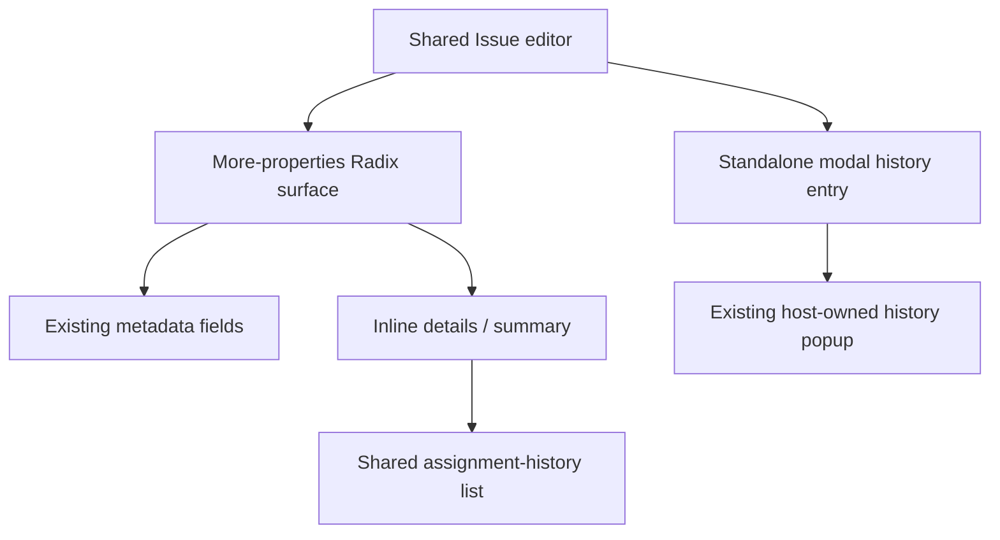

# Assignment history inside Issue properties

- Date: 2026-10-14
- Base revision: A00000004; accepted revision: A00000005; transaction: tx-83d9839abe0a.
- Human intent: inspecting assignment details must not dismiss the original properties popup or move the detail into an unrelated floating surface.
- Affected stable IDs: arch://wegent/ui/aab71205 and arch://wegent/test/aab71206; shared UI arch://wegent/ui/287398da is a read dependency.
- State: implemented and statically/test verified; not deployed or real-Electron verified.

## Cause and final design

The workspace property trigger opened a host-owned AnchorPopover outside the original Radix surface. AnchorPopover focuses its own portal on animation-frame mount, which triggers the parent surface's focus-outside dismissal. That dismissal unmounts the original trigger and leaves the second popup positioned from its old anchor. This implementation crossed two independent overlay lifecycles.

The workspace entry now expands a native details/summary disclosure inside the existing properties DOM. All metadata remains available, the summary switches between view and hide labels, and the shared IssueAssignmentHistoryList renders the same assignment events beneath it. Enter/Space and native disclosure accessibility are preserved. No second portal or manual anchor is involved. Closing and reopening the properties resets the native disclosure; changing the Issue ID remounts it.

The existing property-row presentation was extracted without behavior changes for reuse; obsolete link CSS was removed. The host-owned standalone assignment-history popup remains scoped to the non-workspace presentation. Priority, tags, participants, assignment actions, permissions, API ownership and CP invariants are unchanged.

The accepted relationship graph still has the shared Issue editor containing this metadata surface and the regression tests verifying it. The implementation flow is:

## Verification against combined source

- Wework TodoEditor and TodoEditor.tags: 72 tests passed.
- Shared IssueDetail, IssuePropertiesPopover and IssueDetailControls: 6 tests passed.
- Shared i18n: 4 tests passed.
- Total focused coverage: 82 passed.
- Shared collaboration TypeScript build, Wework typecheck and frontend TypeScript check: passed.
- ESLint inspected the disclosure, extracted property row, history list and TodoEditor tests: four files passed, no ignored files.
- Formatting, scoped diff whitespace checks, and the Wework typography guard: passed.

New integration regressions exercise both editable and read-only history, one dialog with an inline region, clicks within records, collapse/expand, tag draft persistence, Escape and outside-click dismissal without closing the Issue, reset on reopen, and empty-history behavior in both presentations. Existing standalone assignment and status popover tests still pass.

## Visual and keyboard inspection

Isolated component preview uses the actual properties popover, disclosure, history list, extracted property row, tag editor and theme, with fixture metadata and a simplified surrounding panel. This is not an E2E or Electron run.

Artifact directory:
`/Users/hongyu9/.codex/visualizations/2026/10/14/01a1396f-5259-73a3-8676-25fae7740e09/assignment-disclosure/`

Default-size preview: mouse opens the inline disclosure; Enter collapses it; Space expands it; focus stays on SUMMARY; exactly one dialog remains mounted, and its DOM contains the history region. At 390 by 640px with 16px UI setting, a long tag and 30 history entries: document width stays 390px, popup bounds remain within the viewport (x=77..357, y=118..631.58), horizontal scrollWidth equals clientWidth (278px), vertical scrolling accommodates 2090px content in a 512px viewport, summary target is 44px high, and exactly one dialog remains. Geometry evidence is retained with the preview artifacts.

No E2E or ai:verify was run, following repository policy. No deployment/runtime confirmation is claimed. Other existing working-tree edits and the separate open architecture transaction are preserved.
