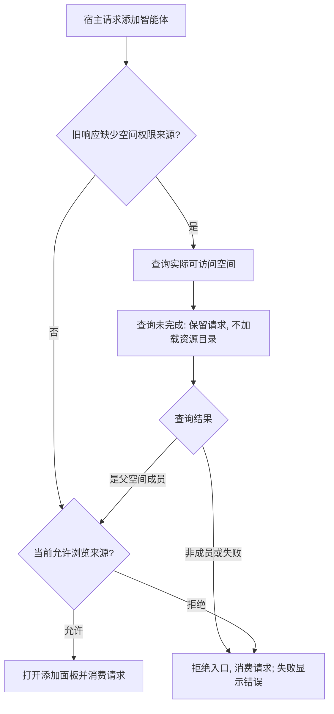

# PR 推送检查发现的权限入口与测试前提

用户已明确本 PR 包含当前工作区全部改动。首次 fork 推送受 Husky 阻止：Web 四项旧 fixture 缺少父空间访问查询；桌面四项包含两个智能体创建流程、旧成员文案和 Creator/Viewer 越权预期。

## 权限入口流程

根因：宿主请求的 effect 没有依赖 `canBrowseSources`，并在旧后端空间查询返回前消费请求。新增显式查询等待状态，成功后打开；拒绝或失败后消费但不打开。查询失败被记为已完成的拒绝状态，不静默授予访问。

Web fixture 补充实际存在的 `workspaces.list`，并断言它被调用。桌面 fixture 补齐可访问空间及资源目录接口；创建表单必须经“已有 / 新建”选项选择新建，最终表单及离线隔离断言保留。成员说明与已设计的短文案对齐，保存职责的断言保留。旧 Viewer 创建者越权断言改为 CP06/CP07 要求的禁用，并验证未调用指派或修改接口。

## 用例与结果

- 已知空间权限：宿主打开命令按原路径消费。
- 旧响应查询未结束：不消费、不打开、不查询私人或空间目录。
- 查询允许：只消费一次并打开。
- 查询拒绝或失败：只消费一次，不打开、不查询资源；失败报告错误。
- 云端新建与离线本地新建：选择创建选项后进入正确宿主，离线用例不调用云端数据 API。
- Viewer 创建者：当前角色只读，不依赖历史创建者身份取得指派能力。

共享 Agent 配置 26 项通过；共享协作全量 861 项通过；桌面两个相关文件 120 项通过；Web automation 四项通过。共享类型检查通过，修改的三个测试文件扩展 ESLint 零错误、零警告。

扩展使用 Wework 的 React lint 检查共享 Agent 组件时，原版本存在五项 refs/set-state-in-effect 错误和一项缺失 effect 依赖提醒；本次修复缺失依赖，五项既有结构诊断仍在。未关闭 lint 规则，不将这次扩展扫描宣称为完全通过。该共享包没有自己的 lint 脚本；实际 Web/Wework 包 lint 在首次推送检查通过。

首次推送其他检查通过，包括 Rust lib tests、fmt 和 clippy、Web/桌面/Electron 类型、Python 格式和语法、Alembic 单 head。修复后重新运行完整推送钩子；其最终结果以推送日志为准。本次没有运行 E2E 或 ai:verify。
