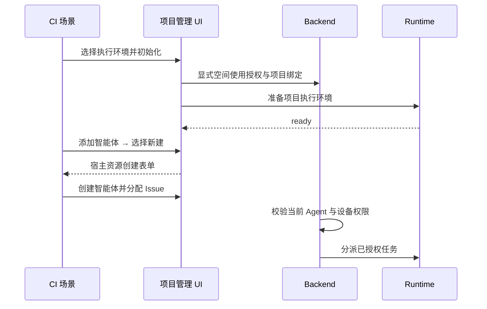

# PR #3910 后续 CI 创建与资源前置条件修复

事务 `tx-ci3910-agent-flow-20261014`，起点 A00000012。用户要求修复 CI 并继续提交到原 PR。失败提交为 `a8f051f122c3059496cee08612b413076ee16b6b`。

## 运行证据与修改

- [桌面 Core 9](https://github.com/wecode-ai/Wegent/actions/runs/38567099943/job/115866093720)、[Core 18](https://github.com/wecode-ai/Wegent/actions/runs/38567099943/job/115866093843)、[Cloud 5](https://github.com/wecode-ai/Wegent/actions/runs/38567099943/job/115866092883)：四个云项目场景点击添加智能体后直接等待资源表单，遗漏现有/新建选择步骤。统一复用 `openProjectAgentCreator`，显式选择新建后等待对应宿主真实表单；本地宿主仍使用默认表单标识。移除旧的轮询兼容路径。
- [桌面 Core 10](https://github.com/wecode-ai/Wegent/actions/runs/38567099943/job/115866093432)：用例以兼容字段 `creator_admin` 创建共享绑定，却要求成员看不到它。CP09 明确这类共享绑定可见；只有 `private` 是创建者私有。保留管理员会话由成员续聊验证，新增真正的私有定义，断言它对成员不可见且成员赋值返回 403，同时断言共享绑定可见。
- [Executor](https://github.com/wecode-ai/Wegent/actions/runs/38567099824/job/115864998309)：Backend 日志显示分配成功、AI 状态一直 queued、没有 Runtime device 或 lease；真实 Executor 日志没有该任务创建，随后已正确授权设备的其他场景正常执行。该场景通过 API 建项目，遗漏空间/项目执行设备授权和准备。复用已通过 CI 的 `initializeProjectExecutionEnvironment`，通过真实 UI 授权并准备执行环境后再建智能体和分配 Issue。

CP 不变量、生产授权实现、运行断言及超时均未放宽。日志与凭据仅存本地忽略目录，不提交。

## 验证

- 桌面辅助函数脚本回归：8 项通过，覆盖两种宿主表单、明确新建选择以及选择不可用时失败传播。
- 修改文件经所属包 Prettier、ESLint 检查；Web TypeScript 检查通过。
- 权限资源与 CP 契约 guard：45 项通过。
- 不在本地运行 E2E 或 ai:verify；端到端结果以新提交对应 GitHub CI 为准。
