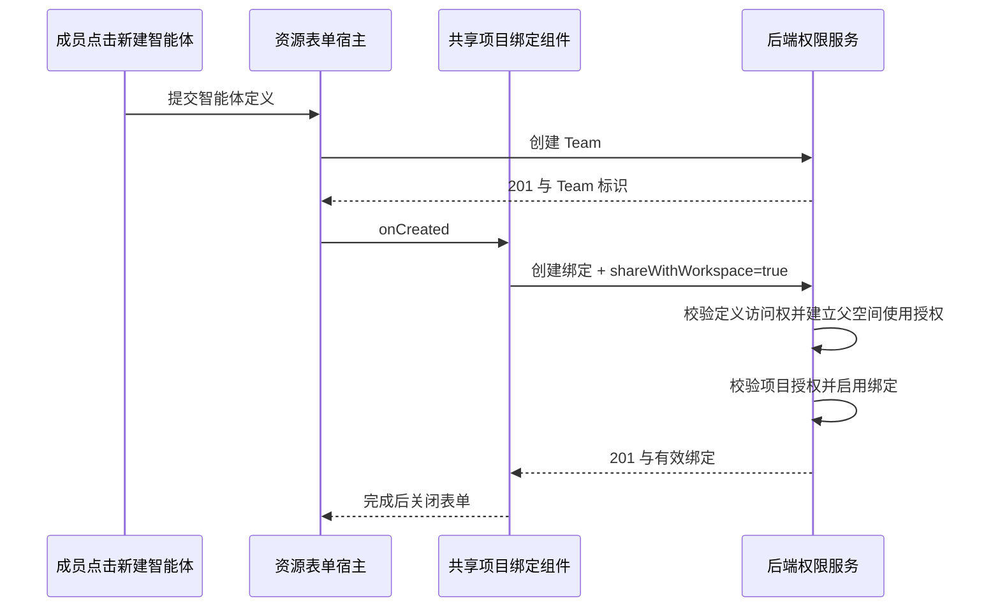

# PR #3910 CI 修复

用户要求：处理 CI 报错并重新提交到同一 fork 分支和主仓库 PR。事务 `tx-ci3910-20261014`，起点 A00000011。

## 失败证据与根因

原 CI 提交为 `626eec6b5e15b3e21be72ee56c06b028a4e45201`。

- [共享单元测试](https://github.com/wecode-ai/Wegent/actions/runs/38562754771/job/115847782292)：活动页眉测试把 UTC 时间按上海时区写死为 08:00，UTC runner 正确显示 00:00。用例改用本地 08:00 构造并转换为带时区的 ISO，验证真实本地时间显示；生产格式化逻辑不变。
- [桌面 Cloud 分片 5](https://github.com/wecode-ai/Wegent/actions/runs/38562754192/job/115850925825) 及 Core 分片 9/10/12/18：自动化 `getAttribute` 按既有契约对缺失属性返回空字符串，新辅助函数错误地期待 null。现在用属性存在性计数验证 0，保留原“直接打开且没有中间菜单”约束。新增五个脚本单元用例覆盖默认与启动入口、拒绝菜单触发器、中间菜单及打开失败。
- [Web E2E 分片 1](https://github.com/wecode-ai/Wegent/actions/runs/38562754758/job/115850181848) 和 [Executor E2E](https://github.com/wecode-ai/Wegent/actions/runs/38562754758/job/115850181614)：旧调用方仍点击取消的空白项目菜单项。更新所有 Web 调用方，复用严格验证无 aria-haspopup、真实创建表单出现、无中间菜单的共享辅助函数。
- Executor trace 和后端日志确认新 Team 创建 201 后，项目绑定接口返回 422，detail 为 `Agent resource authorization is revoked or unavailable`。宿主新建回调缺少已有智能体选择路径使用的 `shareWithWorkspace`，现在显式传 true；后端规则不变。后端新回归先验证未授权 422 且无共享关系，再验证显式同意 201、唯一父空间授权与有效绑定。
- Web 公开项目用例仍选择已删除的 Developer 公开角色。现在验证公开访问只有 Viewer，公开访客创建返回 403；随后经空间所有者显式邀请为项目 Developer，才创建并读取自己的 related Issue。保留其他用户不能读取 owner Issue、管理员可以读取全部 Issue 的断言。

## 创建与授权流

没有改表、清洗数据、修改 CP 不变量、增加授权兜底、放宽超时或跳过失败断言。Trace、Cookie 和完整日志只存放在本地忽略目录 `.pids/`，不提交。

## 实际验证

- `TZ=UTC pnpm --filter @wegent/collaboration test --maxWorkers=1`：110 文件、861 项通过。
- `TZ=Asia/Shanghai ... IssueProjectChatThread.test.tsx`：14 项通过。
- `pnpm --filter wework test scripts/workspace-project-creation.test.mjs`：5 项通过，现有脚本发现机制纳入 CI。
- 后端权限资源和契约 guard：45 项通过，包含新增显式资源共享回归。
- 共享库 build、Web TypeScript、修改的 Web E2E 文件及桌面脚本 ESLint、差异空白检查通过。

本次未本地执行 E2E 或 ai:verify。已有 CI 场景覆盖所有修改过的 E2E 调用方；推送后的 CI 执行结果不能由上述单元结果代替。
