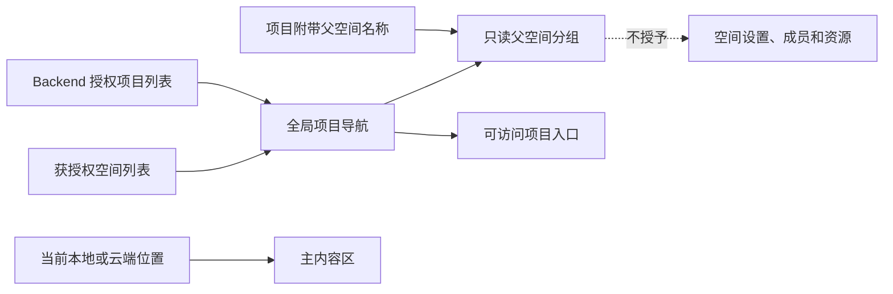

# 只有项目权限的跨空间导航修复

用户指出 admin 浏览本地空间后，“再来一次”从侧栏消失；要求补全只有项目权限、没有父空间权限的场景。事务 `tx-b9d8c5faae1f` 基于 A00000013，影响共享 UI `arch://wegent/ui/287398da` 和权限回归 `arch://wegent/test/94f7802d`。CP04、CP07、CP13、CP20 的既有意图保持不变。

## 根因与证据

只读数据库查询确认空间 166（“再来一次”）仍 active，所有者 user 2，空间仅有 user 2 的有效成员关系。admin 为 user 1，无该空间成员关系；子项目通过 authenticated_users Viewer 公开授权可访问。用户的全局 admin 身份不产生业务空间授权。

`CollaborationPlatformNavigation` 以当前 local/cloud 浏览位置过滤项目。云端项目的父空间不在空间成员列表时，由 `workspace_context` 提供只读分组标签；切到 local 后，项目和依赖它的标签一起被过滤。用实际 TypeScript 导航函数和实际侧栏条件做隔离复现，得到 cloud 时四个分组、local 时三个、切回 cloud 时恢复四个。源项目数量未变。

## 最终设计

删除侧栏重复的 domain 过滤，直接使用控制器聚合的授权项目列表构建导航；父空间标签由既有 `canOpen=false` 规则保留，无法变成空间授权。保留当前父空间最小上下文，不因浏览 domain 再过滤它。后端权限和存储未修改，无数据清洗、迁移或角色提升。

## 回归计划与验证

- 组件矩阵覆盖公开 Viewer，以及直接项目 Viewer、Developer、Maintainer、RestrictedAnalyst；从云端空间切到本地、重复点击本地、切回云端、再次从本地进入项目。项目和父空间标签始终存在，父空间是 DIV 标签、没有空间操作按钮；未读取父空间成员/智能体/设备，未创建空间成员授权。共享平台完整组件文件共 118 项通过。
- CP04 后端契约由单一 Maintainer 扩展为 Viewer、Developer、Maintainer。验证项目详情及列表仍可访问、父空间仍不在可访问空间列表、父空间详情和成员/资源返回 404、私有兄弟项目不可访问。最终契约文件 47 项通过；资源与 guard 45 项通过；文档说明补充后 guard 再检查 2 项通过。
- 桌面真实集成覆盖加入已有 CI checkpoint `collaboration-shared-core`。使用独立账号建立父空间、公开 Viewer 项目、直接邀请 Developer 项目和私有隐藏兄弟项目。真实 HTTP 校验权限来源及拒绝；UI 验证本地切换、重复点击、项目打开和父空间只读；归档测试项目和空间，测试用户随隔离数据库销毁。
- 本次按仓库规则未本地执行 E2E 或 ai:verify。新增集成场景已注册现有 CI suite，尚未宣称运行通过。
- 共享库 TypeScript、桌面集成脚本 ESLint/语法、所属包 Prettier、Python Black/isort 以及差异空白检查通过。

修改前已有后端 CP04 和云端项目发现组件测试，但缺少跨本地/云端切换的集成约束。此前 PR 的 CI 通过仅证明当时的用例通过，不证明此遗漏场景已受保护。
