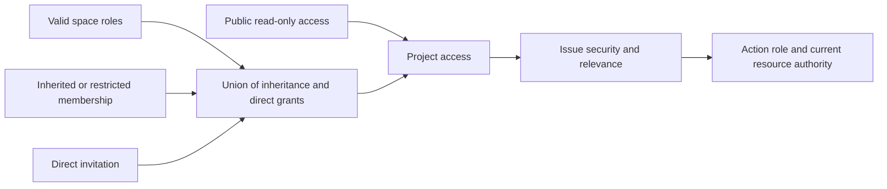

# Project roles and Issue visibility

See the complete [collaboration permission contract](../wegent/developer-guide/collaboration-permissions.md). Project roles are Administrator (Maintainer), Member (Developer), and Viewer. Creation is audit information; project creation separately grants the creator Maintainer.

Each project has one parent through its existing `CloudProject → workspace` relationship; `workspace_id` is a query property, not a new column. Ordinary projects inherit space roles. Restricted projects retain only space owner and administrator governance. Direct invitations and valid inheritance combine using the strongest role. Public access grants only Viewer and never creates assignment candidates.

Issue access first requires project access, then applies `open` or `related` security. Project administrators see every Issue. Other readers see open Issues and Issues they created, are assigned to, collaborate on, have an active task binding for, or that are assigned to an Agent they own. Lists, details, deliveries, execution records and conversations use the same decision; unrelated reads return 404. Being the creator does not confer additional editing, commenting or assignment authority.

DingTalk controls AI Table record access. Project roles control entry and operation capabilities.

Project lists use four batched queries for projects, parents, public access and permission sources, regardless of project count. `workspace_context` supports parent navigation; `workspace_access_role` explicitly indicates space authority. Project-only access never grants space member lists, resource catalogs or other projects.

No table changes or bulk data rewrite are required. Membership mode uses existing JSON, roles are normalized on read, and parent relationships remain intact. Valid legacy installations retain use within their original project; explicit private definitions stay creator-only. New bindings use explicit grants. Old backends still apply old policies, so new permission features require a unified backend policy; see the collaboration contract.
