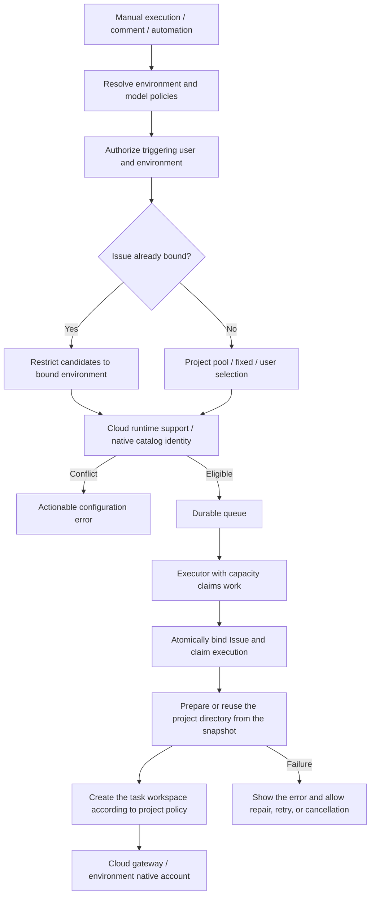
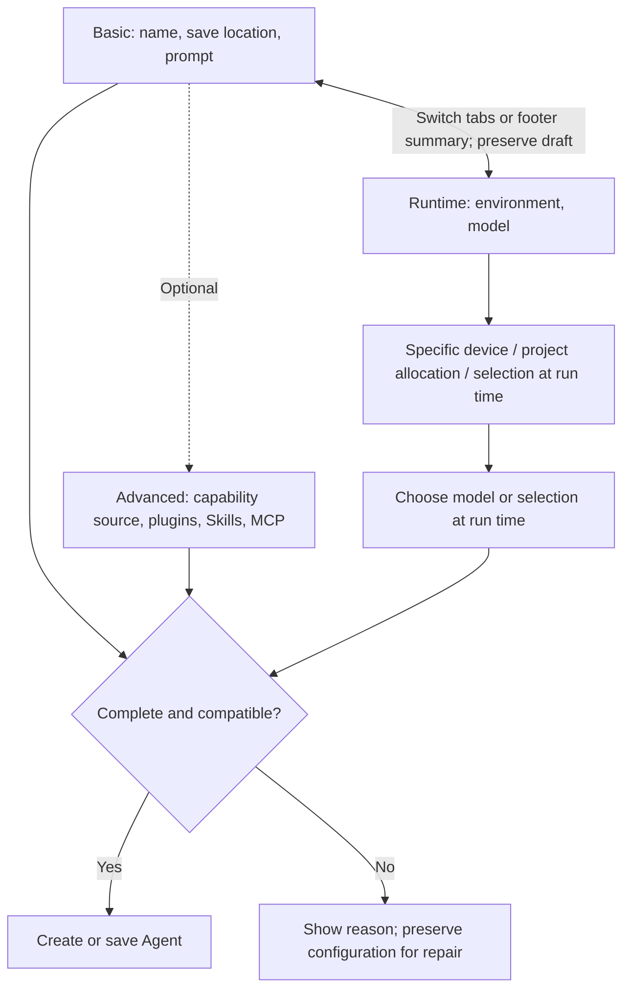
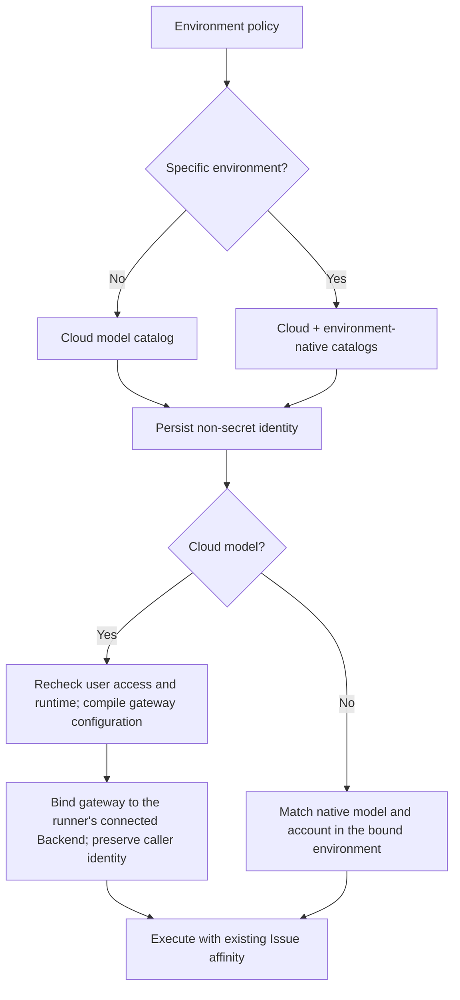
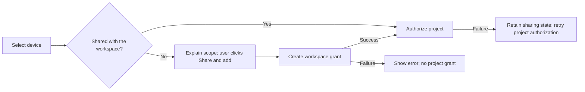
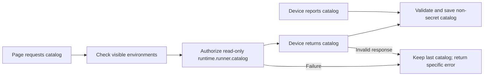
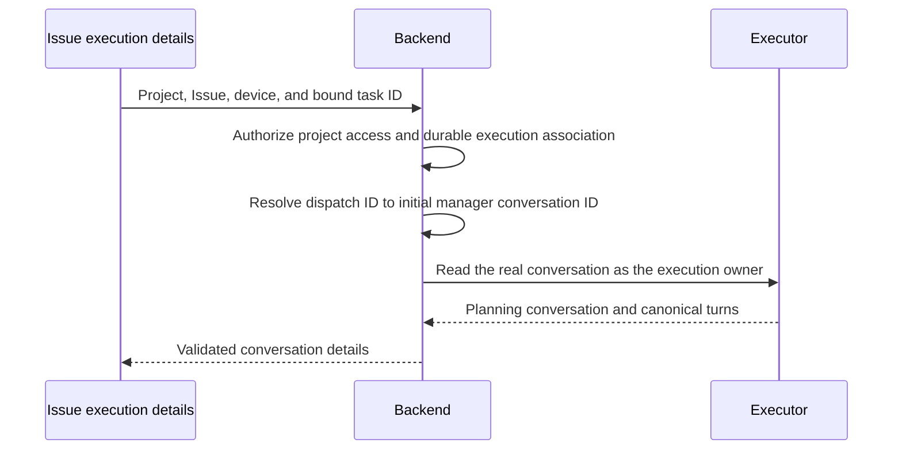
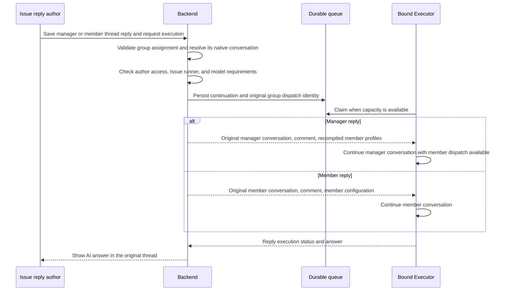
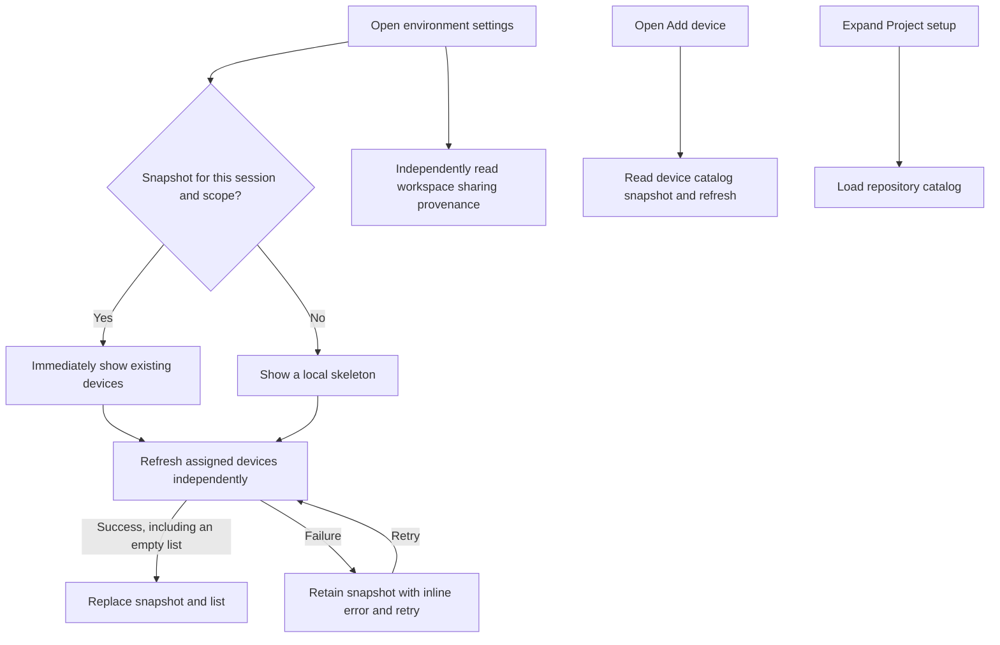
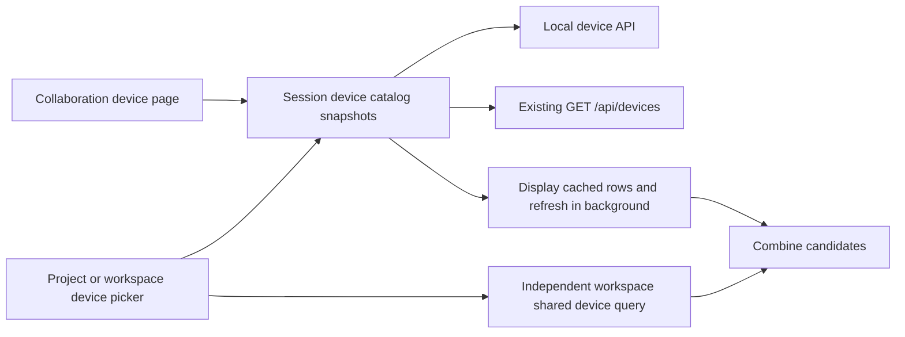

# Collaboration runner routing

Agents store environment and model requirements. Executors claim eligible work from a durable queue. The first successful claim binds the entire Issue to one environment; comments, replies, retries, and automations retain that binding. Changing a personal default or Agent configuration never moves an existing Issue.



## Policies and authorization

The project settings sidebar groups basic information, execution environments, and automatic processing under Project settings. AI team provides separate Agents, Members, and Collaboration teams pages. Project pages no longer nest participant tabs. Add member and Add agent actions during Issue creation open the corresponding sidebar page directly. Cloud and local projects share this navigation.

Wework creation and editing use Basic information and Runtime settings tabs. Basic information opens first with the name, save location, and prompt. New agents default to a fixed environment policy. Among authorized environments supporting the runtime, creation prefers the personal default, then the current desktop Executor. If neither matches and only one eligible environment exists, it selects that environment; multiple candidates require a choice. Device transport aliases match the catalog's `device_key`; the saved policy uses the environment ID. Models prefer the environment's reported default for the runtime, or the sole selectable model when no default exists. Other cases require a choice. Existing agents retain their saved environment and model policies. A clickable environment and model summary appears in the footer. Switching tabs preserves the draft and advanced configuration.

Creation initializes these values once and saves explicit fixed rules. Late catalog responses never overwrite manual choices, and changing environments never replaces a selected model. Incomplete historical configurations and execution-selection dialogs do not apply creation defaults.

Runtime settings use one environment selector, grouping devices by personal or workspace ownership and placing automatic project allocation and selection at run time under Other allocation rules. The model selector stays mounted and is disabled until an allocation rule and, for a fixed policy, a specific device are selected. Concrete models and selection at run time share one selector. Options show the model name and cloud/native source. Native selections show the environment account source. Public cloud models do not show a "public account" hint: gateway calls use the signed-in user's identity. Changing environments never replaces a selected model. Invalid environments and models stay visible, and confirmed conflicts also appear on the basic tab and prevent saving.

Advanced settings retain both following the execution environment and fixing agent capabilities. Fixed capabilities keep the full plugin, Skill, and MCP configuration, including capabilities referenced by the prompt. Tabs and disclosure change presentation without reducing these rules to one checkbox or changing the saved contract.



`execution_policy` supports `project_pool`, `fixed`, and `user_select`. Backend fixed policies reference a Device Kind ID; local projects use the local environment ID. Ownership is independent of deployment location. `model_policy` supports `fixed` and `user_select`. Models store `(runtime, provider, model_id)` and `source`; cloud models additionally store a `cloud_model` reference containing name, type, namespace, and resource owner ID. Rules never contain model configs or credentials. Historical identities without a source retain native catalog matching and are never silently reinterpreted as cloud models.

| Environment policy           | Model catalog                                                    |
| ---------------------------- | ---------------------------------------------------------------- |
| Automatic project allocation | Authorized cloud models                                          |
| Specific environment         | Cloud and environment-native models, filtered by runtime support |
| Selection at run time        | Authorized cloud models                                          |

Cloud catalogs reuse `/api/models/unified` and load independently of device catalogs. Execution authorizes the triggering user and resolves cloud accounts through the existing gateway; native models use the environment account. Codex accepts the gateway's three upstream protocols; Claude Code requires Anthropic Messages. Runners report `runtimes`; native models in historical reports also provide evidence of runtime support.

The Executor binds the model gateway to its connected Backend URL, including the scheme, host, port, and path prefix. Stale internal addresses or ports in server configuration are not used as device request addresses. Only the Wegent model gateway path is rebound; direct provider endpoints remain unchanged. Triggering-user credentials and cloud resource identities are preserved. `codex_catalog_model_id` selects Codex capability metadata independently of the resource identity sent to the gateway. Non-native models receive a capability catalog identity without changing the selected model.

Agent details preserve the cloud resource name, type, and owner instead of exposing the upstream model ID as a native model. Manual reruns persist a separate root comment and resolve policies through the comment execution queue, preserving Issue runner affinity. Authorization or configuration failures remain visible. Explicit Team runs resolve the current model selection before building the Bot execution request, without requiring a routed Bot to store another model reference.

Comment executions retain the project, Issue, and execution IDs and the board reference before appending the current comment. Agents can read the original Issue through the real board tools.



At execution time, `preferences.default_execution_target` applies only to unbound Issues manually invoking a `user_select` Agent without an explicit environment. Automations must persist all deferred choices in `runnerSelection` before being enabled. A collaboration group requires one runner satisfying every member's requirements, while members may use different fixed models.

Sharing a personal environment preserves its owner and model account. Project pools intersect workspace and project Device grants. Revoking workspace sharing invalidates project access. Authorization always uses the triggering user; the creator's access is insufficient.

Cloud project device pickers distinguish **Add** from **Share and add**. Before sharing a personal environment, the UI explains workspace access and account/quota ownership. Clicking the action shares with the workspace before authorizing the project. Submission waits for known sharing status; already shared devices go directly to project authorization. Sharing failures stop the flow. If project authorization fails after sharing succeeds, the UI retains the actual sharing state and retries only project authorization.



`GET /api/v1/resources/execution-environments?project_id=...` exposes the non-secret native catalog reported through `runtime.runner.catalog`. The last report remains available for offline queueing, with refresh errors visible. Cloud models require runtime support without per-device provider credentials. Manual execution may use the default of an explicitly fixed environment; automatic allocation and environment selection at run time require a cloud model choice. Automations must persist all deferred selections. Local queue claims also recheck cloud access and compile runtime gateway configuration.

Device reports and page refreshes use the same catalog contract. Page requests first check environment visibility, then Backend dispatches RPC using the device owner's identity. App environments allow this read-only catalog request through a capability scoped to `runtime.runner.catalog`; other remote-control permissions follow their existing rules. Refresh failures retain the RPC error code, and invalid catalog responses report `runner_catalog_invalid`. Logs contain environment IDs, error codes, and exception types without model credentials or RPC contents.



Local projects use their local Executor's catalog and durable queue. Backend projects may authorize personal computers and existing servers. Sharing a runner does not share a conversation: each root comment has an independent Runtime task, while thread replies enqueue a new turn on that thread's task.

Collaboration dispatch IDs and manager conversation IDs have separate roles. Queue claims, heartbeats, and dispatch outcomes retain `codex-queue-{execution_id}`. Issue task bindings and initial planning activities point to the actual `codex-queue-{execution_id}-manager-initial` conversation. Completion, failure, and requeue projections use the same conversation association. Existing detail links containing a dispatch ID resolve through authorized project, Issue, device, and execution records without rewriting historical database rows. Reads still use the execution owner's identity; client-supplied runtime handles never expand access. Invalid Runtime transcript payloads return an explicit 502 error and log field locations without conversation content.



Manager plan and status-decision activities store their actual conversation and device and create an Issue session binding. Replies validate the current group assignment and resolve the conversation belonging to that activity. Historical activities without a session identity are resolved from the persisted rounds of the same dispatch. An explicitly recorded older conversation never moves to the latest session; invalid associations return a conflict. Replies to a continuation answer retain that answer's recorded model selection and conversation.

Manager replies enter the durable queue with the Issue's bound environment, original conversation, and group dispatch authority. The reply author's permissions and every member's environment and model requirements are checked again. Claiming recompiles member profiles and passes them through the existing continuation API. Materialized member credentials remain in process memory: index refresh preserves the current process's profiles without writing them to the session index. A missing conversation returns an explicit error; saving a comment alone does not count as a successful AI execution.

Member tasks are created inside Executor without a separate ordinary execution record for each task. Member activities store their real device and conversation and create an Issue session binding in the same transaction. Replies resolve the conversation through the root dispatch, round, assignment, and member identity and verify that device aliases refer to the same environment. They enter the durable queue and continue that member's conversation with its model requirements, without switching to the manager. Missing assignments or mismatched session identities return an explicit conflict.

Details for historical member cards without a session binding authorize access through persisted assignments. This does not modify historical data or require the current model catalog. Reading a historical conversation does not require the group to remain the current assignment; executing a reply does. Client-supplied runtime handles cannot expand read authority.



## Automatic project preparation

Environment authorization is independent of directory preparation. Creating Issues, assigning Agents, and entering the queue require no manual initialization. Local projects no longer use preparation records as authorization. The environment page shows device availability without a global initialized badge. **More → Prepare project directory ahead of time** remains optional.

Runner routing selects an execution device without creating a code-project binding. Projects without repositories or setup commands use an independent session directory; configured project preparation supplies the directory when needed. Git worktrees require a repository or a valid code workspace.

Local assignment also requires no preinitialized directory; existing preparation records are only reusable state. Fixed native models do not request the cloud catalog, so cloud outages cannot block their assignment.

After claiming work, Runtime saves a snapshot of repositories, setup commands, and the configuration fingerprint. It prepares the directory asynchronously before creating an isolated worktree or using the shared directory. Automatic and optional preparation share the Executor implementation and serialize access to each directory. Successful fingerprints are reused; changed configurations give new tasks a new directory. Historical paths are reused only on their original runner. Cloning uses Git credentials configured on the environment, including access to private repositories.

While preparation is pending, task creation returns `workspacePending: true` and an empty `workspacePath`. Runtime persists the final directory and updates the local execution binding. Preparation consumes a running slot and supports cancellation without blocking task acceptance or heartbeats. Repository and setup failures retain actionable errors without starting a model session. After repairing the environment, retrying the same task uses its saved snapshot; after editing project configuration, a new execution uses the new configuration. Restored queued work and force-started work also pass through preparation.

Replies retain their session directory. Existing sessions and workflows inheriting an upstream workspace do not prepare a new directory when configuration changes. Issue runner bindings remain stable, and cancelling preparation never deletes a shared project directory.

## Loading environment settings

Device lists keep in-memory snapshots scoped to the API session and project or workspace. Reopening displays the last successful result immediately and refreshes in the background. Only a list without a snapshot shows a local skeleton. Failed refreshes retain devices and show an inline error with retry; a successful empty response clears the snapshot. Successful edits update it immediately, and older reads cannot overwrite those edits. Subscribers share in-flight requests.

Project devices and workspace devices load independently. Sharing provenance is not inferred until the workspace catalog arrives. Personal candidate resources load when Add device opens; the Git repository catalog loads when Project setup expands. An unloaded candidate catalog does not mean no devices are online. Snapshots serve display only; existing server and Executor checks still authorize execution.



Loading unit tests cover reopening, slow requests, initial failure, failed refresh and retry, empty results, API-session and project isolation, request deduplication, and edits racing with older reads. The existing desktop CI environment fixture also checks navigating away and immediately returning.

The collaboration device page and device picker share session snapshots of the device catalog without loading the full resource catalog containing agents. Cloud discovery reuses the Cloud work `GET /api/devices` endpoint and executor filtering; local discovery reads local devices directly. The sources load independently, so slow navigation or cloud requests do not block local devices. Stable device identities deduplicate records, with registered cloud records supplying device IDs for authorization.



Cloud projects and workspaces use registered cloud device IDs; local projects and workspaces use the local catalog. Local placeholder IDs cannot become cloud grants. Personal and workspace candidates render independently, with errors and retry for failed sources instead of false empty results. Catalogs are isolated by API session and shared across project API wrappers in the same session; switching accounts does not reuse the previous catalog. Existing desktop CI scenarios cover cached devices when reopening the device page and picker.

The current device is identified by the stable device identity reported by the local runtime, never by the `local/app` deployment type or display name. Other computers and historical records use cloud device management. Device catalogs and environment lists place a known current device first, followed by online, provisioning, error, and offline states, with natural name sorting and ID tie-breaking. Historical records with the same name but different identities remain distinct.

## Registering a workspace runner

Workspace Maintainers/Owners can register an existing server in the environment UI or call:

```text
POST /api/v1/workspaces/{workspace_id}/runners
{"name": "Team execution server"}
```

The response contains `environment_id`, `device_id`, and a token displayed once. Configure the existing `wegent-executor` service with:

```text
EXECUTOR_MODE=local
WEGENT_BACKEND_URL=<Backend URL>
DEVICE_ID=<registered device_id>
WEGENT_AUTH_TOKEN=<returned token>
```

`local` is the existing Executor transport mode. The environment's `deploymentLocation=cloud` denotes server deployment; `workspaceOwnerId` denotes ownership independently.

The runner uses an independent machine identity, not the administrator's login. The token authorizes only its registered device; only its digest is stored. Project actions inside a task use the triggering user's authorization. Model credentials remain on the server. Codex reports its native model catalog. Claude reports explicitly configured models from `WEGENT_CLAUDE_HOME/settings.json` (default `~/.claude/settings.json`). Custom Claude services automatically derive a provider identity from the SHA-256 digest of the normalized endpoint, without additional configuration. Existing `env.WEGENT_CLAUDE_PROVIDER_ID` values remain explicit identities. Protocol, port, path, and query differences remain distinct; endpoint addresses and credentials are not included in catalog reports. Account configuration still belongs to the execution environment.

Revoke with `DELETE /api/v1/workspaces/{workspace_id}/runners/{environment_id}`. This disables the environment and disconnects its socket. Subsequent events and connections reject the old token. Registering again creates a new environment without migrating bound Issues.

## Queue and recovery

| Condition                                     | Behavior                                                               |
| --------------------------------------------- | ---------------------------------------------------------------------- |
| Offline or busy                               | Remain queued with a reason; resume when available; allow cancellation |
| Project or sharing permission revoked         | Block claiming with an authorization error                             |
| Model removed or provider changed             | Require model/environment configuration repair                         |
| Bound Issue conflicts with a new fixed policy | `ISSUE_RUNNER_CONFLICT`; never switch runners                          |
| Missing manual choice                         | Return a structured selection request and replay after selection       |
| Missing automation choice                     | Reject enabling; never read personal defaults                          |
| Invalid local queued configuration            | Show `waiting_runtime`; repair, cancel the old execution, and resubmit |

Backend binds and claims within one transaction using an Issue row lock and conditional update. Local queues use SQLite `IMMEDIATE` transactions. Execution records retain the final runner, native model, account label, and configuration sources without credentials.

Starting a direct local execution atomically marks its comment as running and its Issue as in progress, including continued threads. Queued replies keep the Issue in progress until the last turn finishes and moves it to review. Group manager and member executions leave Issue state to their workflow.

## Storage, historical data, and verification

This feature reuses existing extension fields. It adds no tables or columns and performs no bulk data migration:

| Data                                                 | Storage                                                                                                               |
| ---------------------------------------------------- | --------------------------------------------------------------------------------------------------------------------- |
| Agent environment and model policies                 | Project Agent `metadata`, or Bot CRD `spec`                                                                           |
| Personal default environment                         | User `preferences.default_execution_target`                                                                           |
| Environment model and account-source catalog         | Device CRD `spec.runnerCatalog`                                                                                       |
| Issue environment binding                            | Issue `metadata.runner_binding.environment_id`                                                                        |
| Execution policy snapshot and version                | Routing object in the existing `execution_payload`: Backend `runtime_selection.runner_routing`, local `runnerRouting` |
| Actual environment, model, and configuration sources | Selection and routing snapshots in the same payload, plus existing Runtime identity fields                            |

First claim uses an Issue row lock and conditional JSON path update in the execution claim transaction, preserving other metadata. ORM content updates protect committed affinity against stale metadata writes. Local claiming uses the existing SQLite `IMMEDIATE` transaction and JSON path update; the local schema version remains 10. Queue queries identify routing objects within the existing payload after applying status and device filters, without a dedicated routing column.

Existing explicit Agent device, model, and runtime configuration remains in its original fields. For historical Issues without a JSON binding, read prior executions and TaskBindings. Backend resolves device aliases within their owner; local storage uses durable device IDs. An unambiguous historical binding is saved on the first valid claim. Unresolved devices or conflicting history require correction rather than adopting a personal default. Existing JSON bindings remain authoritative.

Focused coverage includes policy combinations, model catalogs, revoked access, concurrent first claims, JSON preservation and rollback, historical affinity, original-schema queries, separate root sessions, queued replies, and machine credentials. Existing CI scenarios using native model fixtures choose a fixed environment and assert that automatic allocation does not expose those models. Cloud and native model routing also need separate gateway and account validation. Do not run E2E or AI verify without an explicit user request.

Preparation tests cover first use, concurrent reuse, configuration changes, failure and retry, cancellation during setup, cloning before isolated worktrees, restored queues, and forced starts. Existing CI scenarios no longer initialize environments as a prerequisite; the remote scenario retains optional preparation failure and recovery coverage.

Run E2E and isolated packaged-app AI verification when explicitly requested and retain actual results. Only model services are mocked; backend, queue, and Executor implementations remain real. Provisioning cloud machines, moving Issues between runners, and cost-based scheduling remain outside scope. Python/Rust API ownership and Rust cutover rules are unchanged.
