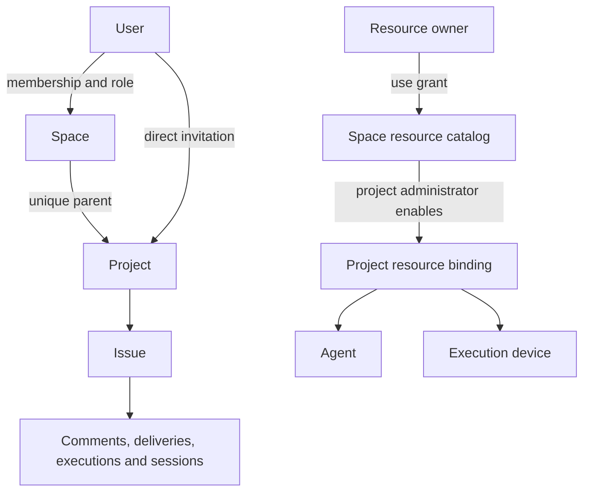

# Collaboration permission architecture and invariants

Memory-review completion must not automatically start an ordinary primary conversation, which would restore capabilities outside the memory/progress allowlist. Host-identified scheduled memory reviews retain their original task results and arrangement status but do not enter generic generative result delivery, including success, failure, cancellation and restart recovery. Ordinary scheduled and delegated reporting is unchanged. `memory_review_completion_never_starts_an_unrestricted_parent_turn` protects this boundary; CP invariants are unchanged.

Project memory identity includes both project ID and storage source. The host carries the currently authorized local/cloud source in its internal read context, keeping inventories, details, attachments and save-time rereads in the same namespace. A local project with the same ID cannot shadow a cloud source, and a missing local project cannot fall through to cloud. Generic tool arguments cannot set this internal field; role, Issue and Backend identity checks remain unchanged. `memory_project_store_collision_keeps_authorization_and_reader_in_same_namespace` protects this alignment. CP invariants are unchanged.

`memory_cloud_project_file_rechecks_owner_and_limits_download_without_token_leak` uses local HTTP protocol fixtures for standalone cloud files: access endpoints receive Backend identity, object downloads do not receive that token, and removal during reads, wrong projects, folders, oversized bodies and missing authentication are rejected. Failed prechecks never request download access. This is protocol integration, not verified real-cloud compatibility.

Memory project evidence kinds `files`/`file` reuse project file services without an Issue binding. Content reads check registered project membership before and after access; models supply only a file ID. Cloud downloads retain byte/time bounds, and saving/completion rereads evidence and validates the current run and project grant. File IDs isolate source/checkpoint keys. `project_file_tools_read_registered_local_files_and_reject_other_projects` and `memory_project_files_without_issues_preserve_file_scope_and_current_membership` cover local reads, cross-project denial, provenance isolation, deletion and revocation. Cloud compatibility remains unverified. CP invariants are unchanged.

Only owner rule management additionally lists legacy fingerprints not referenced by current rules, without guessing text or scope. Model reads still return authorized semantic rules only. Legacy deletion requires the owner, version and exact forgetting timestamp, and rechecks for rule references inside the same immediate transaction. It reuses owner deletion RPC and is unavailable to unattended review. CP invariants are unchanged.

Private project-coordinator conversations reuse the shared proactive formation and semantic forgetting policies without requiring an explicit save command. The host still fixes the current member/project scope; saving private memory never authorizes publication to shared project records, and read-only delegated workers still lack memory writes. Runtime context separates policy from untrusted memory data. `project_memory_policy_preserves_private_context_and_semantic_forgetting` and `project_memory_tool_reuses_formation_and_forgetting_without_widening_scope` cover this boundary. CP invariants are unchanged.

Following the user's explicit choice, correction or forgetting retains a minimal negative rule: only the compact memory fact, scope, version and associated fingerprints, not original conversations, attachment bodies or evidence excerpts. Rules are separate from active memories. `list_memory_forgetting_rules` reuses current source/role authorization filtering and complete pagination; background access still requires a live review run. Models must avoid relearning the specific meaning, without treating rule targets as answerable facts or executable instructions; storage continues enforcing exact evidence fingerprints. Only owner management can delete rules, not unattended consolidation. Deletion atomically releases fingerprints no other rule references, and explicitly restoring a matching memory removes its rule. Isolated native verification using the current account covers cross-conversation paraphrase suppression, learning an independent new fact, and relearning after owner rule deletion; this is not deterministic universal semantic enforcement. CP invariants are unchanged.

Connector evidence reuses the same completion checkpoint mechanism. `complete_memory_connection` isolates the host-resolved source grant (including account, resource and collection boundaries), query and page cursor, and commits only after full reads and settled memory writes in the current run. Reads and completion revisit the provider and revalidate authorization. Unchanged pages omit bodies but retain `nextCursor`, `hasMore` and availability; resource discovery and pagination must continue, and completing a search page never proves full source coverage. The tool writes internal progress only, not external resources. Connector protocol tests cover chunks, changes, revocation and retained pagination; real external provider compatibility remains unverified. CP invariants are unchanged.

Project evidence completion checkpoints bind the current run and exact source key. `complete_memory_project` rereads current evidence and revalidates grants/hash; completion requires contiguous reads of every chunk in the same run and no pending memory writes. Checkpoints retain no body and grant no read authority. Unchanged completed attachments may omit repeated bodies; project and file lists must still be enumerated. This tool belongs to the authorized internal-progress allowlist, not Shell or external writes. `memory_evidence_completion_requires_full_reads_and_settled_writes` covers restart recovery, incomplete reads, failed writes and user/source/run isolation. CP invariants are unchanged.

Memory reads of ordinary Issue attachments reuse attachment listing and reading services: bind the project and Issue, verify attachment membership, then repeat ownership checks after download and parsing. Cloud attachments and delivery files share byte- and timeout-bounded downloads; models cannot supply paths, and saved evidence includes the exact attachment ID. `memory_issue_attachments_bind_real_file_content_to_project_and_issue` and `memory_cloud_issue_attachment_revalidates_membership_and_bounds_downloads` cover real local storage and simulated HTTP protocols. Native Codex verification covers learning from a local Issue attachment and application by an independently authorized role; live cloud compatibility remains unverified. CP invariants are unchanged.

Memory project inventories bind storage provenance to the local/cloud reader channel, never infer it from a matching local project ID or trust a returned entry's store claim. Authorization preserves the exact project ID/store pair; entries without provenance cannot enter the memory inventory. `memory_project_inventory_preserves_source_namespace_on_id_collision` covers colliding IDs, forged provenance, independent grants and exclusions. Read-time ownership and permission checks remain unchanged. CP invariants are unchanged.

Direct owner conversations with a stand-in role can recall memories from that role's currently authorized sources, including project files. Pausing new intake does not revoke source grants. Recall narrows grants to the current role before filtering candidates; it cannot borrow the primary or another role's project, account or resource authority. Source-bound work still recalls only its exact source, and other roles' private memories remain isolated. `role_memory_recall_includes_own_connected_projects_without_borrowing_grants` covers paused roles, project stores, cross-role denial, exact sources and grant revocation. CP invariants are unchanged.

Project memory file reads reuse `download_delivery_asset` Issue/delivery/asset ownership checks and recheck ownership after parsing; outer checks still enforce the live run and current project grants. Models cannot supply file paths. Cloud downloads use host-created temporary directories, byte and timeout limits, and cleanup. `memory_delivery_assets_read_real_documents_and_bind_the_full_owner_chain`, `memory_cloud_delivery_asset_rechecks_ownership_after_download` and download-limit tests cover real local storage and simulated HTTP protocols, not live cloud-service compatibility. CP invariants are unchanged.

Scheduled memory consolidation uses independent arrangement routing only for the primary stand-in's exact `memory_review` template, outside ordinary intake. Pausing new work therefore retains authorized memory consolidation; ordinary calendar work still follows intake pause and confirmation policies. Run version, arrangement enablement, owner and evidence-source checks remain unchanged. `memory_review_due_skips_empty_history_and_routes_changed_history_independently` covers scheduled routing while intake is paused and empty-increment skipping. CP invariants are unchanged.

Project memory evidence reuses existing project, Issue, comment and delivery readers. Reads recheck current stand-in project grants before and after access; saves reread evidence and validate its hash and verbatim excerpt. Cloud evidence requires an authenticated Backend connection and must not fall back to local caches. Inventories read local and cloud sources independently: missing authentication or a failed cloud listing explicitly marks cloud coverage incomplete while authorized local projects remain readable. Failure never means an empty cloud inventory. `missing_cloud_auth_is_incomplete_and_cannot_read_cached_project_evidence` and `memory_project_inventory_keeps_local_reads_independent_of_cloud_failure` protect this boundary and recovery; the latter uses simulated HTTP protocols. Native Codex verification covers learning from local delivery files and cross-session application by an independently authorized role; live cloud-service compatibility remains unverified. CP invariants are unchanged.

The cloud Issue detail endpoint authorizes by Issue ID and does not receive the memory tool's project argument. The memory entrypoint must additionally match the returned `id` and `cloud_project_id`; mismatches or missing ownership prevent evidence exposure and subordinate comment/delivery reads. `cloud_project_evidence_binds_returned_issue_before_subordinate_reads` verifies this binding with a local HTTP protocol fixture, not a real cloud-service compatibility test.

Background memory review reuses the isolated Codex process and restricted model capability catalog, disabling Shell, patch, plugins, web search and sub-agents while retaining only the run-bound stand-in evidence tools. Tool orchestration uses native Code Mode, separately from tool-free text generation; Code Mode does not grant disabled execution capabilities. Following the user's product-policy decision, only explicitly allowlisted evidence reads, internal memory saves and progress tools receive native per-tool automatic approval. The endpoint default still prompts; unlisted tools are not exposed, and inherited unrelated endpoints and per-tool approvals are removed. Server-side run identity, source authorization and evidence checks remain authoritative. Other conversations and external-write approval policies are unchanged. Focused `memory_review_boundary` tests protect configuration boundaries, and a catalog contract requires the allowlist to exactly match the guarded memory catalog; actual native tool exposure still requires isolated Electron verification.

Stand-in model recall and context injection filter memories through current saved source grants. Source-bound turns cannot borrow another identity's connection grants. Owner management lists and deletion retain disconnected records for cleanup; management visibility does not grant model recall. `memory_recall_drops_revoked_sources_but_owner_can_still_delete_records` covers search after connection revocation, identity isolation and deletion. CP invariants are unchanged.

Personal recall of project-coordinator memories also requires a currently connected project with the exact ID and store, respecting project exclusions; owning the memory record does not grant project-source authority. Authorized project-bound turns retain their original scope, and owner management/deletion remain available. `personal_recall_requires_a_current_grant_for_project_coordinator_memories` covers no grant, same ID in another store, a matching grant and subsequent exclusion. This saved-source check does not replace live membership authorization in project services.

Memory collection discovery reuses connector `listResources` without creating subscriptions or grants. Results are filtered by the original provider, account, resource kind and collection partition; reads inherit configuration and confirmation policy from the saved grant. Run identity and authorization are rechecked after external reads. `memory_collection_protocol_preserves_grants_pagination_and_revocation` and `memory_collection_binding_rejects_other_partitions_and_caller_policy` cover pagination, cross-account/partition denial, forged policies and in-flight revocation. These are protocol integration tests; real external-provider compatibility remains unverified. CP invariants are unchanged.

Local attachment lists and file reads bind the project, Issue and attachment together; an attachment ID alone cannot select another task's file. Identical external Issue IDs in different projects do not mix attachment lists. Deletion uses the same ownership check, retaining existing caller authorization. `attachment_access_requires_matching_project_task_and_attachment` covers cross-project and cross-task denial and file preservation after denial. CP13 and CP14 semantics are unchanged.

Spaces define the administrative boundary. Projects inherit space membership by default. Resources participate through explicit use grants and project bindings. Lists and mutations share one server-side authorization policy. This document is a human-approved product contract, protected by tests.

Project details reuse the project list's permission query and response construction (CP13), preserving inherited space roles and permission sources. Personal stand-in settings are saved on the selected Executor. Saving and enabling do not query cloud permissions, agent catalogs, model catalogs or workspace readiness. Personal Issue tasks and stand-in tasks share the same Issue execution permission, without project device bindings or project environment initialization. The server still checks the current user’s execution permission when binding a cloud Issue. The CI-covered `stand-in-personal-task` desktop checkpoint verifies both manual and automatic tasks complete on the current device for an ordinary member with no device bindings.

Primary and silent background stand-ins reuse the current user’s authorized Wework capabilities. Project tools retain server-side resource and dispatch authorization; external tool writes retain native review. Events and transcripts confer no authority. Task orchestration is bound to the current account and device, never answers user input or approvals, and never elevates resumed tasks. Batch dispatch revalidates roles, sources, assignments and enablement time before execution.

Direct owner conversations with personal stand-ins default to Codex's native Guardian review for technical operations. Start, resume, fork and subsequent turns share the same reviewer configuration. Executor does not answer approval cards or convert business answers about timing or scope into execution permission. Read-only execution boundaries, connection scopes, business-operation `askBeforeAct`, configuration confirmation and login authorization retain their original paths. Human-review policies for external-source and delegated work remain unchanged. Native tool approvals use structured protocol metadata; ordinary business forms and URL authorization remain user interactions. CP01–CP20 are unchanged.

Project coordination records responsibility by project, group, enabling member and hosting device. Each project group has one enabled binding; enable, stop and explicit takeover compare the current generation. Saving the binding does not create a private conversation. Project membership, Agent use and device use remain independently authorized. Dispatch and model task credentials use the enabling member as actor, while definition ownership, device ownership and Runtime identity retain their separate responsibilities.

Project coordination commands reuse Issue assignment, group preparation and the existing execution queue. A server-generated immutable input digest binds each command ID; accepted execution records are returned as receipts before mutable checks. Replays cannot change input or create another execution. New admission checks the binding, project/group versions, member and resource authority in one transaction, and compares the Issue version to preserve concurrent edits and existing assignments. Authorization reads reuse that transaction’s connection; single-connection MySQL regressions cover complete admission, resource revocation, duplicate commands and rollback after a write failure. Claims and manager decisions also revalidate the current binding. Independent short authorization transactions observe committed revocation without changing the caller’s transaction. Running work records cancellation requests and waits for Runtime termination confirmation. `test_project_coordination_authority.py` and the CI-registered `project_coordination::mysql_tests` protect these server-side protocol contracts.

Before starting a Codex or Claude turn, project coordination uses the request's execution credentials to validate the current command and resource authority, then compares the complete persisted command context. This read-only check dispatches no work. Subsequent manager rounds retain the enabling member's original identity within the current process; absent credentials must never be filled from the device's login account. These credentials are excluded from the task index. After process recovery, missing identity must be restored through authorization before dispatch can continue, without changing the actor. Receipts read the first accepted execution fact; current authorization reads the latest attempt to preserve the existing isolated retry mechanism.

Local projects reuse the original group execution queue, retaining Issue-level execution occupancy and native approval, model and workspace policies. Command receipts reference existing execution rows without introducing another queue. An assignment identity survives manager, member and human-delivery handoffs; explicit reassignment invalidates it. Claims, start requests, actual Native startup and subsequent rounds check the current Issue and binding. An unstarted Native queue entry releases occupancy through the existing cancellation callback after durable removal. Running tasks receive stop requests and wait for actual termination evidence. Human subtask creation and assignment also record the original enabling member and retain the original delivery workflow.

The owned DSH Router aggregates project events programmatically; coordination in the project leader conversation remains inactive until explicitly enabled. Silent assessment uses a separate ephemeral Codex turn with tools disabled. It receives only authorized shared project, Issue and published comment fields, excluding private conversations, memories, Agent prompts and account configuration. The model returns structured intents; the Executor persists them and submits concrete work through the existing queue. It never answers human inputs or approvals. Requests for clarification are visible only to the enabling member and link back to the original Issue. Publication remains explicit.

No-tools assessment reuses Executor's existing isolated Codex runner, restricting the capability catalog and tool registration at process startup and exiting after completion. Thread overrides in a shared process cannot establish this boundary alone. Model selection, provider authentication, cancellation and the original task queue retain their existing paths. Model protocol verification checks both top-level and incremental tool definitions in the input.

Local project approval compares the local session identity with the actual execution Agent's creator; dispatch and execution retain the enabling member as audit actor. Group approval resolves that creator through the current execution ID, Agent messages on the same Issue and the current project's Agent records. Missing or ambiguous matches expose no approval action; neither the group leader nor a historical run substitutes for the current execution. Cloud approval retains server authorization. Desktop verification approves work through the original Issue, reads its result and accepts completion as the user.

Background contexts and auxiliary tasks are isolated by binding generation, so late reads, registration and callbacks cannot overwrite a replacement binding's batch. Unaccepted intents rejected by version conflicts or an inaccessible Issue refresh current source facts before reassessment; accepted commands recover their original receipts first. Interrupted read-only assessment can be repeated without replaying business operations. The `project_router` regressions protect generation isolation, real queue receipt recovery, archived Issue recovery, source windows and status authorization. The desktop CI `project-coordination` checkpoint covers explicit enable, clarification in the original Issue, preserved approvals, takeover and stop.

## Roles and inheritance

The three administrative roles are administrator (`Maintainer`), member (`Developer`) and read-only member (`Viewer`). Ownership is a separate space relation. The read-only `Owner` response label is derived from that relation and cannot be assigned through membership APIs. Creating a project explicitly adds its creator as a project administrator; creator identity is audit information.

The new project, parent-space grant and creator's administrator grant are written in one transaction. Insert the new project's parent grant directly instead of locking an absent grant, avoiding MySQL gap-lock deadlocks when independent spaces create projects concurrently. Resource grants use an atomic insert or update by their unique resource/entity identity before locking the existing record, preserving the grant ID, approval history and outer transaction boundary. The MySQL permission regression suite covers concurrent project creation, concurrent authorization of distinct and identical resources, the unique parent and use permission after creation.

| Space identity   | Inherited project | Restricted project         |
| ---------------- | ----------------- | -------------------------- |
| Owner            | Administrator     | Administrator              |
| Administrator    | Administrator     | Administrator              |
| Member           | Member            | Direct invitation required |
| Read-only member | Read-only member  | Direct invitation required |
| Project guest    | Direct grant      | Direct grant               |

Space owners and administrators always administer child projects. For other users, a valid direct project role takes precedence over inherited space membership, allowing promotion or demotion within that project. Removing the direct grant restores current inheritance. Updating only a member's project responsibilities neither creates a role override nor approves pending or rejected grants. Public reading does not make visitors eligible project participants.

## Protected contracts

| ID   | Invariant                                                                                                                                                                                                                                                                                                   |
| ---- | ----------------------------------------------------------------------------------------------------------------------------------------------------------------------------------------------------------------------------------------------------------------------------------------------------------- |
| CP01 | A project has exactly one active parent space; containment is separate from membership.                                                                                                                                                                                                                     |
| CP02 | Space owners and administrators administer all child projects, including restricted projects, regardless of creator.                                                                                                                                                                                        |
| CP03 | Ordinary projects inherit members and viewers; restricted projects stop those two sources.                                                                                                                                                                                                                  |
| CP04 | Project invitations never grant access to parent members, resources or sibling projects.                                                                                                                                                                                                                    |
| CP05 | Space owners and administrators retain project administration; otherwise valid direct project roles override inherited roles, and removing a direct grant restores inheritance. Pending, rejected, invalid, inactive and archived sources grant nothing.                                                    |
| CP06 | Creator, assignee, group leader and runner identity do not grant human administration.                                                                                                                                                                                                                      |
| CP07 | Viewers can read authorized spaces and projects but cannot edit, comment, assign or execute.                                                                                                                                                                                                                |
| CP08 | Project rosters include inherited and direct members, effective/direct roles and sources. Space inheritance stays read-only; project administrators can set or remove a direct project role for inherited members.                                                                                          |
| CP09 | Enabled shared agents are visible to project readers; explicit private definitions remain creator-only for visibility and use; readiness problems have explicit states and reasons.                                                                                                                         |
| CP10 | Resource use never grants source-definition editing or access to private credentials.                                                                                                                                                                                                                       |
| CP11 | Project dispatch requires valid Agent/device use authority and an enabled project binding; valid legacy installations retain original-project authority without granting catalog or source-definition access. Personal tasks and stand-ins using their own Executor do not require project device bindings. |
| CP12 | Fixed, pooled and user-selected project dispatch does not bypass project resource authorization; personal tasks and stand-ins use the personal execution path.                                                                                                                                              |
| CP13 | Lists, details, creation, updates, assignment, comment execution, automation and claims use the same policy.                                                                                                                                                                                                |
| CP14 | Issue reads check project access before open/related security; project administrators can read all child Issues.                                                                                                                                                                                            |
| CP15 | Execution checks current Issue access and execution capability. Project dispatch also checks binding and resource grants; personal tasks and stand-ins do not require project device bindings. Snapshots are not durable authority.                                                                         |
| CP16 | Revocation prevents new dispatch and claims; running work requests cancellation and waits for Runtime confirmation.                                                                                                                                                                                         |
| CP17 | Removing a space member revokes membership and all direct child-project grants; further guest access needs a new invitation.                                                                                                                                                                                |
| CP18 | Removing a space resource grant invalidates every child binding while preserving history and exposing the reason.                                                                                                                                                                                           |
| CP19 | Space ownership can transfer without changing historical creator identity; project administration is independent of creator.                                                                                                                                                                                |
| CP20 | Authorization exposes sources and denial reasons; the UI cannot grant capabilities rejected by the server.                                                                                                                                                                                                  |

Stand-in, connection-message and Issue-dispatch executions use Codex native baselines: automatic mode inherits `:workspace` for normal file reads and workspace/temporary-directory writes; confirmation mode inherits `:read-only`. Both retain network access so enabled plugin resources and CLI configuration remain readable. Filesystem readability does not authorize extracting credentials or accessing unrelated private data, and source content cannot grant authority. Operations beyond the baseline require the current native reviewer: AI review in automatic mode and one-time user approval in confirmation mode. Approval must actually escalate that command; denial must prevent execution. Do not use a global root `deny` that survives approval, or turn a single approval into persistent authority for later commands. This execution policy is explicitly user-authorized; CP01–CP20 server-side membership, resource-use and credential-isolation contracts remain unchanged.

The `stand-in-workspace` desktop E2E uses real Codex, shell and GitHub CLI to verify plugin resource reads, synthetic credential-free CLI configuration reads, networking, default rejection of outside-workspace writes, actual elevated writes after AI approval, and non-execution after denial. `stand-in-action-confirmation` uses a real `connection_work` origin to assert the file is absent before user approval and created afterward. Only model and reviewer-model responses are synthetic; the tests do not read personal login files or claim to verify real GitHub authentication.

GitHub/GitLab personal and repository sources use a stricter native boundary: local analysis and edits inherit `:workspace`, while model Shell network access is denied by default. Account-bound read-only MCP tools run on the host; each external write requires native one-time human approval. Role confirmation settings cannot relax this boundary. Merges require explicit delegation and the reviewed head SHA. Inbox reads, acknowledgments and takeovers check the user and device generation; Webhook verification grants no execution authority. CP01–CP20 remain unchanged. Executor Git permission contract tests cover networking, reviewer and tool approval; the `stand-in-git` CI scenario covers real internal service protocol boundaries without claiming live provider login verification.

## Resources and execution

Sharing delegates use, not source editing. Project administrators manage bindings and allowed project configuration; resource editors manage the original definition. Actor, definition owner, device owner and Runtime identity remain separate. Model and connector credentials retain their original access rules. Project session reads authorize one bound Issue session, never the owner's entire device catalog.

Desktop personal sessions and Issue-bound sessions both register `wework_space`; cloud links in the prompt no longer determine tool availability. Codex uses the same native deferred tool discovery as the built-in browser; Claude enables native tool search by default. Initialization supplies brief routing instructions without reading projects, Issues or comments; detailed workflows load with tool descriptions. Without a binding, `get_current_context` returns `bound: false`; `list_spaces` and explicit target arguments discover resources. Bindings supply defaults only. Unbound contexts reuse transport only when the backend, credentials and capability surface match exactly; bound grants always receive independent contexts. Follow-up turns reload threads only when MCP configuration or approval boundaries change, preserving background processes. Process restarts and thread unloads discard loaded configuration records. Tool calls still enforce resource permissions and dispatch scope. Human assignments and stand-in tasks retain personal authority through their human-assignment identity; dispatch IDs correlate workflow activity without granting agent roles. Explicit agent roles still enforce dispatch scope; invalid roles or missing project/Issue bindings reject startup. The `project-space-tool-discovery` desktop CI checkpoint covers deferred discovery, explicit reads and persisted comments from a personal session. MCP unit tests cover initialization without data reads, authorization denials and dispatch boundaries.

Personal tasks created from an Issue use the original project and Issue as their default context. They can explicitly target any project and Issue accessible to the current user through `wework_space` to read, update, assign or comment under that user's actual permissions. The conversation's starting context is not an additional access boundary; the server continues to authorize the target project and Issue. Accessing another project or Issue does not rebind the original session or deliveries. Issue conversations use one collaboration context without extra write restrictions based on private-task or stand-in identity. Comments, assignments and deliveries required by the user's task and configured responsibilities need no separate confirmation merely because they write to a shared Issue. The built-in collaboration MCP `wework_space` is exempt from tool approval at both server and per-tool levels, including automatic and confirmation stand-in modes. External tools retain native approvals; collaboration retains actual server-side permission checks and dispatch role boundaries. The `stand-in-personal-task` desktop checkpoint also asserts that completed collaboration reads, comments and assignments produce no AI review records. `wework/src/features/todo/workItemRuntimeContext.test.ts` protects this context contract. Dispatch executors default to their assigned Issue and execution tools, with the direct-parent read exception below; managers retain project-level management access. `executor/src/task_runtime/mcp/issue_access_tests.rs` covers same-project and cross-project local reads and writes, cloud reads, writes and comments, server read/write denials and unchanged default context. Existing MCP contract tests protect dispatch role boundaries.

Remote execution distinguishes a target-device model reference from an interface explicitly submitted for one task command. References always revalidate the target device’s current model registry. Submitted interfaces are bound only after server-side Runtime RPC authorization to the authenticated actor, actual Runtime device, task and command; client-declared provenance is not authority. Interface credentials remain in that task command’s in-memory binding, never the target’s global model registry or task snapshots. Continuations reuse the same binding; after a process restart, missing credentials require an explicit model reselection. Replaying a command cannot change its interface configuration. CP01–CP20 remain unchanged.

Queued work revalidates current permission at claim time. Device liveness, model readiness and capacity are execution conditions, not permission sources. Project dispatch routing policies use the project's authorized device set.

Comment admission validates the actor's project, Issue and Agent use authority. Queue consumers prepare Runtime configuration, models and runner affinity; failures belong to the execution record. Pending intent grants no device access, and both preparation and claims revalidate resource authority. `test_queued_comment_execution.py` covers admission denial for Viewers, private definitions and revoked resources, plus revocation after admission, configuration failure, manual approval, offline claiming and replies to unclaimed sessions. These tests use isolated databases and synthetic execution state rather than a live Runtime.

Personal stand-in connection plugins retain the existing external-source restrictions and operation confirmations. Neither new `connection_work` nor historical `dingtalk_work` can obtain additional authority from source content. Stand-ins run as independent identities without personal or project agent references. Migration intersects the former project boundary with the selected scope, preserves exclusions and confirmation policies, then removes reference fields without expanding grants. `personal_stand_in_contract` covers legacy formats, idempotent persistence, version conflicts and scope intersection; CP01–CP20 remain unchanged. Connection memories are isolated by user, provider, account and resource; DingTalk migration preserves existing scopes and deduplication identities. `stand_in_identity_contract` covers migration and provider isolation, while Codex confirmation contracts cover both origins in default and named Homes.

Managed `wework_control` does not grant personal control to `stand_in_identity`, `connection_work`, `dingtalk_work` or project-delegated executions. They retain their scoped tools and operation confirmations. Validation also checks the persisted source conversation identity, so omitted origin fields do not grant personal authority. Workbench-control contracts cover injection and source identity; HTTP regressions cover stand-in/control surface isolation and session closure. Personal callers may continue authorized project or stand-in targets while the target retains its original identity rather than the caller's personal authority. Cross-device continuation reuses existing metadata, transcript authorization and send operations without new authority or remote-control exemptions. The send entry reads original identity, workspace and Runtime through the existing transcript authorization chain with an `identityOnly` metadata projection, without loading message bodies or occupying history CPU workers, rejects archived or deleted targets under the same eligibility rules as single-task lookup, and uses the frontend materialization compiler; continuations share existing project/Issue visibility and execute permission services. The owning Runtime preserves delegated roles and project/Issue binding, and stand-in confirmations remain effective. Contracts cover forged sources, retained target scope, device denial and Backend read/write rejection, without a direct-write RPC fallback. CP01–CP20 remain unchanged.

A cloud project binding does not change the dispatch location of a local APP conversation. The existing `/runtime-work/materialize` compiles native or Team intent and checks resource and project execution authority before local Runtime creation or continuation. Both paths share current project/Issue visibility and execute checks; project-only bindings without an Issue also deny Viewer execution. Native credentials remain device-owned; Backend still compiles Team and cloud model configuration. Remote operations retain the APP remote-control policy. An already authorized IM send carries its internal APP messaging grant into original-identity reading, with device ownership still checked; ordinary HTTP reads and sends cannot grant it. Regressions cover authorized IM continuation, ordinary denial, Viewer/revoked/hidden-Issue denial for both creation and continuation, and local APP cloud-project attachment creation, duplicate continuation and UI follow-up.

Conversation creation accepts intent fields from the shared creation contract; trusted device channels or existing Backend compilation provide execution identity and model credentials. Conversation references cannot fork delegated executions into personal runs. Remote creation retains Backend device ownership, resource permissions, capability negotiation and APP control policy. Local project-space bindings remain owned by local storage and executors. Creation/control regressions cover these boundaries, binding cleanup, proxy policy and source isolation.

The background MCP bridge invokes only read tools of the current provider's declared dependencies, without model turns. Ownership checks use exact plugin identities and, for shared app servers, connector identities. Wework adapters may declare precise read contracts for legacy tools without annotations, but cannot override explicit write or destructive annotations. Call arguments cannot grant capabilities. Background elicitations are cancelled and fail explicitly without granting consent or changing stand-in execution confirmations. `connection_mcp_tests` covers ownership, read boundaries, dependency changes and cancellation/deadline cleanup; the `stand-in-mcp` desktop checkpoint covers cross-dependency rejection by the actual Executor.

Plugins without MCP can reuse existing `localAuth.tool` declarations through the generic CLI read transport. Executable identity, Connector, command prefix and allowed arguments come from the exact dependency and the installed Wework adapter's read declaration. Callers cannot supply commands or grant parameters; neither shell code nor Skill prose is executed. DingTalk collection now uses this path and its dedicated read RPC has been removed. Replies retain existing source binding and confirmation requirements. Generic CLI contracts and the CI-registered `stand-in-cli` checkpoint cover write rejection, argument injection and removal of the old endpoint.

### Local delivery metadata for external work

Stand-in delegation and external-source work receive only `WEGENT_EXECUTOR_BINARY`,
`WEGENT_TASK_ID` and `WEGENT_TASK_WORKSPACE` in the current thread's shell environment
for local artifact declaration. This metadata never enters the shared App Server
process. Task credentials, Runtime and Skill identities, Connector broker credentials
and Backend Task identity remain unavailable to the external-work shell. Local
declaration validates the canonical workspace boundary, reads the file to compute
its hash and returns a local path without contacting Backend. Native review,
permission profiles and MCP scope remain unchanged; CP01–CP20 are unchanged.
`task_artifact_env_tests` protects the exact three keys, thread isolation and
start/resume/fork permission boundaries; the `dots-closed-loops` desktop checkpoint
verifies real delegated declaration and opening delivery from the original primary.

Task working directories follow persisted execution intent. An explicit
`workspace_source=local_path` retains its directory even inside a Git worktree;
it is not converted to a managed worktree or promoted to the repository root.
Project grouping and Git properties do not define execution ownership. Managed
worktrees, legacy tasks and standalone chats retain their original constraints.
`workspace_identity_tests` uses real Git worktrees to protect get/list consistency
and the original metadata allowlist.
Historical Stand-in records recover their original current-workspace intent only
when source is absent, original identity/project bindings are complete and
consistent, and the execution directory exactly matches a recorded root. Reads
neither consult current settings nor rewrite the index; explicit sources,
conflicting bindings and incomplete records do not enter this recovery path.

### Read-only parent context for child Issue executions

Dispatch executors have one read-only exception to their assigned Issue scope:
they may explicitly target the current child's direct `parent_id` through
`get_board_item`, `list_board_item_comments`, `list_deliveries`, `read_delivery`
and `download_delivery_asset` in the same project. Every call reads the current
relationship from the existing provider and retains the parent's current project
permissions and open/related visibility. The relationship grants no access by
itself and does not relax CP14. Reparenting or access revocation denies subsequent
reads according to the current relationship and permissions.

This exception excludes ancestors, siblings, unrelated Issues and all parent
writes, comments, assignments and delivery mutations. Deliveries must belong to
the parent Issue and downloaded assets must belong to the requested delivery.
`get_current_context`, stage context and delivery writes remain bound to the
child. Full parent execution conversation history is outside this scope.
`mcp/parent_issue/tests.rs` covers local reads, relationship changes, write denials
and delivery ownership, with cloud protocol integration tests preserving original
credentials and server-side access denials.

The existing `local_task_mcp_contract` suite and Executor CI run real-process E2E
user stories: a child agent reads parent requirements, comments and delivery files
while parent comment writes are denied and the child binding is preserved; the
same running MCP session rejects the old parent after reparenting, permits the new
parent read-only and continues to reject ancestors, siblings and cross-project
Issues. Executor, MCP, SQLite and delivery files are real. Cloud revocation is
covered separately by protocol integration tests, not real cloud E2E verification.

## Management surfaces

Subtree archive and restore authorize every descendant for content editing before any Issue mutation, upstream close, or execution cancellation, preserving CP13/CP14. An editable parent grants no authority over private descendants. Denial returns a uniform 404 without descendant details and preserves versions and queued work. Administrators retain access to all descendants. `test_loop_item_archive_permissions.py` covers native projects and GitHub/GitLab protocols; the web `collaboration-project-views.spec.ts` checks real-member denial, unchanged persistence, and administrator archive/restore. Existing CP invariants remain unchanged.

Each cloud Runtime transcript packet checks current project access, Issue visibility
and durable session binding in an independent short transaction, preserving CP14 and
CP15. The authorization Session closes before device RPC and leaves the caller's
transaction unchanged; repeating SELECT or refreshing ORM objects cannot advance an
old MySQL REPEATABLE READ snapshot. A separately committed grant removal or change to
related-only visibility returns 404 before the next RPC. The existing CI MySQL permission
suite covers omitted-version and v1 callers with separate request, writer and observer
Sessions, asserting that the old snapshot survives, current access is denied and only
the first device RPC occurred.

Personal Runtime tasks linked to an Issue are returned only to their owners. Change-request binding also requires task ownership. Board snapshots, paginated task bindings and per-Issue binding lists filter by the current user; project administration does not grant access to another user's personal tasks. A manual binding alone requires owner authorization for transcript details and search. Recorded dispatch executions and collaboration member activities retain their durable execution authorization. `test_project_board_snapshot_queries.py`, `test_runtime_session_device_identity.py` and the Rust binding query test protect these boundaries. Opening an archived task checks the Runtime's explicit archive state and asks the user to restore it first.

HTTP and MCP board bulk ordering enforce CP07, CP13 and CP14 together: Viewers cannot reorder, and other members may submit and receive only Issues they can read. Reordering visible cards exchanges only their slots in the global sibling sequence, retaining invisible members' positions. For non-administrators, inaccessible or nonexistent request targets return the same 404 before any write. Project administrators retain their existing access to all Issues. `test_loop_item_reorder_permissions.py` covers roles, default security, same-status and cross-status ordering, and unchanged persistence after rejection.

Users with project access and no parent-space access can still open their authorized projects from the unified sidebar. The parent supplies a grouping label only: it grants no space home, settings, membership, resource catalog or unauthorized sibling access. Public Viewers and directly invited project guests follow the same rule. Switching local/cloud spaces or reopening the current space does not change the authorized global project navigation.

- Space settings: members, projects, shared agents/devices, space groups and ownership transfer.
- Project settings: membership mode, effective roster and sources, guests, enabled resources, groups, automation and Issue security.
- Personal resources: source definitions, devices, credentials and sharing grants.

The personal catalog, `GET /api/v1/resources?include_readiness=false`, discovers active Agents and devices owned by the current user. Agents project only identity and name metadata and return `status: unchecked`. This read does not resolve Bots, Ghosts, Shells, Models, runtime credentials or model-dependent group permissions, and omits unused `workspace_ids` and per-Agent device-ID expansions. Devices retain the identity, capabilities and online status required by selectors. Shared Agents still use the space-authorized `/api/v1/workspaces/{workspace_id}/agents` catalog; resource visibility does not expand.

Space Agent discovery uses `GET /api/v1/workspaces/{workspace_id}/agents?include_readiness=false`. It retains workspace visibility, source-edit permissions and ownership metadata, batches owner/device/group reads, and returns `unchecked` without traversing execution dependencies. External identity providers batch the requesting user's group-role resolution within each request; no result survives a permission change into the next request. Roles use only grants for the matched entity type and entity IDs: visibility of a namespace does not confer another department's role in that namespace. The default full-readiness contract remains available to older clients.

Namespace membership reads each reachable namespace once, batching graph frontiers, then propagates verified human or external-entity membership. Cycles alone grant nothing and cannot break unrelated namespace resolution. Pending and rejected grants do not participate in propagation.

The Rust-owned project member roster reads its parent space, human grants and active user identities in three bounded queries. This projection preserves CP02/CP03 inheritance, CP05 protected space administration, CP08 direct overrides, source order, pending direct-row identifiers and participant-only email visibility. The populated MySQL regression covers restricted projects, inactive users and immediate revocation. These reads do not grant execution or configuration authority.

Selectable catalog entries do not promise execution readiness. Execution still rechecks current resource authority and the selected Agent's complete execution configuration. Older clients that omit `include_readiness` or send `true` retain the original `available` / `unavailable` states and binding fields. The web and desktop clients share the lightweight catalog.

Member rows distinguish the effective project role, read-only inherited space role and direct project role. Changing an inherited member's role creates a direct project grant without changing space or sibling-project permissions. Removing that grant keeps the row with its restored inherited role. Project grants cannot lower space-owner or administrator authority.

## Storage and mixed-version compatibility

This implementation adds no tables or columns and requires no bulk data or role rewrite. Project containment continues to use the existing approved `CloudProject → workspace` relationship in `resource_members`, retaining its original Owner label. `workspace_id` is a query property. Reads require exactly one parent; missing or ambiguous containment grants nothing.

Membership mode uses `membership_mode` in existing project metadata JSON, defaulting to `inherit`. New projects also write the original parent relationship understood by old backends. Missing fields in old requests preserve new settings. An old backend that replaces an entire JSON object can still discard newer settings; old code does not enforce the new policy.

Legacy human Owner roles normalize to Maintainer and Reporter to Viewer on read and request handling, without rewriting existing grants. Actual space ownership remains `Kind.user_id`. A new space Viewer is stored as Reporter for old space queries; project Viewer remains Viewer. A legacy public Developer grant supplies only Viewer on the new backend and retains its original stored value.

Resource versions have explicit boundaries:

- New bindings carry `authorization_version: 2`. Inline definitions require `Workspace → project_agent` grants, CRD Agents require `Team → workspace` grants, and devices require space and project use relationships.
- Unmarked legacy bindings retain their original project installation authority. CRD sources must belong to the recorded installer, with existing builtin behavior retained. A fixed device must be explicitly recorded in that legacy binding, active, and owned by its installer. Owning unrelated devices grants nothing and does not expose space catalogs.
- Revoking legacy resource use on the new backend first converts affected bindings to explicit authorization, or records fixed-device revocation in project JSON, before removing the grant. Revoked resources cannot reuse the legacy path. Modern bindings and pending, rejected or invalid explicit grants cannot use this path.

Project Agent creation and reactivation reuse a space grant only when it is approved and carries a use role. Explicit sharing still checks space permission and source-definition sharing authority. Once authorized, it restores approval and the use role on the existing grant before validating the project binding, avoiding read-only grants being treated as usable or pending grants causing unique-key conflicts. `test_project_agent_creation.py` covers the actual Bot and Team creation APIs, reauthorization and denial branches; desktop CI's `project-automation` scenario covers disabling, reauthorizing and reactivating an Agent.

Legacy `creator_admin` input remains accepted, while shared bindings follow project visibility. Explicit `private` remains creator-only for visibility and use; another project administrator cannot publish that definition. Credentials are not shared. Ownership transfer captures a missing historical creator only during that operation, without bulk backfill.

| Client / backend         | Boundary                                                                                                                                                                          |
| ------------------------ | --------------------------------------------------------------------------------------------------------------------------------------------------------------------------------- |
| Old client / new backend | Old role and Agent fields are accepted; original containment stays readable; the new backend enforces the unified policy.                                                         |
| New client / old backend | Missing `owner_user_id` hides transfer; missing `membership_mode` hides mode settings; catalogs require verified space access.                                                    |
| Old client / old backend | Original tables and APIs remain usable with the original policy.                                                                                                                  |
| Mixed backend versions   | Storage compatibility does not upgrade old authorization code. Route permission-sensitive APIs to the new backend, or backport the same policy, before relying on new guarantees. |

Local private projects retain owner authority offline. Shared cloud operations use server-side relationships.

## Incident and recovery evidence

Development startup automatically runs Alembic. The original permission migration was automatically applied while under development and failed serializing backup data. MySQL retained completed DDL while rolling back project-parent backfill. Startup swallowed the failure, and queries against the empty new parent column hid projects. The earlier claim that no real database had been migrated was inaccurate.

Read-only inspection confirmed all 49 original projects and 49 parent relationships remained, including 29 active projects. No project deletion occurred. The new migration has been withdrawn, original relationship queries restored, and Alembic head is `f3a7c9e1b2d4`. Two unused columns and an empty backup table left by the interrupted attempt are deliberately retained and ignored. Recovery performed no further DDL, bulk data rewrite or role rewrite. Any later cleanup is a separate database operation.

Real development HTTP checks returned 200 with 27 authorized projects and two spaces for admin. Python and gateway WebSocket authentication and project subscription both succeeded. The UI now resubscribes after an initial connection failure and clears the error on success, with cleanup on unmount and Issue changes.

Development startup now aborts on migration failure instead of serving an incomplete schema.

## Implementation and regression protection

`collaboration_permissions.py` supplies roles, sources and denial reasons. `cloud_project_visibility.py` implements equivalent list queries. `collaboration_revocation.py` revalidates current Issue, Agent, group, Runtime profile and device authority for durable work.

Regression entry points:

- Mention notifications preserve CP03, CP05, CP08, CP13 and CP14: recipients must be current effective project members, and Issue comments and reply previews also require recipient read access to that Issue. Any invalid recipient rolls back both the message and notifications. GitHub/GitLab Issues always use the provider's read policy, including when no local row exists or only a local index is present. `test_project_chat_mentions.py` covers the permission matrix; `frontend/e2e/tests/collaboration/project-mentions.spec.ts` checks both scopes through real WebSockets, persisted history and recipient inboxes, plus browser selection of an inherited member followed by submission and refresh. `external-issue-mentions.spec.ts` covers GitHub/GitLab actor and recipient permissions with and without a local index, cross-project rejection, self mentions and notification deduplication. These external Issue scenarios mock only third-party HTTP; Wegent APIs, WebSockets, membership, policies, database and inbox use real services. They do not claim real GitHub/GitLab integration verification. The Chromium shards in `e2e-tests.yml` invoke both specs; external scenarios arrange and verify real index rows through an explicit `DATABASE_URL`, without third-party credentials.

- The migrated Rust project list, detail and execution-environment APIs follow the same CP contract. `test_rust_collaboration_permissions_mysql.py` executes the actual Rust SQL on MySQL and compares role overrides, restored inheritance, space administration, restricted inheritance, project guests, public read-only access and revocation. Rust unit tests protect provenance fields and device-consent intersections. Python service tests retain the business assertions; existing desktop CI scenarios cover the migrated HTTP endpoints.

- Role matrices and resource contracts: `test_collaboration_permission_contract.py`, `test_collaboration_permission_resources.py`, and `test_workspace_shared_agents.py`.
- Claims, assignment, comments and queues: execution, runner routing, assignment and comment service tests.
- Existing-schema compatibility: `test_collaboration_permission_compatibility.py`; CI's `integration_checks/test_collaboration_permission_mysql.py` covers populated old databases and unused interrupted-DDL leftovers.
- Startup failure: `test_startup_migration_failure.py`.
- Contract protection: `test_collaboration_permission_guard.py` verifies the approved CP fingerprint and per-rule coverage. The user-approved CP05 and CP08 changes permit direct project roles to override ordinary inheritance while preserving CP02's space administration boundary. CP09 and CP11 preserve private choices and existing project installations.
- Shared UI: inherited sources, guests, membership mode, ownership transfer, absent old-backend capabilities, binding reactivation and chat recovery.

Permission changes must update the corresponding rule, local architecture record and tests. Semantic changes require user authorization. Never weaken assertions, skip cases or add administrator exceptions to conceal a violation. Tests use isolated databases, deterministic encryption and mocked external services; passing them does not claim deployment or live Runtime execution.

## Verification record

Final verification is rerun against the no-DDL implementation. Counts from the withdrawn migration implementation are historical. The full backend suite already includes the focused permission tests.

<!-- final-validation-record -->

Reproduce the backend suite with `cd backend && uv run pytest tests/ -n 4 -q --assert=plain --tb=line --show-capture=no`. The dedicated permission step is in `.github/workflows/test.yml`; shared tests use `pnpm --filter @wegent/collaboration test`. MySQL checks use an isolated temporary container.

E2E and `ai:verify` were not run. No deployment was performed. The real development database was affected by automatic migration as documented above.

Assignment reception receipts preserve CP07, CP13, CP14 and CP15: project and Issue read policies apply, and only the current recipient may acknowledge their own read. Stand-in receipts additionally require that recipient's task binding on an owned device. Receipts grant no edit, execution or resource authority. Cloud writes recheck the active assignment in a transaction; local writes validate it in the same SQLite transaction. Requests from superseded assignments cannot acknowledge new assignments. Focused receipt tests and CI's `stand-in-notifications` and `stand-in-cloud` checkpoints cover identity, persistence and detail presentation.

Frequent receipt reads reuse `loop_items` nodes with `resource_type='assignment_index'` and the existing `(parent_id, resource_type, sort_order)` index, then fetch receipt events by primary key. Assignment creation and removal maintain these nodes in the event transaction; the Issue row lock serializes reassignment and acknowledgement. Legacy Issues are initialized once on first access under the same lock, with a marker distinguishing uninitialized state from an empty assignment set. Subsequent requests do not replay activity. Locally, small `resource_type='issue_receipt'` records in `loop_items` store receipts under deterministic primary keys. Only the first access to a legacy Issue extracts its history; later reads and acknowledgements never deserialize or rewrite Issue metadata. No tables, columns, indexes or database migrations are added.

The first assignment of a newly inserted Issue writes its event and active index directly in the creation transaction, without locking absent comment or index ranges. This prevents InnoDB gap-lock deadlocks between independent projects creating Issues concurrently. Only the creation service selects this initialization path; existing Issues still read current assignments, deduplicate and rebuild the index under the Issue row lock. `test_issue_assignment_initialization.py` verifies the absence of history range locks and the complete index; CI's MySQL permission suite verifies concurrent creation and first assignments in independent projects.

Failed acknowledgements use persisted exponential backoff from 5 seconds up to 1 hour, preserving the delay across restarts. Authentication, authorization, not-found, timeout, rate-limit, server and network failures remain retryable after recovery; success and superseded-assignment conflicts (409) complete the outbox entry. Entries are retained for at most 30 days, bounding retries for deleted Issues or permanently invalid bindings. Stand-in acknowledgements must resolve an active recipient-owned device; historical bindings from inactive devices cannot acknowledge reception.

Milestones preserve CP07, CP13, CP14 and CP20: project read access is required, Maintainers/Owners manage milestones, and Issue associations require content-edit authority, independently of assignment in mixed patches. Counters use the same Issue visibility policy and retain archived completed Issues. Association validation and deletion lock the same milestone; deletion removes references and advances Issue versions in one transaction. Milestones confer no execution or resource-use authority.

Client milestone queries partition counts by current user, project role, storage type and default Issue security policy. A visibility change immediately hides prior-scope counts and isolates pending requests; failed reads never restore data from prior authority. Component contract tests cover downgrade, failure and late privileged responses.
