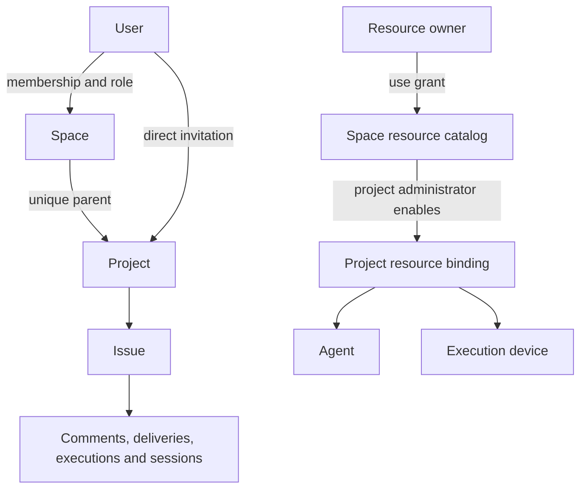

# Collaboration permission architecture and invariants

## Group work ownership and optional resource sources

A Thread's work owner remains its Group. Groups can configure Agents, crews and explicitly authorized execution devices independently. Threads may also use independently authorized resources from their exact current linked Project. Classification does not grant resource access, and Group roles do not grant Project, definition, model credential or device permissions. Personal stand-ins remain available independently of shared Group configuration.

Agents use globally unique binding IDs; the persisted binding's `cloud_project_id` identifies its real source. Definitions are not copied and execution records are not rehomed to that source. When a crew is enabled in multiple containers, `assignee_group_source_id` explicitly selects the owning Group or exact linked Project. The execution snapshot records `binding_owner_id` separately from the definition's original `owner_type/owner_id`. Revocation refuses execution rather than falling back to another container's crew or Agent.

Cloud Group crews reuse `Kind(CollaborationGroup)` and explicit `CollaborationGroup/chat_group` grants. Group automation reuses `ProjectAutomationRule/Run` storage and dispatch rather than a second configuration copy. Inline Group Agents use `CollaborationChatGroup/project_agent` grants; Team and Device grants use their original resource types with `chat_group`. New grants require Group administration and independent source sharing authority. Creating an Agent never grants device access automatically.

Execution lists authorize the actual owning Group. Reading does not join; stopping or starting execution requires a current Group write role, an executable Thread and explicit participation. Crew callbacks verify both the exact dispatch's private Runtime owner and the original initiator's current Group, Thread, resource and assignment-generation authority. Neither identity substitutes for the other. A trusted persisted dispatch may bind its own execution session without joining its Runtime owner or granting Group access; ordinary private Task association retains its original owner-access checks. Changing crews, assigning the same crew again, revoking a source or leaving the Thread prevents the old dispatch from publishing new assignments or starting execution. Cancellation settlement of the original private session remains available.

Creation, assignment, comment execution, queue consumption, continuation and actual runtime startup independently recheck the current Group, participation, exact classification, original resource authorization and private definition visibility. Resource authority uses locking current reads rather than reviving revoked permissions from a repeatable-read snapshot. Revocation retains the cancellation protocol: deny new dispatch and claims, and require Runtime confirmation for already running work. CP-01 through CP-20 remain unchanged. Service tests cover source selection and refusal; real cloud, database concurrency and desktop execution require their own evidence.

Project aggregation ordering has an explicit scope independent of the Thread's owning group. Moves still require current owning-group write authority. Project ordering additionally requires current Project Developer authority, actual classification, and a readable anchor under the same parent. Only private Project metadata `board_item_order` changes; foreign-group content, versions, owners and group order remain unchanged. The existing update transaction commits or rolls back the state change and Project order together. Ordinary group ordering retains its original contract. Authorized Project snapshots overlay ranks only for readable items. `test_project_board_order.py`, Native storage transaction tests and the existing desktop board-sorting checkpoint cover denial, persistence and reload without changing CP invariants.

The primary Rust Socket message entry dispatches by explicit container type; the marker grants no authority. Group sends lock the group root, current direct grants, accounts in numeric order and exact Thread before checking current write capability and participation. Messages, ongoing reminders, stand-in wakeups and content revisions commit together; completed Threads retain discussion. Message retries must match the original group and Thread. Post-commit reminder delivery rechecks current membership, participation and mute choices; group links address groups or Threads directly. Real cloud checkpoint acceptance is in progress; compilation or unit tests do not replace it.

Thread statuses are fixed by the actual group container type to `inbox/pending/in_progress/in_review/completed`. Group preferences cannot redefine statuses or their processing boundary, and valid free-text tags require no prior registry entry. Python validation/history, Native work-container projections and Rust preference writes/reads use the shared five statuses. Project aggregation adds those statuses while retaining complete legacy/external columns and unknown historical values without rewriting stored status. Filtering may include history; Thread status mutations accept only shared statuses and still check owning-group authority.

Cloud group creation atomically allocates a unique `groups/{id}` file namespace. Reads, signed URLs, copies and deletes validate stored object keys against the owning container. Moving and recursive deletion validate every source before the first storage operation. Missing namespaces and ambiguous old records are rejected without guessing, moving or removing objects that may belong to another group. `test_group_file_namespace.py` covers same-path isolation and unsafe-record rejection; cloud acceptance checks actual group creation and object contents.

Tools validate dispatched binding scope before choosing a source from the actual stored node. Private local groups need not appear in the project catalog. Backend mirrors retain backend routing; deleted private groups, invalid source metadata and storage errors terminate instead of triggering a backend attempt. Comment reads still validate the Thread's actual owning container. The read-only parent exception continues to require a direct relationship in the same container and current access. Assignment candidates resolve their work container; shared execution separately follows the resource-source and independent authorization rules above.

Historical participation uses only the persisted creator, current human assignee and actual discussion authors in the original container, intersected with active accounts and current target-group grants. Project rosters, reads and Agent ownership are not participation facts. Human chat authors must use canonical valid user ID strings; abnormal values such as `0007` are not aliases for user `7`. Repeated initialization preserves leaving and mute choices without restoring revoked grants. `test_thread_participation.py` covers exact authors, invalid identities and original-container boundaries; helper verification does not establish complete migration acceptance.

Local participants use device identity `0`. Leaving, rejoining and inviting the owner back preserve durable notification preferences and other metadata; only an explicit preference change unmutes. A deterministic participant key with a conflicting type, parent Thread or user is rejected. Archived groups retain readable participation without posting or Thread navigation. Local-store tests cover these boundaries, and the desktop scenario exercises muted leave/rejoin through the UI.

Unsent Thread creation drafts belong to the actor, not the shared group. Cloud drafts are isolated by backend and account across group boards, project creation and the home launcher; local groups use the device's local identity. Rejoining retains mute preferences, and only an explicit notification change replaces them while preserving other participation metadata. Rust group membership management and participant invitations prelock the actor and all target accounts in numeric order before formal authorization, which still validates current roles, active accounts and exact group grants. Identity comparisons use canonical bytes and reject aliases such as `07`. `group_management_locks_shared_accounts_in_message_order` covers real SQL lock waits, mixed collations, canonical identity rejection and actual participation-preference writes; it is not complete cross-runtime HTTP acceptance.

All group writes lock the owning group first; private conversation reservations cannot hold a Thread while waiting for its group. Messages and assignments with comments lock current direct group grants, then every canonically granted group account in numeric user order. They validate the active actor before locking the exact Thread and applying current role, participation and notification gates. Locking all currently granted accounts, including observers and muted members, before participation ranges prevents repeatable-read gap locks from cycling with another group's assignment-index insertion. It does not join or notify members, or look up unrelated accounts. Public comments use the same message path. Other content writes lock and refresh the Thread after group authorization. Agent activity startup and comment execution reuse the Thread execution gate: completed Threads cannot create misleading running activity, while discussion remains available. The existing CI database suite includes `thread_binding_mysql.py` for discussion/reservation and revocation ordering; `thread_current_facts_mysql.py` for deleted-Thread message/delivery rejection, recipient revocation and newly joined/unmuted/approved recipients; and `thread_cross_group_mentions_mysql.py` for explicit mentions, replies to muted stand-ins and actual assignment-with-comment handlers at observed account-lock waits under both isolation levels. Mute suppresses human reminders while preserving a joined stand-in's existing wakeup authority. These concurrency tests establish message and authorization ordering; personal execution has separate execution-scenario acceptance.

Creating a Thread from a project requires an explicit editable owning group. The Thread, initial participants and optional project link commit together. An outer lock on a derived role-precedence query is insufficient: repeatable-read can retain pre-revocation facts. The write transaction locks and refreshes the active actor, project root, parent-space relationship, active space, and direct and inherited grants before applying existing CP05 precedence. Project membership updates share the project-root lock; Rust classification changes lock old and target project IDs in sorted order. `thread_classification_mysql.py` uses real membership services for 16 concurrent cases covering direct/inherited removal/downgrade, both isolation levels and both commit orders. Revocation-first leaves no Thread, link or sequence change. Rust's `thread_classification_reads_current_permission_facts` verifies the current-permission SQL matrix sequentially, not Rust HTTP concurrency. Project PATCH remains Python-routed; this change does not migrate its ownership.

Private task-binding reads authorize the Thread’s actual owning group with current active-account and membership checks, without interpreting a group ID as a project. Members may read their own bindings before joining; this grants no execution authority. Results remain filtered to the caller’s private-task ownership, so other group members cannot read those bindings.

Project aggregation boards may return the current user's own execution previews for group Threads while bindings remain group-owned. Binding queries reuse current group grants for readable linked Threads, restrict results to this read's visible items, and always filter `task_user_id` to the current user. Revoking group access removes both the Thread and its bindings even if project management remains. `test_project_thread_aggregation.py` covers two executors receiving only their own bindings on group and project boards, and group revocation while retaining project authority.

Project boards aggregate existing project tasks and optionally classified group Threads. GitHub/GitLab projects retain their external task sources and add readable group Threads. Reads require an active account, a current direct group grant, and undeleted group, Thread and link records; each projection uses the owning group role. A project administrator cannot read another group through classification, and a project Viewer retains their separate group role. Responses preserve the owning group's `cloud_project_id/group_id`. Reading does not join the Thread or grant discussion or execution, and aggregation does not broaden access to private runtime bindings. `test_project_thread_aggregation.py` covers local and external task sources; local-store tests verify that classification, leaving and unlinking preserve Thread ownership.

Group Thread chat and public comments share one durable message stream; public comments do not create a second discussion record. Chat publication, Thread invalidation and human notifications share a transaction-scoped after-commit queue. Successful savepoints merge into their parent, while partial rollback discards only local events. Publication reads committed state and current authority through a fresh session only after the root commit releases its connection. Rollback and closing an uncommitted session publish nothing; repeated Thread changes coalesce by object. Single-connection tests cover once-only events/notifications, rollback and preservation of outer records after an inner failure.

Message links identify the owning group and storage source, independent of optional project classification. Anchor and page-cursor reads reuse current membership, exact conversation and undeleted-message predicates, including the same NULL/empty legacy root-scope filter. History mode returns only a bounded requested window and never catches up from an old anchor to the latest message in one response. Earlier/later reads are explicit pages; returning to latest restores live following. Reading and pagination never create Thread participation. `test_group_chat_navigation.py` and the desktop group scenario cover old-message access, repeated focus and observer/completed state; these do not replace cloud multi-user end-to-end acceptance.

Thread messages and public comments create ongoing notifications in their original write transaction for current active group members who have joined and have not muted the Thread, excluding the sender. Mentions bypass neither participation nor mute preferences and do not wake an unjoined member's stand-in. A joined member's human notification preference does not change existing stand-in execution authority. Completing a Thread preserves discussion subscriptions. Delayed delivery rechecks membership, exact Thread scope and notification preferences. Muting or leaving stops subsequent reminders while preserving readable notification history. Removing group membership, disabling the account or deleting the group or Thread excludes inaccessible group content from inbox lists, unread counts and read responses. Notifications grant no project or private-resource authority, and legacy project behavior is unchanged. `test_thread_notifications.py` covers both discussion entry points, subscription choices, delayed delivery, idempotency, the read endpoint and recovery. Rust group-notification MySQL coverage reuses the existing coordination-transaction CI suite.

Group realtime reading uses current group membership without requiring Thread participation. Group publication reuses the personal Runtime room joined during authenticated admission. Ordinary messages, cross-process publication and Runtime deltas/snapshots still select recipients from persisted container type, exact Thread ownership and current active group grants; group messages never use a public group room. All online sessions may receive readable group content, which clients filter by group and Thread; transport neither creates ongoing notifications nor joins a Thread. Rust group history subscriptions return bounded windows, and unsubscribe never leaves the personal room, avoiding a history-read versus temporary-room-join gap. Subsequent audience queries exclude removed members and inactive accounts, and lookup failures never fall back to public broadcasts. A delivery already selected before revocation may remain in flight; this mechanism is not an atomic barrier between revocation commit and network delivery. Legacy projects retain their existing message rooms. `test_group_chat_audience.py` covers independent database sessions observing committed revocation and real persisted Runtime projections excluding a removed member from the next packet. Socket.IO and Redis transport boundaries use test doubles; this is not real two-device or independent-process end-to-end verification.

Group writes lock and reread the group root, active account and direct membership grant in the transaction, sharing the group-root lock with membership changes. Archived groups are read-only. Draft delivery uploads, discard and finalization require current write authority and Thread participation before writing object storage. Completed Threads allow discussion but require reopening before execution. `test_thread_participation.py` covers unchanged persistence and storage after rejection. `thread_group_permissions_mysql.py` reuses the existing Issue-assignment CI schema and observes actual MySQL lock waits for both commit orders between comment writes and member removal, downgrade, leaving and archiving. These cases do not replace realtime subscription or execution revocation acceptance.

Independent chat groups have distinct resource identities and admission paths; project CP01–CP20 invariants are unchanged. Group membership provides Thread discovery and reading. Discussion, attachment or delivery submission, and execution additionally require current role capability, explicit Thread participation and existing private-resource authority. Historical participation consumes only persisted creator, current assignee and discussion-author facts from the original container, intersected with active accounts and current target-group membership. It never copies a project roster or creates group grants. Ordinary legacy comments cannot distinguish manual input from API publication; use their recorded authors and never infer participants from system, assignment or agent owners. Read those facts before remapping historical message/comment scope, and commit initialization with the Thread move and migration checkpoint. Retries insert missing participation only, preserving left/muted choices and finished state. `test_thread_participation.py` covers this boundary; this description does not claim complete migration or desktop acceptance.

An exact human-answer acknowledgement may arrive after execution completion. The existing Rust Socket.IO projection transaction requires matching device ownership, persisted answer, execution, project, Issue and completed Runtime turn. It locks Issue, execution and activity in that order, then publishes the Issue change after commit without repeating completion notifications. Execution status, version and sequence remain unchanged; input is never replayed. Later executions do not discard the original answer acknowledgement. Existing isolated MySQL migration checks cover reordering, duplicates, identity rejection and retry boundaries. This reconciliation is owned by the Rust event projection. CP01–CP20 remain unchanged.

Manual cloud startup retains the durable dispatch queue so transient failures and Executor restarts cannot lose accepted requests. Manual recovery requires no assignment, project subscription or intake enablement, while retaining current account, role and Issue authorization; accepted or deleted work is never replayed. Automatic dispatch retains current assignment and intake-policy checks. `manual_issue_startup_intent_survives_restart_without_assignment_or_intake` and the existing real database fault/restart E2E cover recovery; CP invariants are unchanged.

When a queued stand-in Issue message starts execution, it rereads the server's current Issue `permissions.execute`; a read-only role or missing execution permission prevents model startup. This check is independent of assignees and intake settings, and restoring permission preserves the existing conversation. `queued_stand_in_turns_recheck_current_issue_execution_permission` covers revocation, missing permission and restoration; CP15 is unchanged.

Read confirmations still validate current Issue access and advance only the reader's cursor without changing Issue version/time. Automatic receipts carry the observed content revision; one atomic cloud update is bounded by `min(current, observed)` and remains monotonic, while local unread clearing uses the same observation bound. Stale requests do not consume later content or notifications. `test_delayed_read_acknowledges_only_the_observed_public_content`, API cursor regressions and real MySQL desktop coverage protect this transaction; CP invariants remain unchanged.

Explicit manual delegation and persistent conversations are independent of automatic intake. Role enablement, project subscriptions, tags, the current assignee and historical assignments or mentions do not gate starting, continuing, retrying or publishing replies. Omitted role selection retains an existing project role or uses the default role when no project configuration exists; starting a conversation never reassigns the Issue. Current assignments to the owner retain reception receipts, while missing assignments do not block execution or acknowledge another recipient's work. Requests still match the persisted conversation identity, and execution and publication validate the current role, account, project and Issue access. Automatic intake and background follow-ups still select work using the user's configuration. `issue_conversations_do_not_depend_on_intake_or_current_assignment`, `manual_issue_work_needs_no_assignment_or_intake_subscription` and the existing Issue-conversation desktop scenario cover this boundary; CP invariants remain unchanged.

Stand-in Issue reservations use a persistent identity independent of assignment grants. Existing binding writes lock the Issue and reread the owner, active owned device and live bindings, preventing another device or native task from occupying the same identity. Mentions and assignments share routing checks. The identity grants no execution, source or private-transcript authority. Real two-device MySQL concurrency coverage and `test_issue_conversation_reservation_is_device_independent_and_idempotent` protect this transaction; all CP invariants remain unchanged.

Persistent stand-in Issue conversations preserve all CP invariants. Conversation identity is independent of its triggering assignment or mention: reassignment, unassignment or deletion of the original mention retains conversation history, continuation and public replies. Publication revalidates the current member, project, role and exact owned Issue task binding on an active owned device; foreign devices/tasks and revoked devices are rejected. Public messages expose no private Runtime address; replies select only the original role without granting private transcript access. Durable wakeup inboxes are recipient-only and sources are revalidated before dispatch. Self mentions create no human reminder. `test_stand_in_issue_replies.py`, Executor public-message filtering tests and the existing desktop conversation checkpoint cover these boundaries.

Memory-review completion must not automatically start an ordinary primary conversation, which would restore capabilities outside the memory/progress allowlist. Host-identified scheduled memory reviews retain their original task results and arrangement status but do not enter generic generative result delivery, including success, failure, cancellation and restart recovery. Ordinary scheduled and delegated reporting is unchanged. `memory_review_completion_never_starts_an_unrestricted_parent_turn` protects this boundary; CP invariants are unchanged.

Only owner rule management additionally lists legacy fingerprints not referenced by current rules, without guessing text or scope. Model reads still return authorized semantic rules only. Legacy deletion requires the owner, version and exact forgetting timestamp, and rechecks for rule references inside the same immediate transaction. It reuses owner deletion RPC and is unavailable to unattended review. CP invariants are unchanged.

Private project-coordinator conversations reuse the shared proactive formation and semantic forgetting policies without requiring an explicit save command. The host still fixes the current member/project scope; saving private memory never authorizes publication to shared project records, and read-only delegated workers still lack memory writes. Runtime context separates policy from untrusted memory data. `project_memory_policy_preserves_private_context_and_semantic_forgetting` and `project_memory_tool_reuses_formation_and_forgetting_without_widening_scope` cover this boundary. CP invariants are unchanged.

Following the user's explicit choice, correction or forgetting retains a minimal negative rule: only the compact memory fact, scope, version and associated fingerprints, not original conversations, attachment bodies or evidence excerpts. Rules are separate from active memories. `list_memory_forgetting_rules` reuses current source/role authorization filtering and complete pagination; background access still requires a live review run. Models must avoid relearning the specific meaning, without treating rule targets as answerable facts or executable instructions; storage continues enforcing exact evidence fingerprints. Only owner management can delete rules, not unattended consolidation. Deletion atomically releases fingerprints no other rule references, and explicitly restoring a matching memory removes its rule. Isolated native verification using the current account covers cross-conversation paraphrase suppression, learning an independent new fact, and relearning after owner rule deletion; this is not deterministic universal semantic enforcement. CP invariants are unchanged.

Direct owner conversations with a stand-in role can recall memories from that role's currently authorized sources. Pausing new intake does not revoke source grants. Recall narrows grants to the current role before filtering candidates; it cannot borrow the primary or another role's project, account or resource authority. Source-bound work still recalls only its exact source, and other roles' private memories remain isolated. `role_memory_recall_includes_own_connected_projects_without_borrowing_grants` covers paused roles, project stores, cross-role denial, exact sources and grant revocation. CP invariants are unchanged.

Scheduled memory consolidation uses independent arrangement routing only for the primary stand-in's exact `memory_review` template, outside ordinary intake. Pausing new work therefore retains authorized memory consolidation; ordinary calendar work still follows intake pause and confirmation policies. Run version, arrangement enablement, owner and evidence-source checks remain unchanged. `memory_review_due_skips_empty_history_and_routes_changed_history_independently` covers scheduled routing while intake is paused and empty-increment skipping. CP invariants are unchanged.

Background memory review reuses the isolated Codex process and restricted model capability catalog, disabling Shell, patch, plugins, web search and sub-agents while retaining only the run-bound stand-in evidence tools. Tool orchestration uses native Code Mode, separately from tool-free text generation; Code Mode does not grant disabled execution capabilities. Following the user's product-policy decision, only explicitly allowlisted evidence reads, internal memory saves and progress tools receive native per-tool automatic approval. The endpoint default still prompts; unlisted tools are not exposed, and inherited unrelated endpoints and per-tool approvals are removed. Server-side run identity, source authorization and evidence checks remain authoritative. Other conversations and external-write approval policies are unchanged. Focused `memory_review_boundary` tests protect configuration boundaries, and a catalog contract requires the allowlist to exactly match the guarded memory catalog; actual native tool exposure still requires isolated Electron verification.

Stand-in model recall and context injection filter memories through current saved source grants. Source-bound turns cannot borrow another identity's connection grants. Owner management lists and deletion retain disconnected records for cleanup; management visibility does not grant model recall. `memory_recall_drops_revoked_sources_but_owner_can_still_delete_records` covers search after connection revocation, identity isolation and deletion. CP invariants are unchanged.

Personal recall of project-coordinator memories also requires a currently connected project with the exact ID and store, respecting project exclusions; owning the memory record does not grant project-source authority. Authorized project-bound turns retain their original scope, and owner management/deletion remain available. `personal_recall_requires_a_current_grant_for_project_coordinator_memories` covers no grant, same ID in another store, a matching grant and subsequent exclusion. This saved-source check does not replace live membership authorization in project services.

Spaces define the administrative boundary. Projects inherit space membership by default. Resources participate through explicit use grants and project bindings. Lists and mutations share one server-side authorization policy. This document is a human-approved product contract, protected by tests.

Project details reuse the project list's permission query and response construction (CP13), preserving inherited space roles and permission sources. Personal stand-in settings are saved on the selected Executor. Saving and enabling do not query cloud permissions, agent catalogs, model catalogs or workspace readiness. Personal Issue tasks and stand-in tasks share the same Issue execution permission, without project device bindings or project environment initialization. The server still checks the current user’s execution permission when binding a cloud Issue. The CI-covered `stand-in-personal-task` desktop checkpoint verifies both manual and automatic tasks complete on the current device for an ordinary member with no device bindings.

Primary and silent background stand-ins reuse the current user’s authorized Wework capabilities. Project tools retain server-side resource and dispatch authorization; external tool writes retain native review. Events and transcripts confer no authority. Task orchestration is bound to the current account and device, never answers user input or approvals, and never elevates resumed tasks. Batch dispatch revalidates roles, sources, assignments and enablement time before execution.

Direct owner conversations with personal stand-ins default to Codex's native Guardian review for technical operations. Start, resume, fork and subsequent turns share the same reviewer configuration. Executor does not answer approval cards or convert business answers about timing or scope into execution permission. Read-only execution boundaries, connection scopes, business-operation `askBeforeAct`, configuration confirmation and login authorization retain their original paths. Human-review policies for external-source and delegated work remain unchanged. Native tool approvals use structured protocol metadata; ordinary business forms and URL authorization remain user interactions. CP01–CP20 are unchanged.

Project coordination records responsibility by project, group, enabling member and hosting device. Each project group has one enabled binding; enable, stop and explicit takeover compare the current generation. Saving the binding does not create a private conversation. Project membership, Agent use and device use remain independently authorized. Dispatch and model task credentials use the enabling member as actor, while definition ownership, device ownership and Runtime identity retain their separate responsibilities.

Project coordination commands reuse Issue assignment, group preparation and the existing execution queue. A server-generated immutable input digest binds each command ID; accepted execution records are returned as receipts before mutable checks. Replays cannot change input or create another execution. New admission checks the binding, project/group versions, member and resource authority in one transaction, and compares the Issue version to preserve concurrent edits and existing assignments. Authorization reads reuse that transaction’s connection; single-connection MySQL regressions cover complete admission, resource revocation, duplicate commands and rollback after a write failure. Claims and manager decisions also revalidate the current binding. Independent short authorization transactions observe committed revocation without changing the caller’s transaction. Running work records cancellation requests and waits for Runtime termination confirmation. `test_project_coordination_authority.py` and the CI-registered `project_coordination::mysql_tests` protect these server-side protocol contracts.

Before starting a Codex or Claude turn, project coordination uses the request's execution credentials to validate the current command and resource authority, then compares the complete persisted command context. This read-only check dispatches no work. Subsequent manager rounds retain the enabling member's original identity within the current process; absent credentials must never be filled from the device's login account. These credentials are excluded from the task index. After process recovery, missing identity must be restored through authorization before dispatch can continue, without changing the actor. Receipts read the first accepted execution fact; current authorization reads the latest attempt to preserve the existing isolated retry mechanism.

Local projects reuse the original group execution queue, retaining Issue-level execution occupancy and native approval, model and workspace policies. Command receipts reference existing execution rows without introducing another queue. An assignment identity survives manager, member and human-delivery handoffs; explicit reassignment invalidates it. Claims, start requests, actual Native startup and subsequent rounds check the current Issue and binding. An unstarted Native queue entry releases occupancy through the existing cancellation callback after durable removal. Running tasks receive stop requests and wait for actual termination evidence. Human subtask creation and assignment also record the original enabling member and retain the original delivery workflow.

The owned DSH Router aggregates project events programmatically; coordination in the project leader conversation remains inactive until explicitly enabled. Silent assessment uses a separate ephemeral Codex turn with tools disabled. It receives only authorized shared project, Issue and published comment fields, excluding private conversations, memories, Agent prompts and account configuration. The model returns structured intents; the Executor persists them and submits concrete work through the existing queue. It never answers human inputs or approvals. Requests for clarification are visible only to the enabling member and link back to the original Issue. Publication remains explicit.

No-tools assessment reuses Executor's existing isolated Codex runner, restricting the capability catalog and tool registration at process startup and exiting after completion. Thread overrides in a shared process cannot establish this boundary alone. Model selection, provider authentication, cancellation and the original task queue retain their existing paths. Model protocol verification checks both top-level and incremental tool definitions in the input.

Local project approval compares the local session identity with the actual execution Agent's creator; dispatch and execution retain the enabling member as audit actor. Group approval resolves that creator through the current execution ID, Agent messages on the same Issue and the current project's Agent records. Missing or ambiguous matches expose no approval action; neither the group leader nor a historical run substitutes for the current execution. Cloud approval retains server authorization. Desktop verification approves work through the original Issue, reads its result and accepts completion as the user.

Background contexts and auxiliary tasks are isolated by binding generation, so late reads, registration and callbacks cannot overwrite a replacement binding's batch. Unaccepted intents rejected by version conflicts or an inaccessible Issue refresh current source facts before reassessment; accepted commands recover their original receipts first. Interrupted read-only assessment can be repeated without replaying business operations. The `project_router` regressions protect generation isolation, real queue receipt recovery, archived Issue recovery, source windows and status authorization. The desktop CI `project-coordination` checkpoint covers explicit enable, clarification in the original Issue, preserved approvals, takeover and stop.

## Roles and inheritance

The three administrative roles are administrator (`Maintainer`), member (`Developer`) and read-only member (`Viewer`). Ownership is a separate space relation. The read-only `Owner` response label is derived from that relation and cannot be assigned through membership APIs. Creating a project explicitly adds its creator as a project administrator; creator identity is audit information.

The new project, parent-space grant and creator's administrator grant are written in one transaction. Insert the new project's parent grant directly instead of locking an absent grant, avoiding MySQL gap-lock deadlocks when independent spaces create projects concurrently. Resource grants use an atomic insert or update by their unique resource/entity identity before locking the existing record, preserving the grant ID, approval history and outer transaction boundary. The MySQL permission regression suite covers concurrent project creation, concurrent authorization of distinct and identical resources, the unique parent and use permission after creation.

| Space identity   | Inherited project | Restricted project         |
| ---------------- | ----------------- | -------------------------- |
| Owner            | Administrator     | Administrator              |
| Administrator    | Administrator     | Administrator              |
| Member           | Member            | Direct invitation required |
| Read-only member | Read-only member  | Direct invitation required |
| Project guest    | Direct grant      | Direct grant               |

Space owners and administrators always administer child projects. For other users, a valid direct project role takes precedence over inherited space membership, allowing promotion or demotion within that project. Removing the direct grant restores current inheritance. Updating only a member's project responsibilities neither creates a role override nor approves pending or rejected grants. Public reading does not make visitors eligible project participants.

## Protected contracts

Local participation discovery uses a composition-verified scope: native owner `0` and the current verified account principal. This is not a global user alias and grants no cloud authority. Quick filters, pending work, the read-only native pending hint and the local inbox share this scope. Empty idle workbenches add no inbox polling; failed hints remain unknown. New comments use the composition's actual current author without rewriting historical senders. Reply claims still require exact `recipient == persisted comment.sender`: recipient `0` with author `7` requires an explicit transfer, not an alias-based claim. Existing group, read and task-start permissions retain their authorization identity rather than being overwritten by storage owner `0`; CP01–CP20 remain unchanged.

Question reports and blocking updates require both an actual caller-owned active/default Device and the source activity's persisted execution ID, exact project, Issue, Runtime task/device and canonical `executor_owner_user_id`. An owned Device with the same name does not prove ownership of someone else's Runtime. Manual-only bindings or group Runtime activities without matching canonical execution evidence return 409 rather than guessing an owner or deriving identity from a conversation name. Question IDs use the persisted source device identity so changing an alias cannot create another question.

The reporting source may explicitly `set_blocking` only with current Issue Developer access and matching persisted reporter, original Runtime task and caller-owned original device identity. This grants no assignment, cancellation or reply authority; the payload rejects recipient and cancellation fields. Under the Issue row lock, the update requires pending status and the exact version, changing only the blocking flag, version, update time and a `blocking_changed` event while preserving recipients, responsibility and the handoff clock. Ordinary assignment authority and native operation approvals remain unchanged. Missing source evidence is not inferred; CP01–CP20 are unchanged.

An exact assigned business answer continues the trusted persisted execution's original authority; it does not grant the respondent new private Agent use. The recipient independently retains current Developer, Issue, original-thread and Runtime-binding checks. Admission and queue consumption revalidate the original assigner's current resource grants while attributing the answer to its actual author. A binding without original-authority evidence is rejected rather than inferring authority from its Runtime owner or respondent. Ordinary comments and new executions are unchanged. `test_human_reply_execution_authority.py` covers cross-person private Agent continuation, ordinary-use denial, revocation, wrong recipient/thread/Runtime, queued identity and missing-source denial. No private Runtime or credential access is granted; CP01–CP20 remain unchanged.

Issue human handoffs preserve the existing membership and native-approval boundaries. Reporting a question requires current Developer access and a caller-owned Runtime attached to the same Issue activity. Routing requires Developer access plus the responsible participant, group leader or Maintainer authority; reporting alone grants no routing authority. The recipient independently needs current Issue access and comment capability. The Issue row serializes versioned transfer and exact-message reply claims. An assigned person can answer in the shared original thread without receiving the source owner's private Runtime or credentials. Read receipts do not settle questions, and queued replies are not delivery acceptance. Local SQLite and cloud metadata retain the same request identity and handling states. No CP invariant changes.

<!-- prettier-ignore -->
| ID   | Invariant                                                                                                                                                                                                                                                                                                   |
| ---- | ----------------------------------------------------------------------------------------------------------------------------------------------------------------------------------------------------------------------------------------------------------------------------------------------------------- |
| CP01 | A project has exactly one active parent space; containment is separate from membership. |
| CP02 | Space owners and administrators administer all child projects, including restricted projects, regardless of creator. |
| CP03 | Ordinary projects inherit members and viewers; restricted projects stop those two sources. |
| CP04 | Project invitations never grant access to parent members, resources or sibling projects. |
| CP05 | Space owners and administrators retain project administration; otherwise valid direct project roles override inherited roles, and removing a direct grant restores inheritance. Pending, rejected, invalid, inactive and archived sources grant nothing. |
| CP06 | Creator, assignee, group leader and runner identity do not grant human administration. |
| CP07 | Viewers can read authorized spaces and projects but cannot edit, comment, assign or execute. |
| CP08 | Project rosters include inherited and direct members, effective/direct roles and sources. Space inheritance stays read-only; project administrators can set or remove a direct project role for inherited members. |
| CP09 | Enabled shared agents are visible to project readers; explicit private definitions remain creator-only for visibility and use; readiness problems have explicit states and reasons. |
| CP10 | Resource use never grants source-definition editing or access to private credentials. |
| CP11 | Project dispatch requires valid Agent/device use authority and an enabled project binding; valid legacy installations retain original-project authority without granting catalog or source-definition access. Personal tasks and stand-ins using their own Executor do not require project device bindings. |
| CP12 | Fixed, pooled and user-selected project dispatch does not bypass project resource authorization; personal tasks and stand-ins use the personal execution path. |
| CP13 | Lists, details, creation, updates, assignment, comment execution, automation and claims use the same policy. |
| CP14 | Issue reads check project access before open/related security; project administrators can read all child Issues. |
| CP15 | Execution checks current Issue access and execution capability. Project dispatch also checks binding and resource grants; personal tasks and stand-ins do not require project device bindings. Snapshots are not durable authority. |
| CP16 | Revocation prevents new dispatch and claims; running work requests cancellation and waits for Runtime confirmation. |
| CP17 | Removing a space member revokes membership and all direct child-project grants; further guest access needs a new invitation. |
| CP18 | Removing a space resource grant invalidates every child binding while preserving history and exposing the reason. |
| CP19 | Space ownership can transfer without changing historical creator identity; project administration is independent of creator. |
| CP20 | Authorization exposes sources and denial reasons; the UI cannot grant capabilities rejected by the server. |

Stand-in, connection-message and Issue-dispatch executions use Codex native baselines: automatic mode inherits `:workspace` for normal file reads and workspace/temporary-directory writes; confirmation mode inherits `:read-only`. Both retain network access so enabled plugin resources and CLI configuration remain readable. Filesystem readability does not authorize extracting credentials or accessing unrelated private data, and source content cannot grant authority. Operations beyond the baseline require the current native reviewer: AI review in automatic mode and one-time user approval in confirmation mode. Approval must actually escalate that command; denial must prevent execution. Do not use a global root `deny` that survives approval, or turn a single approval into persistent authority for later commands. This execution policy is explicitly user-authorized; CP01–CP20 server-side membership, resource-use and credential-isolation contracts remain unchanged.

The `stand-in-workspace` desktop E2E uses real Codex, shell and GitHub CLI to verify plugin resource reads, synthetic credential-free CLI configuration reads, networking, default rejection of outside-workspace writes, actual elevated writes after AI approval, and non-execution after denial. `stand-in-action-confirmation` uses a real `connection_work` origin to assert the file is absent before user approval and created afterward. Only model and reviewer-model responses are synthetic; the tests do not read personal login files or claim to verify real GitHub authentication.

GitHub/GitLab personal and repository sources use a stricter native boundary: local analysis and edits inherit `:workspace`, while model Shell network access is denied by default. Account-bound read-only MCP tools run on the host; each external write requires native one-time human approval. Role confirmation settings cannot relax this boundary. Merges require explicit delegation and the reviewed head SHA. Inbox reads, acknowledgments and takeovers check the user and device generation; Webhook verification grants no execution authority. CP01–CP20 remain unchanged. Executor Git permission contract tests cover networking, reviewer and tool approval; the `stand-in-git` CI scenario covers real internal service protocol boundaries without claiming live provider login verification.

## Resources and execution

Issue creation and automation event dispatch neither scan nor prepare the global execution queue. After dispatch commits, they read only the executions associated with those runs and asynchronously notify their target Executors, using the actual owner's device address for shared runners. Notifications carry no work or execution authority; consumers and independent maintenance jobs retain queue preparation and claiming.

Execution and discovery use separate resource resolution scopes. Resolvers can declare whether they participate in execution checks, preserving existing behavior by default. Request-local group caches isolate the scopes so discovery results do not become execution authority. Extensions retain project, Issue, resource-binding, whitelist, and revocation checks.

Sharing delegates use, not source editing. Project administrators manage bindings and allowed project configuration; resource editors manage the original definition. Actor, definition owner, device owner and Runtime identity remain separate. Model and connector credentials retain their original access rules. Project session reads authorize one bound Issue session, never the owner's entire device catalog.

Desktop personal sessions and Issue-bound sessions both register `wework_space`; cloud links in the prompt no longer determine tool availability. Codex uses the same native deferred tool discovery as the built-in browser; Claude enables native tool search by default. Initialization supplies brief routing instructions without reading projects, Issues or comments; detailed workflows load with tool descriptions. Without a binding, `get_current_context` returns `bound: false`; `list_spaces` and explicit target arguments discover resources. Bindings supply defaults only. Unbound contexts reuse transport only when the backend, credentials and capability surface match exactly; bound grants always receive independent contexts. Follow-up turns reload threads only when MCP configuration or approval boundaries change, preserving background processes. Process restarts and thread unloads discard loaded configuration records. Tool calls still enforce resource permissions and dispatch scope. Human assignments retain personal execution identity; public stand-in Issue conversations use their validated owner and role identity independently of a human assignment. Dispatch IDs correlate workflow activity without granting agent roles. Explicit agent roles still enforce dispatch scope; invalid roles or missing project/Issue bindings reject startup. The `project-space-tool-discovery` desktop CI checkpoint covers deferred discovery, explicit reads and persisted comments from a personal session. MCP unit tests cover initialization without data reads, authorization denials and dispatch boundaries.

Personal tasks created from an Issue use the original project and Issue as their default context. They can explicitly target any project and Issue accessible to the current user through `wework_space` to read, update, assign or comment under that user's actual permissions. The conversation's starting context is not an additional access boundary; the server continues to authorize the target project and Issue. Accessing another project or Issue does not rebind the original session or deliveries. Issue conversations use one collaboration context without extra write restrictions based on private-task or stand-in identity. Comments, assignments and deliveries required by the user's task and configured responsibilities need no separate confirmation merely because they write to a shared Issue. The built-in collaboration MCP `wework_space` is exempt from tool approval at both server and per-tool levels, including automatic and confirmation stand-in modes. External tools retain native approvals; collaboration retains actual server-side permission checks and dispatch role boundaries. The `stand-in-personal-task` desktop checkpoint also asserts that completed collaboration reads, comments and assignments produce no AI review records. `wework/src/features/todo/workItemRuntimeContext.test.ts` protects this context contract. Dispatch executors default to their assigned Issue and execution tools, with the direct-parent read exception below; managers retain project-level management access. `executor/src/task_runtime/mcp/issue_access_tests.rs` covers same-project and cross-project local reads and writes, cloud reads, writes and comments, server read/write denials and unchanged default context. Existing MCP contract tests protect dispatch role boundaries.

Remote execution distinguishes a target-device model reference from an interface explicitly submitted for one task command. References always revalidate the target device’s current model registry. Submitted interfaces are bound only after server-side Runtime RPC authorization to the authenticated actor, actual Runtime device, task and command; client-declared provenance is not authority. Interface credentials remain in that task command’s in-memory binding, never the target’s global model registry or task snapshots. Continuations reuse the same binding; after a process restart, missing credentials require an explicit model reselection. Replaying a command cannot change its interface configuration. CP01–CP20 remain unchanged.

Queued work revalidates current permission at claim time. Device liveness, model readiness and capacity are execution conditions, not permission sources. Project dispatch routing policies use the project's authorized device set.

Comment admission validates the actor's project, Issue and Agent use authority. Queue consumers prepare Runtime configuration, models and runner affinity; failures belong to the execution record. Pending intent grants no device access, and both preparation and claims revalidate resource authority. `test_queued_comment_execution.py` covers admission denial for Viewers, private definitions and revoked resources, plus revocation after admission, configuration failure, manual approval, offline claiming and replies to unclaimed sessions. These tests use isolated databases and synthetic execution state rather than a live Runtime.

Personal stand-in connection plugins retain the existing external-source restrictions and operation confirmations. Neither new `connection_work` nor historical `dingtalk_work` can obtain additional authority from source content. Stand-ins run as independent identities without personal or project agent references. Migration intersects the former project boundary with the selected scope, preserves exclusions and confirmation policies, then removes reference fields without expanding grants. `personal_stand_in_contract` covers legacy formats, idempotent persistence, version conflicts and scope intersection; CP01–CP20 remain unchanged. Connection memories are isolated by user, provider, account and resource; DingTalk migration preserves existing scopes and deduplication identities. `stand_in_identity_contract` covers migration and provider isolation, while Codex confirmation contracts cover both origins in default and named Homes.

Managed `wework_control` does not grant personal control to `stand_in_identity`, `connection_work`, `dingtalk_work` or project-delegated executions. They retain their scoped tools and operation confirmations. Validation also checks the persisted source conversation identity, so omitted origin fields do not grant personal authority. Workbench-control contracts cover injection and source identity; HTTP regressions cover stand-in/control surface isolation and session closure. Personal callers may continue authorized project or stand-in targets while the target retains its original identity rather than the caller's personal authority. Cross-device continuation reuses existing metadata, transcript authorization and send operations without new authority or remote-control exemptions. The send entry reads original identity, workspace and Runtime through the existing transcript authorization chain with an `identityOnly` metadata projection, without loading message bodies or occupying history CPU workers, rejects archived or deleted targets under the same eligibility rules as single-task lookup, and uses the frontend materialization compiler; continuations share existing project/Issue visibility and execute permission services. The owning Runtime preserves delegated roles and project/Issue binding, and stand-in confirmations remain effective. Contracts cover forged sources, retained target scope, device denial and Backend read/write rejection, without a direct-write RPC fallback. CP01–CP20 remain unchanged.

A cloud project binding does not change the dispatch location of a local APP conversation. The existing `/runtime-work/materialize` compiles native or Team intent and checks resource and project execution authority before local Runtime creation or continuation. Both paths share current project/Issue visibility and execute checks; project-only bindings without an Issue also deny Viewer execution. Native credentials remain device-owned; Backend still compiles Team and cloud model configuration. Remote operations retain the APP remote-control policy. An already authorized IM send carries its internal APP messaging grant into original-identity reading, with device ownership still checked; ordinary HTTP reads and sends cannot grant it. Regressions cover authorized IM continuation, ordinary denial, Viewer/revoked/hidden-Issue denial for both creation and continuation, and local APP cloud-project attachment creation, duplicate continuation and UI follow-up.

Conversation creation accepts intent fields from the shared creation contract; trusted device channels or existing Backend compilation provide execution identity and model credentials. Conversation references cannot fork delegated executions into personal runs. Remote creation retains Backend device ownership, resource permissions, capability negotiation and APP control policy. Local project-space bindings remain owned by local storage and executors. Creation/control regressions cover these boundaries, binding cleanup, proxy policy and source isolation.

The background MCP bridge invokes only read tools of the current provider's declared dependencies, without model turns. Ownership checks use exact plugin identities and, for shared app servers, connector identities. Wework adapters may declare precise read contracts for legacy tools without annotations, but cannot override explicit write or destructive annotations. Call arguments cannot grant capabilities. Background elicitations are cancelled and fail explicitly without granting consent or changing stand-in execution confirmations. `connection_mcp_tests` covers ownership, read boundaries, dependency changes and cancellation/deadline cleanup; the `stand-in-mcp` desktop checkpoint covers cross-dependency rejection by the actual Executor.

Plugins without MCP can reuse existing `localAuth.tool` declarations through the generic CLI read transport. Executable identity, Connector, command prefix and allowed arguments come from the exact dependency and the installed Wework adapter's read declaration. Callers cannot supply commands or grant parameters; neither shell code nor Skill prose is executed. DingTalk collection now uses this path and its dedicated read RPC has been removed. Replies retain existing source binding and confirmation requirements. Generic CLI contracts and the CI-registered `stand-in-cli` checkpoint cover write rejection, argument injection and removal of the old endpoint.

### Local delivery metadata for external work

Stand-in delegation and external-source work receive only `WEGENT_EXECUTOR_BINARY`,
`WEGENT_TASK_ID` and `WEGENT_TASK_WORKSPACE` in the current thread's shell environment
for local artifact declaration. This metadata never enters the shared App Server
process. Task credentials, Runtime and Skill identities, Connector broker credentials
and Backend Task identity remain unavailable to the external-work shell. Local
declaration validates the canonical workspace boundary, reads the file to compute
its hash and returns a local path without contacting Backend. Native review,
permission profiles and MCP scope remain unchanged; CP01–CP20 are unchanged.
`task_artifact_env_tests` protects the exact three keys, thread isolation and
start/resume/fork permission boundaries; the `dots-closed-loops` desktop checkpoint
verifies real delegated declaration and opening delivery from the original primary.

Task working directories follow persisted execution intent. An explicit
`workspace_source=local_path` retains its directory even inside a Git worktree;
it is not converted to a managed worktree or promoted to the repository root.
Project grouping and Git properties do not define execution ownership. Managed
worktrees, legacy tasks and standalone chats retain their original constraints.
`workspace_identity_tests` uses real Git worktrees to protect get/list consistency
and the original metadata allowlist.
Historical Stand-in records recover their original current-workspace intent only
when source is absent, original identity/project bindings are complete and
consistent, and the execution directory exactly matches a recorded root. Reads
neither consult current settings nor rewrite the index; explicit sources,
conflicting bindings and incomplete records do not enter this recovery path.

### Read-only parent context for child Issue executions

Dispatch executors have one read-only exception to their assigned Issue scope:
they may explicitly target the current child's direct `parent_id` through
`get_board_item`, `list_board_item_comments`, `list_deliveries`, `read_delivery`
and `download_delivery_asset` in the same project. Every call reads the current
relationship from the existing provider and retains the parent's current project
permissions and open/related visibility. The relationship grants no access by
itself and does not relax CP14. Reparenting or access revocation denies subsequent
reads according to the current relationship and permissions.

This exception excludes ancestors, siblings, unrelated Issues and all parent
writes, comments, assignments and delivery mutations. Deliveries must belong to
the parent Issue and downloaded assets must belong to the requested delivery.
`get_current_context`, stage context and delivery writes remain bound to the
child. Full parent execution conversation history is outside this scope.
`mcp/parent_issue/tests.rs` covers local reads, relationship changes, write denials
and delivery ownership, with cloud protocol integration tests preserving original
credentials and server-side access denials.

The existing `local_task_mcp_contract` suite and Executor CI run real-process E2E
user stories: a child agent reads parent requirements, comments and delivery files
while parent comment writes are denied and the child binding is preserved; the
same running MCP session rejects the old parent after reparenting, permits the new
parent read-only and continues to reject ancestors, siblings and cross-project
Issues. Executor, MCP, SQLite and delivery files are real. Cloud revocation is
covered separately by protocol integration tests, not real cloud E2E verification.

## Management surfaces

Subtree archive and restore authorize every descendant for content editing before any Issue mutation, upstream close, or execution cancellation, preserving CP13/CP14. An editable parent grants no authority over private descendants. Denial returns a uniform 404 without descendant details and preserves versions and queued work. Administrators retain access to all descendants. `test_loop_item_archive_permissions.py` covers native projects and GitHub/GitLab protocols; the web `collaboration-project-views.spec.ts` checks real-member denial, unchanged persistence, and administrator archive/restore. Existing CP invariants remain unchanged.

Each cloud Runtime transcript packet checks current project access, Issue visibility
and durable session binding in an independent short transaction, preserving CP14 and
CP15. The authorization Session closes before device RPC and leaves the caller's
transaction unchanged; repeating SELECT or refreshing ORM objects cannot advance an
old MySQL REPEATABLE READ snapshot. A separately committed grant removal or change to
related-only visibility returns 404 before the next RPC. The existing CI MySQL permission
suite covers omitted-version and v1 callers with separate request, writer and observer
Sessions, asserting that the old snapshot survives, current access is denied and only
the first device RPC occurred.

Personal Runtime tasks linked to an Issue are returned only to their owners. Change-request binding also requires task ownership. Board snapshots, paginated task bindings and per-Issue binding lists filter by the current user; project administration does not grant access to another user's personal tasks. A manual binding alone requires owner authorization for transcript details and search. Recorded dispatch executions and collaboration member activities retain their durable execution authorization. `test_project_board_snapshot_queries.py`, `test_runtime_session_device_identity.py` and the Rust binding query test protect these boundaries. Opening an archived task checks the Runtime's explicit archive state and asks the user to restore it first.

HTTP and MCP board bulk ordering enforce CP07, CP13 and CP14 together: Viewers cannot reorder, and other members may submit and receive only Issues they can read. Reordering visible cards exchanges only their slots in the global sibling sequence, retaining invisible members' positions. For non-administrators, inaccessible or nonexistent request targets return the same 404 before any write. Project administrators retain their existing access to all Issues. `test_loop_item_reorder_permissions.py` covers roles, default security, same-status and cross-status ordering, and unchanged persistence after rejection.

Users with project access and no parent-space access can still open their authorized projects from the unified sidebar. The parent supplies a grouping label only: it grants no space home, settings, membership, resource catalog or unauthorized sibling access. Public Viewers and directly invited project guests follow the same rule. Switching local/cloud spaces or reopening the current space does not change the authorized global project navigation.

- Space settings: members, projects, shared agents/devices, space groups and ownership transfer.
- Project settings: membership mode, effective roster and sources, guests, enabled resources, groups, automation and Issue security.
- Personal resources: source definitions, devices, credentials and sharing grants.

The personal catalog, `GET /api/v1/resources?include_readiness=false`, discovers active Agents and devices owned by the current user. Agents project only identity and name metadata and return `status: unchecked`. This read does not resolve Bots, Ghosts, Shells, Models, runtime credentials or model-dependent group permissions, and omits unused `workspace_ids` and per-Agent device-ID expansions. Devices retain the identity, capabilities and online status required by selectors. Shared Agents still use the space-authorized `/api/v1/workspaces/{workspace_id}/agents` catalog; resource visibility does not expand.

Space Agent discovery uses `GET /api/v1/workspaces/{workspace_id}/agents?include_readiness=false`. It retains workspace visibility, source-edit permissions and ownership metadata, batches owner/device/group reads, and returns `unchecked` without traversing execution dependencies. External identity providers batch the requesting user's group-role resolution within each request; no result survives a permission change into the next request. Roles use only grants for the matched entity type and entity IDs: visibility of a namespace does not confer another department's role in that namespace. The default full-readiness contract remains available to older clients.

Namespace membership reads each reachable namespace once, batching graph frontiers, then propagates verified human or external-entity membership. Cycles alone grant nothing and cannot break unrelated namespace resolution. Pending and rejected grants do not participate in propagation.

The Rust-owned project member roster reads its parent space, human grants and active user identities in three bounded queries. This projection preserves CP02/CP03 inheritance, CP05 protected space administration, CP08 direct overrides, source order, pending direct-row identifiers and participant-only email visibility. The populated MySQL regression covers restricted projects, inactive users and immediate revocation. These reads do not grant execution or configuration authority.

Selectable catalog entries do not promise execution readiness. Execution still rechecks current resource authority and the selected Agent's complete execution configuration. Older clients that omit `include_readiness` or send `true` retain the original `available` / `unavailable` states and binding fields. The web and desktop clients share the lightweight catalog.

Member rows distinguish the effective project role, read-only inherited space role and direct project role. Changing an inherited member's role creates a direct project grant without changing space or sibling-project permissions. Removing that grant keeps the row with its restored inherited role. Project grants cannot lower space-owner or administrator authority.

## Storage and mixed-version compatibility

This implementation adds no tables or columns and requires no bulk data or role rewrite. Project containment continues to use the existing approved `CloudProject → workspace` relationship in `resource_members`, retaining its original Owner label. `workspace_id` is a query property. Reads require exactly one parent; missing or ambiguous containment grants nothing.

Membership mode uses `membership_mode` in existing project metadata JSON, defaulting to `inherit`. New projects also write the original parent relationship understood by old backends. Missing fields in old requests preserve new settings. An old backend that replaces an entire JSON object can still discard newer settings; old code does not enforce the new policy.

Legacy human Owner roles normalize to Maintainer and Reporter to Viewer on read and request handling, without rewriting existing grants. Actual space ownership remains `Kind.user_id`. A new space Viewer is stored as Reporter for old space queries; project Viewer remains Viewer. A legacy public Developer grant supplies only Viewer on the new backend and retains its original stored value.

Resource versions have explicit boundaries:

- New bindings carry `authorization_version: 2`. Inline definitions require `Workspace → project_agent` grants, CRD Agents require `Team → workspace` grants, and devices require space and project use relationships.
- Unmarked legacy bindings retain their original project installation authority. CRD sources must belong to the recorded installer, with existing builtin behavior retained. A fixed device must be explicitly recorded in that legacy binding, active, and owned by its installer. Owning unrelated devices grants nothing and does not expose space catalogs.
- Revoking legacy resource use on the new backend first converts affected bindings to explicit authorization, or records fixed-device revocation in project JSON, before removing the grant. Revoked resources cannot reuse the legacy path. Modern bindings and pending, rejected or invalid explicit grants cannot use this path.

Project Agent creation and reactivation reuse a space grant only when it is approved and carries a use role. Explicit sharing still checks space permission and source-definition sharing authority. Once authorized, it restores approval and the use role on the existing grant before validating the project binding, avoiding read-only grants being treated as usable or pending grants causing unique-key conflicts. `test_project_agent_creation.py` covers the actual Bot and Team creation APIs, reauthorization and denial branches; desktop CI's `project-automation` scenario covers disabling, reauthorizing and reactivating an Agent.

Legacy `creator_admin` input remains accepted, while shared bindings follow project visibility. Explicit `private` remains creator-only for visibility and use; another project administrator cannot publish that definition. Credentials are not shared. Ownership transfer captures a missing historical creator only during that operation, without bulk backfill.

| Client / backend         | Boundary                                                                                                                                                                          |
| ------------------------ | --------------------------------------------------------------------------------------------------------------------------------------------------------------------------------- |
| Old client / new backend | Old role and Agent fields are accepted; original containment stays readable; the new backend enforces the unified policy.                                                         |
| New client / old backend | Missing `owner_user_id` hides transfer; missing `membership_mode` hides mode settings; catalogs require verified space access.                                                    |
| Old client / old backend | Original tables and APIs remain usable with the original policy.                                                                                                                  |
| Mixed backend versions   | Storage compatibility does not upgrade old authorization code. Route permission-sensitive APIs to the new backend, or backport the same policy, before relying on new guarantees. |

Local private projects retain owner authority offline. Shared cloud operations use server-side relationships.

## Incident and recovery evidence

Development startup automatically runs Alembic. The original permission migration was automatically applied while under development and failed serializing backup data. MySQL retained completed DDL while rolling back project-parent backfill. Startup swallowed the failure, and queries against the empty new parent column hid projects. The earlier claim that no real database had been migrated was inaccurate.

Read-only inspection confirmed all 49 original projects and 49 parent relationships remained, including 29 active projects. No project deletion occurred. The new migration has been withdrawn, original relationship queries restored, and Alembic head is `f3a7c9e1b2d4`. Two unused columns and an empty backup table left by the interrupted attempt are deliberately retained and ignored. Recovery performed no further DDL, bulk data rewrite or role rewrite. Any later cleanup is a separate database operation.

Real development HTTP checks returned 200 with 27 authorized projects and two spaces for admin. Python and gateway WebSocket authentication and project subscription both succeeded. The UI now resubscribes after an initial connection failure and clears the error on success, with cleanup on unmount and Issue changes.

Development startup now aborts on migration failure instead of serving an incomplete schema.

## Implementation and regression protection

Socket.IO replies recover stand-in identity only from a persisted agent message in the same project and Issue. When the caller supplies no explicit mentions, the original stand-in user and role become the continuation target. Implicit recipients pass the same membership and Issue-read checks as explicit mentions, and wakeups commit with the comment. Caller metadata cannot supply identity, and explicit recipients retain precedence. Focused `socketio::project_chat_events::reply` tests cover identity provenance and explicit-mention precedence; the existing `stand-in-assignment-notifications` E2E verifies queued supplements during child execution and continuation without another mention. CP01–CP20 remain unchanged.

Rust Socket.IO Issue comments persist the comment, notifications and stand-in wakeups in one transaction. Recipients still require effective project membership and Issue read access. Self mentions suppress human notifications while retaining durable wakeups for the actor's stand-in. Writers lock the Issue, recipients and inboxes in that order, reuse Python-compatible recipient/payload deduplication keys, and roll back together on failure. Idempotent inserts precede current reads of inbox and event rows, avoiding missing-row gap locks during concurrent first mentions. CP01–CP20 remain unchanged. The CI-registered `project_coordination::mysql_tests::issue_mention_wakeups_are_atomic_deduplicated_and_recipient_owned` covers concurrent first inbox creation for different recipients, recipient isolation, concurrent sequence allocation, deduplication and rollback on real MySQL; the `stand-in-assignment-notifications` desktop E2E covers actual comment wakeups and public acknowledgments.

First inbox and event creation does not lock missing primary-key ranges. The recipient row still serializes that user's sequence allocation. When an older transaction snapshot misses a concurrently created row, the unique key decides admission: reread the current inbox or retain the existing event without advancing its sequence. The same MySQL regression holds one recipient's first inbox transaction open while another recipient commits, and exercises creation and deduplication from stale snapshots. Comment, notification and wakeup atomicity and CP01–CP20 remain unchanged.

`collaboration_permissions.py` supplies roles, sources and denial reasons. `cloud_project_visibility.py` implements equivalent list queries. `collaboration_revocation.py` revalidates current Issue, Agent, group, Runtime profile and device authority for durable work.

Regression entry points:

- Mention notifications preserve CP03, CP05, CP08, CP13 and CP14: recipients must be current effective project members, and Issue comments and reply previews also require recipient read access to that Issue. Any invalid recipient rolls back both the message and notifications. GitHub/GitLab Issues always use the provider's read policy, including when no local row exists or only a local index is present. `test_project_chat_mentions.py` covers the permission matrix; `frontend/e2e/tests/collaboration/project-mentions.spec.ts` checks both scopes through real WebSockets, persisted history and recipient inboxes, plus browser selection of an inherited member followed by submission and refresh. `external-issue-mentions.spec.ts` covers GitHub/GitLab actor and recipient permissions with and without a local index, cross-project rejection, self mentions and notification deduplication. These external Issue scenarios mock only third-party HTTP; Wegent APIs, WebSockets, membership, policies, database and inbox use real services. They do not claim real GitHub/GitLab integration verification. The Chromium shards in `e2e-tests.yml` invoke both specs; external scenarios arrange and verify real index rows through an explicit `DATABASE_URL`, without third-party credentials.

- The migrated Rust project list, detail and execution-environment APIs follow the same CP contract. `test_rust_collaboration_permissions_mysql.py` executes the actual Rust SQL on MySQL and compares role overrides, restored inheritance, space administration, restricted inheritance, project guests, public read-only access and revocation. Rust unit tests protect provenance fields and device-consent intersections. Python service tests retain the business assertions; existing desktop CI scenarios cover the migrated HTTP endpoints.

- Role matrices and resource contracts: `test_collaboration_permission_contract.py`, `test_collaboration_permission_resources.py`, and `test_workspace_shared_agents.py`.
- Claims, assignment, comments and queues: execution, runner routing, assignment and comment service tests.
- Existing-schema compatibility: `test_collaboration_permission_compatibility.py`; CI's `integration_checks/test_collaboration_permission_mysql.py` covers populated old databases and unused interrupted-DDL leftovers.
- Startup failure: `test_startup_migration_failure.py`.
- Contract protection: `test_collaboration_permission_guard.py` verifies the approved CP fingerprint and per-rule coverage. The user-approved CP05 and CP08 changes permit direct project roles to override ordinary inheritance while preserving CP02's space administration boundary. CP09 and CP11 preserve private choices and existing project installations.
- Shared UI: inherited sources, guests, membership mode, ownership transfer, absent old-backend capabilities, binding reactivation and chat recovery.

Permission changes must update the corresponding rule, local architecture record and tests. Semantic changes require user authorization. Never weaken assertions, skip cases or add administrator exceptions to conceal a violation. Tests use isolated databases, deterministic encryption and mocked external services; passing them does not claim deployment or live Runtime execution.

Stand-in roles and conversation identity do not require a cloud Executor. Cloud
Issue reservations, assignment receipts and public replies use the owning Runtime's
backend-assigned registration route; the desktop `electron-…` identity routes local
IPC. Multiple Runtime registrations may share a desktop alias, so it cannot prove
device ownership. A missing registration route waits for registration without
bypassing device, project, Issue or active-assignment checks. Receipt outbox entries
retain their accepted binding's device. Route changes do not recreate the role or
conversation identity. `test_stand_in_issue_replies.py` and Executor
`runtime_owner_tests` cover ambiguity denial, exact routes and receipt identity;
CI's stand-in Issue-conversation scenario covers real execution with duplicate
desktop aliases.

A role's execution device selects where new work is received; it grants no resource
authority. A device change stages a paused role on the target, redirects source
intake, and then activates the target. The target retains identity, resource and
source authorization checks; credentials are not copied. Source tasks, sessions
and role configuration remain on their original device, and existing Issues retain
their conversation binding. Recovery uses version checks and never restores a
second receiver when target activation is uncertain. CP rules remain unchanged.
`saveStandInRoleDevice.test.ts`, Executor role-device tests and the existing CI
stand-in conversation scenario cover success, denial, lost responses and routing
new work separately from existing tasks.

The Rust comment entry preserves existing authority checks: project and Issue
visibility are checked for the comment and mentioned recipients, and the comment
and stand-in wakeups commit in one transaction. Lock order is Issue, recipient,
then recipient inbox; sequence and event identity retain the Python contract.
Disabling human reminders or mentioning oneself does not suppress wakeups. Replies
to a validated public stand-in message retain its role identity and recheck recipient
visibility; ordinary user messages cannot forge a stand-in recipient. Events only
prompt Runtime permission revalidation and grant no execution or resource authority.
The CI stand-in conversation scenario covers self-mentions, durable events and
direct replies; focused Rust tests cover reply identity and cross-implementation
event deduplication.

A manual request rejected for the wrong device must never recover as accepted
work. Repeating that request must also preserve work accepted durably before a
role move. Project-addressed role saves preserve the primary device. Only imports
from the old project format normalize stale device aliases; saved independent
role choices remain intact. Executor regressions cover these persistence and
recovery boundaries.

## Verification record

Final verification is rerun against the no-DDL implementation. Counts from the withdrawn migration implementation are historical. The full backend suite already includes the focused permission tests.

<!-- final-validation-record -->

Reproduce the backend suite with `cd backend && uv run pytest tests/ -n 4 -q --assert=plain --tb=line --show-capture=no`. The dedicated permission step is in `.github/workflows/test.yml`; shared tests use `pnpm --filter @wegent/collaboration test`. MySQL checks use an isolated temporary container.

E2E and `ai:verify` were not run. No deployment was performed. The real development database was affected by automatic migration as documented above.

Assignment reception receipts preserve CP07, CP13, CP14 and CP15: project and Issue read policies apply, and only the current recipient may acknowledge their own read. Stand-in receipts additionally require that recipient's task binding on an owned device. Receipts grant no edit, execution or resource authority. Cloud writes recheck the active assignment in a transaction; local writes validate it in the same SQLite transaction. Requests from superseded assignments cannot acknowledge new assignments. Focused receipt tests and CI's `stand-in-notifications` and `stand-in-cloud` checkpoints cover identity, persistence and detail presentation.

Frequent receipt reads reuse `loop_items` nodes with `resource_type='assignment_index'` and the existing `(parent_id, resource_type, sort_order)` index, then fetch receipt events by primary key. Assignment creation and removal maintain these nodes in the event transaction; the Issue row lock serializes reassignment and acknowledgement. Legacy Issues are initialized once on first access under the same lock, with a marker distinguishing uninitialized state from an empty assignment set. Subsequent requests do not replay activity. Locally, small `resource_type='issue_receipt'` records in `loop_items` store receipts under deterministic primary keys. Only the first access to a legacy Issue extracts its history; later reads and acknowledgements never deserialize or rewrite Issue metadata. No tables, columns, indexes or database migrations are added.

The first assignment of a newly inserted Issue writes its event and active index directly in the creation transaction, without locking absent comment or index ranges. This prevents InnoDB gap-lock deadlocks between independent projects creating Issues concurrently. Only the creation service selects this initialization path; existing Issues still read current assignments, deduplicate and rebuild the index under the Issue row lock. `test_issue_assignment_initialization.py` verifies the absence of history range locks and the complete index; CI's MySQL permission suite verifies concurrent creation and first assignments in independent projects.

Assignment history reads retain `FOR UPDATE` and `populate_existing()` without forcing a MySQL index name. This avoids MySQL 1176 on historically migrated databases that lack the ORM-generated index name. Locking reads query nodes by `loop_item_id` alone, then select undeleted assignment comments in memory, avoiding subtype/deletion index scans through another Issue's uncommitted rows. Ordinary reads still filter comments in SQL. `test_loop_item_assignment.py` covers Issue-only locking predicates, no index hints, refresh semantics and comment filtering; cross-Issue lock contention is separately covered by the MySQL integration suite.

Failed acknowledgements use persisted exponential backoff from 5 seconds up to 1 hour, preserving the delay across restarts. Authentication, authorization, not-found, timeout, rate-limit, server and network failures remain retryable after recovery; success and superseded-assignment conflicts (409) complete the outbox entry. Entries are retained for at most 30 days, bounding retries for deleted Issues or permanently invalid bindings. Stand-in acknowledgements must resolve an active recipient-owned device; historical bindings from inactive devices cannot acknowledge reception.

Milestones preserve CP07, CP13, CP14 and CP20: project read access is required, Maintainers/Owners manage milestones, and Issue associations require content-edit authority, independently of assignment in mixed patches. Counters use the same Issue visibility policy and retain archived completed Issues. Association validation and deletion lock the same milestone; deletion removes references and advances Issue versions in one transaction. Milestones confer no execution or resource-use authority.

Classified Thread counts additionally require the reader's current approved group grant and active account, including when the reader administers the project. Joining the Thread is unnecessary for reading these counts. Removing a milestone clears its references on classified Threads, including archived ones, as referential cleanup in the same transaction; this neither reveals their contents nor changes their group ownership or project classification. Local project lists, archive lists and milestone counters share the same classification scope.

Cloud project archives also include classified archived Threads only under current group authority. External project archives merge readable closed provider Issues with these Threads before ordering and pagination; provider ownership and restore paths remain distinct. Project administration alone cannot reveal an archived Thread or its contents.

Restoration explicitly locks archived Thread rows after current group authorization and checks every restored descendant before changing any record. Ordinary writes still exclude archived rows; Viewer, revoked-member and archived-group restore attempts leave the subtree unchanged. `test_project_thread_aggregation.py` covers these checks and external archive pagination, with provider calls replaced only in unit tests. The desktop `group-thread-cloud` checkpoint verifies internal project counts and archives using two real authenticated users; it does not certify live GitHub/GitLab compatibility.

Local queue claims resolve the owning work container independently of project classification. Group claims require current participation in an active group and an unfinished Thread; refusal settles the unstarted queue entry. Group runs preserve their agent's private workspace configuration rather than applying a project environment to the group ID. Store tests cover Group claim/completion, leaving before dispatch, and existing Project completion and archive refusal. These store tests do not certify desktop execution dispatch or cloud execution resources.

A successful claim never caches startup authority: the actual start request rechecks the current owning group, exact Thread ownership, participation and lifecycle before writing its start marker or binding. Runtime observations may advance an existing private binding's observation timestamp but cannot reopen a completed Group Thread or grant a new execution or public publication. Every public stand-in reply checks the current active group and participation after validating origin and private binding, before deduplication. Leaving or archiving denies publication; a joined completed Thread still permits discussion. `tests/group_runtime.rs` covers these windows and refusal without mutation.

The read-only `backend/scripts/inspect_thread_migration.py` inventories an explicit source project and target group, requiring management access to both and an active actor. Deployment operators run `uv run python scripts/inspect_thread_migration.py --source-project <project-ID> --target-group <group-ID> --actor-user <actor-ID>` from Backend, with optional `--status-map-json` for explicit legacy-state mappings. Output includes public historical records, historical participants intersected with active target-group members, archive flags, resource counts and recorded object references. It excludes private Runtime addresses and context and never grants membership, moves data or copies objects. Restricted legacy records are excluded; public children cannot retain cross-container references to excluded parents. Unknown states, execution-resource mappings and uninitialized target counters appear as blockers. Source visibility retains existing Project permissions, including archive restrictions. Its digest identifies a report, not execution authorization, a migration checkpoint or a verified copy manifest; read-only inventory does not establish object-copy or migration completion.

Client milestone queries partition counts by current user, project role, storage type and default Issue security policy. A visibility change immediately hides prior-scope counts and isolates pending requests; failed reads never restore data from prior authority. Component contract tests cover downgrade, failure and late privileged responses.

`thread_migration_assets.py` separately stages migration objects, using fresh database sessions before and after copying to recheck the active actor, management access at both ends and the inventory. The inventory includes each public Thread attachment/delivery object's resource identity, field, key and recorded size/SHA-256; unknown or foreign references are never guessed into target files. Copies preserve historical snapshot bytes and provenance, without copying project shared directories, group grants or private execution context. Every copy is verified by size and SHA-256, with a complete source/target recheck at the end. Identical staged objects can be reused; corrupt targets are never silently overwritten. Failure neither deletes sources nor changes database ownership. `test_thread_migration_assets.py` covers interruption recovery, corruption, source mutation, inventory tampering and revocation during copying. The existing `group-thread-cloud` checkpoint reuses real MySQL and MinIO for copy/recovery verification. A copy receipt is not a migration checkpoint: ownership writes still need receipt and current-authority checks. These copy checks do not establish complete migration acceptance.

Source-project writes share the Thread mutex with migration. Python content, comments and deliveries, Rust ordinary chat and execution activity inserts/updates, and queue admission reread actual ownership before side effects. A stale ORM object or request scope cannot admit a write after ownership changes. Existing positive Project operations and GitHub/GitLab provider ownership retain their paths. The real cloud checkpoint observes exact row-lock waits and verifies rejection without mutations.

`thread_migration.py` provides a forward transaction for an explicit target group; retaining source-project classification is an explicit input. Current management authority at both ends and source Threads are locked before the first consistent checkpoint, inventory or resource read, preventing an old RR snapshot from omitting a just-committed attachment. Active execution is checked in a fresh session. Ownership, explicit shared-state mappings, public resource references, optional classification, historical participation and the completed checkpoint commit together. Failure rolls back all database changes and never deletes source objects. Completed retries still require current management authority and never replay later edits or left/muted choices. Legacy comments and chat merge by original time into destination pagination cursors, preserving business message IDs, authors, content, metadata and dates. Private binding identities/context gain no authority; recipient-owned private origin records retain their source scope. The existing cloud checkpoint uses the real database, object storage and operator CLI to verify transactions, assets, writer-disconnect rollback and recovery from persisted receipts. Native historical migration and continuation of the original private session have also passed real Electron acceptance; complete execution-resource mappings and final release acceptance remain outstanding. Terminal execution history changes ownership in the same transaction while retaining its executor, private task address, origin context and historical dates; the former project execution list must no longer expose migrated items. Pre-migration durable mention events retain their identity and source. Cloud acceptance sends the delayed event to the real Executor and verifies rejection of old-source intake even when its actor retains project management and target-group access; a historical event cannot authorize a new group execution.

Deployment operators use `scripts/migrate_threads.py --inventory-file <reviewed-plan.json> --receipts-file <copy-receipts.json> --actor-user <actor-ID>` and must explicitly choose `--retain-source-project` or `--unclassified`. The tool never infers a target roster or classification. The first invocation revalidates the report and current management authority, prepares objects, exclusively creates the receipt file, then commits ownership. Repeating the same plan and receipts recognizes a completed checkpoint under current authority without moving data again or overwriting later edits. Neither report nor receipts are authorization tokens; prepared assets do not establish a committed migration.

Native `chat_groups.migration.inspect/apply` requires an explicit active local source project, target group and project-classification choice. System items, cloud mirrors and external sources are never automatically migrated. Apply rereads the inventory and execution state in a SQLite Immediate transaction; stable IDs, discussion, dates, object keys and private binding context are preserved, with ownership and the completed checkpoint committed together. Native object keys contain no container path, so existing files need no copying or renaming. Historical participation accepts only canonical identity `0` and preserves left/muted choices. Historical Project Agent/crew assignments are retained deterministically only when the original Project classification is explicitly kept, the binding is unchanged and its current authority remains valid. Records without a valid retained source block individually; migration never clears assignments, guesses mappings or creates authorization. Native store tests cover batch rollback, retries and restricted hierarchies; real Electron verifies navigation, optional classification, file bytes, delivery content and continuation of the original private session without publishing private results.
