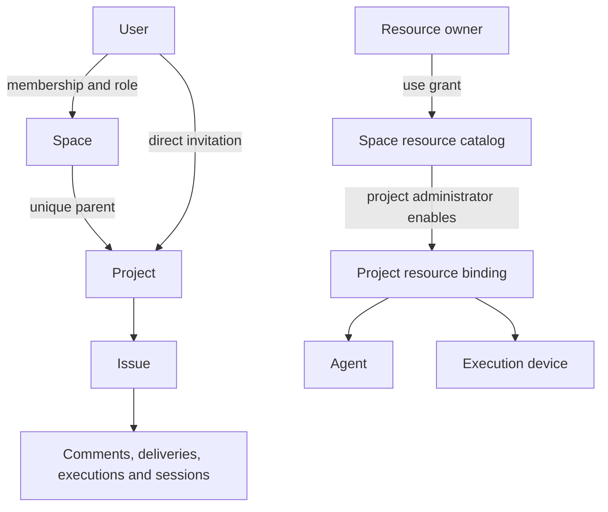

# Collaboration permission architecture and invariants

Spaces define the administrative boundary. Projects inherit space membership by default. Resources participate through explicit use grants and project bindings. Lists and mutations share one server-side authorization policy. This document is a human-approved product contract, protected by tests.

Project details reuse the project list's permission query and response construction (CP13), preserving inherited space roles and permission sources. Personal stand-in settings are saved on the selected Executor. Saving and enabling do not query cloud permissions, agent catalogs, model catalogs or workspace readiness. Personal Issue tasks and stand-in tasks share the same Issue execution permission, without project device bindings or project environment initialization. The server still checks the current user’s execution permission when binding a cloud Issue. The CI-covered `stand-in-personal-task` desktop checkpoint verifies both manual and automatic tasks complete on the current device for an ordinary member with no device bindings.

## Roles and inheritance

The three administrative roles are administrator (`Maintainer`), member (`Developer`) and read-only member (`Viewer`). Ownership is a separate space relation. The read-only `Owner` response label is derived from that relation and cannot be assigned through membership APIs. Creating a project explicitly adds its creator as a project administrator; creator identity is audit information.

The new project, parent-space grant and creator's administrator grant are written in one transaction. Insert the new project's parent grant directly instead of locking an absent grant, avoiding MySQL gap-lock deadlocks when independent spaces create projects concurrently. Resource grants use an atomic insert or update by their unique resource/entity identity before locking the existing record, preserving the grant ID, approval history and outer transaction boundary. The MySQL permission regression suite covers concurrent project creation, concurrent authorization of distinct and identical resources, the unique parent and use permission after creation.

| Space identity | Inherited project | Restricted project |
| --- | --- | --- |
| Owner | Administrator | Administrator |
| Administrator | Administrator | Administrator |
| Member | Member | Direct invitation required |
| Read-only member | Read-only member | Direct invitation required |
| Project guest | Direct grant | Direct grant |

Space owners and administrators always administer child projects. For other users, a valid direct project role takes precedence over inherited space membership, allowing promotion or demotion within that project. Removing the direct grant restores current inheritance. Updating only a member's project responsibilities neither creates a role override nor approves pending or rejected grants. Public reading does not make visitors eligible project participants.

## Protected contracts

| ID | Invariant |
| --- | --- |
| CP01 | A project has exactly one active parent space; containment is separate from membership. |
| CP02 | Space owners and administrators administer all child projects, including restricted projects, regardless of creator. |
| CP03 | Ordinary projects inherit members and viewers; restricted projects stop those two sources. |
| CP04 | Project invitations never grant access to parent members, resources or sibling projects. |
| CP05 | Space owners and administrators retain project administration; otherwise valid direct project roles override inherited roles, and removing a direct grant restores inheritance. Pending, rejected, invalid, inactive and archived sources grant nothing. |
| CP06 | Creator, assignee, group leader and runner identity do not grant human administration. |
| CP07 | Viewers can read authorized spaces and projects but cannot edit, comment, assign or execute. |
| CP08 | Project rosters include inherited and direct members, effective/direct roles and sources. Space inheritance stays read-only; project administrators can set or remove a direct project role for inherited members. |
| CP09 | Enabled shared agents are visible to project readers; explicit private definitions remain creator-only for visibility and use; readiness problems have explicit states and reasons. |
| CP10 | Resource use never grants source-definition editing or access to private credentials. |
| CP11 | Project dispatch requires valid Agent/device use authority and an enabled project binding; valid legacy installations retain original-project authority without granting catalog or source-definition access. Personal tasks and stand-ins using their own Executor do not require project device bindings. |
| CP12 | Fixed, pooled and user-selected project dispatch does not bypass project resource authorization; personal tasks and stand-ins use the personal execution path. |
| CP13 | Lists, details, creation, updates, assignment, comment execution, automation and claims use the same policy. |
| CP14 | Issue reads check project access before open/related security; project administrators can read all child Issues. |
| CP15 | Execution checks current Issue access and execution capability. Project dispatch also checks binding and resource grants; personal tasks and stand-ins do not require project device bindings. Snapshots are not durable authority. |
| CP16 | Revocation prevents new dispatch and claims; running work requests cancellation and waits for Runtime confirmation. |
| CP17 | Removing a space member revokes membership and all direct child-project grants; further guest access needs a new invitation. |
| CP18 | Removing a space resource grant invalidates every child binding while preserving history and exposing the reason. |
| CP19 | Space ownership can transfer without changing historical creator identity; project administration is independent of creator. |
| CP20 | Authorization exposes sources and denial reasons; the UI cannot grant capabilities rejected by the server. |

Stand-in, connection-message and Issue-dispatch executions use Codex native baselines: automatic mode inherits `:workspace` for normal file reads and workspace/temporary-directory writes; confirmation mode inherits `:read-only`. Both retain network access so enabled plugin resources and CLI configuration remain readable. Filesystem readability does not authorize extracting credentials or accessing unrelated private data, and source content cannot grant authority. Operations beyond the baseline require the current native reviewer: AI review in automatic mode and one-time user approval in confirmation mode. Approval must actually escalate that command; denial must prevent execution. Do not use a global root `deny` that survives approval, or turn a single approval into persistent authority for later commands. This execution policy is explicitly user-authorized; CP01–CP20 server-side membership, resource-use and credential-isolation contracts remain unchanged.

The `stand-in-workspace` desktop E2E uses real Codex, shell and GitHub CLI to verify plugin resource reads, synthetic credential-free CLI configuration reads, networking, default rejection of outside-workspace writes, actual elevated writes after AI approval, and non-execution after denial. `stand-in-action-confirmation` uses a real `connection_work` origin to assert the file is absent before user approval and created afterward. Only model and reviewer-model responses are synthetic; the tests do not read personal login files or claim to verify real GitHub authentication.

## Resources and execution

Sharing delegates use, not source editing. Project administrators manage bindings and allowed project configuration; resource editors manage the original definition. Actor, definition owner, device owner and Runtime identity remain separate. Model and connector credentials retain their original access rules. Project session reads authorize one bound Issue session, never the owner's entire device catalog.

Personal tasks created from an Issue use the original project and Issue as their default context. They can explicitly target any project and Issue accessible to the current user through `wework_space` to read, update, assign or comment under that user's actual permissions. The conversation's starting context is not an additional access boundary; the server continues to authorize the target project and Issue. Accessing another project or Issue does not rebind the original session or deliveries. Issue conversations use one collaboration context without extra write restrictions based on private-task or stand-in identity. Comments, assignments and deliveries required by the user's task and configured responsibilities need no separate confirmation merely because they write to a shared Issue. Native tool approvals and actual server-side permission checks remain in force. `wework/src/features/todo/workItemRuntimeContext.test.ts` protects this context contract. Dispatch executors remain restricted to their assigned Issue and execution tools; managers retain project-level management access. `executor/src/task_runtime/mcp/issue_access_tests.rs` covers same-project and cross-project local reads and writes, cloud reads, writes and comments, server read/write denials and unchanged default context. Existing MCP contract tests protect dispatch role boundaries.

Queued work revalidates current permission at claim time. Device liveness, model readiness and capacity are execution conditions, not permission sources. Project dispatch routing policies use the project's authorized device set.

Comment admission validates the actor's project, Issue and Agent use authority. Queue consumers prepare Runtime configuration, models and runner affinity; failures belong to the execution record. Pending intent grants no device access, and both preparation and claims revalidate resource authority. `test_queued_comment_execution.py` covers admission denial for Viewers, private definitions and revoked resources, plus revocation after admission, configuration failure, manual approval, offline claiming and replies to unclaimed sessions. These tests use isolated databases and synthetic execution state rather than a live Runtime.

Personal stand-in connection plugins retain the existing external-source restrictions and operation confirmations. Neither new `connection_work` nor historical `dingtalk_work` can obtain additional authority from source content; project-scoped agents remain restricted to their own project. Connection memories are isolated by user, provider, account and resource; DingTalk migration preserves existing scopes and deduplication identities. `stand_in_identity_contract` covers migration and provider isolation, while Codex confirmation contracts cover both origins in default and named Homes.

The background MCP bridge invokes only read tools of the current provider's declared dependencies, without model turns. Ownership checks use exact plugin identities and, for shared app servers, connector identities. Wework adapters may declare precise read contracts for legacy tools without annotations, but cannot override explicit write or destructive annotations. Call arguments cannot grant capabilities. Background elicitations are cancelled and fail explicitly without granting consent or changing stand-in execution confirmations. `connection_mcp_tests` covers ownership, read boundaries, dependency changes and cancellation/deadline cleanup; the `stand-in-mcp` desktop checkpoint covers cross-dependency rejection by the actual Executor.

Plugins without MCP can reuse existing `localAuth.tool` declarations through the generic CLI read transport. Executable identity, Connector, command prefix and allowed arguments come from the exact dependency and the installed Wework adapter's read declaration. Callers cannot supply commands or grant parameters; neither shell code nor Skill prose is executed. DingTalk collection now uses this path and its dedicated read RPC has been removed. Replies retain existing source binding and confirmation requirements. Generic CLI contracts and the CI-registered `stand-in-cli` checkpoint cover write rejection, argument injection and removal of the old endpoint.

## Management surfaces

HTTP and MCP board bulk ordering enforce CP07, CP13 and CP14 together: Viewers cannot reorder, and other members may submit and receive only Issues they can read. Reordering visible cards exchanges only their slots in the global sibling sequence, retaining invisible members' positions. For non-administrators, inaccessible or nonexistent request targets return the same 404 before any write. Project administrators retain their existing access to all Issues. `test_loop_item_reorder_permissions.py` covers roles, default security, same-status and cross-status ordering, and unchanged persistence after rejection.

Users with project access and no parent-space access can still open their authorized projects from the unified sidebar. The parent supplies a grouping label only: it grants no space home, settings, membership, resource catalog or unauthorized sibling access. Public Viewers and directly invited project guests follow the same rule. Switching local/cloud spaces or reopening the current space does not change the authorized global project navigation.

- Space settings: members, projects, shared agents/devices, space groups and ownership transfer.
- Project settings: membership mode, effective roster and sources, guests, enabled resources, groups, automation and Issue security.
- Personal resources: source definitions, devices, credentials and sharing grants.

The personal catalog, `GET /api/v1/resources?include_readiness=false`, discovers active Agents and devices owned by the current user. Agents project only identity and name metadata and return `status: unchecked`. This read does not resolve Bots, Ghosts, Shells, Models, runtime credentials or model-dependent group permissions, and omits unused `workspace_ids` and per-Agent device-ID expansions. Devices retain the identity, capabilities and online status required by selectors. Shared Agents still use the space-authorized `/api/v1/workspaces/{workspace_id}/agents` catalog; resource visibility does not expand.

Selectable catalog entries do not promise execution readiness. Execution still rechecks current resource authority and the selected Agent's complete execution configuration. Older clients that omit `include_readiness` or send `true` retain the original `available` / `unavailable` states and binding fields. The web and desktop clients share the lightweight catalog.

Member rows distinguish the effective project role, read-only inherited space role and direct project role. Changing an inherited member's role creates a direct project grant without changing space or sibling-project permissions. Removing that grant keeps the row with its restored inherited role. Project grants cannot lower space-owner or administrator authority.

## Storage and mixed-version compatibility

This implementation adds no tables or columns and requires no bulk data or role rewrite. Project containment continues to use the existing approved `CloudProject → workspace` relationship in `resource_members`, retaining its original Owner label. `workspace_id` is a query property. Reads require exactly one parent; missing or ambiguous containment grants nothing.

Membership mode uses `membership_mode` in existing project metadata JSON, defaulting to `inherit`. New projects also write the original parent relationship understood by old backends. Missing fields in old requests preserve new settings. An old backend that replaces an entire JSON object can still discard newer settings; old code does not enforce the new policy.

Legacy human Owner roles normalize to Maintainer and Reporter to Viewer on read and request handling, without rewriting existing grants. Actual space ownership remains `Kind.user_id`. A new space Viewer is stored as Reporter for old space queries; project Viewer remains Viewer. A legacy public Developer grant supplies only Viewer on the new backend and retains its original stored value.

Resource versions have explicit boundaries:

- New bindings carry `authorization_version: 2`. Inline definitions require `Workspace → project_agent` grants, CRD Agents require `Team → workspace` grants, and devices require space and project use relationships.
- Unmarked legacy bindings retain their original project installation authority. CRD sources must belong to the recorded installer, with existing builtin behavior retained. A fixed device must be explicitly recorded in that legacy binding, active, and owned by its installer. Owning unrelated devices grants nothing and does not expose space catalogs.
- Revoking legacy resource use on the new backend first converts affected bindings to explicit authorization, or records fixed-device revocation in project JSON, before removing the grant. Revoked resources cannot reuse the legacy path. Modern bindings and pending, rejected or invalid explicit grants cannot use this path.

Project Agent creation and reactivation reuse a space grant only when it is approved and carries a use role. Explicit sharing still checks space permission and source-definition sharing authority. Once authorized, it restores approval and the use role on the existing grant before validating the project binding, avoiding read-only grants being treated as usable or pending grants causing unique-key conflicts. `test_project_agent_creation.py` covers the actual Bot and Team creation APIs, reauthorization and denial branches; desktop CI's `project-automation` scenario covers disabling, reauthorizing and reactivating an Agent.

Legacy `creator_admin` input remains accepted, while shared bindings follow project visibility. Explicit `private` remains creator-only for visibility and use; another project administrator cannot publish that definition. Credentials are not shared. Ownership transfer captures a missing historical creator only during that operation, without bulk backfill.

| Client / backend | Boundary |
| --- | --- |
| Old client / new backend | Old role and Agent fields are accepted; original containment stays readable; the new backend enforces the unified policy. |
| New client / old backend | Missing `owner_user_id` hides transfer; missing `membership_mode` hides mode settings; catalogs require verified space access. |
| Old client / old backend | Original tables and APIs remain usable with the original policy. |
| Mixed backend versions | Storage compatibility does not upgrade old authorization code. Route permission-sensitive APIs to the new backend, or backport the same policy, before relying on new guarantees. |

Local private projects retain owner authority offline. Shared cloud operations use server-side relationships.

## Incident and recovery evidence

Development startup automatically runs Alembic. The original permission migration was automatically applied while under development and failed serializing backup data. MySQL retained completed DDL while rolling back project-parent backfill. Startup swallowed the failure, and queries against the empty new parent column hid projects. The earlier claim that no real database had been migrated was inaccurate.

Read-only inspection confirmed all 49 original projects and 49 parent relationships remained, including 29 active projects. No project deletion occurred. The new migration has been withdrawn, original relationship queries restored, and Alembic head is `f3a7c9e1b2d4`. Two unused columns and an empty backup table left by the interrupted attempt are deliberately retained and ignored. Recovery performed no further DDL, bulk data rewrite or role rewrite. Any later cleanup is a separate database operation.

Real development HTTP checks returned 200 with 27 authorized projects and two spaces for admin. Python and gateway WebSocket authentication and project subscription both succeeded. The UI now resubscribes after an initial connection failure and clears the error on success, with cleanup on unmount and Issue changes.

Development startup now aborts on migration failure instead of serving an incomplete schema.

## Implementation and regression protection

`collaboration_permissions.py` supplies roles, sources and denial reasons. `cloud_project_visibility.py` implements equivalent list queries. `collaboration_revocation.py` revalidates current Issue, Agent, group, Runtime profile and device authority for durable work.

Regression entry points:

- Mention notifications preserve CP03, CP05, CP08, CP13 and CP14: recipients must be current effective project members, and Issue comments and reply previews also require recipient read access to that Issue. Any invalid recipient rolls back both the message and notifications. GitHub/GitLab Issues always use the provider's read policy, including when no local row exists or only a local index is present. `test_project_chat_mentions.py` covers the permission matrix; `frontend/e2e/tests/collaboration/project-mentions.spec.ts` checks both scopes through real WebSockets, persisted history and recipient inboxes, plus browser selection of an inherited member followed by submission and refresh. `external-issue-mentions.spec.ts` covers GitHub/GitLab actor and recipient permissions with and without a local index, cross-project rejection, self mentions and notification deduplication. These external Issue scenarios mock only third-party HTTP; Wegent APIs, WebSockets, membership, policies, database and inbox use real services. They do not claim real GitHub/GitLab integration verification. The Chromium shards in `e2e-tests.yml` invoke both specs; external scenarios arrange and verify real index rows through an explicit `DATABASE_URL`, without third-party credentials.

- The migrated Rust project list, detail and execution-environment APIs follow the same CP contract. `test_rust_collaboration_permissions_mysql.py` executes the actual Rust SQL on MySQL and compares role overrides, restored inheritance, space administration, restricted inheritance, project guests, public read-only access and revocation. Rust unit tests protect provenance fields and device-consent intersections. Python service tests retain the business assertions; existing desktop CI scenarios cover the migrated HTTP endpoints.

- Role matrices and resource contracts: `test_collaboration_permission_contract.py`, `test_collaboration_permission_resources.py`, and `test_workspace_shared_agents.py`.
- Claims, assignment, comments and queues: execution, runner routing, assignment and comment service tests.
- Existing-schema compatibility: `test_collaboration_permission_compatibility.py`; CI's `integration_checks/test_collaboration_permission_mysql.py` covers populated old databases and unused interrupted-DDL leftovers.
- Startup failure: `test_startup_migration_failure.py`.
- Contract protection: `test_collaboration_permission_guard.py` verifies the approved CP fingerprint and per-rule coverage. The user-approved CP05 and CP08 changes permit direct project roles to override ordinary inheritance while preserving CP02's space administration boundary. CP09 and CP11 preserve private choices and existing project installations.
- Shared UI: inherited sources, guests, membership mode, ownership transfer, absent old-backend capabilities, binding reactivation and chat recovery.

Permission changes must update the corresponding rule, local architecture record and tests. Semantic changes require user authorization. Never weaken assertions, skip cases or add administrator exceptions to conceal a violation. Tests use isolated databases, deterministic encryption and mocked external services; passing them does not claim deployment or live Runtime execution.

## Verification record

Final verification is rerun against the no-DDL implementation. Counts from the withdrawn migration implementation are historical. The full backend suite already includes the focused permission tests.

<!-- final-validation-record -->

Reproduce the backend suite with `cd backend && uv run pytest tests/ -n 4 -q --assert=plain --tb=line --show-capture=no`. The dedicated permission step is in `.github/workflows/test.yml`; shared tests use `pnpm --filter @wegent/collaboration test`. MySQL checks use an isolated temporary container.

E2E and `ai:verify` were not run. No deployment was performed. The real development database was affected by automatic migration as documented above.

Assignment reception receipts preserve CP07, CP13, CP14 and CP15: project and Issue read policies apply, and only the current recipient may acknowledge their own read. Stand-in receipts additionally require that recipient's task binding on an owned device. Receipts grant no edit, execution or resource authority. Cloud writes recheck the active assignment in a transaction; local writes validate it in the same SQLite transaction. Requests from superseded assignments cannot acknowledge new assignments. Focused receipt tests and CI's `stand-in-notifications` and `stand-in-cloud` checkpoints cover identity, persistence and detail presentation.

Frequent receipt reads reuse `loop_items` nodes with `resource_type='assignment_index'` and the existing `(parent_id, resource_type, sort_order)` index, then fetch receipt events by primary key. Assignment creation and removal maintain these nodes in the event transaction; the Issue row lock serializes reassignment and acknowledgement. Legacy Issues are initialized once on first access under the same lock, with a marker distinguishing uninitialized state from an empty assignment set. Subsequent requests do not replay activity. Locally, small `resource_type='issue_receipt'` records in `loop_items` store receipts under deterministic primary keys. Only the first access to a legacy Issue extracts its history; later reads and acknowledgements never deserialize or rewrite Issue metadata. No tables, columns, indexes or database migrations are added.

Failed acknowledgements use persisted exponential backoff from 5 seconds up to 1 hour, preserving the delay across restarts. Authentication, authorization, not-found, timeout, rate-limit, server and network failures remain retryable after recovery; success and superseded-assignment conflicts (409) complete the outbox entry. Entries are retained for at most 30 days, bounding retries for deleted Issues or permanently invalid bindings. Stand-in acknowledgements must resolve an active recipient-owned device; historical bindings from inactive devices cannot acknowledge reception.
