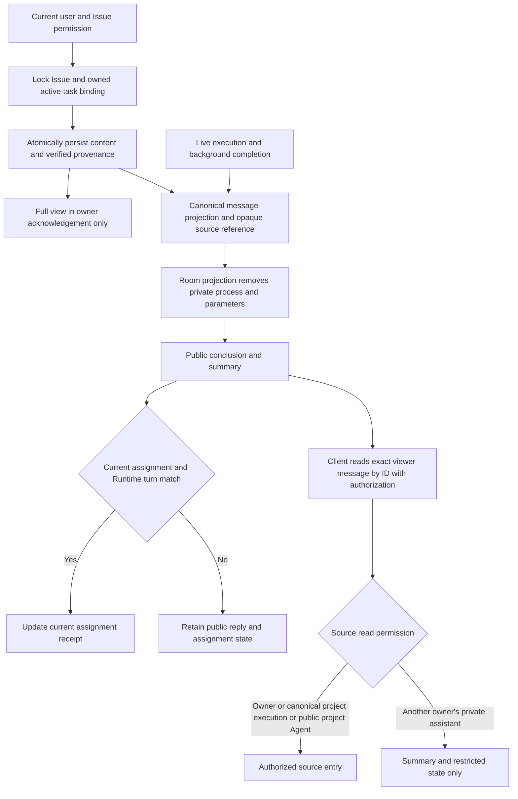
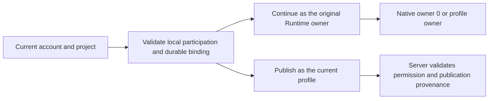
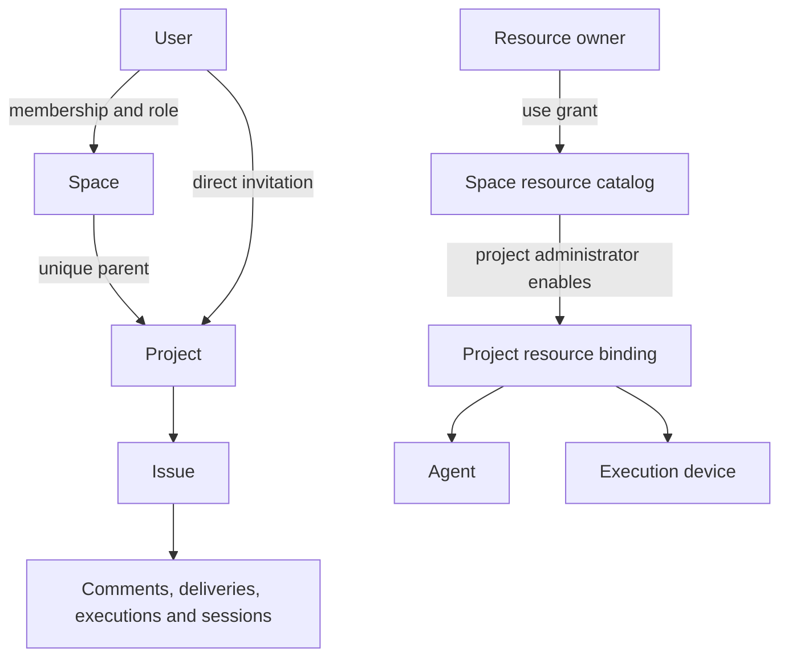

# Collaboration permission architecture and invariants

Personal assistant sharing commits the portable definition, the named recipient's grant and the first inbox notification in one transaction. Direct conversations check the current grant at admission and before a new turn starts, then run under the recipient's account and environment. Continued access to updates for copied team members requires an active team copy grant and a recorded copy. Definition changes and updates for recipients who copied them commit together. To export across devices, the gateway routes only the definition read to a device owned by the publishing account. The target Executor verifies that account again and returns only names, prompts and team duties. This scope grants no access to settings, credentials, conversations, tasks or projects. The cross-account MySQL contract and device scope tests exercise these boundaries. Publication revisions use a dedicated kind in `kinds`. Named grants, direct use, copy permission, and copy receipts use scoped resource types in `resource_members`, separate from space and project memberships. The database schema requires no migration. Publishing checks the revisions of definitions it would update. Sync work and copy receipts are scoped to the backend and account. Team member definitions are read from their saved device routes. CP01–CP20 remain unchanged.

When a conversation is shared into a project Issue with an explicit human assignee, the assignment and recipient inbox wake commit with the Issue. Invitees other than the assignee receive no assistant intake event. IM delivery addresses participants with Issue access. The web link opens the same Issue using the recipient's authenticated account, and conveys no Issue, attachment, or conversation grant. CP01–CP20 remain unchanged.

Sharing a conversation creates the Issue, invitations, attachment references and account-private conversation reference in one transaction. Notification delivery follows commit and addresses the selected colleagues. A selected project supplies its default Issue visibility. Explicit invitations grant access only to that Issue. Attachment downloads recheck current Issue access. Only the creator account can resolve the original conversation or list its linked Issues. The share grants no access to the source conversation, device or full transcript. Request identifiers are scoped to the creator account and replay returns the committed Issue. The desktop `task-share-as-issue` scenario covers both destinations, attachment bytes, denied reads and notification links. After an Issue moves into a project, old share links resolve its current location and check access through the project Issue endpoint. Deleting an independent Issue revokes attachment access immediately. Background maintenance retries incomplete file cleanup from the deletion record.

Cancelling a role delegation requires the original personal conversation and request identity. To cancel or retry a branch, the dispatching Executor checks the durable branch record against the account and original conversation. Before stopping work on another device, the executing device verifies the cancellation for the exact task with its dispatcher. Cancellation intent and confirmation are recorded separately. A retry keeps the task identity, and the target verifies the incremented attempt number. Prerequisite results pass as data to dependent tasks within the same request subtree. This uses the personal stand-in scope and preserves CP01–CP20.

Personal assistant delegation binds the current account, its original conversation, and the role's configured execution device. The Rust Socket.IO gateway checks the request owner and target device, and resolves the source device within the same account before dispatch. The target Executor verifies the original device's durable task identity, role, and dispatch payload before accepting work. Results and repeated requests use the same record. The grant is limited to the specialist task protocol, and role operations still follow native approvals. CP01–CP20 remain unchanged.

An owner-initiated assistant task stores its permission mode on the execution device. When the owner changes it, the Executor verifies the account, device, and task record before saving atomically. The Rust Socket.IO route checks the authenticated account and the target installation's personal-task access consent. Project read access and role dispatch access cannot substitute for that consent. The Executor checks that the primary assistant’s owner request is current before recording the new task. An owner request superseded or cancelled during preparation cannot create a task. The Executor uses the trusted turn entry point to decide whether to apply saved permissions. Background follow-ups and source events use their own execution policies. Moving an assistant to another execution device starts with read-only task permissions on the receiving device. The owner can configure permissions there after the move. Submitted model execution parameters cannot set task permissions. CP01–CP20 remain unchanged.

Following the owner's explicit authorization, desktop personal stand-in instances compare only `userId` for binding ownership and retain installation-local owner `0`; backend addresses and usernames do not determine ownership. Equal user IDs from different deployments can therefore read, edit and stop the same local binding; cross-deployment account isolation is not provided. Reading historical bindings preserves metadata and versions without automatically recording usernames. Stop and rebind retain the existing versioned transactions. Current cloud-device ownership and availability checks, project and Issue permissions, role and source grants, and native approvals remain unchanged. `standInConnectionState.test.tsx` and local-store lifecycle contracts cover different-ID rejection, read-only legacy bindings and stop transactions; the existing CI desktop `stand-in-cloud-device` scenario covers changed addresses, owner renames and different-ID rejection. E2E was not run locally for this change, so real desktop verification is not claimed; server-side CP01–CP20 remain unchanged.

Tool-generated comments verify their source against the caller's active task binding and use `requires_confirmation=true` to remain pending. `source_verified` proves generation identity; publication authority still depends on the separate `verified` flag and existing automatic-publication policy. Idempotent replay cannot upgrade a pending comment to human confirmation.

For tool-posted root comments and replies from cloud project collaboration groups, the Executor supplies the dispatch and Runtime identity from the bound Issue session. The Backend checks current Issue access, the original dispatch owner and device, and current execution authority, then derives authorship from the recorded coordinator or member activity. While member activity is pending, the Executor retries HTTP 425 with bounded backoff and the same message ID. Structured mentions share one project membership and Issue read check for both notifications and stand-in wakeups. A nonmember mention rejects the entire comment transaction. Retries validate the same body, reply target, and mentions. CP01–CP20 remain unchanged.

Assistant conclusion publication locks the Issue and validates current membership and an active task binding on the caller's owned device before writing content and server-derived provenance in one transaction. Notifications and shared pushes observe only the complete committed message. Publication requires a nonempty idempotency key; retries require the same source and content; ordinary comments cannot impersonate confirmed AI conclusions. An old conversation may still publish public replies, but completing the current assignment requires both its current humanAssignmentId and matching task binding. Completion receipts additionally match the current Runtime turn, thread and generation. Room broadcasts and cross-process pushes remove execution text, sub-agent process content and private parameters; owner request acknowledgements retain the full view. Native runtime ownership is recorded from the verified binding separately from the publisher and trigger author, including valid local owner 0. Canonical project executions and current public project Agents retain their Issue-authorized source entries. Private Agents, member assistants and resources from other projects cannot gain that access by claiming shared metadata. Focused provenance, push, stale-assignment and native publication tests, plus existing CI desktop scenarios, protect this chain. CP01–CP20 remain unchanged.

A restricted source notification from a shared room is not the current viewer's message view. The client reads that exact message by ID through the existing subscription history endpoint, which revalidates project, Issue and source access. Only a response matching the message and subscription scope can update the source entry. Responses after unsubscribe and older responses superseded by a newer notification are discarded. A failed authorized read retains the received public projection and logs the error; bindings never imply private access.

The authenticated snapshot of the current subscription can update read access for the same project, Issue, message and source reference independently. When the snapshot's content is older, apply the verified source or denial while retaining newer content and execution status. A live update received during subscription setup prevents a superseded snapshot from applying this source update.

Rust live execution, background completion and history reads share one message projection. When a durable source exists, an unauthenticated projection carries only an opaque reference and restricted state. Shared pushes contain no Runtime address, private process text or parameters. The client uses the existing subscription endpoint to obtain the current viewer's authorized source, preserving the read entry across running and completion notifications. Missing sources remain history-unavailable. Projection and shared-push contracts cover live deltas, final results, background completion and missing sources. CP01–CP20 remain unchanged.

Private discussion sends retain the original Runtime owner within the validated participation scope, including local owner 0. Public conclusions retain the current profile as publisher. This identity composition applies only within the local project's participation scope for the current account; 0 is never a global account alias and grants no cloud private-history access. `PrivateDiscussionPane` regressions verify actual sends for local owner 0 and the profile owner, plus rejection of account changes, cloud and out-of-scope owners.

Rust Socket.IO cancellation validates current task access before recording intent
or delivering cancellation on Chat, executor and device routes. Task owners and
approved task members retain the shared task-access policy; shell selection and
executor placement grant no access. The existing isolated MySQL cancellation
contract covers all three routes and verifies that denied requests leave task,
subtask and Redis cancellation state unchanged. The existing Chromium CI shards
discover `chat-cancel-access.spec.ts`, covering a rejected foreign caller followed
by owner cancellation of a real Chat execution. HTTP device cancellation applies
the same task access check. It captures the current assistant turn under the task
lock and addresses the device using the turn's execution account. Delivery and
local finalization remain scoped to that turn. Backend service tests cover
approved members, denied callers, and a delayed cancellation after a new turn.
CP01–CP20 remain unchanged.

Member drawer Skill discovery and saving use the same target publication groups. Ordinary edits and same-namespace clones retain those groups; only an actual cross-namespace clone clears the source group context, with omitted namespaces normalized to `default`. Binding loads and retries belong to the current editing session. Unknown or failed bindings block member saving and expose retry; closing, creating, switching Agents and unmounting invalidate old requests so they cannot overwrite later groups, errors or loading state. The server still validates current resource and target-group authority; client context grants no new permission. CP01–CP20 remain unchanged. Parent-component and BotEdit contract tests cover classification, empty bindings and stale responses. The existing Chromium CI suite discovers `settings-team-member-skills.spec.ts` for real member edits, same-namespace clones, persistence and binding transport-fault recovery; the existing Skill scope suite retains cross-namespace clone coverage.

Mobile and PC personal project/conversation management reuse the same typed Runtime RPCs: project upsert, rename, remove and pin; task pin, rename and archive; archive list, restore and permanent deletion. Python HTTP, Rust Socket.IO and the target executor require current personal-task consent on that installation. Neither another installation nor a project-read grant substitutes for it. Archive `cleanupWorktree` resolves managed worktrees only from the resolved task ID and preserves snapshots; active shared worktrees remain. Cleanup failures retain `accepted: true` with separate `cleanupError`, without repeating archival. Direct worktree deletion, shell, terminal and global configuration remain denied. Archive item identities project to the exact registered route rather than a shared computer name. Three-layer policy matrices, native Git snapshot tests and the existing remote-task-access CI checkpoint cover this flow; CP01–CP20 remain unchanged.

Personal-task worktree capabilities and preflight are task-creation reads. Python HTTP, Rust Socket.IO and the target Executor each require current remote-task consent on that exact computer installation; project transcript grants and another installation's consent cannot replace it. Preflight's `includeBranches` projects only branches from the selected source repository through a fixed Git query. Raw `device.execute_command`, worktree configuration, direct preparation and deletion remain denied. Revocation rejects subsequent reads. Three-layer permission contracts and the existing `remote-task-access` CI checkpoint cover HTTP, Socket.IO, installation isolation and revocation; CP01–CP20 remain unchanged.

Mobile file and Git reads from a desktop App device use `runtime.workspace.read`. The Backend and target Executor both require current remote-task consent on that installation. The Executor binds the root to an active task's actual workspace, including a managed worktree, or a local project workspace, and checks canonical paths after following symlinks. Only directory, text, chunk, search, fixed Git queries and that task's historical change reads are supported. Generic device commands, writes, terminals and paths outside the authorized root remain denied. Revocation or switching installations rejects subsequent reads; CP01–CP20 remain unchanged.

Manual source starts use the host snapshot's existing `origin.manual` and exact `standInSourceBindings`. Transient confirmation flags confer no durable authorization, and later arrivals cannot reuse the grant. Disabling automation does not block authorized manual workers or their completion reports. Queue admission revalidates the original message grant, source, identity and configuration version while retaining native confirmation. Automatic workers still require enabled role and source policies; revoking the binding blocks both workers and reports. Native manual-start, snapshot and source-task admission regressions protect these boundaries. CP01–CP20 remain unchanged.

Personal task creation from a connected source requires a connector-verified owner self-conversation record; `isOwn` alone is insufficient. Third-party messages, own messages to others/groups and unknown identity are rejected. The scoped `create_task` revalidates the current owner, device, role, work and exact source, then creates a task using the immutable message record and a stable request ID. Workers inherit role configuration and the stricter confirmation policy; callers cannot supply an owner, permissions, workspace overrides or source-read grants. Workers can read only their own conversation. The durable result outbox returns to the original source work, revalidating source authority before native replies; revocation, identity mismatch, uncertain sends and duplicate execution confer no authority. `stand_in_source_tasks`, source-tool catalog contracts and CI's `stand-in-cli` user story cover these transactions. CP01–CP20 remain unchanged.

Resumed group managers publish their Issue activity and exact Runtime binding before starting a new turn. The Issue-locked transaction verifies the original dispatch owner/device, immutable leader, recorded previous round, terminal member outcomes and exact next manager task ID; replay cannot replace a later assignee. IDs exceeding the database and API's 255-character bound use a deterministic encoding of the previous session and round, shared by Backend and Executor when validating the recorded lineage. Shared transcript reads require current Issue visibility and that recorded collaboration identity. A manual binding alone still grants no access to another owner's transcript or device catalog. `test_collaboration_manager_activity.py` covers these boundaries; the existing remote group desktop checkpoint covers answering native input through the resumed activity. CP01–CP20 remain unchanged.

The device owner can request refreshed model configuration with their login session when reporting a resumed manager. Backend checks that the dispatch remains active and the round has not been superseded, rechecks execution authorization, and recompiles as the original execution actor used at claim. Credentials are returned only to the requesting Executor with caching disabled and are excluded from the Issue activity.

My Work reuses the Issue list/detail response projector, loading names, executions, human task bindings and visibility once for the whole page. Each Issue uses only its own project's current effective role and security policy; another project's access cannot grant authority. Responses normalize timestamps to UTC while retaining raw database pagination cursors and external-provider boundaries. API field parity, mixed-project permissions and constant cross-project query-count regressions protect this read path. CP01–CP20 remain unchanged.

Child creation from comments rechecks current parent-Issue access and retains the stricter of parent visibility and the project default. Guessing a hidden parent identifier cannot create a child, and copying a comment cannot expose related-only content to the project. CP13 and CP14 remain unchanged. Permission contracts cover both parent and default visibility levels; the existing comment-assignment desktop checkpoint covers a restricted parent.

Independent Issue resource invitations are validated inside the Rust personal-Issue transaction against resource ownership and current group access. Clients cannot submit credentials or execution configuration. Team invitations snapshot human members as explicit invitees; later roster changes confer no access, and removing a team revokes access derived from that invitation while preserving direct invitations. References grant no administration, execution or private-transcript authority. Inviting resources starts no execution; manual task creation retains Runtime Agent authorization checks. Project Issue reads expose only participant kind, name and identifier, and omit them when detail access is denied. CP06, CP14 and CP15 remain unchanged. `personal_issues::tests` and the existing CI-covered `personal_issues::mysql_tests` extend invitation and revocation contracts.

An explicit independent Issue assignment commits with its recipient inbox event. The assignee can enable independent Issues in their assistant’s collaboration connection in advance. The saved enable boundary and existing handling and confirmation policy govern intake. Claim and publication recheck the current assignee, assignment identity, and owned device under the Issue lock. One device and task can claim an assignment, and repeated publication returns the original reply. Reassignment, archive, completion, and project association invalidate the previous execution and publication authority. Ordinary invitees retain their existing Issue access. Independent Issue execution has no project tool or general workbench control grant. The real MySQL contract covers device contention, identity rejection, idempotent replies, and revocation. The desktop `task-share-as-issue` scenario adds the assignee’s assistant reply story.

Remote access to personal tasks requires current local consent on the target computer. Answering a question during execution reuses `runtime.tasks.guidance`; Python RPC, Rust Socket.IO and Executor each enforce this consent. Revocation rejects subsequent guidance, and neither another installation's consent nor project read access can replace it. Consent grants no remote configuration or device administration. Contract tests cover consent, revocation, installation isolation and project boundaries; the existing `remote-task-access` CI checkpoint covers real guidance submission. CP01–CP20 remain unchanged.

Independent Issues belong to no project or space, as explicitly authorized by the user. Only their creator and explicit invitees can read them; only the creator manages invitations, deletion and project association. Updates, comments and revocation share the Issue row lock and version checks prevent lost updates. Pagination filters current access first. Association locks the Issue and target project, rechecks target edit authority, allocates a project number and retains discussion without granting participants project membership. CP06 and CP14 add this independent boundary while preserving existing project rules. Real MySQL `personal_issues::mysql_tests` and the `collaboration-personal-issues` desktop checkpoint cover these transactions.

The participant control in Issue details submits the target user and invitation action. The backend applies direct invitation changes under the Issue row lock and preserves team invitations. Revoking the current assignee's direct invitation clears the assignment and assistant binding in the same transaction. Stale versions and insufficient permissions cause the request to fail without changing the Issue.

Detail, list, attachment and task binding reads for Issues without a project check shared collaborator records for current invitations. Revoking a direct invitation preserves the same record if an invited team still covers the person. Revoking the last invitation removes the record. Invitations and attachments stored only in legacy Issue metadata are unavailable through the shared APIs.

Direct invitations from Issue details use `POST /api/v1/loop-items/{item_id}/collaborators`. Only creators can issue direct invitations for Issues without a project. The invitation write and Issue revision update share the same row lock. If the person already has access through a team invitation, the direct invitation keeps the existing record ID and avoids a duplicate notification.

Direct invitation revocation uses `DELETE /api/v1/loop-items/{item_id}/collaborators/{user_id}`. The default gateway routes this method to Rust. The backend checks project roles or creator authority under the Issue row lock. Revoking a current assignee's invitation for an Issue without a project clears the assignment and assistant binding and advances the Issue revision. Project Issues retain their existing assignee access rules.

The shared editor reads both kinds of Issue details through `GET /api/v1/loop-items/{item_id}`. Issues without a project require a user session token and authorize only the creator or current invitees. Task tokens and API keys continue to follow project read rules.

Opening an Issue without a project and refreshing it after edits use the same endpoint. The response carries the fields required for participant selection, archiving and resource selection. Only the creator sees the linked source conversation action. When an existing link opens an Issue now associated with a project, the same response supplies the authorized project ID.

Issue details save title, description, priority and due date through `PATCH /api/v1/loop-items/{item_id}`. Issues without a project require a user session and current Issue access. Both kinds share content revision tracking and version checks, and saves update only the submitted fields.

Archiving and restoring an Issue without a project submits only the archive field and refreshes the current assignee's assignment count after commit. Ordinary edits from the full form also use this endpoint. Edits that change invited users or resources commit the invitations, assignee, and form fields together.

Clients use `DELETE /api/v1/loop-items/{item_id}` for both kinds of Issue. Project Issues go to the archive. Deleting an Issue without a project requires the creator and the current version. The transaction hides the discussion and releases the assistant execution binding, and the existing background cleanup job removes attachment objects.

My Work uses the same projection and cursor pagination for both kinds of Issue. The `unlinked=true` scope returns only Issues the current user created or was invited to. Assignee fields and task bindings do not grant read access.

Closing and reopening use the same endpoint. Both kinds share status history and notify affected assignees to refresh their assignment count after commit. Project Issues validate against the board configuration and apply project automation. Issues without a project use the default statuses.

Both kinds of Issue use the same endpoint to set and clear the assignee from the detail view. For an Issue without a project, eligible targets are the creator, directly invited users, and resources already added to the Issue. Human assignment events, assistant wakeups, and removal of old execution bindings commit with the Issue update. When a project Issue changes only its human, bot or agent assignee, the update reuses project assignment permissions, execution configuration, and queue handling.

Both kinds of Issue use the same assignment event update when clearing the primary assignee. The affected user's assignment count refreshes after commit. Workflow steps manage their own assignments.

Issues share discussion message storage. Until an Issue has a project, the transaction scopes messages by Issue ID and an empty project ID, and checks access against the current Issue permissions. Both Rust comment paths share transactional writes for the message, content revision and eligible recipients' mention notifications. The write checks the project association of the locked Issue. Posting the first message or associating the Issue with a project imports older discussion in its original order and preserves message IDs, authors and timestamps. The association transaction updates the discussion's project ID. Subsequent reads follow the destination project's Issue permissions.

Creating a child of an Issue without a project locks its parent and rechecks the creator's access in the creation transaction. The child maintains its own explicit invitations. The relationship grants no read or execution access to either Issue. A retry with the same creator, parent, and request ID returns the existing child.

Assignment and task binding reads resolve the current Issue scope through a shared lookup. Project Issues use project and Issue access rules. Issues without a project use creator and current explicit invitation access. Task binding reads return only active bindings owned by the requesting account. Project association moves the binding records in the same transaction and subsequent requests check the target project permissions. A task binding grants no private conversation, project membership or resource access. The desktop `collaboration-personal-issues` checkpoint covers binding, caller isolation, outsider denial and retention after association.

Explicit human assignments use the same event and active index with or without a project. An Issue without a project uses the event ID to validate assistant claims and replies. Recipient wakeups commit in the same transaction as assignment events. Clearing an assignment removes the earlier event from the active index, and a repeated creation request retains the original event ID. The creation transaction inserts the first index entry directly and skips locking empty history ranges.

Assistant claims for Issues without a project use Issue task binding records. The linked tasks endpoint returns these records only to the binding owner. Reassignment, deletion and project association unlink the previous claim in the same transaction as the Issue change.

Discussion files and attachments from newly shared conversations use the same Issue attachment storage and API. Without a project, reading and editing requires a session from the creator or a current invitee. Revocation is rechecked on access. Files stay with the same Issue after project association. Deletion retries object and attachment-record cleanup from the Issue tombstone. Mentions notify only active people whose current Issue access is verified in the comment transaction.

Legacy share attachment links validate current Issue access and attachment ownership before redirecting to the shared download endpoint on the same origin. The shared endpoint checks current access again before reading the file.

Inline detail edits send the observed version and changed fields. For an Issue without a project, the backend locks the current row, verifies access and version, and preserves omitted fields and invitations. Explicit null clears a date or assignee.

Both Issue detail views use the Issue collaborators endpoint. For an Issue without a project, the endpoint checks current creator or invitee access and returns direct invitees with email addresses omitted.

Batch board tools preserve CP01–CP20. Every nested project/Issue reference and optional detail section reuses current source and role authorization; local references additionally match the trusted current device and store. Personal Issue bindings remain defaults, while delegated executors retain only their own Issue actions and existing direct-parent read exceptions. Query pages and aggregates revalidate visibility, and successful receipts reauthorize the actual resulting Issues before returning stored content. Each supported mutation commits its expected-version check, domain change and deduplication receipt in the same transaction; cloud response loss remains unknown until the original operation key can be read, never replaying a mutation. `test_wework_space_batch.py`, Executor MCP batch tests and local `board_receipts` transaction tests cover nested scope denial, permission revocation, parent sections, conflicts, rollback, restart and response-loss recovery. The local architecture transaction records these unchanged invariants.

An exact human-answer acknowledgement may arrive after execution completion. The existing Rust Socket.IO projection transaction requires matching device ownership, persisted answer, execution, project, Issue and completed Runtime turn. It locks Issue, execution and activity in that order, then publishes the Issue change after commit without repeating completion notifications. Execution status, version and sequence remain unchanged; input is never replayed. Later executions do not discard the original answer acknowledgement. Existing isolated MySQL migration checks cover reordering, duplicates, identity rejection and retry boundaries. This reconciliation is owned by the Rust event projection. CP01–CP20 remain unchanged.

Manual cloud startup retains the durable dispatch queue so transient failures and Executor restarts cannot lose accepted requests. Manual recovery requires no assignment, project subscription or intake enablement, while retaining current account, role and Issue authorization; accepted or deleted work is never replayed. Automatic dispatch retains current assignment and intake-policy checks. `manual_issue_startup_intent_survives_restart_without_assignment_or_intake` and the existing real database fault/restart E2E cover recovery; CP invariants are unchanged.

When a queued stand-in Issue message starts execution, it rereads the server's current Issue `permissions.execute`; a read-only role or missing execution permission prevents model startup. This check is independent of assignees and intake settings, and restoring permission preserves the existing conversation. `queued_stand_in_turns_recheck_current_issue_execution_permission` covers revocation, missing permission and restoration; CP15 is unchanged.

Read confirmations still validate current Issue access and advance only the reader's cursor without changing Issue version/time. Automatic receipts carry the observed content revision; one atomic cloud update is bounded by `min(current, observed)` and remains monotonic, while local unread clearing uses the same observation bound. Stale requests do not consume later content or notifications. `test_delayed_read_acknowledges_only_the_observed_public_content`, API cursor regressions and real MySQL desktop coverage protect this transaction; CP invariants remain unchanged.

Explicit manual delegation and persistent conversations are independent of automatic intake. Role enablement, project subscriptions, tags, the current assignee and historical assignments or mentions do not gate starting, continuing, retrying or publishing replies. Omitted role selection retains an existing project role or uses the default role when no project configuration exists; starting a conversation never reassigns the Issue. Current assignments to the owner retain reception receipts, while missing assignments do not block execution or acknowledge another recipient's work. Requests still match the persisted conversation identity, and execution and publication validate the current role, account, project and Issue access. Automatic intake and background follow-ups still select work using the user's configuration. `issue_conversations_do_not_depend_on_intake_or_current_assignment`, `manual_issue_work_needs_no_assignment_or_intake_subscription` and the existing Issue-conversation desktop scenario cover this boundary; CP invariants remain unchanged.

Stand-in Issue reservations use a persistent identity independent of assignment grants. Existing binding writes lock the Issue and reread the owner, active owned device and live bindings, preventing another device or native task from occupying the same identity. Mentions and assignments share routing checks. The identity grants no execution, source or private-transcript authority. Real two-device MySQL concurrency coverage and `test_issue_conversation_reservation_is_device_independent_and_idempotent` protect this transaction; all CP invariants remain unchanged.

Persistent stand-in Issue conversations preserve all CP invariants. Conversation identity is independent of its triggering assignment or mention: reassignment, unassignment or deletion of the original mention retains conversation history, continuation and public replies. Publication revalidates the current member, project, role and exact owned Issue task binding on an active owned device; foreign devices/tasks and revoked devices are rejected. Public messages expose no private Runtime address; replies select only the original role without granting private transcript access. Durable wakeup inboxes are recipient-only and sources are revalidated before dispatch. Self mentions create no human reminder. `test_stand_in_issue_replies.py`, Executor public-message filtering tests and the existing desktop conversation checkpoint cover these boundaries.

Project-chat room broadcasts and member snapshots derive Runtime sharing from the persisted message and its same-project Agent. Shared Agent activities retain their canonical execution address and task title through terminal updates; private Agent and stand-in sources retain only an opaque trace and public metadata. Sender views and client metadata cannot grant sharing or replace the persisted Runtime identity. Opening an activity still validates current Issue access and canonical execution authority, independently of manual task bindings. `test_project_chat_provenance.py`, `test_project_chat_push.py` and Rust authorship projection tests cover these boundaries. CP01–CP20 remain unchanged.

Memory-review completion must not automatically start an ordinary primary conversation, which would restore capabilities outside the memory/progress allowlist. Host-identified scheduled memory reviews retain their original task results and arrangement status but do not enter generic generative result delivery, including success, failure, cancellation and restart recovery. Ordinary scheduled and delegated reporting is unchanged. `memory_review_completion_never_starts_an_unrestricted_parent_turn` protects this boundary; CP invariants are unchanged.

Only owner rule management additionally lists legacy fingerprints not referenced by current rules, without guessing text or scope. Model reads still return authorized semantic rules only. Legacy deletion requires the owner, version and exact forgetting timestamp, and rechecks for rule references inside the same immediate transaction. It reuses owner deletion RPC and is unavailable to unattended review. CP invariants are unchanged.

Private project-coordinator conversations reuse the shared proactive formation and semantic forgetting policies without requiring an explicit save command. The host still fixes the current member/project scope; saving private memory never authorizes publication to shared project records, and read-only delegated workers still lack memory writes. Runtime context separates policy from untrusted memory data. `project_memory_policy_preserves_private_context_and_semantic_forgetting` and `project_memory_tool_reuses_formation_and_forgetting_without_widening_scope` cover this boundary. CP invariants are unchanged.

Following the user's explicit choice, correction or forgetting retains a minimal negative rule: only the compact memory fact, scope, version and associated fingerprints, not original conversations, attachment bodies or evidence excerpts. Rules are separate from active memories. `list_memory_forgetting_rules` reuses current source/role authorization filtering and complete pagination; background access still requires a live review run. Models must avoid relearning the specific meaning, without treating rule targets as answerable facts or executable instructions; storage continues enforcing exact evidence fingerprints. Only owner management can delete rules, not unattended consolidation. Deletion atomically releases fingerprints no other rule references, and explicitly restoring a matching memory removes its rule. Isolated native verification using the current account covers cross-conversation paraphrase suppression, learning an independent new fact, and relearning after owner rule deletion; this is not deterministic universal semantic enforcement. CP invariants are unchanged.

Direct owner conversations with a stand-in role can recall memories from that role's currently authorized sources. Pausing new intake does not revoke source grants. Recall narrows grants to the current role before filtering candidates; it cannot borrow the primary or another role's project, account or resource authority. Source-bound work still recalls only its exact source, and other roles' private memories remain isolated. `role_memory_recall_includes_own_connected_projects_without_borrowing_grants` covers paused roles, project stores, cross-role denial, exact sources and grant revocation. CP invariants are unchanged.

Scheduled memory consolidation uses independent arrangement routing only for the primary stand-in's exact `memory_review` template, outside ordinary intake. Pausing new work therefore retains authorized memory consolidation; ordinary calendar work still follows intake pause and confirmation policies. Run version, arrangement enablement, owner and evidence-source checks remain unchanged. `memory_review_due_skips_empty_history_and_routes_changed_history_independently` covers scheduled routing while intake is paused and empty-increment skipping. CP invariants are unchanged.

Background memory review reuses the isolated Codex process and restricted model capability catalog, disabling Shell, patch, plugins, web search and sub-agents while retaining only the run-bound stand-in evidence tools. Tool orchestration uses native Code Mode, separately from tool-free text generation; Code Mode does not grant disabled execution capabilities. Following the user's product-policy decision, only explicitly allowlisted evidence reads, internal memory saves and progress tools receive native per-tool automatic approval. The endpoint default still prompts; unlisted tools are not exposed, and inherited unrelated endpoints and per-tool approvals are removed. Server-side run identity, source authorization and evidence checks remain authoritative. Other conversations and external-write approval policies are unchanged. Focused `memory_review_boundary` tests protect configuration boundaries, and a catalog contract requires the allowlist to exactly match the guarded memory catalog; actual native tool exposure still requires isolated Electron verification.

Stand-in model recall and context injection filter memories through current saved source grants. Source-bound turns cannot borrow another identity's connection grants. Owner management lists and deletion retain disconnected records for cleanup; management visibility does not grant model recall. `memory_recall_drops_revoked_sources_but_owner_can_still_delete_records` covers search after connection revocation, identity isolation and deletion. CP invariants are unchanged.

Personal recall of project-coordinator memories also requires a currently connected project with the exact ID and store, respecting project exclusions; owning the memory record does not grant project-source authority. Authorized project-bound turns retain their original scope, and owner management/deletion remain available. `personal_recall_requires_a_current_grant_for_project_coordinator_memories` covers no grant, same ID in another store, a matching grant and subsequent exclusion. This saved-source check does not replace live membership authorization in project services.

Spaces define the administrative boundary. Projects inherit space membership by default. Resources participate through explicit use grants and project bindings. Lists and mutations share one server-side authorization policy. This document is a human-approved product contract, protected by tests.

Project details reuse the project list's permission query and response construction (CP13), preserving inherited space roles and permission sources. Personal stand-in settings are saved on the selected Executor. Saving and enabling do not query cloud permissions, agent catalogs, model catalogs or workspace readiness. Personal Issue tasks and stand-in tasks share the same Issue execution permission, without project device bindings or project environment initialization. The server still checks the current user’s execution permission when binding a cloud Issue. The CI-covered `stand-in-personal-task` desktop checkpoint verifies both manual and automatic tasks complete on the current device for an ordinary member with no device bindings.

Primary and silent background stand-ins reuse the current user’s authorized Wework capabilities. Project tools retain server-side resource and dispatch authorization; external tool writes retain native review. Events and transcripts confer no authority. Task orchestration is bound to the current account and device, never answers user input or approvals, and never elevates resumed tasks. Batch dispatch revalidates roles, sources, assignments and enablement time before execution.

Direct owner conversations with personal stand-ins default to Codex's native Guardian review for technical operations. Start, resume, fork and subsequent turns share the same reviewer configuration. Executor does not answer approval cards or convert business answers about timing or scope into execution permission. Read-only execution boundaries, connection scopes, business-operation `askBeforeAct`, configuration confirmation and login authorization retain their original paths. Human-review policies for external-source and delegated work remain unchanged. Native tool approvals use structured protocol metadata; ordinary business forms and URL authorization remain user interactions. CP01–CP20 are unchanged.

Project coordination records responsibility by project, group, enabling member and hosting device. Each project group has one enabled binding; enable, stop and explicit takeover compare the current generation. Saving the binding does not create a private conversation. Project membership, Agent use and device use remain independently authorized. Dispatch and model task credentials use the enabling member as actor, while definition ownership, device ownership and Runtime identity retain their separate responsibilities.

Project coordination commands reuse Issue assignment, group preparation and the existing execution queue. A server-generated immutable input digest binds each command ID; accepted execution records are returned as receipts before mutable checks. Replays cannot change input or create another execution. New admission checks the binding, project/group versions, member and resource authority in one transaction, and compares the Issue version to preserve concurrent edits and existing assignments. Authorization reads reuse that transaction’s connection; single-connection MySQL regressions cover complete admission, resource revocation, duplicate commands and rollback after a write failure. Claims and manager decisions also revalidate the current binding. Independent short authorization transactions observe committed revocation without changing the caller’s transaction. Running work records cancellation requests and waits for Runtime termination confirmation. `test_project_coordination_authority.py` and the CI-registered `project_coordination::mysql_tests` protect these server-side protocol contracts.

Before starting a Codex or Claude turn, project coordination uses the request's execution credentials to validate the current command and resource authority, then compares the complete persisted command context. This read-only check dispatches no work. Subsequent manager rounds retain the enabling member's original identity within the current process; absent credentials must never be filled from the device's login account. These credentials are excluded from the task index. After process recovery, missing identity must be restored through authorization before dispatch can continue, without changing the actor. Receipts read the first accepted execution fact; current authorization reads the latest attempt to preserve the existing isolated retry mechanism.

Assigning a group fixes its leader and eligible members for that assignment. A human leader dispatches from the Issue and an agent leader uses its execution tools. Both paths check the current project, Issue, assignment and membership on each round. The complete batch and its member work records commit together. Replaying the accepted batch returns the original work references. Changing the accepted list causes a conflict. A final decision requires all assigned members to finish. Reassignment and revocation prevent a former leader from writing through an old snapshot.

When a multi-Bot agent leads a project group, the Executor holds the manager credentials and calls the existing project tools. Codex dynamic calls must identify the active root thread and turn through the app-server protocol. Claude registers member MCP grants with their native roles. The Executor accepts structured operations only from a successful foreground result in the root session. Child results and background completion notifications cannot submit assignments or final decisions.

Local projects reuse the original group execution queue, tracking member executions by assignment and retaining native approval, model and workspace policies. Command receipts reference existing execution rows without introducing another queue. An assignment identity survives manager, member and human-delivery handoffs; explicit reassignment invalidates it. Claims, start requests, actual Native startup and subsequent rounds check the current Issue and binding. An unstarted Native queue entry releases occupancy through the existing cancellation callback after durable removal. Running tasks receive stop requests and wait for actual termination evidence. Human subtask creation and assignment also record the original enabling member and retain the original delivery workflow.

The owned DSH Router aggregates project events programmatically; coordination in the project leader conversation remains inactive until explicitly enabled. Silent assessment uses a separate ephemeral Codex turn with tools disabled. It receives only authorized shared project, Issue and published comment fields, excluding private conversations, memories, Agent prompts and account configuration. The model returns structured intents; the Executor persists them and submits concrete work through the existing queue. It never answers human inputs or approvals. Requests for clarification are visible only to the enabling member and link back to the original Issue. Publication remains explicit.

No-tools assessment reuses Executor's existing isolated Codex runner, restricting the capability catalog and tool registration at process startup and exiting after completion. Thread overrides in a shared process cannot establish this boundary alone. Model selection, provider authentication, cancellation and the original task queue retain their existing paths. Model protocol verification checks both top-level and incremental tool definitions in the input.

Local project approval compares the local session identity with the actual execution Agent's creator; dispatch and execution retain the enabling member as audit actor. Group approval resolves that creator through the current execution ID, Agent messages on the same Issue and the current project's Agent records. Missing or ambiguous matches expose no approval action; neither the group leader nor a historical run substitutes for the current execution. Cloud approval retains server authorization. Desktop verification approves work through the original Issue, reads its result and accepts completion as the user.

Background contexts and auxiliary tasks are isolated by binding generation, so late reads, registration and callbacks cannot overwrite a replacement binding's batch. Unaccepted intents rejected by version conflicts or an inaccessible Issue refresh current source facts before reassessment; accepted commands recover their original receipts first. Interrupted read-only assessment can be repeated without replaying business operations. The `project_router` regressions protect generation isolation, real queue receipt recovery, archived Issue recovery, source windows and status authorization. The desktop CI `project-coordination` checkpoint covers explicit enable, clarification in the original Issue, preserved approvals, takeover and stop.

## Roles and inheritance

The three administrative roles are administrator (`Maintainer`), member (`Developer`) and read-only member (`Viewer`). Ownership is a separate space relation. The read-only `Owner` response label is derived from that relation and cannot be assigned through membership APIs. Creating a project explicitly adds its creator as a project administrator; creator identity is audit information.

The new project, parent-space grant and creator's administrator grant are written in one transaction. Insert the new project's parent grant directly instead of locking an absent grant, avoiding MySQL gap-lock deadlocks when independent spaces create projects concurrently. Resource grants use an atomic insert or update by their unique resource/entity identity before locking the existing record, preserving the grant ID, approval history and outer transaction boundary. The MySQL permission regression suite covers concurrent project creation, concurrent authorization of distinct and identical resources, the unique parent and use permission after creation.

| Space identity   | Inherited project | Restricted project         |
| ---------------- | ----------------- | -------------------------- |
| Owner            | Administrator     | Administrator              |
| Administrator    | Administrator     | Administrator              |
| Member           | Member            | Direct invitation required |
| Read-only member | Read-only member  | Direct invitation required |
| Project guest    | Direct grant      | Direct grant               |

Space owners and administrators always administer child projects. For other users, a valid direct project role takes precedence over inherited space membership, allowing promotion or demotion within that project. Removing the direct grant restores current inheritance. Updating only a member's project responsibilities neither creates a role override nor approves pending or rejected grants. Public reading does not make visitors eligible project participants.

## Protected contracts

Project permission queries compare project identities as bytes across direct, inherited and public grants. This prevents valid requests from failing when historical tables and connections use different utf8mb4 collations. Role precedence, the unique parent, current membership and CP01–CP20 are unchanged. The metric receipt regression uses the migrated schema and covers first writes, concurrent replay from existing snapshots and one persisted receipt. Receipt reads under the Issue lock use a current locking read so an older consistent snapshot cannot duplicate a receipt.

Local participation discovery uses a composition-verified scope: native owner `0` and the current verified account principal. This is not a global user alias and grants no cloud authority. Quick filters, pending work, the read-only native pending hint and the local inbox share this scope. Empty idle workbenches add no inbox polling; failed hints remain unknown. New comments use the composition's actual current author without rewriting historical senders. Reply claims still require exact `recipient == persisted comment.sender`: recipient `0` with author `7` requires an explicit transfer, not an alias-based claim. Existing group, read and task-start permissions retain their authorization identity rather than being overwritten by storage owner `0`; CP01–CP20 remain unchanged.

Question reports and blocking updates require both an actual caller-owned active/default Device and the source activity's persisted execution ID, exact project, Issue, Runtime task/device and canonical `executor_owner_user_id`. An owned Device with the same name does not prove ownership of someone else's Runtime. Manual-only bindings or group Runtime activities without matching canonical execution evidence return 409 rather than guessing an owner or deriving identity from a conversation name. Question IDs use the persisted source device identity so changing an alias cannot create another question.

The reporting source may explicitly `set_blocking` only with current Issue Developer access and matching persisted reporter, original Runtime task and caller-owned original device identity. This grants no assignment, cancellation or reply authority; the payload rejects recipient and cancellation fields. Under the Issue row lock, the update requires pending status and the exact version, changing only the blocking flag, version, update time and a `blocking_changed` event while preserving recipients, responsibility and the handoff clock. Ordinary assignment authority and native operation approvals remain unchanged. Missing source evidence is not inferred; CP01–CP20 are unchanged.

An exact assigned business answer continues the trusted persisted execution's original authority; it does not grant the respondent new private Agent use. The recipient independently retains current Developer, Issue, original-thread and Runtime-binding checks. Admission and queue consumption revalidate the original assigner's current resource grants while attributing the answer to its actual author. A binding without original-authority evidence is rejected rather than inferring authority from its Runtime owner or respondent. Ordinary comments and new executions are unchanged. `test_human_reply_execution_authority.py` covers cross-person private Agent continuation, ordinary-use denial, revocation, wrong recipient/thread/Runtime, queued identity and missing-source denial. No private Runtime or credential access is granted; CP01–CP20 remain unchanged.

Issue human handoffs preserve the existing membership and native-approval boundaries. Reporting a question requires current Developer access and a caller-owned Runtime attached to the same Issue activity. Routing requires Developer access plus the responsible participant, group leader or Maintainer authority; reporting alone grants no routing authority. The recipient independently needs current Issue access and comment capability. The Issue row serializes versioned transfer and exact-message reply claims. An assigned person can answer in the shared original thread without receiving the source owner's private Runtime or credentials. Read receipts do not settle questions, and queued replies are not delivery acceptance. Local SQLite and cloud metadata retain the same request identity and handling states. No CP invariant changes.

<!-- prettier-ignore -->
| ID   | Invariant                                                                                                                                                                                                                                                                                                   |
| ---- | ----------------------------------------------------------------------------------------------------------------------------------------------------------------------------------------------------------------------------------------------------------------------------------------------------------- |
| CP01 | A project has exactly one active parent space; containment is separate from membership. |
| CP02 | Space owners and administrators administer all child projects, including restricted projects, regardless of creator. |
| CP03 | Ordinary projects inherit members and viewers; restricted projects stop those two sources. |
| CP04 | Project invitations never grant access to parent members, resources or sibling projects. |
| CP05 | Space owners and administrators retain project administration; otherwise valid direct project roles override inherited roles, and removing a direct grant restores inheritance. Pending, rejected, invalid, inactive and archived sources grant nothing. |
| CP06 | Creator, assignee, group leader and runner identity do not grant space or project administration; an independent Issue creator administers only that Issue’s explicit invitations and deletion. |
| CP07 | Viewers are read-only by default. Current invited participants or human assignees of native project Issues, including explicit Viewers, may manage that Issue under CP14 without gaining project or execution authority. |
| CP08 | Project rosters include inherited and direct members, effective/direct roles and sources. Space inheritance stays read-only; project administrators can set or remove a direct project role for inherited members. |
| CP09 | Enabled shared agents are visible to project readers; explicit private definitions remain creator-only for visibility and use; readiness problems have explicit states and reasons. |
| CP10 | Resource use never grants source-definition editing or access to private credentials. |
| CP11 | Project dispatch requires valid Agent use authority and an enabled project binding. Devices require shared use authority or a manual fixed selection by their current owner. Valid legacy installations retain original-project authority without granting catalog or source-definition access. Personal tasks and stand-ins using their own Executor do not require project device bindings. |
| CP12 | Manual project dispatch may use the caller's specifically selected fixed device through current ownership, without workspace sharing or a project device binding. Other owners' devices, project pools and automations still require project resource authorization. Personal use creates no sharing grants; personal tasks and stand-ins retain the personal execution path. |
| CP13 | Lists, details, creation, updates, assignment, comment execution, automation and claims use the same policy. |
| CP14 | Project Issue reads check project access and open/related security. Current explicit participants or the current human assignee of a native project Issue may manage that Issue only, without granting project access or project execution resources. Child Issues require separate authorization; parent-child relationships do not propagate invitations. Project administrators can read all their child Issues. Independent Issues have no parent project and require the current creator or explicit invitation; assignment and historical snapshots grant no access. |
| CP15 | Execution checks current Issue access and execution capability. Project dispatch checks Agent bindings and grants; devices require shared authority or current caller ownership and active status for a manual fixed selection. Personal tasks and stand-ins do not require project device bindings. Admission, claims and running checks never replace current authority with snapshots. |
| CP16 | Revocation prevents new dispatch and claims; running work requests cancellation and waits for Runtime confirmation. |
| CP17 | Removing a space member revokes membership and all direct child-project grants; further guest access needs a new invitation. |
| CP18 | Removing a space resource grant invalidates every child binding while preserving history and exposing the reason. |
| CP19 | Space ownership can transfer without changing historical creator identity; project administration is independent of creator. |
| CP20 | Authorization exposes sources and denial reasons; the UI cannot grant capabilities rejected by the server. |

Stand-in, connection-message and Issue-dispatch executions use Codex native baselines: automatic mode inherits `:workspace` for normal file reads and workspace/temporary-directory writes; confirmation mode inherits `:read-only`. Both retain network access so enabled plugin resources and CLI configuration remain readable. Filesystem readability does not authorize extracting credentials or accessing unrelated private data, and source content cannot grant authority. Operations beyond the baseline require the current native reviewer: AI review in automatic mode and one-time user approval in confirmation mode. Approval must actually escalate that command; denial must prevent execution. Do not use a global root `deny` that survives approval, or turn a single approval into persistent authority for later commands. This execution policy is explicitly user-authorized; CP01–CP20 server-side membership, resource-use and credential-isolation contracts remain unchanged.

Ordinary personal Calendar tasks are an explicitly authorized exception. With a missing Calendar approval policy or AI review explicitly enabled, the Executor uses `:danger-full-access` with native Codex AI review. High-risk commands reach the reviewer, and denial prevents execution. Explicit human confirmation uses the native read-only profile and user reviewer. Assistant memory consolidation, weekly reviews and resumed restricted source conversations retain their respective permission boundaries.

The `stand-in-workspace` desktop E2E uses real Codex, shell and GitHub CLI to verify plugin resource reads, synthetic credential-free CLI configuration reads, networking, default rejection of outside-workspace writes, actual elevated writes after AI approval, and non-execution after denial. `stand-in-action-confirmation` uses a real `connection_work` origin to assert the file is absent before user approval and created afterward. Only model and reviewer-model responses are synthetic; the tests do not read personal login files or claim to verify real GitHub authentication.

GitHub/GitLab personal and repository sources use a stricter native boundary: local analysis and edits inherit `:workspace`, while model Shell network access is denied by default. Account-bound read-only MCP tools run on the host; each external write requires native one-time human approval. Role confirmation settings cannot relax this boundary. Merges require explicit delegation and the reviewed head SHA. Inbox reads, acknowledgments and takeovers check the user and device generation; Webhook verification grants no execution authority. CP01–CP20 remain unchanged. Executor Git permission contract tests cover networking, reviewer and tool approval; the `stand-in-git` CI scenario covers real internal service protocol boundaries without claiming live provider login verification.

## Resources and execution

An unresolved Shell reference is not retained merely because its name is unchanged.
Re-resolution requires the editor and definition owner to access the same Shell;
an expired group reference cannot install an owner-private namesake.
`test_bot_team_shell_selection.py` and CI Chromium cover denial and unchanged references.
CP invariants remain unchanged.

Issue creation and automation event dispatch neither scan nor prepare the global execution queue. After dispatch commits, they read only the executions associated with those runs and asynchronously notify their target Executors, using the actual owner's device address for shared runners. Notifications carry no work or execution authority; consumers and independent maintenance jobs retain queue preparation and claiming.

Execution and discovery use separate resource resolution scopes. Resolvers can declare whether they participate in execution checks, preserving existing behavior by default. Request-local group caches isolate the scopes so discovery results do not become execution authority. Extensions retain project, Issue, resource-binding, whitelist, and revocation checks.

Sharing delegates use, not source editing. Project administrators manage bindings and allowed project configuration; resource editors manage the original definition. Actor, definition owner, device owner and Runtime identity remain separate. Model and connector credentials retain their original access rules. Project session reads authorize one bound Issue session, never the owner's entire device catalog.

Group-namespace Agent configuration requires a current Developer-or-higher role,
independently of project or space resource-use grants. An existing Team may retain
a default-private Bot owned by the same creator. Editing requires that Team
context and an exact Bot name, namespace and owner match; it never grants source
editing in another group. Team creation and member replacement check reference
authority. Existing Skill, knowledge-base and routing references may be retained
unchanged, while additions and replacements check the actual editor. Custom
Models remain in the Bot owner's scope. New predefined selections must resolve
to the same model for the editor and the persisted owner-side reference; missing
models and same-name private/public shadowing are rejected. Group model reads
reuse current namespace membership and approved capability references.
`test_bot_team_model_selection.py` protects selection identity, reload and
independent group authority. `test_bot_kinds_permissions.py` covers
real persistence and denial branches; CI Chromium's `team-share-scope.spec.ts`
covers private Skill preservation, model selection, reload and cross-group denial.
Editors hydrate missing private Bot definitions through the authorized Team detail,
not the group catalog, and block saves on incomplete or failed loading. Unchanged
private model references retain their definition and Shell identity without
granting new private model selections. `useTeamLeaderBot.test.tsx` protects
hydration, denial, stale response isolation and exact private model retention. CP10, CP13 and
all other invariants are unchanged.

Primary and secondary model replacements both check the editor's and definition
owner's current access and resolved identity. An existing private secondary
reference can be retained or cleared, but cannot authorize a new private
selection. Model selection contract tests and `team-share-scope.spec.ts` cover
secondary persistence, reload, retention and denials without changing CP invariants.

Desktop personal sessions and Issue-bound sessions both register `wework_space`; cloud links in the prompt no longer determine tool availability. Codex uses the same native deferred tool discovery as the built-in browser; Claude enables native tool search by default. Initialization supplies brief routing instructions without reading projects, Issues or comments; detailed workflows load with tool descriptions. Without a binding, `get_current_context` returns `bound: false`; `list_spaces` and explicit target arguments discover resources. Bindings supply defaults only. Unbound contexts reuse transport only when the backend, credentials and capability surface match exactly; bound grants always receive independent contexts. Follow-up turns reload threads only when MCP configuration or approval boundaries change, preserving background processes. Process restarts and thread unloads discard loaded configuration records. Tool calls still enforce resource permissions and dispatch scope. Human assignments retain personal execution identity; public stand-in Issue conversations use their validated owner and role identity independently of a human assignment. Dispatch IDs correlate workflow activity without granting agent roles. Explicit agent roles still enforce dispatch scope; invalid roles or missing project/Issue bindings reject startup. The `project-space-tool-discovery` desktop CI checkpoint covers deferred discovery, explicit reads and persisted comments from a personal session. MCP unit tests cover initialization without data reads, authorization denials and dispatch boundaries.

Personal tasks created from an Issue use the original project and Issue as their default context. They can explicitly target any project and Issue accessible to the current user through `wework_space` to read, update, assign or comment under that user's actual permissions. The conversation's starting context is not an additional access boundary; the server continues to authorize the target project and Issue. Accessing another project or Issue does not rebind the original session or deliveries. Issue conversations use one collaboration context without extra write restrictions based on private-task or stand-in identity. Comments, assignments and deliveries required by the user's task and configured responsibilities need no separate confirmation merely because they write to a shared Issue. The built-in collaboration MCP `wework_space` is exempt from tool approval at both server and per-tool levels, including automatic and confirmation stand-in modes. External tools retain native approvals; collaboration retains actual server-side permission checks and dispatch role boundaries. The `stand-in-personal-task` desktop checkpoint also asserts that completed collaboration reads, comments and assignments produce no AI review records. `wework/src/features/todo/workItemRuntimeContext.test.ts` protects this context contract. Dispatch executors default to their assigned Issue and execution tools, with the direct-parent read exception below; managers retain project-level management access. `executor/src/task_runtime/mcp/issue_access_tests.rs` covers same-project and cross-project local reads and writes, cloud reads, writes and comments, server read/write denials and unchanged default context. Existing MCP contract tests protect dispatch role boundaries.

Remote execution distinguishes a target-device model reference from an interface explicitly submitted for one task command. References always revalidate the target device’s current model registry. Submitted interfaces are bound only after server-side Runtime RPC authorization to the authenticated actor, actual Runtime device, task and command; client-declared provenance is not authority. Interface credentials remain in that task command’s in-memory binding, never the target’s global model registry or task snapshots. Continuations reuse the same binding; after a process restart, missing credentials require an explicit model reselection. Replaying a command cannot change its interface configuration. CP01–CP20 remain unchanged.

Queued work revalidates current permission at claim time. Device liveness, model readiness and capacity are execution conditions, not permission sources. Project dispatch routing policies use the project's authorized device set.

Comment admission validates the actor's project, Issue and Agent use authority. Queue consumers prepare Runtime configuration, models and runner affinity; failures belong to the execution record. Pending intent grants no device access, and both preparation and claims revalidate resource authority. `test_queued_comment_execution.py` covers admission denial for Viewers, private definitions and revoked resources, plus revocation after admission, configuration failure, manual approval, offline claiming and replies to unclaimed sessions. These tests use isolated databases and synthetic execution state rather than a live Runtime.

Personal stand-in connection plugins retain the existing external-source restrictions and operation confirmations. Neither new `connection_work` nor historical `dingtalk_work` can obtain additional authority from source content. Stand-ins run as independent identities without personal or project agent references. Migration intersects the former project boundary with the selected scope, preserves exclusions and confirmation policies, then removes reference fields without expanding grants. `personal_stand_in_contract` covers legacy formats, idempotent persistence, version conflicts and scope intersection; CP01–CP20 remain unchanged. Connection memories are isolated by user, provider, account and resource; DingTalk migration preserves existing scopes and deduplication identities. `stand_in_identity_contract` covers migration and provider isolation, while Codex confirmation contracts cover both origins in default and named Homes.

The owner changes the default assistant from DingTalk delegation to a standard connection by saving the selected scope directly. In the same transaction, the Executor saves the account-bound intake scope, revokes the previous automatic delegation, and requires confirmation before sending. Intake starts with new messages and previously paused sources stay out of automatic handling. Indirect saves cannot enable this mode or change its DingTalk sources. Existing delegation retains its version, conversation and account boundaries until the owner saves a DingTalk scope.

Managed `wework_control` does not grant personal control to `stand_in_identity`, `connection_work`, `dingtalk_work` or project-delegated executions. They retain their scoped tools and operation confirmations. Validation also checks the persisted source conversation identity, so omitted origin fields do not grant personal authority. Workbench-control contracts cover injection and source identity; HTTP regressions cover stand-in/control surface isolation and session closure. Personal callers may continue authorized project or stand-in targets while the target retains its original identity rather than the caller's personal authority. Cross-device continuation reuses existing metadata, transcript authorization and send operations without new authority or remote-control exemptions. The send entry reads original identity, workspace and Runtime through the existing transcript authorization chain with an `identityOnly` metadata projection, without loading message bodies or occupying history CPU workers, rejects archived or deleted targets under the same eligibility rules as single-task lookup, and uses the frontend materialization compiler; continuations share existing project/Issue visibility and execute permission services. The owning Runtime preserves delegated roles and project/Issue binding, and stand-in confirmations remain effective. Contracts cover forged sources, retained target scope, device denial and Backend read/write rejection, without a direct-write RPC fallback. CP01–CP20 remain unchanged.

A cloud project binding does not change the dispatch location of a local APP conversation. The existing `/runtime-work/materialize` compiles native or Team intent and checks resource and project execution authority before local Runtime creation or continuation. Both paths share current project/Issue visibility and execute checks; project-only bindings without an Issue also deny Viewer execution. Native credentials remain device-owned; Backend still compiles Team and cloud model configuration. Remote operations retain the APP remote-control policy. An already authorized IM send carries its internal APP messaging grant into original-identity reading, with device ownership still checked; ordinary HTTP reads and sends cannot grant it. Regressions cover authorized IM continuation, ordinary denial, Viewer/revoked/hidden-Issue denial for both creation and continuation, and local APP cloud-project attachment creation, duplicate continuation and UI follow-up.

When the desktop cancels or refreshes a cloud-project conversation's event subscription, the Runtime takes the login context from its current device connection. It checks the conversation origin and current Backend authorization before changing the subscription. The task snapshot supplies the conversation identity and binding. A missing connection or authorization denial preserves the subscription state. The desktop cancellation IPC regression covers disconnection, denial, credential changes and successful cancellation. CP01–CP20 remain unchanged.

Conversation creation accepts intent fields from the shared creation contract; trusted device channels or existing Backend compilation provide execution identity and model credentials. Conversation references cannot fork delegated executions into personal runs. Remote creation retains Backend device ownership, resource permissions, capability negotiation and APP control policy. Local project-space bindings remain owned by local storage and executors. Creation/control regressions cover these boundaries, binding cleanup, proxy policy and source isolation.

The background MCP bridge invokes only read tools of the current provider's declared dependencies, without model turns. Ownership checks use exact plugin identities and, for shared app servers, connector identities. Wework adapters may declare precise read contracts for legacy tools without annotations, but cannot override explicit write or destructive annotations. Call arguments cannot grant capabilities. Background elicitations are cancelled and fail explicitly without granting consent or changing stand-in execution confirmations. `connection_mcp_tests` covers ownership, read boundaries, dependency changes and cancellation/deadline cleanup; the `stand-in-mcp` desktop checkpoint covers cross-dependency rejection by the actual Executor.

Plugins without MCP can reuse existing `localAuth.tool` declarations through the generic CLI read transport. Executable identity, Connector, command prefix and allowed arguments come from the exact dependency and the installed Wework adapter's read declaration. Callers cannot supply commands or grant parameters; neither shell code nor Skill prose is executed. DingTalk collection now uses this path and its dedicated read RPC has been removed. Replies retain existing source binding and confirmation requirements. Generic CLI contracts and the CI-registered `stand-in-cli` checkpoint cover write rejection, argument injection and removal of the old endpoint.

### Local delivery metadata for external work

Stand-in delegation and external-source work receive only `WEGENT_EXECUTOR_BINARY`,
`WEGENT_TASK_ID` and `WEGENT_TASK_WORKSPACE` in the current thread's shell environment
for local artifact declaration. This metadata never enters the shared App Server
process. Task credentials, Runtime and Skill identities, Connector broker credentials
and Backend Task identity remain unavailable to the external-work shell. Local
declaration validates the canonical workspace boundary, reads the file to compute
its hash and returns a local path without contacting Backend. Native review,
permission profiles and MCP scope remain unchanged; CP01–CP20 are unchanged.
`task_artifact_env_tests` protects the exact three keys, thread isolation and
start/resume/fork permission boundaries; the `dots-closed-loops` desktop checkpoint
verifies real delegated declaration and opening delivery from the original primary.

Task working directories follow persisted execution intent. An explicit
`workspace_source=local_path` retains its directory even inside a Git worktree;
it is not converted to a managed worktree or promoted to the repository root.
Project grouping and Git properties do not define execution ownership. Managed
worktrees, legacy tasks and standalone chats retain their original constraints.
`workspace_identity_tests` uses real Git worktrees to protect get/list consistency
and the original metadata allowlist.
Historical Stand-in records recover their original current-workspace intent only
when source is absent, original identity/project bindings are complete and
consistent, and the execution directory exactly matches a recorded root. Reads
neither consult current settings nor rewrite the index; explicit sources,
conflicting bindings and incomplete records do not enter this recovery path.

### Read-only parent context for child Issue executions

Dispatch executors have one read-only exception to their assigned Issue scope:
they may explicitly target the current child's direct `parent_id` through
`get_board_item`, `list_board_item_comments`, `list_deliveries`, `read_delivery`
and `download_delivery_asset` in the same project. Every call reads the current
relationship from the existing provider and retains the parent's current project
permissions and open/related visibility. The relationship grants no access by
itself and does not relax CP14. Reparenting or access revocation denies subsequent
reads according to the current relationship and permissions.

This exception excludes ancestors, siblings, unrelated Issues and all parent
writes, comments, assignments and delivery mutations. Deliveries must belong to
the parent Issue and downloaded assets must belong to the requested delivery.
`get_current_context`, stage context and delivery writes remain bound to the
child. Full parent execution conversation history is outside this scope.
`mcp/parent_issue/tests.rs` covers local reads, relationship changes, write denials
and delivery ownership, with cloud protocol integration tests preserving original
credentials and server-side access denials.

The existing `local_task_mcp_contract` suite and Executor CI run real-process E2E
user stories: a child agent reads parent requirements, comments and delivery files
while parent comment writes are denied and the child binding is preserved; the
same running MCP session rejects the old parent after reparenting, permits the new
parent read-only and continues to reject ancestors, siblings and cross-project
Issues. Executor, MCP, SQLite and delivery files are real. Cloud revocation is
covered separately by protocol integration tests, not real cloud E2E verification.

## Management surfaces

Subtree archive and restore authorize every descendant for content editing before any Issue mutation, upstream close, or execution cancellation, preserving CP13/CP14. An editable parent grants no authority over private descendants. Denial returns a uniform 404 without descendant details and preserves versions and queued work. Administrators retain access to all descendants. `test_loop_item_archive_permissions.py` covers native projects and GitHub/GitLab protocols; the web `collaboration-project-views.spec.ts` checks real-member denial, unchanged persistence, and administrator archive/restore. Existing CP invariants remain unchanged.

Each cloud Runtime transcript packet checks current project access, Issue visibility
and durable session binding in an independent short transaction, preserving CP14 and
CP15. The authorization Session closes before device RPC and leaves the caller's
transaction unchanged; repeating SELECT or refreshing ORM objects cannot advance an
old MySQL REPEATABLE READ snapshot. A separately committed grant removal or change to
related-only visibility returns 404 before the next RPC. The existing CI MySQL permission
suite covers omitted-version and v1 callers with separate request, writer and observer
Sessions, asserting that the old snapshot survives, current access is denied and only
the first device RPC occurred.

Personal Runtime tasks linked to an Issue are returned only to their owners. Change-request binding also requires task ownership. Board snapshots, paginated task bindings and per-Issue binding lists filter by the current user; project administration does not grant access to another user's personal tasks. A manual binding alone requires owner authorization for transcript details and search. Recorded dispatch executions and collaboration member activities retain their durable execution authorization. The desktop Issue activity link opens a recorded manager or member execution through its project session, including for Issue viewers without a personal task binding. `test_project_board_snapshot_queries.py`, `test_runtime_session_device_identity.py` and the Rust binding query test protect these boundaries. Opening an archived task checks the Runtime's explicit archive state and asks the user to restore it first.

HTTP and MCP board bulk ordering enforce CP07, CP13 and CP14 together: Viewers cannot reorder, and other members may submit and receive only Issues they can read. Reordering visible cards exchanges only their slots in the global sibling sequence, retaining invisible members' positions. For non-administrators, inaccessible or nonexistent request targets return the same 404 before any write. Project administrators retain their existing access to all Issues. `test_loop_item_reorder_permissions.py` covers roles, default security, same-status and cross-status ordering, and unchanged persistence after rejection.

Users with project access and no parent-space access can still open their authorized projects from the unified sidebar. The parent supplies a grouping label only: it grants no space home, settings, membership, resource catalog or unauthorized sibling access. Public Viewers and directly invited project guests follow the same rule. Switching local/cloud spaces or reopening the current space does not change the authorized global project navigation.

- Space settings: members, projects, shared agents/devices, space groups and ownership transfer.
- Project settings: membership mode, effective roster and sources, guests, enabled resources, groups, automation and Issue security.
- Personal resources: source definitions, devices, credentials and sharing grants.

The personal catalog, `GET /api/v1/resources?include_readiness=false`, discovers active Agents and devices owned by the current user. Agents project only identity and name metadata and return `status: unchecked`. This read does not resolve Bots, Ghosts, Shells, Models, runtime credentials or model-dependent group permissions, and omits unused `workspace_ids` and per-Agent device-ID expansions. Devices retain the identity, capabilities and online status required by selectors. Shared Agents still use the space-authorized `/api/v1/workspaces/{workspace_id}/agents` catalog; resource visibility does not expand.

Space Agent discovery uses `GET /api/v1/workspaces/{workspace_id}/agents?include_readiness=false`. It retains workspace visibility, source-edit permissions and ownership metadata, batches owner/device/group reads, and returns `unchecked` without traversing execution dependencies. External identity providers batch the requesting user's group-role resolution within each request; no result survives a permission change into the next request. Roles use only grants for the matched entity type and entity IDs: visibility of a namespace does not confer another department's role in that namespace. The default full-readiness contract remains available to older clients.

Namespace membership reads each reachable namespace once, batching graph frontiers, then propagates verified human or external-entity membership. Cycles alone grant nothing and cannot break unrelated namespace resolution. Pending and rejected grants do not participate in propagation.

The Rust-owned project member roster reads its parent space, human grants and active user identities in three bounded queries. This projection preserves CP02/CP03 inheritance, CP05 protected space administration, CP08 direct overrides, source order, pending direct-row identifiers and participant-only email visibility. The populated MySQL regression covers restricted projects, inactive users and immediate revocation. These reads do not grant execution or configuration authority.

Selectable catalog entries do not promise execution readiness. Execution still rechecks current resource authority and the selected Agent's complete execution configuration. Older clients that omit `include_readiness` or send `true` retain the original `available` / `unavailable` states and binding fields. The web and desktop clients share the lightweight catalog.

Member rows distinguish the effective project role, read-only inherited space role and direct project role. Changing an inherited member's role creates a direct project grant without changing space or sibling-project permissions. Removing that grant keeps the row with its restored inherited role. Project grants cannot lower space-owner or administrator authority.

## Storage and mixed-version compatibility

Project Maintainer administration permits editing visible inline definitions in that project, including entries created by other members. The list's `can_edit` and the update API use the same decision. Explicitly private definitions retain CP09 protection; shared Team and personal Agent sources still require CP10 source-edit authority, and creator identity remains unchanged. Non-creators still receive redacted MCP configuration; saving unchanged redacted entries preserves stored configuration. CP01–CP20 remain unchanged. `test_project_agent_edit_permissions.py` covers role and archived-state matrices, alongside the existing private/shared resource contracts. Desktop CI's `collaboration-template-app-device-routing` checkpoint covers cross-member editing, affinity established by a real execution, conflict rejection and reassignment of the same Issue after repair.

Routing denials retain affinity and resource authorization checks and expose credential-free `routing_context`: the failed member, bound environment, policy environment and workspace-grant, project-grant or policy-mismatch reason. Environment names are limited to the caller's visible catalog. A rejected assignment restores the saved assignee in the UI. Reassignment can follow policy or grant repair. Changing devices after a rejected assignment requires an explicit recovery selection carrying the expected old device; the saved owner remains until admission succeeds. Recovery admission also reads current occupancy under the Issue row lock so concurrent recovery requests cannot block each other. The claim transaction rechecks that binding, active execution occupancy and current resource authority. After explicit confirmation, groups intersect every member’s environment and model candidates before deciding whether recovery is needed; if the bound device still satisfies the entire group, they retain that binding. Active work, stale bindings and automation cannot use this recovery path. Historical tasks, workspaces and credentials are not migrated, and old-thread replies do not overwrite the new binding. CP01–CP20 remain unchanged.

This implementation adds no tables or columns and requires no bulk data or role rewrite. Project containment continues to use the existing approved `CloudProject → workspace` relationship in `resource_members`, retaining its original Owner label. `workspace_id` is a query property. Reads require exactly one parent; missing or ambiguous containment grants nothing.

Membership mode uses `membership_mode` in existing project metadata JSON, defaulting to `inherit`. New projects also write the original parent relationship understood by old backends. Missing fields in old requests preserve new settings. An old backend that replaces an entire JSON object can still discard newer settings; old code does not enforce the new policy.

Legacy human Owner roles normalize to Maintainer and Reporter to Viewer on read and request handling, without rewriting existing grants. Actual space ownership remains `Kind.user_id`. A new space Viewer is stored as Reporter for old space queries; project Viewer remains Viewer. A legacy public Developer grant supplies only Viewer on the new backend and retains its original stored value.

Resource versions have explicit boundaries:

- New bindings carry `authorization_version: 2`. Inline definitions require `Workspace → project_agent` grants, CRD Agents require `Team → workspace` grants, and devices require space and project use relationships.
- Unmarked legacy bindings retain their original project installation authority. CRD sources must belong to the recorded installer, with existing builtin behavior retained. A fixed device must be explicitly recorded in that legacy binding, active, and owned by its installer. Owning unrelated devices grants nothing and does not expose space catalogs.
- Revoking legacy resource use on the new backend first converts affected bindings to explicit authorization, or records fixed-device revocation in project JSON, before removing the grant. Revoked resources cannot reuse the legacy path. Modern bindings and pending, rejected or invalid explicit grants cannot use this path.

Project Agent creation and reactivation reuse a space grant only when it is approved and carries a use role. Explicit sharing still checks space permission and source-definition sharing authority. Once authorized, it restores approval and the use role on the existing grant before validating the project binding, avoiding read-only grants being treated as usable or pending grants causing unique-key conflicts. `test_project_agent_creation.py` covers the actual Bot and Team creation APIs, reauthorization and denial branches; desktop CI's `project-automation` scenario covers disabling, reauthorizing and reactivating an Agent.

Legacy `creator_admin` input remains accepted, while shared bindings follow project visibility. Explicit `private` remains creator-only for visibility and use; another project administrator cannot publish that definition. Credentials are not shared. Ownership transfer captures a missing historical creator only during that operation, without bulk backfill.

| Client / backend         | Boundary                                                                                                                                                                          |
| ------------------------ | --------------------------------------------------------------------------------------------------------------------------------------------------------------------------------- |
| Old client / new backend | Old role and Agent fields are accepted; original containment stays readable; the new backend enforces the unified policy.                                                         |
| New client / old backend | Missing `owner_user_id` hides transfer; missing `membership_mode` hides mode settings; catalogs require verified space access.                                                    |
| Old client / old backend | Original tables and APIs remain usable with the original policy.                                                                                                                  |
| Mixed backend versions   | Storage compatibility does not upgrade old authorization code. Route permission-sensitive APIs to the new backend, or backport the same policy, before relying on new guarantees. |

Local private projects retain owner authority offline. Shared cloud operations use server-side relationships.

## Incident and recovery evidence

Development startup automatically runs Alembic. The original permission migration was automatically applied while under development and failed serializing backup data. MySQL retained completed DDL while rolling back project-parent backfill. Startup swallowed the failure, and queries against the empty new parent column hid projects. The earlier claim that no real database had been migrated was inaccurate.

Read-only inspection confirmed all 49 original projects and 49 parent relationships remained, including 29 active projects. No project deletion occurred. The new migration has been withdrawn, original relationship queries restored, and Alembic head is `f3a7c9e1b2d4`. Two unused columns and an empty backup table left by the interrupted attempt are deliberately retained and ignored. Recovery performed no further DDL, bulk data rewrite or role rewrite. Any later cleanup is a separate database operation.

Real development HTTP checks returned 200 with 27 authorized projects and two spaces for admin. Python and gateway WebSocket authentication and project subscription both succeeded. The UI now resubscribes after an initial connection failure and clears the error on success, with cleanup on unmount and Issue changes.

Development startup now aborts on migration failure instead of serving an incomplete schema.

## Implementation and regression protection

Socket.IO replies recover stand-in identity only from a persisted agent message in the same project and Issue. When the caller supplies no explicit mentions, the original stand-in user and role become the continuation target. Implicit recipients pass the same membership and Issue-read checks as explicit mentions, and wakeups commit with the comment. Caller metadata cannot supply identity, and explicit recipients retain precedence. Focused `socketio::project_chat_events::reply` tests cover identity provenance and explicit-mention precedence; the existing `stand-in-assignment-notifications` E2E verifies queued supplements during child execution and continuation without another mention. CP01–CP20 remain unchanged.

Rust Socket.IO Issue comments persist the comment, notifications and stand-in wakeups in one transaction. Recipients still require effective project membership and Issue read access. Self mentions suppress human notifications while retaining durable wakeups for the actor's stand-in. Writers lock the Issue, recipients and inboxes in that order, reuse Python-compatible recipient/payload deduplication keys, and roll back together on failure. Idempotent inserts precede current reads of inbox and event rows, avoiding missing-row gap locks during concurrent first mentions. CP01–CP20 remain unchanged. The CI-registered `project_coordination::mysql_tests::issue_mention_wakeups_are_atomic_deduplicated_and_recipient_owned` covers concurrent first inbox creation for different recipients, recipient isolation, concurrent sequence allocation, deduplication and rollback on real MySQL; the `stand-in-assignment-notifications` desktop E2E covers actual comment wakeups and public acknowledgments.

First inbox and event creation does not lock missing primary-key ranges. The recipient row still serializes that user's sequence allocation. When an older transaction snapshot misses a concurrently created row, the unique key decides admission: reread the current inbox or retain the existing event without advancing its sequence. The same MySQL regression holds one recipient's first inbox transaction open while another recipient commits, and exercises creation and deduplication from stale snapshots. Comment, notification and wakeup atomicity and CP01–CP20 remain unchanged.

`collaboration_permissions.py` supplies roles, sources and denial reasons. `cloud_project_visibility.py` implements equivalent list queries. `collaboration_revocation.py` revalidates current Issue, Agent, group, Runtime profile and device authority for durable work.

Regression entry points:

- Mention notifications preserve CP03, CP05, CP08, CP13 and CP14: recipients must be current effective project members, and Issue comments and reply previews also require recipient read access to that Issue. Any invalid recipient rolls back both the message and notifications. GitHub/GitLab Issues always use the provider's read policy, including when no local row exists or only a local index is present. `test_project_chat_mentions.py` covers the permission matrix; `frontend/e2e/tests/collaboration/project-mentions.spec.ts` checks both scopes through real WebSockets, persisted history and recipient inboxes, plus browser selection of an inherited member followed by submission and refresh. `external-issue-mentions.spec.ts` covers GitHub/GitLab actor and recipient permissions with and without a local index, cross-project rejection, self mentions and notification deduplication. These external Issue scenarios mock only third-party HTTP; Wegent APIs, WebSockets, membership, policies, database and inbox use real services. They do not claim real GitHub/GitLab integration verification. The Chromium shards in `e2e-tests.yml` invoke both specs; external scenarios arrange and verify real index rows through an explicit `DATABASE_URL`, without third-party credentials.

- The migrated Rust project list, detail and execution-environment APIs follow the same CP contract. `test_rust_collaboration_permissions_mysql.py` executes the actual Rust SQL on MySQL and compares role overrides, restored inheritance, space administration, restricted inheritance, project guests, public read-only access and revocation. Rust unit tests protect provenance fields and device-consent intersections. Python service tests retain the business assertions; existing desktop CI scenarios cover the migrated HTTP endpoints.

- Role matrices and resource contracts: `test_collaboration_permission_contract.py`, `test_collaboration_permission_resources.py`, and `test_workspace_shared_agents.py`.
- Claims, assignment, comments and queues: execution, runner routing, assignment and comment service tests.
- Existing-schema compatibility: `test_collaboration_permission_compatibility.py`; CI's `integration_checks/test_collaboration_permission_mysql.py` covers populated old databases and unused interrupted-DDL leftovers.
- Startup failure: `test_startup_migration_failure.py`.
- Contract protection: `test_collaboration_permission_guard.py` verifies the approved CP fingerprint and per-rule coverage. The user-approved CP05 and CP08 changes permit direct project roles to override ordinary inheritance while preserving CP02's space administration boundary. CP09 and CP11 preserve private choices and existing project installations.
- Shared UI: inherited sources, guests, membership mode, ownership transfer, absent old-backend capabilities, binding reactivation and chat recovery.

Permission changes must update the corresponding rule, local architecture record and tests. Semantic changes require user authorization. Never weaken assertions, skip cases or add administrator exceptions to conceal a violation. Tests use isolated databases, deterministic encryption and mocked external services; passing them does not claim deployment or live Runtime execution.

Stand-in roles and conversation identity do not require a cloud Executor. Cloud
Issue reservations, assignment receipts and public replies use the owning Runtime's
backend-assigned registration route; the desktop `electron-…` identity routes local
IPC. Multiple Runtime registrations may share a desktop alias, so it cannot prove
device ownership. A missing registration route waits for registration without
bypassing device, project, Issue or active-assignment checks. Receipt outbox entries
retain their accepted binding's device. Route changes do not recreate the role or
conversation identity. `test_stand_in_issue_replies.py` and Executor
`runtime_owner_tests` cover ambiguity denial, exact routes and receipt identity;
CI's stand-in Issue-conversation scenario covers real execution with duplicate
desktop aliases.

Cloud hosts and remote devices confirmed by the Backend device catalog use their
exact registered identity for task metadata without a desktop-alias identity RPC.
This path requires an exact match between the requested ID and catalog record;
local devices, desktop devices and unknown or mismatched aliases still attest
their registration through the owning Runtime. Backend checks continue to enforce
device ownership, project, Issue and private-conversation access for every read
and binding. CP01–CP20 remain unchanged. `canonicalCloudTaskPort.test.ts` covers
registered devices, an unavailable identity RPC and ambiguous-alias rejection;
the remote group planning-details E2E covers the real conversation entry.

A role's execution device selects where new work is received; it grants no resource
authority. A device change stages a paused role on the target, redirects source
intake, and then activates the target. The target retains identity, resource and
source authorization checks; credentials are not copied. Source tasks, sessions
and role configuration remain on their original device, and existing Issues retain
their conversation binding. Recovery uses version checks and never restores a
second receiver when target activation is uncertain. CP rules remain unchanged.
`saveStandInRoleDevice.test.ts`, Executor role-device tests and the existing CI
stand-in conversation scenario cover success, denial, lost responses and routing
new work separately from existing tasks.

The Rust comment entry preserves existing authority checks: project and Issue
visibility are checked for the comment and mentioned recipients, and the comment
and stand-in wakeups commit in one transaction. Lock order is Issue, recipient,
then recipient inbox; sequence and event identity retain the Python contract.
Disabling human reminders or mentioning oneself does not suppress wakeups. Replies
to a validated public stand-in message retain its role identity and recheck recipient
visibility; ordinary user messages cannot forge a stand-in recipient. Events only
prompt Runtime permission revalidation and grant no execution or resource authority.
The CI stand-in conversation scenario covers self-mentions, durable events and
direct replies; focused Rust tests cover reply identity and cross-implementation
event deduplication.

A manual request rejected for the wrong device must never recover as accepted
work. Repeating that request must also preserve work accepted durably before a
role move. Project-addressed role saves preserve the primary device. Only imports
from the old project format normalize stale device aliases; saved independent
role choices remain intact. Executor regressions cover these persistence and
recovery boundaries.

## Verification record

Final verification is rerun against the no-DDL implementation. Counts from the withdrawn migration implementation are historical. The full backend suite already includes the focused permission tests.

<!-- final-validation-record -->

Reproduce the backend suite with `cd backend && uv run pytest tests/ -n 4 -q --assert=plain --tb=line --show-capture=no`. The dedicated permission step is in `.github/workflows/test.yml`; shared tests use `pnpm --filter @wegent/collaboration test`. MySQL checks use an isolated temporary container.

E2E and `ai:verify` were not run. No deployment was performed. The real development database was affected by automatic migration as documented above.

Assignment reception receipts preserve CP07, CP13, CP14 and CP15: project and Issue read policies apply, and only the current recipient may acknowledge their own read. Stand-in receipts additionally require that recipient's task binding on an owned device. Receipts grant no edit, execution or resource authority. Cloud writes recheck the active assignment in a transaction; local writes validate it in the same SQLite transaction. Requests from superseded assignments cannot acknowledge new assignments. Focused receipt tests and CI's `stand-in-notifications` and `stand-in-cloud` checkpoints cover identity, persistence and detail presentation.

Frequent receipt reads reuse `loop_items` nodes with `resource_type='assignment_index'` and the existing `(parent_id, resource_type, sort_order)` index, then fetch receipt events by primary key. Assignment creation and removal maintain these nodes in the event transaction; the Issue row lock serializes reassignment and acknowledgement. Legacy Issues are initialized once on first access under the same lock, with a marker distinguishing uninitialized state from an empty assignment set. Subsequent requests do not replay activity. Locally, small `resource_type='issue_receipt'` records in `loop_items` store receipts under deterministic primary keys. Only the first access to a legacy Issue extracts its history; later reads and acknowledgements never deserialize or rewrite Issue metadata. No tables, columns, indexes or database migrations are added.

The first assignment of a newly inserted Issue writes its event and active index directly in the creation transaction, without locking absent comment or index ranges. This prevents InnoDB gap-lock deadlocks between independent projects creating Issues concurrently. Only the creation service selects this initialization path; existing Issues still read current assignments, deduplicate and rebuild the index under the Issue row lock. `test_issue_assignment_initialization.py` verifies the absence of history range locks and the complete index; CI's MySQL permission suite verifies concurrent creation and first assignments in independent projects.

Assignment history reads retain `FOR UPDATE` and `populate_existing()` without forcing a MySQL index name. This avoids MySQL 1176 on historically migrated databases that lack the ORM-generated index name. Locking reads query nodes by `loop_item_id` alone, then select undeleted assignment comments in memory, avoiding subtype/deletion index scans through another Issue's uncommitted rows. Ordinary reads still filter comments in SQL. `test_loop_item_assignment.py` covers Issue-only locking predicates, no index hints, refresh semantics and comment filtering; cross-Issue lock contention is separately covered by the MySQL integration suite.

Failed acknowledgements use persisted exponential backoff from 5 seconds up to 1 hour, preserving the delay across restarts. Authentication, authorization, not-found, timeout, rate-limit, server and network failures remain retryable after recovery; success and superseded-assignment conflicts (409) complete the outbox entry. Entries are retained for at most 30 days, bounding retries for deleted Issues or permanently invalid bindings. Stand-in acknowledgements must resolve an active recipient-owned device; historical bindings from inactive devices cannot acknowledge reception.

Milestones preserve CP07, CP13, CP14 and CP20: project read access is required, Maintainers/Owners manage milestones, and Issue associations require content-edit authority, independently of assignment in mixed patches. Counters use the same Issue visibility policy and retain archived completed Issues. Association validation and deletion lock the same milestone; deletion removes references and advances Issue versions in one transaction. Milestones confer no execution or resource-use authority.

Client milestone queries partition counts by current user, project role, storage type and default Issue security policy. A visibility change immediately hides prior-scope counts and isolates pending requests; failed reads never restore data from prior authority. Component contract tests cover downgrade, failure and late privileged responses.

The user explicitly requested independent Issues together with this navigation change: creator-private by default, shared only through explicit invitations. Rust personal-issues operations validate current invitations, versions and mutations under the same Issue row lock. Only the creator changes invitations or deletes. Comment reads/writes serialize against invitation revocation. Project association additionally checks current target-project edit authority and creates no membership or resource grants. Real MySQL regression coverage protects private defaults, invitations/revocation, identity isolation, concurrent conflicts, comments, deletion and project association.

CP14 includes current native Issue invitations and human assignment as an Issue-scoped boundary. Every access rechecks current invitations; historical assignments, task bindings and client confirmation grant no access. Invitation writes and revocation lock the Issue. Project and external-provider authorization remain unchanged. `test_issue_explicit_invitations.py` and CI Chromium `issue-outside-people.spec.ts` cover invitation, assignment, revocation and denial across Issue/project boundaries.

Native project Issue revocation also governs live discussion: delivery revalidates namespace-authenticated identities and captures the authorized connections for each frame, excluding sockets that join during validation. Former project members follow the same checks. Removing a participant who is no longer the assignee stops subsequent discussion delivery. Detail, delivery-list and discussion reads use current Issue authority; project catalogs and navigation are not prerequisites for opening the Issue. Invitations cannot restore access to inactive projects or parent workspaces, or invalid parent relationships.

Current invitations or human assignment grant the same Issue management to outsiders, public readers and explicit Viewers; revocation restores their existing project authority. Management excludes starting or modifying agent executions. Archiving an Issue that cancels active executions checks execution authority before any mutation.

Discussion writes, execution observations and history repair lock Issue → Run → activity. Execution truth still precedes activity projection, while replies and Runtime updates cannot invert the shared lock order. CI's existing `runtime_activity_mysql.py` covers concurrent legacy and Run sessions, terminal transitions, Runtime acceptance and owner rejection on real MySQL. Native Issue revocation does not change external providers' existing subscription admission policy or add provider HTTP requests for each streaming chunk.

Device manager credentials carry the claimed manager execution ID. Batch admission and final decisions compare this signed ID with the locked dispatch before accepting a device turn. Member and ordinary device credentials lack this grant. Platform manager turns continue to require the bound Task and Subtask.
