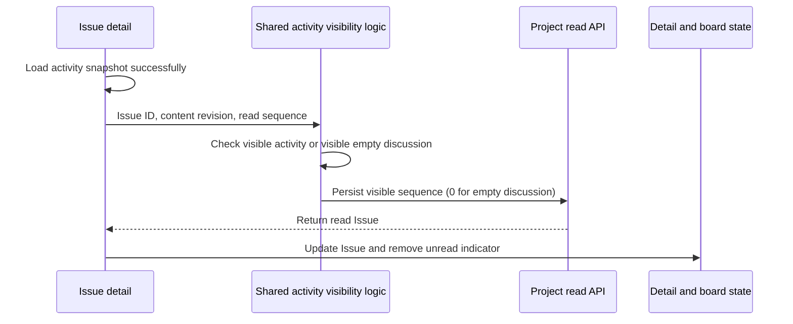

# Issue unread state

Issue unread state belongs to the current user and persists in existing Issue metadata. Reading does not change the Issue version or update timestamp and requires no schema migration.

Desktop `TaskActivityView` and shared `IssueActivityPanel` both use `useIssueActivityScroll`. Desktop selects the cloud or local API according to the project's storage location and updates detail and board state through the existing `onTaskUpdated` callback.

- An Issue containing only its creation record must become read after its activity loads successfully and its detail is visible.
- Advance the activity cursor only through visible messages. Offscreen replies must not inherit a sequence from the entire discussion card.
- Recheck when incoming activity becomes visible without requiring a scroll event.
- Persist a changed unread content revision even when the message sequence remains unchanged.
- Confirm local read progress only after a successful request. Report failures and keep the cursor available for a later visibility event to retry. Failed subscriptions must not count as loaded empty discussions.
- Deduplicate identical pending reads and isolate read state when switching Issues.

## Regression verification

`useIssueActivityScroll.test.tsx` covers empty discussions, hidden details, visible and offscreen messages, failed read recovery, incoming messages, content revisions, pending request deduplication, and Issue switching.

`TaskActivityView.test.tsx` covers cloud and local API selection, empty discussion state propagation, subscription failures retaining unread state, visible sequence persistence, and read error recovery.

The existing desktop CI checkpoint `collaboration-issue-comment-notification` verifies reading an empty discussion created by another member, board indicator removal, persistence after closing and reopening, and activity cursor persistence through a comment deep link. Follow repository execution policy when running E2E or real Electron verification.
