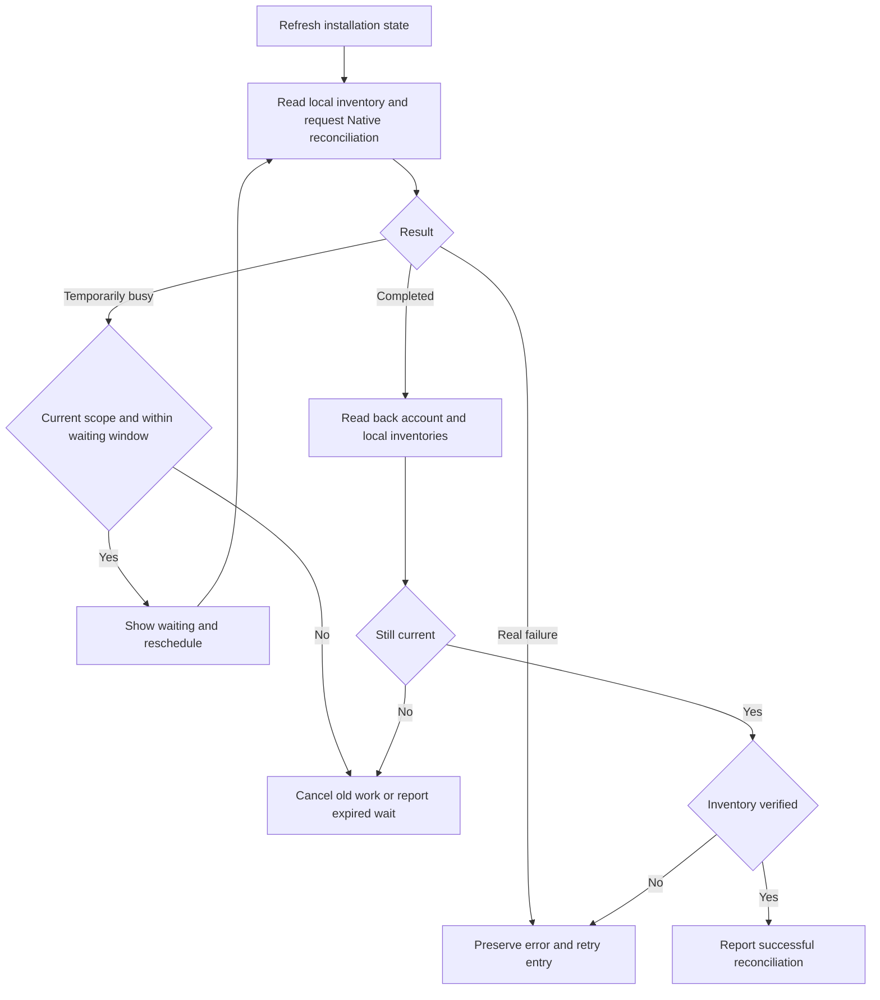

# Local plugin execution without device registration

Local install, uninstall, update and reconciliation use authenticated account HTTP and local IPC. Device registration, a device ID, Socket connectivity and other-device acknowledgements are not prerequisites. Ordinary local plugin commands keep their local authentication flow; managed account commands use the Native authorization below. Cloud and legacy clients retain Device/Socket permission checks.

## State ownership

`InstalledPlugin/default` remains authoritative account intent. One `plugin_states` table adds unique `(user_id, plugin_key)` identities without modifying shared `kinds` columns or indexes. No independent operation ledger or snapshot history is created. There are no records in a `plugin-local-sync` namespace.

Each plugin state retains its own generation and device watermarks; `installed_kind_id` binds the original installation through catalog renames. `spec.localIntentOrders` fences old requests per instance/plugin. `spec.localIntents` retains only one latest acceptance marker per instance/plugin: operation ID, request hash, order, installed ID, action and installed revision. It stores no complete plugin copy or operation history. Markers, watermarks and account changes commit atomically under installation Redis leases and CAS.

Native persists original requests before HTTP in an account/Backend-scoped journal without tokens. The shared Socket/HTTP installer owns real files, manifests, generation ordering, tombstones, validation and publication.

HTTP and Socket deliveries of the same plugin target share preparation and publication, while each response retains its own generation. The target fingerprint covers the installation and plugin identities, enabled state, version, package checksum, and component configuration. Sharing installation targets across generations requires a trusted checksum, which also allows temporary download URLs to be ignored. The manifest retains the fingerprint and equivalent ordering range; publication always preserves the newest accepted generation. A changed target, update, or removal ends the previous equivalent range, so a later return to that target cannot revive an obsolete operation. Shared failures and cancellations never confirm successful installation.

After a shared download failure, a waiting request with a different download path rechecks ordering and tries its own path once. Failures using the same path, verification failures, and cancellations still reach the caller and never imply successful installation.

Connected devices submit their precise registered record route as the optional origin; unregistered local instances leave it empty. The Backend retains a supplied but ambiguous origin and defers its background broadcast instead of treating failed resolution as an instruction to synchronize every device. Local HTTP operations still complete independently.

Manual reconciliation treats Native `plugin_local_sync_busy` as a deferral signal, rereading and checking again after 500 ms, then 1 second, capped at 2-second intervals within a 30-second waiting window. It schedules state checks without creating new install, update, or uninstall intents; the journal retains its existing request recovery. Foreground operations suspend checking, which resumes with fresh state afterward. Account, Backend, device, or request changes cancel old work. Real failures and expired waits remain visible, and success requires inventory readback verification.

After a Rust device reconnect, plugin acknowledgements commit one installation at a time, each with its own plugin lease, transaction, and CAS validation. Persistence does not hold every plugin lease together, and one busy plugin does not prevent other acknowledgements from committing. The entire round retains its 20-second write budget. Database conflicts retry only the transaction without resending an executed device operation; unrecorded plugins remain pending and diagnostics identify the installation.

## Execution

1. Probe `POST /api/plugins/local-sync` with `probeOnly=true`; require protocol 1 and contract revision 3. Backend probing performs no writes.
2. Submit original account mutations through the existing Python endpoints with `delivery_mode=local_pull_v1`, operation ID and intent order.
3. Replay matching latest markers without executing the mutation again. Persist the desired state and marker together for new accepted writes.
4. Read the current plan through the same Rust endpoint and apply it through local IPC. Plans are returned directly and never persisted. There are no snapshot IDs or receipt endpoint.
5. Complete locally after real application, without cloud acknowledgements. Targeted mutations use deltas; full reconciliation discovers legacy changes and implicit removals.
6. Reuse existing background Socket dispatch and registration-time synchronization for cloud devices. Optional source routing never gates local operations. Automatic updates retain the existing account batch mutation.

## Recovery and rollout

Timeouts, missing/mismatched acceptance headers, 5xx, authentication failures and unknown conflicts retain the original ID, order, action, target and payload. They do not trigger a legacy fallback.

A compacted request cannot override later intent: persistent watermarks fence late arrivals. Only a matching explicit `409 INTENT_SUPERSEDED` with `X-Plugin-Operation-State: superseded` archives the original request as superseded. Installation revision changes from legacy APIs, another instance or automatic updates also fence accepted replays. Ordinary acknowledged business rejections retire only unaccepted requests. Absence of a compacted marker is not proof of nonacceptance: rejection acknowledgement also requires an order newer than the retained instance watermarks.

Pending recovery runs independently from full snapshot HTTP/application and merges its result into the freshly loaded journal. Automatic update and reconciliation scheduling remain independent; real file publication remains serialized.

Queued foreground operations and scan publication validate the Backend, account token and installer Socket. Pending account HTTP recovery validates only the Backend and account token. Runtime-token renewal alone does not interrupt this work. Account or Backend replacement still rejects old-profile requests, and Socket replacement still fences publication through the captured installer.

Before application, persist only the existing `reconcilePending` marker, never a copy of the execution plan. Recovery fetches the account's current plan. Reading an older journal converts its `snapshot` object into this marker and removes the copy while preserving original pending requests and ordering. Foreground submission and background recovery share attempt, acceptance and rejection handling.

Pending submission starts before full content scanning. Fingerprints run on a blocking thread without the foreground execution or journal file lease. Before writing back, the coordinator revalidates the account, journal execution state and manifest revision, preserving acceptance results merged during scanning. New foreground operations or publications invalidate old scan results. A separate scan lease remains with the worker through cancellation, preventing duplicate scans from accumulating.

Scans use the existing monotonic intent order to identify new foreground requests. Acceptance, definitive rejection and superseded archival are recovery progress and merge without rescanning; their reconciliation markers and cache invalidation remain intact.

## Installation write coordination

The shared key is `wegent:plugin-write:{user_id}:{InstalledPlugin.name}`. Existing
stable name derivation is available before first installation; legacy names also
retain their own lease. Device identity cannot partition account-owned writes.
TTL is 30 seconds, Python renewal is every 10 seconds, operation budget is 20
seconds and single-target acquisition waits up to three seconds. Multi-target
operations acquire sorted names without waiting and roll back before releasing
partially acquired leases.

`InstalledPlugin.spec.writeRevision` fences installation, authentication and device
writes. Whole-document replacements preserve and compare it; final commits advance
it by CAS. The existing `spec.revision` remains the desired-state revision. Soft
uninstall retains the parent row for reinstall and late-receipt fencing. Existing
v2 generations, watermarks and desired-state comparisons reject obsolete receipts.

Healthy catalog reads take no installation write leases. Only detected catalog
drift or duplicate groups are leased and revalidated before repair.

The probe advertises `pluginSyncVersions=[2,3]` and new Native clients select 3. Runtime features retain `protocolVersion=2` for existing servers and explicitly advertise `supportedVersions=[2,3]` for V3 negotiation. V3 uses `plugin_sync.revisions[installedId]` and `intentRevisions[installedId]`. Snapshots carry `complete=false` and explicit `removed_plugins`; absence never removes another plugin. Full Skills/MCP snapshots use a separate `@capabilities` stream that ordinary plugin operations never touch.

Snapshots capture plugin metadata revisions before reading intent, then CAS-publish included plugins. Desired-state mutations advance only their own plugin metadata. V3 acknowledgements validate each plugin's generation, device watermark, current intent revision and desired state. V2 snapshots use the `@legacy-v2` aggregate generation and CAS the captured plugin revisions before publishing. Ordinary mutations only advance their own state and never update the account aggregate. New plugin states inherit the V2 generation baseline only when created, then advance independently.

Single-device and batch acknowledgements share one persistence entry point.
Metadata CAS conflicts use the existing limit of three transaction attempts,
rolling back, releasing leases and rereading current state each time. Only database
writes are replayed, never remote execution. Busy locks in ordinary operations,
unavailable Redis and lost leases still fail directly.

Python full-snapshot reconciliation retains metadata CAS for catalog
preparation and acknowledgement persistence; V3 fences only the involved plugins. Only these two database transactions
may back off after contention, after rolling back and releasing all leases and
sessions. They reread state at 50/100/200 ms intervals capped at 250 ms within each
transaction's existing 20-second budget. Waiting to persist an acknowledgement
does not resend the executed device RPC. Changed desired state still requires a
new snapshot, so an old acknowledgement cannot confirm current state. Account
installation, update and removal requests are not resubmitted.

Authentication validates the actual account policy using a final conditional no-op
update until commit; ordinary authentication never advances that policy revision.
Installation/update/uninstall do not depend on the policy. Genuine policy edits
retain their dedicated lease; first metadata creation uses the new unique database identity. Local
journal leases are released across HTTP, adapter and installer waits; existing
per-plugin preparation and short manifest publication locks remain.

Before a parent exists, atomic insertion claims its plugin state. The unique key remains protected until database COMMIT or rollback even if Redis expires. Installation creation then CAS-updates that plugin's creation counter and binds the installed ID in the installation transaction. An expired creator cannot overwrite the successor's binding. Soft removal retains the parent, counters and ordering watermarks; different plugins can commit independently.

Old user keys and new plugin keys do not coordinate. Deployment and rollback must
stop acceptance and drain old writers before switching both Python and Rust
Backends. Mixed rolling deployment is unsafe. The v2 client protocol remains
compatible; local concurrency requires the updated desktop.

Deploy all Backend, gateway and Runtime replicas before enabling `PLUGIN_LOCAL_SYNC_ENABLED` (default false). Legacy requests without the mode preserve their original behavior. Contract 3 does not mix with contract 2 from earlier PR revisions. Disabling new acceptance retains replay and reconciliation for existing instances. Old local pending requests are preserved; obsolete receipt entries are no longer sent.

Focused tests cover no-device lifecycle, bounded acceptance slots, request hashing, rollback, compacted and legacy-write supersession, isolation, independent recovery, and Runtime-token renewal during queued operations, both scan phases and pending recovery. Independent connection-field changes verify the account, Backend and Socket validation boundaries. Existing CI invokes real HTTP/MySQL/Redis coverage and the desktop `plugin-write-coordination` checkpoint. Actual release-package compatibility for 1.0.0, 1.1.0 and 1.1.1 remains unverified.

## Managed account commands in local conversations

The Rust `POST /api/plugins/native-auth/exchange` endpoint issues a restricted
`plugin_native` session after the main process proves possession of the private
key bound to its existing desktop refresh token. Proofs bind the exact request
path, method, token and time; short Redis TTL markers reject replays. Sessions
expire within one hour and cannot authorize shared user, Device, Task or
Workspace APIs. Neither the private key nor the Native session enters renderer.
Older Backends returning 404 retain the existing Socket transport. HTTP failures
do not silently fall back to Socket.

Executor reuses the existing Broker and adapter pipeline. Account/Backend
switches cancel the Broker; same-account access-token rotation preserves its
endpoint. Sessions bind the current profile and late previous-profile responses
are discarded. Device registration status remains accurate, and cloud Device
grants and Runtime checks are unchanged. Ordinary local SDK commands retain their
existing local authentication flow.

The authorization channel adds no further tables, columns or execution ledger. Existing connection,
migration and transfer records share their installation write lease. Optional
JSON fields hold Native key grants (`localGrants`), keyed source observations
(`nativeAuthSources`), pending login generations and Native lease ownership.
Legacy credential writes preserve applicable Native grants; definition changes
and logout revoke them. Exclusive transfers keep escrow until durable adapter
detach, including lost acceptance replies. Uncertain OAuth refreshes require
reconnection rather than reusing a potentially consumed refresh token.

Automatic authentication reuses the existing task. Startup, Backend reconnection,
managed inventory changes and successful local login/logout trigger reconciliation.
Inventory events select changed enabled managed installations; lifecycle events clear
only the target cooldown. Safety audits run every 300 seconds with per-process ±30
second jitter, unaffected by intervening events. Each audit drains all batches of up
to 16 installations, with at most four adapter actions per batch. Failures retry after
30, 60 and then 300 seconds; removed installations lose their retries. Success
cooldowns do not create minute polling. Revocation keeps its existing 15-second
checks and backoff; session refresh is unchanged. Empty inventory returns without
an automatic-auth Backend query. Native HTTP business reads, status and preparation
do not advance installation write revisions. Local-device automatic `prepare_only`
on the legacy Socket path is also read-only, without batch installation leases.
Intent creation and credential writes acquire their target installation leases and
validate CAS.

After credential enrollment, OAuth updates or exclusive transfer commits, Rust
Backend publishes `plugin.auth.changed` through the existing Socket.IO Redis
adapter to the same account. It contains only the installation ID. Cloud/Remote
executors immediately reconcile that installation under existing account policy
and device authorization. Local executors ignore the hint to prevent export loops.
The low-frequency audit recovers lost notifications.

Real HTTP/MySQL/Redis tests cover no-Device sessions, user/key isolation, Python
ciphertext compatibility, refresh/revocation and escrow replay. The existing
CI-covered `plugin-account-auth-password` checkpoint also exercises local chat
and install/update/uninstall after a real Backend registration rejection,
without weakening its legacy assertions.

## State migration

`a5b6c7d8e9f0` checks ambiguous active legacy state, duplicate installation identities and malformed counters before DDL. It projects generations, device watermarks, creation counters, acceptance slots and request order into plugin state and removes the old active synchronization Kind. Retained baseline history preserves orphan receipts from catalog repair. Downgrade merges maximum watermarks and latest receipts before restoring the old Kind and dropping the new table.

Drain old backend plugin transactions before switching Python and Rust together; old binaries must not write the removed Kind after migration. New backends explicitly serve old desktops through V2. Tests upgrade, downgrade and upgrade again on disposable databases. Production migration remains part of deployment.
