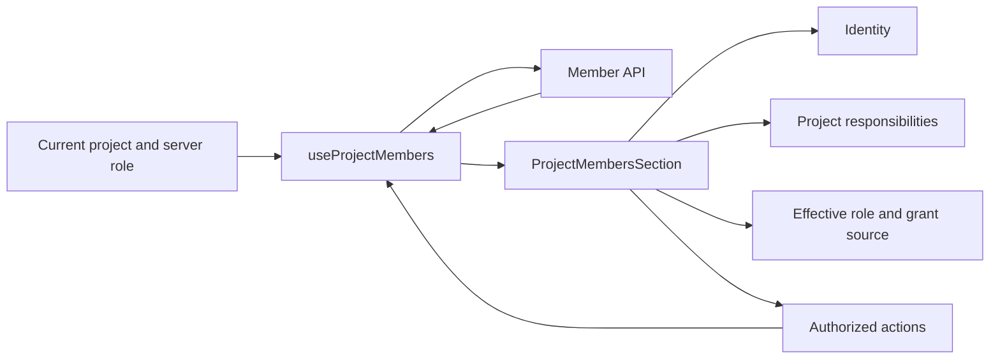

# Project member settings

The member page uses a compact neutral settings layout with four cells per row: identity, responsibilities, role and source, and actions. Inherited-source information stays inside the role cell so it cannot displace the role control or action button.

Roles use product labels such as Administrator, Member and Viewer. Inherited sources use the space name provided in the project response. If unavailable, the page says “Inherited from parent space”; it neither displays database IDs nor fetches the space catalog.

Inherited roles are read-only within a project. When inheritance and direct invitation coexist, the page shows the effective inherited role separately from the editable direct role. Project administrators can edit inherited members' project responsibilities without changing their roles.

The membership setting explains that space administrators retain governance. The control is hidden when an older server does not provide that capability. Read-only viewers cannot add members, change roles or remove grants.

Responsibilities save on blur. Member mutation controls are disabled while saving. Loading, empty results and failed saves are distinct states. Project changes reset member editing state, and responses from the previous project cannot update the new project.

Desktop uses aligned columns, light dividers and neutral role markers. Mobile uses horizontal settings navigation and stacked member information with targets at least 44px high. Blue rings indicate keyboard focus, and Escape closes the member picker.

The implementation lives under `packages/collaboration/src/project-manage/`. Presentation and member state are separate modules. Tag and extension presentation use separate components, while the project mutation queue retains version checks.

Regression tests cover localized roles/sources, four-cell rows, inherited read-only grants, combined grants, responsibilities, failed saves, project isolation, missing older-server capabilities and loading/empty states. `ProjectMembersSection.test.tsx` and `ProjectManageView.test.tsx` run in shared-component CI. Desktop member checks extend the existing `collaboration-shared-core` scenario. E2E and `ai:verify` were not run for this change.

Component previews were inspected at 1440×900 and 390×844. The mobile document width was 390px with no page-level horizontal overflow. Previews use sample members and do not claim real Electron verification or deployment.

Architecture transaction `tx-76face5c9721` merged into `A00000003`. The UI is `arch://wegent/ui/287398da`; member UI tests are `arch://wegent/test/8e6bb2c4`. This view does not change the CP permission contract.

## Verification record

On 2026-10-14, all 830 shared-component tests passed, together with shared/web/desktop TypeScript checks, ESLint for six changed presentation/controller files, formatting checks and two CP contract guards. The desktop E2E addition passed syntax checks and is called by the existing CI checkpoint.

Compilation and full-suite testing ran separately using `pnpm --filter @wegent/collaboration test --maxWorkers=1`, retaining the existing five-second test limit. An earlier run concurrent with compilation had six timeouts, recorded as validation-environment resource contention. No tests were skipped, retried automatically or given longer timeouts.
