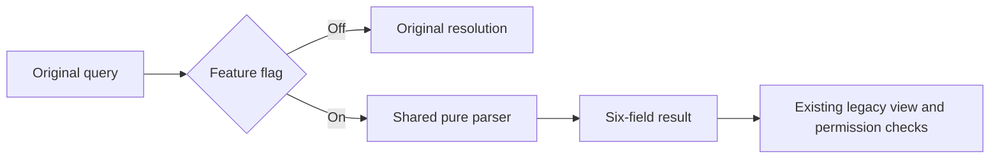

# Project surface contract

`@wegent/collaboration/project-shell/projectSurfaces` owns shared project-view semantics.
It parses entry points without changing navigation layout, authorization, or data models.

| Legacy view | Surface | Mode       | Timeline subview |
| ----------- | ------- | ---------- | ---------------- |
| board       | work    | board      | null             |
| calendar    | plan    | timeline   | calendar         |
| gantt       | plan    | timeline   | gantt            |
| table       | plan    | table      | null             |
| milestones  | plan    | milestones | null             |
| files       | admin   | files      | null             |
| manage      | admin   | settings   | null             |

Every result contains exactly `surface`, `mode`, `legacyView`, `timelineSubview`, `lossy`, and `unsupported`.
The registry covers every existing `CollaborationView`, including extension views.
Adding a registry entry requires handling the resolver's exhaustive `never` branch.

## Query rules

- A valid `view` wins over conflicting or invalid surface parameters.
- Otherwise, resolve `surface+mode`. A valid new pair supersedes an invalid legacy parameter with `unsupported=false`.
- Missing modes default to work→board, plan→timeline, and admin→files.
- Timeline without a valid legacy hint defaults to calendar with `lossy=true`; other valid pairs are exact.
- No selection parameters means exact work/board.
- Invalid selections without a usable mapping return work/board with both flags true.
- Values are case-sensitive; empty values are invalid, and repeated keys use the first value.
- Parsing reads the query without rewriting it. Hosts still own existing path migration and explicit navigation.

## Flag and rollback

`collab.projectSurfaces.v1` defaults to false. Hosts check it outside the parser, so disabled renders invoke neither resolver.
Enable Web with `NEXT_PUBLIC_COLLAB_PROJECT_SURFACES_V1=true`, or desktop with
`VITE_COLLAB_PROJECT_SURFACES_V1=true`. Desktop's existing runtime configuration accepts
`featureFlags`, overriding build configuration, including an explicit false.
Both hosts also accept injected flags; changing them restores their original resolution path.
There is no flag persistence, data migration, or new settings UI. Desktop `wework://` protocol rules are unchanged.

## Verification

`src/project-shell/__fixtures__/resolver-matrix.json` retains the supplied 15 golden cases.
Additional tests cover conflicts, invalid values, duplicate keys, prototype-property names,
flag isolation, theme changes, and runtime rollback. A compiler test adds a registry entry
in memory and requires the only error to occur at the resolver's `never` branch.

Run `pnpm --filter @wegent/collaboration typecheck` and focused package tests.
The default Chromium CI suite collects `frontend/e2e/tests/collaboration/project-surface-links.spec.ts`
for all seven legacy links. E2E and pixel comparisons require separate execution;
passing unit tests does not establish pixel equivalence.
