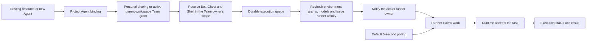

# Wework collaboration execution and authorization

Project Agent bindings, Agent resource owners, Issue assigners, and runner owners are distinct identities.
A project member can use an Agent authorized in its parent workspace without receiving permission to modify the source Team, Bot, or another user's model credentials.

## Resources and editing

- Workspace Team access must match an active grant in the project's parent workspace. Removing that grant removes this authorization path.
- Resolve Team dependencies in the resource owner's scope. Continue validating execution models against the executing user's capabilities; sharing a Team does not expose another user's private model credentials.
- The server returns `can_edit`. Personal Teams require ownership; group Teams require Developer permission in their group. Project management permissions do not replace resource editing permissions.
- Local resources have no Team ID. The existing-Agent picker uses their supplied `project_binding_input` and preserves local execution configuration.
- The local resource catalog ensures the current-device Agent exists. Project configuration offers both existing-Agent selection and Agent creation.

## Delivery

The durable queue, atomic claim, and Runtime acceptance control task delivery. A wake notification only announces work; it carries no task and does not establish execution success.
Routed work notifies eligible devices using their owners' connection identities, after checking current grants, models, and Issue runner affinity.
`LOCAL_RUNTIME_WORK_POLL_INTERVAL` overrides the default five-second interval. Reconnection and availability notifications still initiate an immediate pull.

## Stand-in assignment identities

For a direct human assignment, `human_task_binding.assignmentId` identifies the
Issue assignment event. In a collaboration round it identifies the manager's
member work; the additional `issueAssignmentId` identifies the current Issue
assignment event. Executor uses the latter for current-assignment validation and
reception receipts, persisting it as `issue_assignment_id` in task binding
metadata while retaining the member work ID for round coordination. Receipts
still require the current recipient, an owned device, and an owned task binding.

Manual delegation from a notification without an execution omits the stand-in
ID so Executor resolves an identity connected to the project, rather than
assuming `default`. Reassignment creates a new assignment event and an independent
stand-in task. The CI-covered `stand-in-assignment-notifications` suite verifies
notification dispatch, manual delegation, reassignment after completion, and
round reception receipts together.

## Verification cases

1. A project Maintainer can bind another member's workspace-authorized Agent while global configuration permissions remain unchanged.
2. Revoking the workspace Team grant blocks new bindings and execution across its child projects. Personal sharing does not bypass the workspace grant.
3. Shared runners receive notifications through their own identities, and revoked runner grants stop notifications.
4. A Bot routing-only update preserves its name and Shell and saves without uninitialized state.
5. Local projects can reuse the current-device Agent without creating a fictitious Team reference.

Focused unit and API tests cover these contracts. Desktop regression coverage extends the existing CI-covered `collaboration-local-agent-dispatch` scenario. Run local E2E and `ai:verify` only when explicitly requested.
