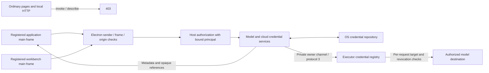
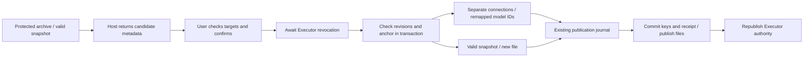

# Wework desktop credential storage and migration

The desktop Host owns persistence for model keys, cloud refresh tokens and device private keys. The native OS credential repository owns secrets and transaction commit state. Model files contain connection metadata and references. Renderers and ordinary Executor clients cannot read these business credentials.

## Trust boundaries



- Identity comes from registered web contents, the actual main frame and its expected origin. A workbench must also belong to an active runtime; the Host binds its principal and capabilities.
- HTTP electron-host describe/invoke always reject requests. Host, Origin and Fetch Metadata headers do not establish identity. Plugin clients also use preload IPC.
- Generic `secureStorage` rejects `wework-model-key.*`, `wework-models.*`, `wework-cloud.*` and `wework-mirrors.*`. Dedicated services use business credentials internally.
- Trusted Core plugins share the application JavaScript environment. Isolated rendering surfaces remain in the application trust domain. This design does not isolate secrets from malicious native plugins, arbitrary code running as the same user, full Host RCE or administrators. WW-29 still requires its own fix.
- Replacing an API key alone does not change a request destination. Credential use also binds the provider, complete request URL, model, protocol and proxy. Changing a destination or authentication path requires explicit authorization with a newly supplied key.

## Repository and transactions

The native stores are macOS Keychain, Windows Credential Manager and explicitly selected Linux Secret Service. Linux does not fall back to keyutils, memory or plaintext files. Unavailable storage produces a stable error and never creates a disk master key. See the native dependency's [platform selection implementation](https://github.com/Brooooooklyn/keyring-node/blob/v2.1.2/src/entry_builder.rs).

`credential-profile.json` holds only a version and random profile ID. An OS-protected locator binds the canonical data directory. Copying files does not export the OS repository or authorize another profile. Directory, brand, OS user and machine changes require a recovery or reauthorization procedure.

```mermaid
sequenceDiagram
  participant Host
  participant Lock as Process lock
  participant Vault as OS repository
  participant Disk as Application files
  Host->>Lock: Acquire and continuously verify ownership
  Host->>Vault: Load profile / current / pending / retired
  Host->>Vault: Validate all current bytes; preserve recovery sources on failure
  Host->>Vault: Remove uncommitted pending and retired generations
  Host->>Vault: Register new pending generation
  Host->>Vault: Write and read back every chunk
  Host->>Vault: Switch current to candidate: commit point
  Host->>Vault: Remove retired generation and transaction state
  Host->>Disk: Remove migrated application-owned weak files
  Host->>Lock: Release
```

The logical repository limit is 16 MiB. Each raw chunk contains 1,500 bytes, producing at most 2,000 ASCII bytes after Base64 encoding. The native adapter uses explicit UTF-8 byte APIs. After an asynchronous native operation times out, the process rejects further operations to avoid treating a late write as absent. This timeout does not promise native cancellation or interruption of synchronous initialization.

A protected model publication journal commits new keys, the valid snapshot, file ownership and publication intent in one repository generation. It then atomically publishes YAML and binding files before retiring references no longer used by any registered file. Recovery accepts only the previous or candidate file contents and never overwrites unrelated external edits. File publication synchronizes the file, renames it and synchronizes the parent directory on non-Windows systems. Actual power-loss behavior requires platform verification.

Recovery validates the complete current generation before removing pending chunks, retired generations or legacy files. Missing, corrupt or inaccessible current data preserves recovery sources and reports an error; it never silently trusts an old backup. Reads and updates reuse the validated values within the same lock instead of loading the generation twice.

## Migration and recovery

| Source                                   | Migration and failure behavior                                                                                                                                                                                                 |
| ---------------------------------------- | ------------------------------------------------------------------------------------------------------------------------------------------------------------------------------------------------------------------------------ |
| `secure-values.json` and `.key`          | Strictly validate versions, the 32-byte key and all AES-GCM entries. Remove weak files only after protected commit and readback. Missing keys, invalid tags and unknown formats reject migration.                              |
| Inline keys in `model.yml`               | Before publishing application capabilities, the Host reads the default or bound file, replacing keys with UUID references and `credential_protocol: 3`. Invalid files retain a visible error and the protected valid snapshot. |
| Legacy renderer model list               | Protect the original source, strictly convert it and import model IDs not already owned. The renderer no longer merges localStorage models into its runtime catalog or performs import.                                        |
| `cloud-credentials.json`                 | Migrate the complete device identity at startup, validate the public/private key pair and preserve the device public key. Corruption never silently creates a replacement identity.                                            |
| Cloud preferences and renderer mirrors   | Move tokens into the OS repository; persisted mirrors retain metadata. Preserve conflicting sources privately without replacing the selected identity.                                                                         |
| Known damaged copies and temporary files | Process only application-owned matching names. Protect exact original bytes before removing a weak copy. Do not silently delete unknown backups.                                                                               |

Choosing a valid model file explicitly resolves a blocked publication and ends automatic legacy-model import. The original import source remains protected for recovery. Save and selection wait for Executor revocation before mutation. Canceling selection preserves current authorization. Discovery runs serially with configuration changes; revocation interrupts connection probes.

When legacy and YAML model IDs collide, preserve the YAML ownership and archive the exact legacy source in protected recovery storage before removing the import source. Neither partial merges nor complete collisions may discard an old credential. Cloud migration rechecks its marker inside the protected transaction, preventing a delayed instance from overwriting a rotated token or restoring an identity after logout.

Only the transport-authenticated owner channel can replace Executor protocol-3 credentials. The binary removes the owner token from the environment before starting threads or shells and filters it from child environments. Client-supplied owner fields grant no authority. Runtime routes contain opaque references; every request rechecks the URL, model, protocol, proxy, lifetime and revocation state. Revocation cancels queued requests and streaming responses. Already transmitted bytes cannot be recalled.

Refresh tokens and device private keys do not return to renderers. Short-lived cloud access tokens still support existing cloud requests but are not persisted in preferences or localStorage. The Host restores legacy cloud access tokens only for their bound endpoint. Logout confirms disconnection after native cleanup; cleanup failures remain visible.

Recovery and release procedures must preserve these constraints:

- Never create plaintext compatibility files for downgrade. Old applications reject protocol-3 YAML; old Executors cannot complete the credential handshake. Ship matching Host, Executor and plugin components.
- Preserve protected markers after clear/logout so restored weak files cannot automatically resurrect credentials. For missing repositories or mismatched profiles, unlock or restore the original user's repository, or explicitly reauthorize. Do not overwrite evidence with a same-name empty repository.
- Other registered model files can still own shared credentials. Retire only references unused by every registered file. Protected recovery sources consume repository capacity and are not proof that a secret was deleted.
- Existing Kimi, DeepSeek and MiniMax normalization continues inside the Host using the shared catalog. It no longer depends on renderer reads from weak storage. Ordinary custom connections retain their stored protocols and capabilities.
- Logical file deletion cannot prove erasure from SSDs, Time Machine, snapshots, external copies, historical logs or crash dumps. Suspected prior compromise requires server-side key revocation, renewed cloud sessions and destination inspection.
- The Host and Executor necessarily hold decrypted secrets in memory. OS-backed persistence does not isolate heaps, process dumps or arbitrary same-user process access. Validate diagnostics and support bundles separately; never place authentication secrets in connection URLs or query parameters returned as public metadata.

Model settings provide a recovery entry. The Host reads candidates, receipts and their revision in one vault transaction and returns only opaque IDs and endpoint/model metadata. After confirmation, historical connections are imported separately with new local model IDs, catalog slugs and remapped internal vision references. Each key retains its archived destination. Current connections, existing conversation identities and original archives remain available; users explicitly select recovered models.



Restoring a valid snapshot creates a new recovered YAML file and switches the binding, preserving the damaged, missing or externally edited original. Source revisions, the current anchor, a receipt and new keys use the existing publication journal. Interrupted commits resume without duplicate imports. Unavailable vaults, missing keys and incomplete vision graphs cannot report success. A protected publication conflict permits opening settings for explicit recovery; vault failures still block startup.

The recovery capabilities use the existing sender/principal checks and wait for Executor revocation before committing and republishing. HTTP remains denied. The UI supports cancellation, refresh, failure retry and native selection of a valid file. Cloud token conflicts require reauthorization. Damaged archives, future renderer versions and unparseable data remain protected without speculative repair; files without secrets cannot reconstruct a lost vault.

The recovery unit suite covers concurrent/stale/forged requests, missing keys, damaged or missing files and faults before/after each of three protected transactions. The existing desktop model-settings checkpoint adds isolated historical fixtures, cancellation, separate connection recovery and new-file restoration. Registered E2E definitions do not establish an executed pass.

## Risks and verification gates

Cloud identity format and key-pair validation must precede legacy-file cleanup. An invalid protected identity preserves recovery sources and stops initialization. JSON parsing failures return a stable error without source excerpts in logs or UI.

This register identifies required checks; it does not claim all possible states have been verified.

| Risks                                                                         | Required scenarios                                                                                                                                                                                                                  |
| ----------------------------------------------------------------------------- | ----------------------------------------------------------------------------------------------------------------------------------------------------------------------------------------------------------------------------------- |
| R01–R03 Inventory, formats and legacy key                                     | All historical sources, empty install, unknown versions, corruption, invalid tags, missing/wrong-size keys, empty values and Unicode. Failure preserves original input.                                                             |
| R04–R07 References, identity, semantics and paths                             | Shared secrets, model aliases, identical upstream names across providers, device keys, every capability field, external/read-only/offline files, symlinks and path replacement.                                                     |
| R08–R10 Transactions, interruptions and concurrency                           | Fail before/after every native get/set/delete and publication stage; lost locks, concurrent instances, SIGKILL, actual power loss and disk errors. Mock fault injection does not establish physical durability.                     |
| R11–R15 Migration ordering, precedence and cleanup                            | Directory migration order, conflicting sources, post-commit cleanup, restored backups, known temporary/damaged files and cleanup reentry.                                                                                           |
| R16–R21 Consumers, entrypoints, plugins, targets, revocation and legacy cloud | Every model consumer; main/workbench frames; ordinary pages/subframes rejected; reserved namespaces; token substitution; destinations/redirects; vision caches; rotation and streaming; legacy connection restore.                  |
| R22–R23 Availability and waiting                                              | Startup readiness, locked repositories, denied/canceled authorization, sleep/wake, timeouts and late writes; recoverable UI behavior.                                                                                               |
| R24–R29 Release identity, profiles, platforms, packages, rollback and backup  | Signed upgrades, certificate changes, development/release builds, beta/stable, brand/directory changes, arm64/x64, real stores on three platforms, ASAR loading, mixed components, downgrade and machine/user changes.              |
| R30–R34 Logout, prior compromise, diagnostics, capacity and evidence          | Failed cleanup and neighboring profiles, preexisting malicious destinations, server revocation, logs/support bundles, maximum size/startup latency, coverage denominators, security mutations, CI discovery and statistical claims. |

`wework-credentials.yml` defines real native roundtrip, cross-process reads, rotation and deletion on three platforms. The existing desktop `model-settings` checkpoint includes HTTP rejection, reserved-namespace rejection and opaque runtime references. Local E2E and `ai:verify` execution require an explicit request; new scenarios must still run in CI.

`credential-upgrade.test.ts` combines real file stores, cloud identity, model configuration and mirror migration. It injects failures before and after every OS-store call in the full upgrade and verifies restarts, historical references, conflict archives, damaged-source preservation and file-publication recovery. Its explicit memory credential adapter does not replace native verification.

The native verifier uses a random namespace and temporary directories containing synthetic credentials only. It terminates child processes at eleven migration and recovery checkpoints and checks two fresh-process recoveries at each point. CI runs it by default; local execution requires an explicit synthetic-data mode. An Executor path enables production file-lock and concurrent-writer checks:

```bash
pnpm --dir wework/electron run build
ELECTRON_RUN_AS_NODE=1 pnpm --dir wework/electron exec electron scripts/verify-native-credentials.mjs --local-synthetic --executor /absolute/path/to/wegent-executor
```

The verifier deletes entries in its own namespace when it finishes. Process termination is not a power-loss test, and a local native pass does not validate signed upgrades, other operating systems or denied access.

Coverage reports must identify the source set, denominators, platform, execution evidence and exact revision. Unit coverage, risk mapping, native integration and migration reliability are distinct metrics. 99.99% line or branch coverage does not establish 99.99% migration reliability or an exhaustive risk universe. Release judgment requires CI for the actual change, native permission semantics, signed installation/upgrade and recovery evidence. Passing simulated-backend tests cannot replace those gates.
