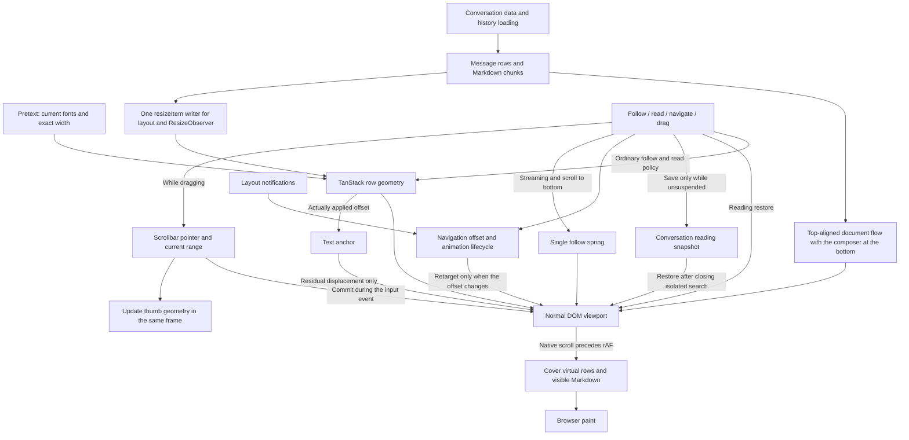

# Wework Message Scroll Verification

The shared conversation uses normal DOM coordinates: `scrollTop = 0` at the top and `max(0, scrollHeight - clientHeight)` at the bottom. Desktop workbenches, temporary conversations and web Issue conversations share this implementation. Short conversations start at the top, leaving spare space between the messages and the bottom composer. Once content overflows, follow or read mode controls scrolling. The scrollbar uses the same real range.



Drag input uses current geometry to update the viewport position and thumb transform immediately. Do not wait for a later `scroll` event to paint the thumb or defer the scroll write to another rAF. Browsers dispatch native `scroll` before rAF; virtual rows and Markdown chunks must cover the new viewport before paint. Writing the scroll position inside rAF misses that phase and can expose placeholders or blank content for one frame. Short-conversation regressions must first establish that content fits within the viewport; message count alone does not establish this prerequisite.

Implementation invariants:

- The message content container uses a forward flex column. Never push short conversations down with `justify-end` or a leading spacer. TanStack end anchoring controls overflow scroll positions, not document-flow alignment. Virtual and nonvirtual lists share the same layout.
- `useConversationVirtualizer` uses TanStack `anchorTo: 'end'` and `followOnAppend` for ordinary prepends, appends and row-size compensation. Navigation uses start anchoring. Reading disables append follow and end tolerance; even a few pixels of upward movement must pause following.
- There is no reverse-coordinate adapter, scrollHeight-delta prepend guess or delayed positioning retry chain. Sample a semantic anchor before history loads; nonvirtual short conversations preserve actual text displacement too.
- Navigation loading and mounted targets share cancellation: a new click, viewport input, or external scrollbar input cancels the previous target. Stale asynchronous results cannot reposition the viewport or clear newer loading state. Scroll commands and completion checks use the same target offset, including top spacing and range limits. Layout notifications retarget only when the offset changes; initial observations and unrelated resizes cannot interrupt native smooth scrolling.
- A scrollbar drag gives the pointer exclusive viewport ownership, disabling row-size compensation, text anchoring and bottom follow. Measured content changes remap the grabbed thumb point using the current range. Release samples the current position and returns to reading or bottom follow. Drag frames save numeric snapshots without scanning text anchors.
- The waiting indicator is a virtual row. `scrollMargin` accounts for the preceding history button. `paddingEnd` includes content footers and the sticky composer; subtract their height from the list sizer because these real footers already participate in document flow.
- Every row measurement uses `resizeItem` with `Math.round(getBoundingClientRect().height)`. Synchronous Markdown layout and one ResizeObserver call the same function; they do not also use TanStack `measureElement`. Hidden zero-size rows cannot overwrite valid heights.
- Pretext estimates unmeasured content; real DOM geometry remains authoritative. Use current UI fonts, paragraph line heights and exact widths. Prepared text is independent of width. Fenced code uses unwrapped line counts and process sections use their default collapsed height.
- Cached rows validate the actual message-column width, layout classes, typography, font-loading revision and content signature. Measure the column during layout before enabling virtualization and restoring or estimating heights; viewport width cannot substitute for column width. Cache fingerprints of complete block content so equal-length changes also invalidate a measurement. Expanded, edited or search-specific sizes are excluded. At most 50 conversations are retained; task aliases migrate snapshots, sizes and validity metadata together, and eviction removes them together.
- Search prepares the selected range and starts one native scroll. Navigation owns the viewport until `scrollend` or arrival at the target. Pausing, replacing the target, unmounting and reader input cancel an unfinished animation. Manual input cancels positioning while highlights keep updating with loaded messages. Navigation completion cannot reclaim ownership already handed to reading or dragging.
- `overflow-anchor: none` prevents another anchoring owner. TanStack owns row geometry; the text anchor only corrects residual displacement: `correction = ΔanchorOffset + ΔreaderScrollTop`. Exclude actual engine writes and range clamps from reader movement. If the original node disappears, resample rather than using its old ordinal to select another paragraph.
- Switching conversations uses saved snapshots without scanning the outgoing transcript during unmount. Follow snapshots save zero bottom distance; reading snapshots save distance and resolvable message/item/text identity. Suspending automatic scrolling for search or a hidden pane also suspends snapshot writes: temporary navigation in isolated search pages must not overwrite the original conversation snapshot. Restore-generated scroll events cannot overwrite the reader's position.

| Trigger                                               | Ownership and expected behavior                                                                              |
| ----------------------------------------------------- | ------------------------------------------------------------------------------------------------------------ |
| Ordinary append, waiting indicator, streaming growth  | Follow continues; reading retains its position                                                               |
| Own message or guidance submission                    | Resume following                                                                                             |
| Wheel, touch, scrollbar or keyboard                   | Cancel programmatic scrolling immediately; upward movement pauses, downward arrival at the bottom can resume |
| Scroll-to-bottom button                               | Clear manual input and enter follow; retain ownership across future size changes without a release timer     |
| Search or turn navigation                             | Cancel prior commands; actual layout and scrollend settle positioning; user input interrupts                 |
| Side panel, font change, expansion or history prepend | Update real sizes and preserve the same text position                                                        |
| Hidden pane                                           | Suspend scrolling and restore the previous follow/read policy on display                                     |

Keep these ordering and send invariants:

- When reopening a long conversation, the canonical turn-level conversation view must merge by the global `messageIndex` returned by the executor transcript. A locally preserved stopped turn that is absent from the paginated snapshot must return to its original position instead of being appended after the latest AI response; temporary turns without an index may use message timestamps as a secondary ordering key. Provider transcript pages remain Provider-owned: deduplicate them by stable IDs without merging local stopped turns into them or bypassing their pagination.
- When an idle task receives a new goal, the goal and first instruction must be sent atomically through one `runtime.tasks.send`. Codex `thread/goal/set` automatically starts the goal turn, so the executor must await that turn instead of issuing another `turn/start`; otherwise the real output is associated with the wrong position while the duplicate idle turn eventually shows a “Message generation failed” error after 180 seconds.
- Regression coverage must send a message in a long-history real Electron conversation, pause the model response, and assert that the scroller is at the bottom and the waiting indicator is fully contained by the scroll-container bounds.

## Streaming Rendering Ownership

Streaming text and scroll following each have exactly one scheduler. Component animation, direct scrolling, and delayed scroll timers must not compete:

- `useBufferedStreamingText` only coalesces text updates received within one frame into the next animation frame. It must not maintain a typewriter queue that trails the authoritative message content; the next frame must commit the latest complete prefix, with a short timeout fallback when frames are unavailable.
- `Streamdown` remains in `streaming` mode for incremental Markdown parsing. Existing windowing and freezing continue to own non-tail Markdown blocks; animation must not rebuild the whole message tree.
- Streaming auto-follow in `ScrollableMessageArea` is owned by one damped spring. ResizeObserver callbacks, message appends, and runtime-state changes may only ask that spring to keep tracking the latest bottom; they must not also perform streaming jumps or schedule stabilization timers.
- While the spring owns following, disable TanStack append follow and end-resize compensation while retaining virtual row geometry. In reading mode, TanStack compensates row changes before the viewport; the text anchor corrects residual within-row reflow.
- Upward input, navigation and auto-scroll suspension cancel the spring and pending TanStack commands immediately. The bottom button reuses the same spring instead of creating a second smooth animation.
- With `prefers-reduced-motion`, skip spring motion and position the viewport at the bottom immediately.

Run E2E and `ai:verify` only when explicitly requested. Otherwise run focused unit tests and type checks. Desktop regression entry:

```bash
cd wework
pnpm e2e:desktop:streaming-text
```

The scenario uses real backend requests and a deterministic SSE response stream supplied by the desktop E2E harness. It pauses the server before output begins so the race between the user message rendering and the later waiting-indicator and virtual-list measurements is deterministic. Do not hide a scroll regression by skipping the scenario, mocking frontend requests, or weakening the bottom or visibility assertions.

Streaming rendering changes must also verify that frame coalescing immediately displays the latest complete prefix, including Unicode content, plus spring convergence, user-scroll pause, and bottom-follow recovery. The real Electron scenario must retain viewport-anchor evidence before and after later streaming appends and verify that those appends do not move the user-selected anchor. The explicit bottom-recovery regression must dispatch real pointer-down and click events, continue appending enough content to change the virtualized height after the click, and finally assert that the remaining bottom distance is within the scroll tolerance.

The ordering regression first stops a response, sends 26 follow-up turns to move the stopped turn outside the default transcript page, switches to other tasks, reopens the original task, and verifies that the latest AI response—not the “Stopped” notice—occupies the bottom position.

The `latest-conversation-history` desktop checkpoint covers an itemless failed turn in cached history: open the latest page, load the older page containing the failure, switch tasks, and reopen the conversation with the latest reply still at the bottom. Itemless turns must use their existing start or completion timestamps for ordering; a missing message timestamp must not disable ordering for the entire history. The checkpoint exercises the real executor, Codex history store, and Electron UI with test responses from the model service.

The goal-continuation regression verifies that one `runtime.tasks.send` payload contains both the goal and first instruction, then reads the real executor log to confirm that submission awaits exactly one turn automatically started by `thread/goal/set`, issues no extra `turn/start`, and renders no error card during streaming or after completion.

## Markdown chunk windowing contract

Markdown windowing retains lazy rendering for distant chunks. Ordinary chunks mount rich Markdown within 1600px above or below the actual chat viewport; more distant chunks use placeholders. Making every chunk eager is not a flicker fix that preserves this behavior. The first and last streaming chunks render immediately. Indivisible chunks of at least 4000 characters remain fully rendered after streaming completes and when the conversation is reopened.

- `MarkdownWindowingScope` uses the message list's actual scroll element as the intersection root. Without a scope, root lookup skips content wrappers that explicitly allow `overflow: visible`; a nested scroll container must not clip a browser-viewport rootMargin and defeat preloading.
- On a virtual row's first mount or a visible-range commit, check the preload range in the layout phase. A chunk already inside the viewport must not paint its placeholder while waiting for IntersectionObserver. On scroll, the message list reads the viewport once, gathers chunk activations, and commits them together synchronously. IntersectionObserver still releases distant rich chunks, but callbacks recheck current geometry so stale entries cannot demote a chunk that has entered the viewport.
- The height cache stores only measured rich Markdown dimensions, keyed by exact content and measured width, and survives outer virtual-row unmounts and remounts within the same conversation list. Each scope retains at most 256 content/width pairs with LRU eviction. A changed conversation or scroll-container scope gets a new cache. Changed content or width cannot reuse an old dimension; estimates apply only when no matching measurement exists.
- Placeholders use a matching measured height. Rich Markdown continues to take its natural current height instead of holding shortened content at an old height. Each chunk uses `flow-root`, keeping paragraph margins inside the measured chunk.
- A rich chunk synchronously notifies its owning message row during layout. The virtualizer updates that row's measured size with `resizeItem`, then the existing layout callback lets `ScrollableMessageArea` preserve the reading anchor or follow the bottom. Markdown never writes `scrollTop` or adds another scroll-compensation or bottom-follow scheduler.
- For fractional message-row heights, every explicit DOM measurement passed to `resizeItem` uses `Math.round`, matching the shared ResizeObserver path. Initial estimates may still round upward, but that estimate rule must not apply to measured rows: otherwise synchronous and asynchronous measurements repeatedly change the same row by 1px and trigger unnecessary anchor corrections.
- Rendering or releasing a preceding chunk inserts or removes semantic anchors such as headings and paragraphs. Compensation must keep measuring the original reading node and validate that it remains in the current content and the same message; an old message-wide ordinal must never select another paragraph. If the original node is detached, replaced, or loses its anchor marker, skip the unattributable correction and resample. This fix preserves distant lazy rendering and retention of long chunks after streaming completes.

Use a long history containing several virtual message rows, chunkable headings, multiline lists or tables, wrapped long lines, and an indivisible long code block. Test a completed conversation first, then a conversation still streaming at the bottom. Retain geometry events and real Electron visual evidence for these cases:

| Case                                           | Steps                                                                                                                                               | Expected behavior                                                                                                                                                                                                               |
| ---------------------------------------------- | --------------------------------------------------------------------------------------------------------------------------------------------------- | ------------------------------------------------------------------------------------------------------------------------------------------------------------------------------------------------------------------------------- |
| Preloading and distant release                 | Scroll upward from the bottom until an ordinary chunk enters the preload range, then move it beyond that range                                      | Rich Markdown is ready before entering the viewport, while distant chunks still use placeholders; both external and internal scrollers use their actual viewport                                                                |
| First visible frame and rapid upward scrolling | Cross several outer virtual rows quickly so previously unmounted history enters the viewport directly                                               | The first sampled frame contains rich Markdown and actual visible text, with no visible placeholder or later expansion                                                                                                          |
| Height reuse                                   | Render a chunk fully, unmount its outer virtual row by scrolling away, and return at the same width                                                 | Its placeholder reuses the matching measured height and rich rendering completes on entry, without falling back to the 1200px estimate ceiling                                                                                  |
| Width and content changes                      | Open and close the side panel, or continue growing a streaming chunk, then repeat the round trip                                                    | Dimensions match current content and width; the reading position stays stable and stale measurements cannot leave permanent blank space                                                                                         |
| Same reading node                              | Pause at a paragraph while preceding chunks in the same message render or release; also replace the current paragraph and remount its virtual row   | Inserted or removed semantic anchors cannot change the sampled node; compensation reflects only that node's actual movement. A detached node triggers resampling, never correction against another paragraph at the old ordinal |
| Consistent fractional row measurements         | Keep width and content unchanged while a row with fractional height receives synchronous layout measurement and native ResizeObserver remeasurement | Both paths produce the same integer row height; repeated measurements have zero `sizeDelta` and cannot cause alternating −1px/+1px anchor corrections                                                                           |
| Streaming completion and restoration           | Finish a long code block, switch tasks, and reopen the conversation                                                                                 | Code DOM and highlighting survive completion within the same mount; completion and reopening do not replace the block with an estimated placeholder, while distant ordinary chunks remain lazy                                  |
| Reading and bottom following                   | Scroll upward and pause while the bottom streams, then click “scroll to bottom” and append more content                                             | History retains its reading anchor; bottom recovery follows the latest output with one scroll owner                                                                                                                             |

The existing `rendering-extensions` desktop regression uses `sampleRapidMarkdownWindowing` to scroll in one animation frame, sample four frames starting with the next frame, and then perform the next scroll. It saves `streaming-text-rapid-markdown-windowing.json` containing only geometry, counts, and state. Assertions require distant placeholders to remain, every sampled frame to contain rich Markdown and actual visible text without a visible placeholder, and completed chunks to change height by no more than 1px while visible in consecutive samples. Offscreen preloading may change height; the overall maximum delta is diagnostic evidence and need not be zero. Run this check through the desktop regression command above, without adding a separate test command.

The added `streaming-conversation-switching` regression creates four real turns, eight message rows and windowable heading sections. It holds the scrollbar pointer down across nine positions, samples four frames at each position, and checks pointer/thumb agreement plus rich visible text without placeholders. It also covers Home, End and reading-position restoration after switching conversations, through the existing CI checkpoint.

## Rapid-scroll flicker diagnostics

The diagnostics control interface or feedback entry explicitly starts a 10-second local capture window. Ordinary scroll input does not automatically start capture. The page retains the latest 400 events in memory. Outside the window, diagnostics add no Markdown geometry reads and never stream per-frame console logs. Events contain temporary scroller numbers, row/chunk indexes, lengths, dimensions, and state; they exclude message text, paths, task IDs, and message IDs.

Verification uses an isolated executor home by default. To reproduce long historical conversations in an explicitly chosen existing home, pass its absolute path. Window data and verification logs remain isolated, while the executor uses the real data in that home. `--executor-home` cannot be combined with first-run Codex initialization verification.

```bash
WEGENT_EXECUTOR_HOME="/absolute/path/to/executor-home" pnpm --filter wework ai:verify start --executor-home "/absolute/path/to/executor-home"
pnpm --filter wework ai:verify conversation-diagnostics --session <absolute-session-path>
```

Poll the snapshot during reproduction to retain more than the final 400 events after scrolling stops. The response contains only numbers and state, not conversation text. When finished, run `ai:verify stop` with the same absolute session path.

If occasional jitter remains without nonzero anchor corrections or lost anchors in ordinary diagnostics, enable the optional animation-frame probe in the same verification session. It is disabled by default and runs only during the reader-input capture window after explicit activation. It measures actual nodes and character positions without changing the reading anchor, scroll position, or follow ownership, and stops when the input window expires.

1. Start the verification session above and open the long historical conversation to test.
2. Explicitly enable the probe. `--value` must be exactly `true` or `false`; no selector is required:

   ```bash
   pnpm --filter wework ai:verify conversation-frame-probe --session <absolute-session-path> --value true
   ```

3. Start continuously reading `conversation-diagnostics` through the control interface before the gesture, then scroll rapidly upward from the bottom and stop when jitter occurs. Save snapshots while scrolling and deduplicate by session start time and event `sequence`; do not rely on one read after stopping. Frame records and scroll events share the 400-entry ring, so check sequence gaps and `droppedEventCount` and shorten the polling interval when needed.
4. Compare `anchor-frame` measurements of the same actual node and character, expected and current positions, and latest wheel input with scroll-write and virtual-offset events. Resampling may select another line in the same paragraph; the probe remeasures the previous frame's original character before calculating `frameLayoutShift`, avoiding false shifts caused by changing sample points. A detached node cannot supply continuous measurements of the same point.
5. Disable the probe after collection, then stop the verification session:

   ```bash
   pnpm --filter wework ai:verify conversation-frame-probe --session <absolute-session-path> --value false
   pnpm --filter wework ai:verify stop --session <absolute-session-path>
   ```

After reproducing flicker, you can also keep the window open and immediately open feedback with runtime logs selected. The preview and bundle may include `logs/webview/conversation-diagnostics.json`. Reloading or closing the page clears the events. Check the preview and `droppedEventCount` to ensure the relevant interval is still retained. Export reuses redaction; a diagnostic file exceeding 256 KB is skipped with a preview warning. With frame probing enabled, prefer continuous control-interface export and do not assume the final snapshot fits in the feedback bundle. This file is available only in builds containing the diagnostic change.

Read the events chronologically to distinguish the stages:

| Events                                      | Evidence                                                                                                                                                                                                                                                                                                                                                  |
| ------------------------------------------- | --------------------------------------------------------------------------------------------------------------------------------------------------------------------------------------------------------------------------------------------------------------------------------------------------------------------------------------------------------- |
| `markdown-intersection` / `markdown-layout` | Compare `previousHeight`, `height`, and `heightDelta` when a chunk changes from `rendered: false` to `true`. Intersection and scroller geometry show whether rich rendering starts only after entering the visible area.                                                                                                                                  |
| `virtual-measurement` / `virtual-range`     | Compare historical rows' previous/measured sizes, deltas, and visible range to identify row remeasurement following a chunk transition.                                                                                                                                                                                                                   |
| `anchor-lost` / `anchor-sample`             | Identify whether crossing virtual rows removed the reading anchor and whether resampling succeeded.                                                                                                                                                                                                                                                       |
| `anchor-correction` / `scroll-position`     | Compare requested `correction` and actual `appliedCorrection` to determine whether layout movement was corrected or the write was clamped.                                                                                                                                                                                                                |
| `anchor-frame`                              | When explicitly enabled, compare `anchorOffset`, `expectedAnchorOffset`, and `frameShift`. Use `trackedNodeId`, `trackedTextOffset`, `trackedConnected`, and `frameLayoutShift` to identify movement of the same actual character that reader scrolling does not explain. `lastWheelDeltaY` and `lastWheelAgeMs` give the latest input direction and age. |
| `scroll-write`                              | `writeSource` numerically identifies application scroll writers. Compare `previousScrollTop`, `targetScrollTop`, `scrollTop`, and `appliedCorrection` to distinguish requested and applied offsets; anchor corrections still use `anchor-correction`.                                                                                                     |

Geometry events can locate layout jumps but cannot prove that every painted frame is flicker-free. Earlier rapid-scroll tests that only required visible text accepted plaintext placeholders; the new frame sampler checks placeholders, rich Markdown, and text geometry separately. The animation-frame probe also records DOM geometry rather than painted pixels. Combine the timeline with real Electron visual evidence, recordings, and the installed build version/commit to assess painting behavior.
