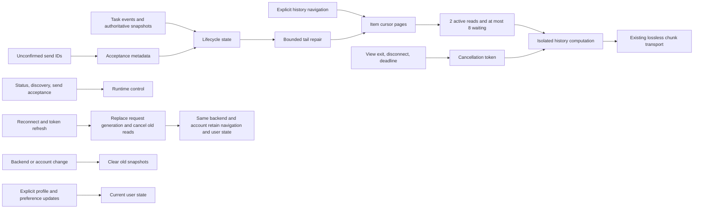

# Wework long-history responsiveness

Task control, task discovery, and transcript bodies have separate responsibilities.
A conversation may contain thousands of tool steps without making history reads,
terminal reconciliation, or reconnect recovery block unrelated task operations.

## Incident evidence

On 2026-11-03, two reads of one conversation in the installed build (source
`a19aa4b`, different from the fix baseline) took 176,741 ms and 232,519 ms.
The configured 75-second executor deadline fired only after the
computation completed. A separate status request entered its executor handler
after its client had timed out, then completed in 1 ms. Sampling captured
synchronous transcript projection and JSON copies. This demonstrates missing
compute isolation; it does not establish exhaustion of all Tokio workers.

The approximately 83 MiB history contained only about 12 turns, including one
with 7,363 completed items. Turn-count pagination does not bound work. The old
terminal coordinator requested `includeFullContent: true`, which walks all
history pages; `limit: 50` does not limit the total read.

A separate ordinary task remained running after `turn_settled` until an
authoritative snapshot arrived about 69 seconds later, with no active Goal.
This establishes delayed terminal confirmation, without attributing the entire
wait to history projection.

## Responsibility boundaries

- Consume task events and authoritative execution state first. Complete live
  content with authoritative terminal state needs no history repair. Necessary
  repairs read a bounded tail without resuming the provider session or scanning
  the entire conversation.
- Stop the thinking indicator when an ordinary turn settles; authoritative state
  still owns task occupancy. An active Goal may continue between turns, so final
  text or one settled turn cannot establish that its execution is idle. A provider
  turn result cannot rewrite an already-final native execution outcome. Confirm
  local task state independently through the existing task query without waiting
  for body repair; project sessions retain their project-authorized read path.
- Provider checks before stopping or compacting read current thread state and
  recent turn metadata without bodies or history-worker admission. An active
  thread's synthetic historical `interrupted` status cannot establish completion.
- Publish reconnect task state before content recovery. Recover tasks
  independently with bounded concurrency.
- Reconcile only the currently unconfirmed message IDs against explicit native
  turn bindings, including accepted messages outside the loaded tail. Missing
  bodies do not establish non-acceptance. Missing receipts retain unconfirmed
  sends with a diagnostic instead of automatically resending them. A query cannot
  requeue a newer send created after it started. Project and cloud sessions pass
  receipt queries and results through their existing authorization path.
- Normal history uses item cursors and item/byte budgets. Long turns remain
  pageable. Full export is explicit and never a prerequisite for terminal state.
  Building a native rollout offset index initially still scans its file on a cancellable
  isolated worker. Later reads update the index incrementally and load only the
  selected page's item bodies.
  Explicit `historyMode=legacy` threads use the shared legacy projection of their
  canonical rollout instead of the unsupported `thread/items/list` API. Ordinary
  pages retain at most 100 item bodies and 2 MiB, allowing one oversized item
  alone. Record-level cancellation preserves synthetic IDs, rollbacks, and late
  terminal metadata. Each legacy page still scans metadata to EOF; it does not
  have the incremental index's read cost.
- Preserve content and ordering. The page byte budget permits one oversized item
  alone through existing lossless chunks. It is not a strict per-body memory
  bound. A strict bound requires a separate body-reference/hydration contract,
  rather than silently truncating content or rejecting valid conversations.
- Run projection in a bounded worker pool. A worker owns its permit until it
  actually exits. Dropping the asynchronous caller signals cancellation, checked
  at bounded item checkpoints; dropping a JoinHandle alone does not stop work.
- Native history pages read lightweight task metadata and select page-related
  prompts and interaction overlays before copying bodies. Never clone the entire
  transcript cache under the shared task lock. Filter completed active-turn items
  before cloning the bodies needed to supplement the page.
- Identical conversation/range/options reads share work. Each viewer owns its
  subscription; cancel the provider only when the last subscriber leaves.
- The new IPC cancellation and admission contract applies only to
  `runtime.tasks.transcript` requests owned by the same authenticated connection.
  Search endpoints retain their existing contract.
  Ordinary concurrent reads wait in FIFO order instead of failing as soon as both
  active slots are occupied. Waiting remains subject to the existing deadline,
  disconnect, and cancellation; an expired queued request cannot start computation.
  HTTP cancellation cannot establish that a send or another action
  was not accepted; retain message identity and idempotency semantics.
  Existing search and search-result context computation paths are outside this
  isolation change; cooperative cancellation is not guaranteed for all of their
  blocking work.
- A read deadline, cancellation, or busy response is local operation state, not
  evidence that the executor process stopped.
- Task lists distinguish initial loading, successful empty, refresh, and failure.
  Keep successful same-scope data during refresh failure. A same-owner reconnect or
  token refresh replaces request generations without clearing the selected project,
  conversation, or navigation and without unmounting active collaboration panels.
  Remote task and device caches share the backend/account scope. Older cache entries
  without backend identity cannot hydrate a new backend, and an old request cannot
  abandon synchronization owned by the new scope.
  List and device responses own discovery data, not profile or preference updates:
  they cannot overwrite the current account's newer model selection with an older
  user snapshot. Explicit profile and preference updates own that state. Clear old
  snapshots on backend or account changes and reject late responses from previous scopes.
  Electron's local authentication user can differ from the connected cloud account.
  Navigation refresh uses the same workbench identity as runtime services; it must
  not write the local authentication user into connected-account state and rely on
  a later effect to correct it.

## Verification contract

| Scenario                                    | Required result                                                                     |
| ------------------------------------------- | ----------------------------------------------------------------------------------- |
| One turn with 7,000+ tool items             | Bounded normal reads; cursor traversal preserves all items and their order          |
| Status during heavy history work            | Control requests proceed without waiting for projection                             |
| Transcript deadline, disconnect, view exit  | Transcript work cancels; permits release after actual computation exit              |
| Two shared viewers, one exits               | The remaining viewer receives its complete result                                   |
| Old completion overlaps a new send          | The old result cannot settle or overwrite the new turn                              |
| Initial/refresh list failure                | Local error and retry; no false empty state or discarded valid data                 |
| Refresh overlaps account switch             | Independent results publish promptly; old responses cannot cross scopes             |
| Same-account reconnect overlaps preferences | Retain project, conversation, and new model selection; reject old transport results |

Run focused Rust, component, and protocol tests locally. Desktop regression
coverage uses the existing CI checkpoint runner. Repository policy requires an
explicit request before local E2E or `ai:verify` execution.

Desktop CI queries health, task state, task discovery, and renderer snapshots
concurrently with real transcript transfer. Each control query must complete
within three seconds. Restore full history through UI pagination while retaining
existing large-output and content-integrity assertions. Observe the request
boundary after completion to reject automatic full-history scans and confirm that
the thinking indicator disappears.

Diagnostics include request IDs and stage durations: client send, IPC receive,
admission, provider read, projection, encoding, queue, and client receipt. Record
counts, byte sizes, and state without bodies, credentials, or session contents.
