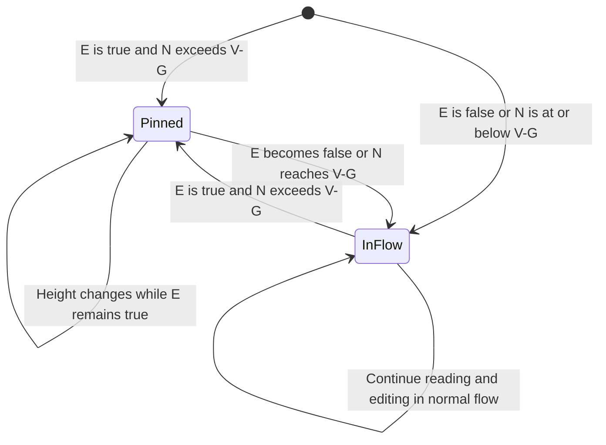

# Issue activity comment composer interaction contract

This contract covers the main composer in issue activity. Timeline replies reuse the bottom composer; inline replies in the non-timeline layout scroll with their cards.
“Per frame” means geometry invariants on every rendered frame, not a timed animation. All dimensions are CSS pixels.

## Collaboration Issue activity and execution

Descriptions initially preview up to `240px`, preserving goal text and acceptance context, with expansion for longer content.
When the editable title scrolls out of view while reading activity, the header retains a compact Issue title and current status.
When the linked-task entry scrolls away, Create task becomes a compact header action without consuming another row of reading space.
In narrow windows, an open detail dialog uses the full collaboration area. Closing it restores project navigation, preserving room for reading and full-size controls.
During the current app session, unsent comments retain their text, attachments, and reply destinations separately by tab, server, account, project store, project, and Issue. Return from settings to continue editing. A successful send clears the draft; cancelling a reply retains the text and attachments while leaving that reply destination.
Open an unsent attachment to preview it within the Issue. Close the preview or press Esc to return to the composer with its text and attachments intact.
Local projects currently do not support manual participant editing. Details show the reason and disable the add action while preserving existing participation records for reading. Backend projects continue to offer participant selection and addition.
Titles and descriptions use shared semantic sizes and follow appearance settings. Changing text size or window width remeasures the title so it remains fully visible without losing editing focus.
Descriptions expose a keyboard-accessible Edit description action that focuses the editor. Loading and normalizing Markdown alone does not mark the content as unsaved.
Titles and properties save immediately; description edits use Save. A shared header indicator reports unsaved changes, saving, saved, or failure. Failed changes remain available for retry.
An empty title stays as a draft and shows an associated required-field error after Enter or blur, without sending an invalid save request. Entering a title clears the error; a newer invalid edit cannot retry a superseded title.
Replies to ordinary human discussions say they continue the discussion. Only discussions with execution records promise execution continuation; stand-in conversations and human work assignments retain their own reply explanations.
Comment editors expose accessible names. Property labels, input hints, and timestamps use the readable secondary text color.
The scroll viewport reserves the composer's measured footprint so keyboard focus and automatic positioning remain visible. Description Save and Cancel wait for an in-flight write; cancelling a failed edit also discards that description's retry operation.
While a pending human question is visible in the reading viewport, the comment composer follows document flow so the question and submission controls remain readable. After scrolling past the question, the composer resumes sticking when space permits. When the composer plus bottom inset exceeds half the reading viewport, it also follows document flow: readers can scroll up through the full discussion and return to editing. Reducing its content or enlarging the window restores sticky positioning. Retries apply only to the latest submission for that field and cannot restore values superseded by later edits.

Opening an Issue from the Collaboration board shows creation, status changes, and comments in time order in the right detail drawer. An execution belongs to the comment that started it: the comment shows its run status, and its task entry opens the linked transcript, workspace, Terminal, and files. The execution page is read-only and does not expose a second reply composer. Return to the source Issue and reply in the corresponding discussion to add instructions.

A comment initially shows a body preview, with expansion for long content. The author, run status, time, and Reply action remain visible when the body is collapsed. In the timeline, Reply selects that discussion in the bottom composer; non-timeline layouts open the card's inline composer. Replies remain available while an execution is active: later instructions enter the same execution's message queue, do not start a concurrent run, and do not expose a low-level "task is already running" error. Completed runs display their persisted terminal status instead of an unverified status.

The Issue status describes the current work phase. It moves to In progress when the agent starts or receives a follow-up, then moves to In review after the final queued instruction finishes. Historical AI replies keep the Completed state of their own turn; that state does not imply that the Issue has no newer active run. Use the Issue header and latest execution card as the current progress indicators.

The activity list uses one vertical timeline for creation, status changes, and comments. System events use compact nodes, while comment avatars act as timeline nodes; horizontal separators must not break the continuous flow. A comment header keeps the author and role in the main information column, with run status and time in a separate trailing area. Long author or role text may truncate only within the main column and must not push run status below the author or shift the body start position.

For AI managed workflows, the manager writes an execution prompt for each child task from the Issue. Executors report their outcomes to the manager, who then decides whether the Issue moves to In review or Completed. Finishing a child task does not automatically make either transition. These manager decisions appear alongside manual status changes in the activity timeline. The automation summary shows the current stage and child task progress without repeating the full stage chain.

## Geometry and states

- `V`: the visible bottom edge of the actual detail scroll container.
- `G = max(16px, safe-area-inset-bottom)`: pinned bottom inset.
- `N`: the composer's normal-flow bottom in viewport coordinates.
- `H`: a pending human question intersects the reading viewport.
- `E`: sticky positioning is eligible when `H` is false and composer height plus `G` is at most half the reading viewport height.
- `B`: its actual bottom. Use normal flow (`B = N`) when `E` is false; otherwise `B = min(N, V-G)` on every frame, within `1px`.
- Its horizontal edges match the content column within `1px`; state changes must not change width.
- Keep one DOM instance to preserve focus, drafts, attachments and IME composition.

## Frame-by-frame behavior

| Situation                              | Required behavior                                                                  | Prohibited behavior                                         |
| -------------------------------------- | ---------------------------------------------------------------------------------- | ----------------------------------------------------------- |
| Enter activity                         | Pin eligible long content; otherwise remain after content without excessive whitespace      | Flash in the middle before snapping down                    |
| Scroll the middle                      | Keep `B = V-G` when `H` is false; only content moves                                | Body text visible below the pinned composer                 |
| A pending question is visible          | Use normal flow (`B = N`) and release sticky scroll clearance                       | A pinned composer covering question or submission controls |
| Approach the end                       | Transition continuously when `N = V-G`                                             | Position animation, jitter or duplicate inputs              |
| Reach the end                          | Use normal flow; at least `12px` after the final event and `32px` page-end spacing | Permanent occlusion or duplicate spacer height              |
| Reverse scrolling                      | Retrace the same geometry without resetting draft, focus or scroll                 | Force scrolling to the bottom                               |
| Enter more lines                       | Grow upward from two lines; cap the text area at `240px`, then scroll internally   | Native resize handle or downward growth                     |
| Expand attachments, settings or errors | Use normal flow above half the viewport; restore sticky positioning when smaller, retaining draft and focus          | Controls outside the panel or clipped popovers              |
| Receive content or load images         | Reflow under the same formula; preserve the reader's position in the middle        | Timers or repeated scrollTo calls to conceal layout defects |
| Resize panel or change safe area       | Recompute layout against actual `V` and `G` on the next frame                      | Cached window dimensions or screen coordinates              |

An opaque panel-colored bottom gutter prevents content from appearing beneath the pinned surface.
The composer reserves its own normal-flow space: do not add a second fixed-height placeholder. Keep settings menus on their separate overlay layer.
In short panels, constrain composer height to the visible height minus the bottom inset and `16px` top clearance, with internal scrolling as necessary.

## Implementation constraints

1. The detail pane is the only vertical body scroll owner; activity must not create another scroll region.
2. Keep one bottom-inset source. Do not add scroll-container bottom padding to the sticky bottom inset; put end spacing inside the content column.
3. Use browser layout instead of per-scroll top/transform writes or input remounts.
4. Dynamic input, attachment and settings heights must participate in layout; never position using only the initial measured height.
5. Respect the configured send shortcut, Shift+Enter and IME confirmation; preserve drafts and attachments after failure.
6. Web and desktop share the main composer, attachment cards and image preview. Hosts provide file storage and download services. Show image thumbnails during upload, then use the shared lightbox with zoom, download and close controls.
7. The main toolbar contains execution settings, attachments and send. Typing `@` reveals available member or agent candidates; inserting a mention changes only the comment body and never implicitly reassigns the Issue.
8. Execution settings apply to the current comment's execution context; never substitute a project-wide configuration action. Keep the draft while sending and clear it only on success. Results from an old Issue must not update the new Issue's composer.

## Acceptance evidence

Each activity body initially shows up to `240px`, or `192px` on narrow screens (at most `767px`), roughly 8–10 ordinary text lines.
Measure rendered height: short content needs no toggle; overflowing content offers Show full content / Collapse without truncating Markdown source.
Only collapse the body, keeping authors, timestamps, reply controls and run status accessible. Expansion preserves tables, code and links without introducing a nested vertical scroller.
Remeasure after resizing, streaming updates and image loading; preserve the user's expanded state.
If collapsing moves the activity above the panel, bring its top into view instead of jumping to the list's bottom.

Use short and multi-screen Markdown threads, code blocks, a final run event, attachments and send errors.
Check desktop and narrow panels at entry, mid-scroll, `1px` on both sides of the transition, the end and reverse scrolling.
Include multiline input, expanded settings and viewport resizing. Record `H`, scrollTop, scroll-container rect, composer rect and normal-flow bottom per frame; assert the applicable formula and retain middle/end screenshots. Move a pending question into and out of the viewport, including through preceding-content expansion, and verify normal flow and sticky clearance switch with its visibility. Also combine a long reply and an attachment at 720×450: scroll up to read the entire discussion, return to editing without losing the draft, then remove the attachment and verify sticky positioning returns.
Append content while reading the middle and verify no forced bottom jump. The final event must be fully readable at the end.

An isolated CSS check proves only layout mechanics. Unit tests, type checks and still images do not replace real Electron scroll acceptance.
Under repository policy, run E2E and AI verify only when explicitly requested, and report unexecuted checks as unverified.

Web and desktop activity share the desktop Markdown renderer for headings, numbered lists, highlighted code, table copy/expansion and diagram previews. Hosts provide clipboard, navigation, theme and authenticated attachment services; local files and local HTML previews remain desktop capabilities. Do not add a separate Web body renderer or stylesheet.
