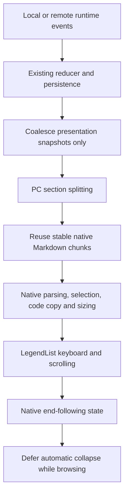

# Mobile conversation rendering

Mobile retains LegendList and native Enriched Markdown, reusing the PC Markdown buffer and section splitting rules.
Minis informs batching, completed-block reuse, native selection and reading-position protection. PC remains authoritative for conversation data, tool states and execution protocols.

## Streaming and completed content

- Runtime events reach the reducer immediately. Presentation buffering does not delay persistence, input requests, cancellation or completion states.
- History and streaming merges retain loaded neighbors and restore known messages to native snapshot order. Runtime `clientUserMessageId` binds each user message to its exact reply, keeping the user first when history reads overlap sending without inferring ownership from client timestamps.
- Mobile uses 48, 96 or 160ms batching windows based on text length, followed by a frame flush. Incoming deltas do not restart the deadline.
- Initial content, replacements and terminal snapshots appear immediately. Unmount releases batch, frame and fallback work.
- PC retains its default next-frame behavior. Shared scheduling uses platform globals; Metro and test resolution bind shared hooks to the native app's single React instance.
- Long text follows PC heading boundaries and code-fence handling. Stable sections are memoized. Reference definitions retain whole-source rendering so links and definitions remain together.
- Long code, tables or paragraphs without safe section boundaries remain atomic. This reuses rendered sections; it does not virtualize every Markdown AST node.
- Completed processing segments retain source-block identity. Reply-tail deltas do not rebuild completed tool groups. The native renderer owns background parsing and width/font-aware size caches.

## Selection and code actions

Native text selection owns assistant-body long presses. No competing JS assistant long-press menu is installed. Body taps still dismiss the keyboard; links and file previews remain actionable.
Native menus provide Copy, Copy as Markdown, Copy Entire Message and image URL actions. Entire-message copy reads the current source across every section. User bubbles retain their existing copy menu.

Native GFM code blocks own language headers, code copy, horizontal scrolling and highlighting. Incomplete fences render progressively; copying and highlighting follow the component's closing-fence rules. No second code parser or duplicate copy button is introduced.

## Reading position

The list subscribes to LegendList's `isFollowingEnd`. Newly eligible processing collapse and live-preview hiding wait until the reader returns to the end. Existing folds remain folded while browsing; explicit toggles stay immediate. Dataset changes release old subscriptions and message component state.
LegendList continues to compensate measured size changes. No per-delta scrolling, timed scroll correction or additional height cache is introduced.

## Verification boundaries

Component tests cover continuous streaming, terminal and replacement snapshots, trailing flushes, section reuse, references, fences, clipboard failures, listener cleanup and collapse during browsing.
PC buffer regressions, Mobile type checks, the full unit suite and both platform exports verify delivery. Native selection dragging, code gestures and actual smoothness require physical-device checks; JS tests do not establish native interaction success.
