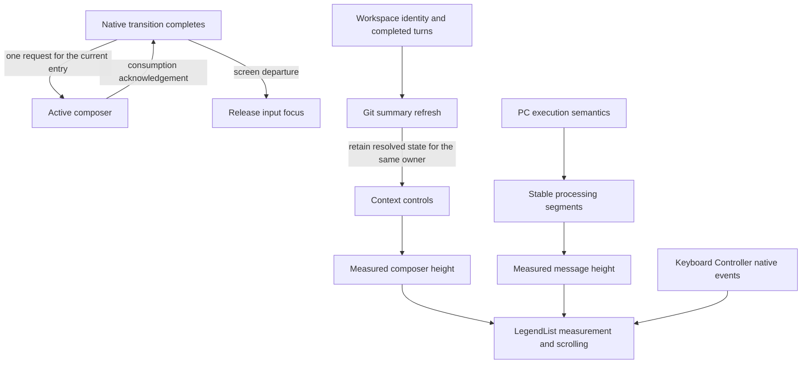

# Mobile scrolling and keyboard lifecycle

Mobile preserves PC conversation, tool execution and workspace ownership semantics. Native components own navigation, keyboard animation and message measurement.

## Component ownership

| Responsibility                        | Component                        | Boundary                                                                                  |
| ------------------------------------- | -------------------------------- | ----------------------------------------------------------------------------------------- |
| Navigation                            | React Navigation native-stack    | Enable `keyboardHandlingEnabled` for screen departure and interactive back gestures       |
| Keyboard animation and form avoidance | react-native-keyboard-controller | One root Provider; LegendList integration for chat, KeyboardAwareScrollView for forms     |
| Virtualized chat                      | LegendList                       | Own anchoring, end following and keyboard insets; no imperative scrolling for every delta |
| Native rich text                      | react-native-enriched-markdown   | Keep paragraph identity stable and measure actual content changes                         |

The keyboard dependency is pinned to **1.23.0**, including the iOS focus recycling fix in
[PR #1678](https://github.com/kirillzyusko/react-native-keyboard-controller/pull/1678).
That change addresses a race between navigation removing an input and deferred resignation on iOS 26+.
The [release notes](https://github.com/kirillzyusko/react-native-keyboard-controller/releases/tag/1.23.0)
also describe a keyboard preloading flash fix. Native upgrades require an updated Pod lockfile and native compilation; a JavaScript export alone does not validate them.

[FlashList](https://shopify.github.io/flash-list/docs/usage/) also supports chat anchoring. Switching lists cannot correct application components repeatedly inserting and removing content.
Use the existing [LegendList keyboard integration](https://www.legendapp.com/open-source/list/v3/api/) rather than disabling anchoring or adding a competing scroll compensation loop.

## Focus and layout flow

- A new-conversation focus request belongs to one screen entry. Publish after its transition, clear after consumption, and expire on cancellation, departure or input unavailability. Do not replay after returning or finishing a send.
- An inactive screen releases only its own input. Avoid delayed focus or global dismissal callbacks that interfere with the next screen. Returning does not restore old focus.
- Use `interactive` dismissal on iOS and `on-drag` on Android. React Native treats Android `interactive` as `none`.
- Preserve `keyboardShouldPersistTaps="handled"` for first-tap link and button actions. Message body taps explicitly dismiss the keyboard; long-press copying remains separate.
- During a Git summary refresh, retain resolved visibility and counts for the same file owner. Empty/non-Git workspaces must not repeatedly acquire a loading control. Device, directory, task and API-owner changes isolate old results and cancel old requests.
- Work-list snapshots are not ownership changes. Stabilize file context by all four fields: `deviceId/path/taskId/workspaceSource`.
- Key processing segments by source block identity, not completion counts, the last member or derived row type. Collapse the entire timeline only at a real terminal state. Preserve the live preview between successive tools and retain user expansion state.

PC references: `wework/src/lib/workbenchComposerFocus.ts`, `packages/collaboration/src/conversation/AssistantMessage.tsx`, `blocks/ToolBlocksDisplay.tsx`, `assistantMessagePresentation.ts`, `useConversationVirtualizer.ts`, and `wework/src/lib/workspace-target.ts`.

## Regression coverage and diagnostics

Component tests cover repeated entry, canceled transitions, inactive focus requests, platform gestures, message taps, same-workspace refresh, API-owner changes, successive tool transitions and expansion state. Run Mobile type checking, the full test suite and both platform exports. Native visual behavior requires separate device confirmation.

The existing `EXPO_PUBLIC_CHAT_LAYOUT_DIAGNOSTICS=1` diagnostics retain every item/content/viewport size event and throttle only scrolling. They record counts, statuses and geometry, never message content, paths or credentials. A 200ms-sampled trace cannot rule out a one-frame height reversal, and logs from another session cannot establish the cause of a supplied recording.
