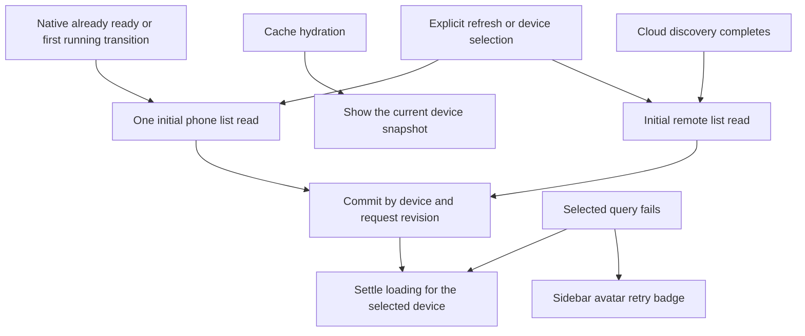

# Mobile list loading ownership

This-phone lists use native IPC to the local executor. Cloud discovery, model catalogs and cache hydration must not determine their visibility. Execution protocol and ownership follow PC `listRuntimeWork` / `runtime.tasks.list`.

- Check native availability when subscribing; an already-running executor does not need another status transition before its first read.
- Each phone environment's initial read is independent of cloud discovery. Later discovery completion does not duplicate it.
- `reloadWork` owns single-device loading from start to settlement. Only the latest request for the currently selected device may clear it.
- Existing snapshots remain visible during refresh. Late cache hydration derives loading from the currently retained snapshot, preserving fresh phone results.
- Failures also settle loading and use the existing avatar retry badge. Foreground, reconnect and later readiness changes do not retry automatically; explicit refresh does.
- All-device mode retains progressive publication and partial results.

List transport diagnostics record only local/remote classification, elapsed time and task count. They distinguish actual executor query latency from unrelated UI gates without recording messages, paths, accounts or credentials.
This change preserves list contents and data sources and does not modify Backend or executor.
