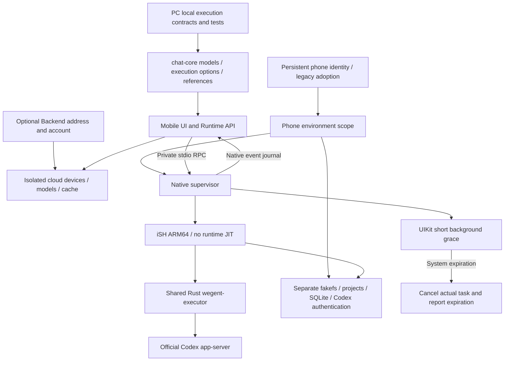

# Phone-local executor

Phone-local execution reuses PC Wework's local executor, Codex app-server, and Runtime RPC.
It does not register a synthetic cloud device or forward local tasks to a remote machine.
The current embedded implementation targets ARM64 iPhones. Android needs its own native
execution backend; iOS validation does not establish Android support.
Codex sends model requests according to the user's selected provider and model configuration.

## Local-first startup and optional Backend

The app opens directly into the existing task list without requiring Backend login. Builds with
the native module prepare local execution automatically; view status or retry in “Settings → Local
execution”. Device filters are hidden before Backend login, and new conversations run on the phone
by default. Existing conversations retain their execution device; the new-chat layout is unchanged.

“Settings → Models and accounts” provides official OpenAI browser login, an explicit device-code
option, and custom Responses models. API Base URL, model ID and API Key use device secure storage.
Runtime configuration and real tool-call connection probes reuse the PC implementation. Custom
models support only Responses. Desktop Codex credentials are never read.

Configure the Backend address in “Settings → Sign in to Wegent” and complete the existing
authorization to enable Backend models, authorized cloud devices, and device filters. Backend
models can also execute on the phone: model service location and execution device are separate.

Local availability comes directly from the current phone environment's native supervisor, independently
of Backend device requests. Cloud responses and cache restoration cannot overwrite current
native state. After stopping the runtime, the phone is unavailable for new conversations.
Inventory composition and response ordering follow PC `hybridServices.ts` and
`useWorkbenchDataRefresh.ts`.

## Data and process ownership



- PC references are `wework/electron/src/runtime/managed-executor-runtime.ts`,
  `runtime-supervisor.ts`, and `runtime-supervisor.process-group.test.ts`.
  Device, workspace, task, and request fields retain existing executor semantics.
- Model selection and execution permissions come from
  `packages/chat-core/src/local-runtime-model.ts` and `local-runtime-execution.ts`.
  Composer references come from `runtime-composer-references.ts`.
- The phone filesystem, executor directory, Codex authentication and local models belong to a
  persistent phone profile. Backend login, logout and account changes neither remount local data
  nor stop local work. Browser and device-code authentication
  uses the official app-server protocol; completion must match both the login ID and process
  generation so an old process cannot overwrite a newer login.
- The executor owns transcript persistence. The native event journal only bridges notifications
  while JavaScript is suspended; it does not replace task history or replay across phone environments.
- Upgrades adopt an existing environment without moving, merging or deleting roots. Multiple
  unselected legacy environments require explicit selection in “Settings → Local execution”. Native
  discovery reads only valid root metadata, never authentication or chat contents.
- Cloud HTTP, Socket.IO, device caches and file previews are scoped by Backend address and user.
  Account changes revoke old requests, sockets and remote file caches while preserving phone
  previews and reading positions. Each cache scope must finish hydration before writes are enabled,
  preventing empty startup state from overwriting offline history.

## Shutdown and explicit phone environment switching

Wegent logout revokes only the cloud connection. The drain sequence below applies to stopping
local execution or explicitly confirming a preserved phone environment switch in “Settings → Local
execution”. Backend account changes never trigger it.

```mermaid
sequenceDiagram
    participant UI as Mobile
    participant N as Native supervisor
    participant G as Guest threads
    participant F as Mounted fakefs
    UI->>N: Stop the current phone environment
    N->>G: Close IPC / guest SIGTERM
    opt Live threads remain
        N->>G: guest SIGKILL
    end
    G->>G: Each thread releases its own mm / files / fs
    G-->>N: Last thread exits; leader becomes waitable
    N->>N: native count = 0; join; reap
    alt All cleanup completed
        N->>F: Unmount old environment; mount selected environment
    else Timeout or cleanup failure
        N-->>UI: Explicit failure; retain the old environment boundary
    end
```

The main process exiting does not prove that its descendants and host threads have stopped.
The compatibility patch removes upstream `do_exit_group` logic that removed live threads after
a timeout, deferred resource release, and reported a completed exit. Live threads stay in the
group. The leader becomes a reapable zombie only after the last thread releases its own resources.
Threads clear TLS `current` before allowing a parent to reap their task, preventing pthread
cleanup from dereferencing freed memory.

Native entry points increment the host-thread count before `pthread_create`, undo it on creation
failure, and decrement it at the end of the outermost cleanup handler. A nonzero count prevents
mount switching. Timeouts must remain visible failures. Never use host `_exit()` or host signals
to terminate the entire app. Startup, extraction, login, and shutdown failures disable only the
local capability; remote features must remain openable.

## Execution permission boundary

The App sandbox and current account mount bound local files. The runtime does not implement
complete Linux namespace, seccomp, or Landlock isolation.

The native host owns the mount table. Guest `mount` and `umount` return `EPERM`, preventing
host-path exposure through the `real` filesystem and mounts that survive environment switches.
Host fakefs, proc, and devpts setup remains available. An attachment explicitly targeting the
phone must fail when that environment is unavailable or mismatched; it must never use Backend
upload instead.

Tasks within one phone environment have no workspace-level security isolation. Full access can
read other projects and Codex authentication files in that environment. Original API Key settings
use Keychain, but execution still supplies credentials to the guest runtime. Treat untrusted
repository scripts accordingly. The emulator shares the app process, so native crashes or extreme
memory pressure can terminate the app. Memory monitoring is not process fault isolation and
does not impose disk or CPU quotas.

The pinned official Codex `0.167.0` runs in this environment, but its restricted Linux sandbox
does not:

- `readOnly` and `workspaceWrite` commands fail. Never automatically elevate them.
- The bundled bubblewrap `--version` succeeds. A minimal isolation command,
  `bwrap --ro-bind / / --unshare-user --unshare-pid -- /bin/true`, fails at
  `prctl(PR_SET_NO_NEW_PRIVS)` with `EINVAL`.
- The pinned iSH source lacks the corresponding complete namespace and seccomp implementations.
  Its supported `clone` flags also exclude namespace creation. Returning fake success for these
  calls would create a false security guarantee.
- Command validation uses explicit `dangerFullAccess`. The product must require the user to
  select permissions that match this capability; it must not claim read-only or workspace
  isolation is enforced.

Upstream references:
[Linux PR_SET_PDEATHSIG](https://man7.org/linux/man-pages/man2/PR_SET_PDEATHSIG.2const.html),
[PR_GET_PDEATHSIG](https://man7.org/linux/man-pages/man2/PR_GET_PDEATHSIG.2const.html), and
[pinned iSH source](https://github.com/OpenMinis/ish-arm64/tree/0fd17a135e78b7a0cf08a4f5831217bbb76ed22f).

## Pinned source and builds

`wework-mobile/modules/wework-local-runtime/native/ish-source-lock.json` pins the upstream
revision and SHA-256 checksums for the patch, licenses, probe Alpine image, and Codex npm package.
The preparation script verifies these inputs and the complete applied patch in existing
checkouts. Other revisions or local changes are rejected.

```bash
uv run --no-project python \
  wework-mobile/modules/wework-local-runtime/scripts/prepare-ish-source.py \
  --output /external/ish-source

node wework-mobile/scripts/build-local-executor.mjs \
  --repo "$PWD" --output /external/executor-cache

uv run --no-project python wework-mobile/scripts/build-local-runtime-ios.py \
  --source /external/ish-source \
  --rootfs /external/clean-rootfs.tar.gz \
  --rootfs-sha256 VERIFIED_ROOTFS_SHA256 \
  --executor /external/executor-cache/wegent-executor \
  --output /external/ios-runtime --link-module
```

The executor toolchain pins Rust `1.94.1`, Zig `0.15.2`, cargo-zigbuild `0.23.0`, and
OpenSSL `3.5.9`. `--openssl-archive` accepts a previously downloaded archive with the same
mandatory checksum validation. iSH uses `guest_arch=arm64`, `engine=asbestos`, `jit=true`, and
`jit_emit=false`: the former enables the AOT-capable engine; the latter disables runtime
executable-code generation.

The production rootfs is a separate, explicitly supplied and hash-verified artifact containing
Alpine, bash, git, CA certificates, and the complete official Codex resource directory. The build
script adds the current Rust executor. Do not copy `meta.db` directly from an active development
rootfs: fakefs inode mappings refer to host files, and moving them can break symlinks. Use upstream
`fakefsify` / `unfakefsify` import and export, then verify an independently imported directory.
Delivery archives must have empty `/root` and `/tmp` directories, with no probes, logs, account
data, or session files.

Keep large files, toolchain caches, static libraries, rootfs archives, logs, and installation
artifacts outside the repository. The module's generated `vendor` link is local build state
and must not be committed.

## Focused validation

`native/tests` contains 22 guest C assertions covering parent-thread death notifications,
fork/exec/identity-change semantics, blocked pipe shutdown, `EINTR` and `SA_RESTART` on both
read paths, and `/proc/<pid>/stat` for retained zombies and live workers. An additional host
probe deliberately blocks a native worker beyond the upstream timeout and verifies that the
process cannot be waited or reaped early. Only actual worker termination permits a zero count
and final reap. It also verifies rollback of a child that was constructed and exec-loaded but
whose native thread never started.

```bash
uv run --no-project python \
  wework-mobile/modules/wework-local-runtime/scripts/test-ish-runtime.py \
  --ish /external/ish-source/build-host/ish \
  --fakefsify /external/ish-source/build-host/tools/fakefsify \
  --rootfs-archive /external/alpine-minirootfs-3.21.0-aarch64.tar.gz \
  --output /external/probe-results \
  --native-source /external/ish-source
```

Use a fresh output directory to avoid overwriting account filesystems. Results go to
`results.json`. The host probe requires Apple ARM64; omit `--native-source` to run guest
assertions only. The runner checks guest exit status and assertion counts because the upstream
CLI's PID 1 halt path can turn a guest failure into host exit code zero.

Completed macOS ARM64 validation covers non-JIT iSH, the focused probes, real Rust executor
IPC, official Codex initialization, commands, file writes, Git operations, streaming output,
cancellation, and shutdown.

An independent native harness on an iPhone running iOS 27.3 on 2026-11-14 verified executor
health, Codex `config/read` through the real executor, shutdown and restart, plus initialization,
file writes, Git staging/diff, and real `command/exec/outputDelta` after directly starting
official Codex. The harness uses the same native runtime and rootfs. The direct Codex probe
changes only the program entry point in an external test copy; it does not extend the product
executor's RPC allowlist. A subsequent probe using the actual UIKit grace implementation
completed system expiration, real Codex command cancellation (exit 137 with no subsequent file
write), and native shutdown/restart health checks while still in the background. A separate
foreground probe completed after 45.088 seconds with `backgroundTransitions=0`, exit 0, and
successful real file writes and Git operations, without premature cancellation.
These checks are not the full product task-to-model path. Device model
inference, product task streaming, the complete product cancellation flow, and sustained
background execution remain unverified. Android remains unverified. E2E and AI verify are not
run by default.

The existing CI `core:native-lifecycle` suite now includes `mobile-local-payload.scenario.mjs`.
It loads the real shared model and execution builders and uses the real executor and Codex for
two create/send rounds, checking thread identity, message IDs, and state. Only model SSE is
mocked. Syntax, lint, module loading, and CI classification were checked; the new E2E scenario
was not executed during this development and does not constitute device coverage.

## iOS background execution and distribution

The current implementation supports foreground execution and uses UIKit
`UIApplication.beginBackgroundTask` to request a short grace period after entering the
background. It does not use `BGContinuedProcessingTask`, fixed percentages, or output byte
counts. The system decides whether to grant time and when it expires. There is no promised
duration, lock-screen continuity, or background completion for arbitrary-length tasks.
Expiration must cancel the actual task and report `expired`; the executor transcript retains
completed content. An artificial background deadline must not cancel a foreground task.
Leases still match runtime generations and task revisions so old releases or state queries
cannot cancel a newer turn.

The retired Continued Processing probe explains this choice. That API requires timely,
measurable progress. Bounded work can update `Progress` using its real total and completed
items. Bytes received from a model with an unknown output length show activity, but do not
provide the required completion progress. Never fabricate totals, percentages, or meaningless
keepalive activity.

The retired probe set `totalUnitCount` to `-1` while continually adding actual output bytes. On iOS
27.3, expiration arrived approximately 20 seconds after entering the background despite real
output every second. System `dasd` logs explicitly reported
`Task has not reported progress within expected cadence, marking stalled`; the
`Activity Progress Policy` suspended the task, with a recorded fraction of zero.
`NSProgress` defines a negative total as indeterminate, with `fractionCompleted` always zero.
That approach cannot support sustained background execution for Codex tasks of unknown length.
Twenty seconds is an observation from this run, not a fixed UIKit grace period or system allowance;
other expirations still require system-log diagnosis. Resuming output after returning to the
foreground does not establish continuous background execution.

The native event journal bridges suspended JavaScript notifications; it does not grant
background execution rights. The product must report uncertainty and expiration accurately.
Host tests and bounded-work controls cannot replace device validation of actual model tasks.

Apple references:
[UIKit background grace](<https://developer.apple.com/documentation/uikit/uiapplication/beginbackgroundtask(withname:expirationhandler:)>),
[BGContinuedProcessingTask](https://developer.apple.com/documentation/backgroundtasks/bgcontinuedprocessingtask),
[long-running task guide](https://developer.apple.com/documentation/backgroundtasks/performing-long-running-tasks-on-ios-and-ipados),
[Progress.isIndeterminate](https://developer.apple.com/documentation/foundation/progress/isindeterminate),
[WWDC25 session 227](https://developer.apple.com/videos/play/wwdc2025/227/), and
[Apple DTS discussion of unknown-length work](https://developer.apple.com/forums/thread/840384).
The DTS discussion describes an API primarily suited to fixed-length work; fabricated-progress
suggestions must not be used to bypass the system's requirements.

The module retains iSH's original `LICENSE.md`, `LICENSE.IOS`, and the complete GPLv3 text.
The App Store additional terms address conflicts with store terms only; they do not waive GPL
source and license obligations. Distribution must provide the matching upstream revision,
compatibility patch, and build instructions. Wegent's license does not replace these upstream
terms.
