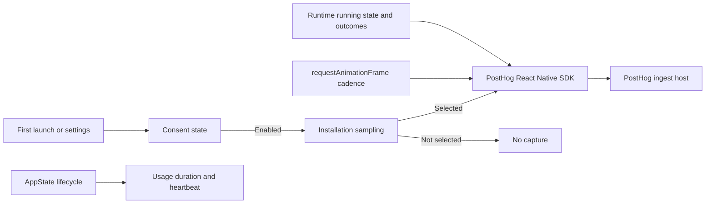
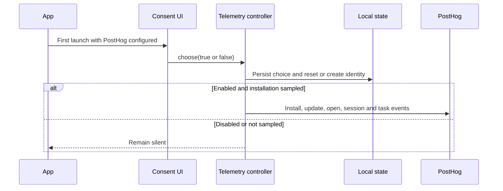

# Wework Mobile telemetry

Wework Mobile uses the PostHog React Native SDK for anonymous product and stability metrics. Collection is disabled by default. The first launch asks the user to opt in, and the choice can be changed later in **Settings → Privacy → Help improve WeWork**.

## Architecture

Consent, installation identity and foreground-session state are stored in `wework-telemetry-state.json` under the app documents directory. State writes are serialized. A telemetry write failure affects telemetry only and never blocks startup or another feature.

## Build-time configuration

`wework-mobile/app.config.ts` reads environment variables during packaging and writes them to Expo `extra.weworkTelemetry`. Runtime code reads only configuration embedded in the app. It does not derive telemetry settings from a user-entered Backend address or account state.

| Variable                       | Default                      | Purpose                                                       |
| ------------------------------ | ---------------------------- | ------------------------------------------------------------- |
| `WEWORK_POSTHOG_HOST`          | `https://us.i.posthog.com`   | PostHog ingest host, using the desktop variable name          |
| `WEWORK_POSTHOG_KEY`           | Empty                        | PostHog project key. Empty disables consent UI and collection |
| `WEWORK_TELEMETRY_SAMPLE_RATE` | `1`                          | Installation-level sample rate from `0` to `1`                |
| `WEWORK_TELEMETRY_ENVIRONMENT` | Derived from release channel | Bounded environment label                                     |
| `WEWORK_RELEASE_CHANNEL`       | EAS profile or `development` | Release channel label                                         |
| `WEWORK_TELEMETRY_SOURCE`      | `wework-mobile`              | Data source label                                             |

Local Expo builds can use the matching `EXPO_PUBLIC_WEWORK_*` variables. An explicit `WEWORK_*` value wins. An invalid sample rate fails Expo config loading so a typo cannot silently change collection volume.

Sampling uses a stable bucket derived from the anonymous installation identifier. Once an installation is selected, its session, jank and task events stay consistent for that identity. Unselected installations send no events. Installation counts require weighting by `telemetry_sample_rate`, so production should keep the rate at `1` when exact counts are required.

## Metrics

| Event                                                  | Main properties                                            | Use                                                                                    |
| ------------------------------------------------------ | ---------------------------------------------------------- | -------------------------------------------------------------------------------------- |
| `mobile_app_installed`                                 | `since_install_ms`                                         | New installations                                                                      |
| `mobile_app_updated`                                   | `from_version`, `to_version`                               | Version upgrades                                                                       |
| `mobile_app_opened`                                    | `launch_count`, `since_install_ms`                         | Opens, active installations, retention cohorts                                         |
| `mobile_foreground_started`, `mobile_foreground_ended` | `duration_ms`                                              | Foreground usage duration                                                              |
| `mobile_session_abnormal_end`                          | `duration_ms`                                              | Previous foreground session did not end normally, used as a crash or force-quit signal |
| `mobile_frame_health`                                  | `jank_rate`, `max_stall_ms`, dropped and long-stall counts | Jank rate and responsiveness                                                           |
| `mobile_startup_completed`                             | `duration_ms`                                              | JS startup through first interface mount                                               |
| `mobile_screen_viewed`                                 | `screen`                                                   | Screen usage distribution                                                              |
| `mobile_task_started`, `mobile_task_completed`         | Execution target, duration, result, retry interval         | Task funnel, success and latency                                                       |

A foreground heartbeat is written every 30 seconds. When the OS terminates the app, no end event is sent. The next launch reconstructs an approximate duration from the last heartbeat. The jank metric samples `requestAnimationFrame` callback gaps against a 60 Hz target. A gap of at least 100 ms counts as a stall, and gaps of at least 500 ms are counted separately. This catches JS and native scheduling pauses but cannot isolate GPU render work or work entirely inside the native UI thread.

## Privacy boundary

- Account IDs, user names, email addresses, task IDs, device IDs, project paths and file paths are excluded.
- Chats, prompts, model responses, code, terminal contents and credentials are excluded.
- The SDK has automatic pages, app lifecycle, exceptions, Session Replay, Surveys and feature flags disabled.
- `before_send` accepts only the documented events and bounded properties. Unknown events are dropped.
- Every event disables GeoIP and uses `person_profiles: never`.
- Disabling sharing stops the SDK, clears pending events, resets the analytics identity and deletes the local anonymous installation identifier.

Server-side PostHog settings should also disable autocapture and Session Replay and anonymize IP addresses as defense in depth.
