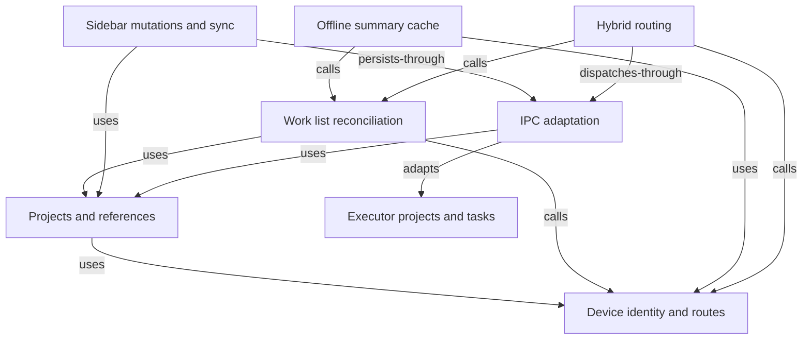

# Codex sidebar state parity

The Wework desktop app follows the Codex App sidebar state model. Project and live task content comes from the Codex app-server, while sidebar metadata comes from `.codex-global-state.json` in the target device's `CODEX_HOME`. While a remote device is online, Wework also stores a local task-list summary for startup recovery after that device goes offline.

## State ownership

| Data                                       | Source of truth                                | Notes                                                                              |
| ------------------------------------------ | ---------------------------------------------- | ---------------------------------------------------------------------------------- |
| Project names, roots, and kinds            | Codex global state                             | Covers legacy roots, multi-root `local-projects`, and `remote-projects`            |
| Project order, pins, and appearance        | Codex global state                             | Uses `project-order`, `pinned-project-ids`, and `project-appearances`              |
| Task title, timestamps, and runtime status | Codex app-server + Wework remote summary cache | Task bodies are not cached; cached runtime status is always stopped                |
| Task grouping, order, and pins             | Codex global state                             | Uses assignments, workspace hints, per-project thread order, and pinned thread IDs |
| Expansion and scroll preferences           | Wework localStorage                            | UI-only preferences that do not affect Codex                                       |

Project UI ids normally derive from the state-owning device and project key. Resolved remote references use the target device and project key to preserve UI identity across synchronization; existing references retain their UI id during reconciliation. Data merging follows the project identity rules below rather than comparing numeric UI ids.

A task UI identity combines the state-owning device with the task ID. Live-list refreshes merge tasks only by that identity; title, workspace path, and runtime kind are not identity fields. Distinct tasks can share a title, such as consecutive attachment-only submissions with no text, so neither the frontend nor Executor may infer duplicates from those display fields.

New project tasks that have not entered the manual order appear before existing manually ordered tasks; multiple unordered tasks are sorted by their latest activity. Tasks with a manual order continue to follow `sidebarOrder`. This keeps an optimistic task without `sidebarOrder` at the top immediately, then preserves its position after Executor returns the persisted order instead of dropping it to the bottom.

The project list must not depend on the array order of any individual local, cloud, or cached response. Executor derives `projectSidebarOrder` from `project-order`; Wework preserves it in project summaries and the offline cache, then reapplies it after merging runtime work sources. Projects without persisted order keep their relative merge order, while ordered projects do not move because of task activity, request completion timing, or device reconnection.

## Project model

Executor merges three Codex project representations:

1. `electron-saved-workspace-roots` and `electron-workspace-root-labels` for legacy single-root projects.
2. `local-projects` and `project-writable-roots` for current local multi-root projects.
3. `remote-projects` for projects on remote hosts.

Thread grouping applies this precedence: exclusion through `projectless-thread-ids`, explicit `thread-project-assignments`, `thread-workspace-root-hints`, then longest-root path matching. Explicit metadata always wins over path inference.

## Project editing across devices

Local, cloud, and remote project menus and in-conversation project actions use the same editor. Users can change the project name, add or remove source folders, choose the primary folder, and configure project instructions, the default model, quick phrases, and plugins. The default project space remains controlled by the experimental feature flag.

All source folders belong to the project's execution device, and at least one folder must remain. The first folder is the primary directory for new conversations. Local projects use the native folder picker; cloud and remote projects browse the target device through the device folder picker. Desktop paths cannot be saved as remote folders. Executor verifies that each folder exists and is a directory before saving.

Execution ownership is stored separately from local sidebar ownership. Edit requests target the execution device and its real project key, saving the complete configuration in that device's `CODEX_HOME`. The local remote-project descriptor retains the full folder and settings projection for refreshes and offline viewing. Stable identities keep primary-folder changes from creating duplicate projects or resetting order, pins, or appearance. Plugin reads and installations also target the execution device, with caches isolated by device.

Updated folders and AI settings apply to new conversations. Existing conversations retain their saved working directory, writable folders, and project execution settings; users can still explicitly change the current turn's model or other conversation controls. Removing a source folder does not delete its files.

An offline device's editor can display saved settings, but saving and plugin installation are disabled. A failed save retains the draft. If the execution device saves successfully but local index synchronization fails, the UI reports the synchronization error.

Local sidebar synchronization uses the device address and runtime instance reported by the current local IPC executor. Building the registration list and submitting it use the same qualified identity; historical cloud registrations or shared addresses cannot change the local state owner. Reconnection revalidates the current identity. A changed runtime instance invalidates queued writes, and new synchronization reads the current identity and complete project list. Remote project ownership remains strictly validated; unresolved ownership never results in a partial registration batch.

After the owning runtime confirms the save and a fresh readback passes validation, the client updates project settings by executor identity across equivalent device routes. If local sidebar synchronization subsequently fails, new conversations still use the confirmed project model and quick phrases; existing conversations retain their configuration.

### Compatibility by feature

Registration and heartbeat metadata declare `multiRoots`, `aiSettings`, `defaultProjectSpace`, and `plugins` independently in `runtime_features.projectEditing`. Explicit booleans take precedence; false, missing, or malformed explicit fields grant no writes. Devices without advertisements use only verified legacy contracts: Executor 1.8.5 supports names and multiple folders, and 1.8.6 and the verified published image version 2.0.21 additionally support AI settings, quick phrases, and the default project space. Other versions, including unknown and future versions, retain only the existing rename operation.

Project plugin selections live inside the AI settings object, so changing them requires both AI settings writes and plugin RPC support; RPC support alone permits only read-only inventory. Plugin support cannot be inferred from the version. Without an advertisement, the client sends a read-only `plugin/installed` query to the owning runtime through `runtime.codex.app_server.request`. Only an explicitly unsupported runtime method produces an upgrade hint; authentication, disconnect, timeout, and plugin service failures remain visible errors. Device, runtime instance, version, and online-state changes invalidate support and inventory caches. Saved selections remain readable, unsupported controls are disabled, and plugin discovery does not block unrelated settings saves.

Saves omit unsupported fields and compare the owner's response with its live project list, including the name, root order, and settings. Dropped or mismatched values leave the draft open and never replace the local projection with empty values.

### Explicit, safe upgrade of a legacy Docker device

The device maintainer initiates upgrades; Codex homes are never automatically migrated, merged, or overwritten.

1. While the old container still exists, identify its actual Codex home, Executor home, workspaces, volumes, and mounts. A legacy image may omit `CODEX_HOME`; identify the default Codex home instead of backing up only the new version's expected path.
2. Stop new task writes and back up the actual `.codex-global-state.json`, pending oplog, Codex configuration/sessions/plugins, persisted Executor identity, and workspaces to independent storage before destroying the old container. Verify projects, roots, and AI settings in the backup. Record the original `device_id`, `runtime_instance_id`, mounts, user/home identity, permissions, and image version. Treat backups as private data because they may contain credentials.
3. Retain the original device ID, persisted runtime identity, volumes, and home mounts when preparing the replacement. Identify the new canonical persisted `CODEX_HOME`, restore the backup there, then start the replacement container. If the destination already contains data, back it up separately and explicitly choose which home to keep; never silently merge or overwrite two homes.
4. Verify unchanged identity and compare the owning runtime's project names, root order, default spaces, AI settings, and plugin selections against the backup, then verify capability advertisement. Keep the old backup for rollback; a successful runtime upgrade alone does not confirm data preservation.

## Executor identity, projects, and local sidebar references

- `deviceId` is the device address used for execution requests. `workbench-device.ts` resolves aliases centrally. When available, the persisted `runtime_instance_id` determines executor equality while requests retain the routable `device_id`. When both Runtime identities are missing, only the same registration record (matching record ID and canonical device ID) is deduplicated; a shared alias cannot establish executor equality. A record with an identity cannot merge with one lacking it; conflicting Runtime owners of one alias produce an explicit error.
- Local identity comes from the required `runtime_instance_id` in `executor.describe`. Only APP cloud registrations with the same Runtime identity may join the local IPC routes; another installation sharing `app_device_id` is a separate executor. Missing or invalid Runtime identity in the description is an IPC protocol error.
- Connection health is separate from installation identity. A transient IPC disconnection marks the validated executor offline while retaining its identity, so rollback and terminal cleanup through APP addresses keep their local routes. Reconnection updates the identity; an invalid protocol description revokes the cached identity.
- `remoteHostId` is the host reference stored in a Codex remote-project entry. Preserve its original value on read and write; resolve it for comparison without replacing it during list reconciliation.
- `stateDeviceId` owns pins, order, and sidebar-entry metadata. It may differ from the execution device and must not redirect tasks.

Executor projects are identified by their owning executor and project key. Directory identity consists of executor identity and normalized path. Numeric UI ids are not project merge keys. Actual Backend project ids retain their separate global namespace.

Wework's `wegent-remote:<host>:<projectKey>` entries explicitly reference a target project. Reconciliation indexes actual projects before resolving references, independently of input order. The reference supplies name, pins, order, and appearance; the actual project supplies directories and tasks. Distinct projects may share a directory without becoming one project. Legacy directory records and external directory-only references attach only to a unique project on the same executor and path. Ambiguous references remain separate. A missing explicit target must not bind to another project at the same path.

Executor responses preserve project keys and remote-host boundaries too. Tasks follow their existing `group_project_key`. Unassigned standalone chats keep their own directory group even when their directory is inside a code project; other unassigned tasks may belong to a unique longest local root. A remote reference cannot claim local tasks at an identical path. Workspace kind is metadata, not directory identity.

Sync removal records are scoped by device and project key. An unresolved external reference is scoped by its state device and sidebar key. Removing or reopening one project cannot affect another device or another project sharing its directory. Never suppress references by display name or block synchronization by path alone.

This model introduces no public API field, database migration, or newly allocated device identifier. Existing reference formats remain readable; unknown external hosts retain their original values.

The diagram shows responsibilities and dependencies across device identity, project references, work list reconciliation, and synchronization.

## User questions and execution state

Executor persists task `interactionStatus` independently of turn and execution
completion. Blocking questions use `waitingForUserInput`. Codex's
`request_user_input_async` uses `awaitingUserReply`: the model can keep working,
and the answer travels as the next user message. Both states show the sidebar
bell, but an async pending reply alone does not prevent sending a message.

Async reminders survive successful execution completion, task switching, and
task-list reloads. Executor clears them when it accepts the next message or
in-turn guidance, or when execution fails or is cancelled. Completing a turn or
the question's tool call does not constitute an answer.

The desktop `priority-filter` checkpoint covers the async bell regression: wait
for execution to finish, verify the bell in the current and background task,
then submit an answer and verify that the reminder disappears.

## Writes and concurrency

Wework sends semantic mutations such as “move project A before B” or “pin thread T”; the frontend never overwrites the complete JSON document. Executor reads the latest state and computes the affected arrays for each mutation.

When Codex App is not running, Executor writes a same-directory temporary file, flushes it, and atomically replaces global state. While Codex App is running, mutations are appended to a JSONL oplog. Reads overlay pending mutations on disk state for immediate UI feedback. After Codex exits, Executor merges the oplog into the latest disk state. Unknown fields are preserved by every write.

Local projects are mutated by the local Executor in the local `CODEX_HOME`. While a device is online, remote projects are mutated by the Executor on the owning device. Backend does not persist sidebar state.

When Wework synchronizes remote-project descriptors into the local Executor, each non-empty batch is authoritative for the remote hosts represented in that batch. Executor updates the listed projects and removes stale projects for those hosts, including their order, pin, appearance, and task-assignment metadata. Hosts absent from the batch remain unchanged, and an empty batch does not clear remote projects, preventing a temporarily incomplete local view from deleting offline-device state.

## Offline remote task recovery

After a cloud or remote task-list sync succeeds, Wework stores a per-user, allowlisted summary in local `localStorage`. It includes task IDs, titles, update times, workspace paths, repository and branch hints, and sidebar ordering metadata. Project projections also retain execution ownership, all source folders, the default project space, and AI settings for offline viewing. Default models retain only their name, type, and conversation options. The cache excludes device or model credentials, complete model endpoint configuration, conversation bodies, tool calls, runtime handles, and parent or child task trees. Full conversation details remain only on the remote device.

At startup, the cached summary is merged as stale data with the local Codex remote-project descriptors. When the remote device is unavailable, the project, last known IP, and task summaries remain visible with a gray status dot. Task rows cannot be opened, pinned, renamed, subscribed, or archived. After the device reconnects, the live list becomes authoritative and updates or removes cached entries. A failed device discovery or task-list sync keeps the previous summary so a temporary network error does not empty the sidebar.

An unavailable remote device and an explicitly disconnected cloud session are different states. As long as Wework remains connected to the cloud, projects for offline devices stay visible under the rules above. When the user explicitly disconnects the cloud session, Wework temporarily hides remote projects, remote tasks, and remote chats without deleting the local summary cache or `remote-projects` in Codex global state. Reconnecting first restores the saved remote projects from the cache, then refreshes them from the live device and task lists. Local projects are unaffected.

Removing a cloud or remote project while its device is offline is local to the current Wework instance. Wework deletes the corresponding `remote-projects` descriptor from the local Codex global state and clears its local summary cache without contacting the offline device or deleting project state or workspace files there. The project therefore stays absent across refreshes and Wework restarts while the device remains offline. It may reappear after the device reconnects and reports the same workspace again.

## Interaction boundary

- When the Cloud Work entry reports `Available`, clicking the row opens the dedicated Cloud work page. Its trailing settings action still opens Connections settings.
- Clicking a project only expands or collapses its tasks and does not change the center pane.
- Clicking a task or creating a project task changes the main content.
- Projects, pinned projects, pinned tasks, and tasks within one project support semantic drag ordering.
- Tasks can only be reordered within their current project. There is no cross-project drop target, and dragging never changes `thread-project-assignments`.
- Ellipsis menus and context menus share the same project or task action set.
