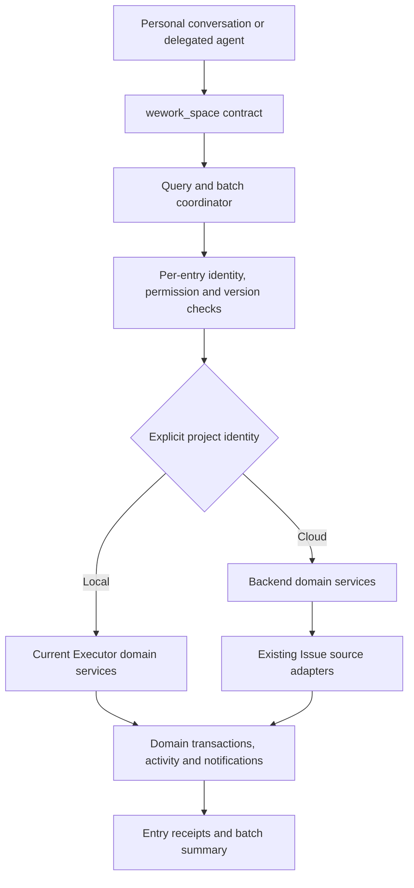
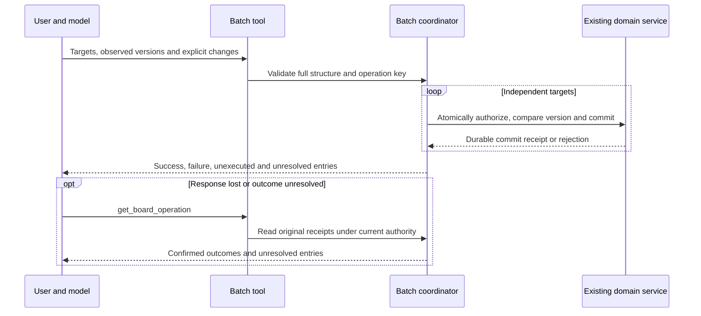
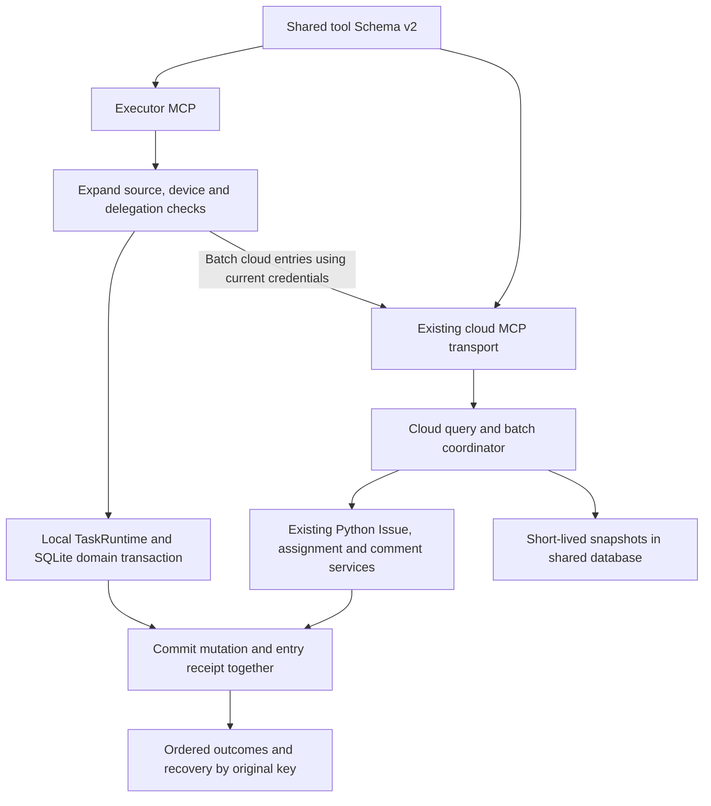

# Wework collaboration batch tool design

Status: A+B+C+D implemented. Protocol version: 2. Date: 2026-11-16.

The implementation covers local Executor and cloud MCP tools. Development changes no real Issue state. The shared Schema owns input fields and limits.
[中文](../../../zh/wework/developer-guide/wework-collaboration-batch-tools-design.md)

## 1. Objective and observed gaps

Support an accountable workflow: find a person's complete backlog, read completion evidence, let the user select targets, apply a batch change, and verify outcomes.

The motivating conversation involved more than a hundred Issues across several projects. Historical counts and completion assessments are scenario inputs, not business facts reverified for this document.

| Observed implementation                                                      | Consequence                                            | Required behavior                               |
| ---------------------------------------------------------------------------- | ------------------------------------------------------ | ----------------------------------------------- |
| Search returns at most 200 results without continuation                      | A truncated list can be mistaken for the full backlog  | Pagination with explicit coverage               |
| Search filters creators but not assignees                                    | Responsibility and authorship are easily conflated     | Independent identity filters                    |
| Local desktop, cloud desktop, and remote MCP implement search separately     | Supported filters differ                               | One contract and conformance cases              |
| Details, comments, updates, and assignments have individual entry points     | Tool calls grow with Issue count                       | Batch tools organized by business purpose       |
| Comments default to a recent window, ordered oldest first within that window | Ordering does not establish complete history           | Explicit oldest/latest reading modes            |
| Desktop scope checks primarily inspect top-level space_id/item_id            | Checking only the batch envelope misses nested targets | Expand authorization for every entry            |
| Assignment currently reads a fresh version before submitting                 | It need not use the state the user reviewed            | Explicit expected versions for batch assignment |

Evidence: `executor/src/task_runtime/mcp.rs`, `executor/src/task_runtime/mcp/comments.rs`, `executor/src/task_runtime/router.rs`, `executor/crates/task-store/src/task_runtime/model.rs`, and `backend/app/mcp_server/tools/wework_space.py`.

## 2. Product and execution boundaries

- A project space is a business container. Code workspace location, execution device, and Runtime conversation are separate identities.
- Existing tools use `space_id` for one project, not its parent workspace. Preserve that meaning; use `workspace_id` for the parent.
- The current device's Executor owns local project data; Backend owns cloud project data. Identical ID strings do not identify the same project across stores.
- Existing business adapters continue handling GitHub/GitLab and other Issue sources. Agents use `wework_space` rather than accessing underlying project providers directly.
- Remote cloud MCP handles cloud targets within its capabilities. It does not automatically discover, wake, or substitute another local device.
- Personal conversations may operate across authorized projects. Delegated manager/executor sessions retain their existing scope restrictions.



A query snapshot fixes reading results; an operation receipt records what happened. Neither grants additional execution authority.

## 3. Tool catalog and selectable groups

Groups are scope choices, not an approved implementation schedule. Each selected group includes its permission, failure, and testing requirements.

| Group                   | Tool                              | Main input                                       | Main output                                                    |
| ----------------------- | --------------------------------- | ------------------------------------------------ | -------------------------------------------------------------- |
| A Discovery and queries | Enhance `list_spaces`             | Workspace, name, cursor                          | Complete project references, names, capabilities, continuation |
| A                       | `describe_space_board`            | Project reference                                | Status IDs/labels, fields, supported operations and limits     |
| A                       | Restructure `search_board_items`  | Scope, filters, sort, projection, cursor         | Issue page, query ID, coverage                                 |
| A                       | `aggregate_board_items`           | Shared filters or query ID, grouping             | Counts by project, status, assignee, and other dimensions      |
| B Batch reading         | `batch_get_board_items`           | Targets and requested sections                   | Versions, details, permissions, attachment/delivery summaries  |
| B                       | `batch_list_board_item_comments`  | Per-target reading mode and cursor               | Comment pages, history coverage, independent continuation      |
| B                       | `batch_get_assignment_candidates` | Projects and candidate types                     | Per-project people, robots, and collaboration groups           |
| C Batch maintenance     | `batch_update_board_items`        | Expected version and field changes per entry     | Outcomes and committed versions                                |
| C                       | `batch_assign_board_items`        | Expected version, assignee, notification options | Assignment and relevant execution/notification receipts        |
| C                       | `get_board_operation`             | Operation ID                                     | Durable progress, entry outcomes, unresolved entries           |
| D Batch collaboration   | `batch_add_board_item_comments`   | Bodies, structured mentions, deduplication keys  | Comment IDs and notification/follow-up receipts                |
| D                       | `batch_create_board_items`        | Creation payloads and deduplication keys         | Complete created references, versions, side-effect receipts    |

Keep individual tools; individual and batch operations use the same domain services. Creating ordinary Issues in a batch does not replace a manager's `submit_workflow_plan` or grant dispatch, workflow advancement, or delivery finalization authority.

Read attachment content, files, and delivery assets on demand through existing tools. Batch details default to metadata. Table CRUD, deletion, archiving, cross-project moves, and copying need their own business contracts; they are outside this Issue batching proposal and are not exposed through a generic arbitrary `execute` tool.

## 4. Shared identities and inputs

These are logical types. Implementation maintains one machine-validatable JSON Schema source for Rust, Python, and protocol tests.

```typescript
type SpaceRef =
  | { project_store: "backend"; space_id: string }
  | { project_store: "local"; space_id: string; device_id: string };

type ItemRef = { space: SpaceRef; item_id: string };

type QueryScope =
  | { kind: "projects"; spaces: SpaceRef[] }
  | { kind: "workspace"; workspace_id: string }
  | { kind: "accessible" };

type AssigneeRef = {
  type: "user" | "agent" | "group" | "team";
  id: string;
};
```

- Discovery supplies references. Preserve string IDs; never infer stores from numbers, prefixes, or historical caches. A device ID grants no remote-device access.
- A bound Issue's `get_current_context` returns `space_ref`, allowing authorized batch targets without project enumeration. Executors retain their original Issue scope and must not resolve bindings through `list_spaces`. An unavailable trusted local identity produces `space_ref_error` while preserving authorized Issue details.
- Conversational “me” resolves to the current trusted principal before service execution. Local owner `0` is not a global account alias.
- Every batch entry has a unique `request_id`. Preserve input order and correlate by that ID, rather than by potentially repeated Issue numbers.
- Repeated write targets are valid and execute serially in input order; different targets may execute concurrently. Each entry retains its explicit expected version without silent rewriting from a predecessor's result. Failed or unresolved predecessors leave dependent later entries `not_executed`.
- Reject unknown fields, empty batches, duplicate request IDs, and invalid parameter combinations before any writes. Entry-level authorization, version, and business failures produce individual outcomes.
- Omitted fields remain unchanged. `null` clears a field only when the existing domain permits it. Existing status, assignment, and hierarchy validation still applies.

## 5. Search, pagination, and aggregation

### 5.1 Filters

Values within one field use OR; different fields use AND. Tag filters explicitly choose `any` or `all`.

| Filter                                 | Meaning                                                                               |
| -------------------------------------- | ------------------------------------------------------------------------------------- |
| `scope`                                | Explicit projects, visible projects in a parent workspace, or all accessible projects |
| `query`                                | Issue ID, title, description, and tags; no implicit comment-history full-text scan    |
| `assignees`                            | People, robots, groups, and existing team identities, matched by ID                   |
| `unassigned`                           | No assignee; mutually exclusive with `assignees`                                      |
| `participation: "mine"`                 | Issues that list the authenticated user as a participant |
| `creator_user_ids`                     | Authorship independent of assignment                                                  |
| `statuses` / `exclude_statuses`        | Dynamic status IDs; mutually exclusive                                                |
| `priorities` / `tags`                  | Priority and tags                                                                     |
| `parent` / `has_children`              | Parent reference and child existence; no unscoped cross-project ID                    |
| `created_at` / `updated_at` / `due_at` | Timezone-aware, start-inclusive and end-exclusive intervals                           |
| `include_archived`                     | Explicit selection where supported; report unsupported sources                        |

Do not hardcode five default statuses. `describe_space_board` supplies actual statuses and terminal categories. A status label such as “completed” does not prove delivery acceptance. “Unfinished” requires declared project status categories; otherwise require explicit status IDs rather than guessing.

Describe source capability separately from current caller authority: supporting assignment does not replace the caller's `permissions.assign`. Declare conditional versions, idempotent creation/comments, historical reading, archive filters, and time filters explicitly rather than silently degrading behavior.

Projection supports `summary`, `detail`, or an allowed field set. Summaries include complete references, title, status, assignee, version, update time, and an available open link. Declare supported sort fields and use the complete reference as a deterministic final tie-breaker.

Collect each complete space reference once; pagination and aggregation count distinct items. Sort time fields by actual instants with consistent timezone interpretation, rather than date strings.

### 5.2 Query snapshots

Initial search builds a short-lived, read-only query snapshot: discovered target projects, matching Issue projections, and ordering. It returns a `query_id` reused by pages and aggregation so maintenance during review does not continually move results between pages.

- Declare creation/expiry times and per-source read intervals. Reading snapshots may expire on restart and need not be durable.
- Do not claim one transaction across local, cloud, or external data. Return `consistency: materialized_scan` and source read times. This fixes the captured scan, without promising upstream data stayed unchanged while scanning. Only sources with actual consistent transactions may additionally declare that guarantee.
- Revalidate current visibility for resources involved in the query before returning pages, aggregation, or cached reads. Visibility changes invalidate the entire query with `query_scope_changed`; do not expose old projections or counts.
- Opaque cursors bind the actor, query, ordering, and position. Reject cross-query/user reuse and changed filters. Return `cursor_expired` on expiry; restarting the query must be presented as a fresh review.
- Snapshot versions are observed versions. Mutations still compare against current versions in the domain transaction.
- Large scans advance within the existing call deadline. While collecting, return `state: collecting`, a `continuation_cursor`, and `matched_so_far`. Subsequent calls continue the scan; progress is not a total. Finished scans become `ready` or `partial` when sources failed, then expose fixed pages and counts. This does not require new background scan jobs.

```json
{
  "query_id": "q_example",
  "state": "partial",
  "items": [{ "item_id": "issue-a", "title": "Example issue", "version": 7 }],
  "next_cursor": "cursor_example",
  "matched_total": 88,
  "coverage": {
    "complete": false,
    "sources": [
      { "scope_key": "backend:project-a", "state": "complete" },
      { "scope_key": "backend:project-b", "state": "unavailable" }
    ]
  },
  "consistency": "materialized_scan",
  "expires_at": "2026-11-16T11:10:00Z"
}
```

The example omits other Issue summary fields; counts are illustrative. `matched_total` covers successfully read sources only and must be labeled partial when `coverage.complete=false`. A null page cursor means no more captured pages, not complete source coverage.

### 5.3 Aggregation

`aggregate_board_items` shares the visibility query and filters. It supports `space`, `status`, `assignee`, `creator`, `priority`, and `tag`, including combinations. Do not return every dimension by default. Bound bucket output through response budgets and pagination rather than arbitrarily limiting the number of requested dimensions.

- A query ID produces counts from that snapshot. Direct filters create a query with the same semantics.
- Counts cover matching results rather than the current page. Read-only callers cannot infer hidden Issue counts.
- Tags are multivalued: an Issue may appear in multiple buckets. Declare `count_mode: memberships`; bucket sums need not equal distinct Issues. Other dimensions also state their distinct-Issue counting basis.
- Report failed sources separately. Hidden Issues contribute no exposed title, count, assignee, or existence signal. Explicit inaccessible targets follow existing invisibility errors.
- An unsupported filter returns `unsupported_filter` and a coverage gap; never silently ignore a filter.

## 6. Batch reading and historical evidence

`batch_get_board_items` defaults to details and versions. Optional sections are `permissions`, `attachment_metadata`, and `delivery_summaries`. Mark each requested section complete, denied, failed, or not requested. Do not automatically inline large content/assets.

Each `batch_list_board_item_comments` target has independent reading parameters:

```typescript
type CommentRead = {
  request_id: string;
  target: ItemRef;
  mode: "oldest" | "latest" | "after";
  cursor?: string;
  limit: number;
};
```

- `oldest` starts with the earliest visible activity. `latest` returns the newest page, ordered chronologically within the page. `after` requires the existing cursor for that Issue.
- Return `has_earlier`, `has_later`, `next_cursor`, and `history_complete`. No newer activity does not mean the entire history was read.
- Cursors retain whether reading started at the oldest activity. Continuing from `latest` with `after` cannot claim full history; only an uninterrupted scan from `oldest` through the final page returns `history_complete: true`.
- Bind cursors to target and direction; do not reuse another Issue's sequence. Preserve source activity IDs, authors, and timestamps without rewriting historical identity.
- Explicitly adapt the existing recent-200 behavior; wrapping the old call in an array does not implement full-history reading.
- If details succeed and comments fail, preserve the successful details and report incomplete evidence.

Tools expose facts and evidence references rather than implicit business verdicts. Merged code, migration to another Issue, and accepted delivery are different facts. A completion claim in a comment grants no closing authority.

## 7. Batch mutation contract

### 7.1 Example input

```json
{
  "operation_key": "close-reviewed-items-20261116-a",
  "preview": false,
  "items": [
    {
      "request_id": "close-a",
      "target": {
        "space": { "project_store": "backend", "space_id": "project-a" },
        "item_id": "issue-a"
      },
      "expected_version": 7,
      "patch": { "status": "completed" }
    }
  ]
}
```

`batch_update_board_items` supports permitted domain fields, using actual project status IDs. Tags allow either replacement or explicit add/remove operations under the same version constraint; do not read and then overwrite unconditionally. Assignee changes use assignment domain capabilities rather than duplicating notification/execution logic inside updates.

Every `batch_assign_board_items` entry requires `expected_version` and `assignee`. Human notifications retain existing defaults and explicit options; the model must not suppress them merely to reduce noise. Robot/group assignment can start real execution. Previews and receipts describe those effects and preserve native operation approvals.

`batch_add_board_item_comments` uses structured mentions, the current author, and existing notifications. Mentions are not text substitution and must not produce duplicate alerts. Assistant wakeups retain existing rules.

### 7.2 Preview, transactions, and ordering

- `preview=true` validates current conditions and returns expected changes, versions, known effects, and unresolved prerequisites. It changes no Issues, reserves no versions, sends no notifications, starts no executions, and grants no bypass token.
- Submission rechecks scope, current permissions, expected versions, and domain constraints per entry. Version comparison belongs in the atomic commit or equivalent upstream conditional mutation, not just coordinator preflight.
- Each entry is an independent domain transaction. There is no batch atomicity across projects, databases, and external sources. Independent targets may run with bounded concurrency; repeated targets execute in input order with separate receipts.
- Individual business failures preserve their errors while independent entries continue. Structural failure yields zero writes. Session authority revocation stops subsequent submissions and records unexecuted entries without erasing committed facts.
- Report domain commits and side-effect states separately. A notification failure does not mean the Issue was unchanged; repeating the mutation is not a notification repair mechanism.
- Do not silently refresh conflicting versions, substitute statuses, bypass approvals, or weaken workflow constraints.

### 7.3 Receipts and idempotency

```typescript
type ItemOutcome = {
  request_id: string;
  target?: ItemRef;
  state: "succeeded" | "failed" | "not_executed" | "unknown";
  committed: boolean | null;
  item_version?: number;
  result?: object;
  error?: {
    code: string;
    message: string;
    retryable: boolean;
  };
  effects?: object[];
};
```

Return an operation ID, batch state, input count, counts of all four outcome categories, and ordered entry receipts. Outcome counts must sum to the input count. Successful commits return the committed projection/version without requiring another detail request for every entry.

- Mutations require an `operation_key`, bound to the real principal, execution/delegation context, tool type, and canonical payload hash. Same key with different content returns `idempotency_conflict`. Preview does not consume a mutation key.
- Repeating the same key and payload returns the original receipt without rerunning failed or unexecuted entries. A revised submission is a new explicit operation.
- Controlled local/cloud storage commits deduplication receipts with the domain mutation in the same transaction. Notifications and execution intents use existing transaction/outbox capabilities. A separate receipt written after mutation leaves an unacceptable crash window.
- `get_board_operation` reads durable receipts under current identity and authorization. Historical receipts cannot expose content that is no longer visible.
- After a timeout or interruption, read the original receipt first. Never resubmit confirmed successes. Explicitly resubmit unexecuted entries with a new key after current authorization checks.
- Sources lacking idempotency or conditional versions cannot promise exactly-once execution or simulate atomic version checks with a pre-read. Declare capabilities and reject writes that cannot satisfy the version contract before submission.
- A sent external request without a verifiable receipt remains `unknown`, with limited reconciliation evidence. Do not automatically repeat non-idempotent creation or comments. Equal final state alone does not prove exactly one comment or creation.
- Local receipts live on the original device; cloud receipts live in Backend. The current Executor stores child-operation references for mixed batches. No shared cross-source transaction is implied. An unreachable receipt owner leaves results unresolved.
- Register an operation ID before side effects. Reserve time within the existing tool deadline to return receipts. Entries not started within budget become `not_executed`; sent but unconfirmed requests become `unknown`. Do not detach ownerless background mutation jobs from the original session.
- Receipt bodies declare retention and expiry; an initial proposal is 30 days through `expires_at`. Retain minimal deduplication records after body expiry so old keys return `operation_expired` rather than replaying as new operations. Reuse audit/idempotency facilities and assess index size and cleanup boundaries during implementation. Removing deduplication indexes requires an equivalent mechanism rejecting old keys.



## 8. Permissions and tool visibility

Preserve the [CP01–CP20 contract](../../wegent/developer-guide/collaboration-permissions.md). Batch envelopes confer no authority on nested targets.

| Caller or situation          | Reads                                                                 | Writes                                                     |
| ---------------------------- | --------------------------------------------------------------------- | ---------------------------------------------------------- |
| Personal conversation        | Projects/Issues visible to current identity                           | Existing domain capabilities                               |
| Project Viewer               | Visible Issues, comments, aggregation                                 | No editing, commenting, assignment, or execution           |
| Delegated manager            | Existing project scope and management categories                      | Only previously permitted manager actions                  |
| Delegated executor           | Existing execution scope and explicitly requested direct-parent reads | No new management or parent-write authority                |
| Knowledge of an Issue ID     | Project access checked before Issue visibility                        | No authority granted                                       |
| Revoked or expired authority | No stale projections, hidden counts, or receipt bodies                | Reject new submissions without reviving previous authority |

Classify expanded actions using existing individual tool categories rather than granting one blanket batch category. Direct-parent exceptions apply only to previously permitted reads, not arbitrary parent-related objects, ancestors, or siblings.

Use existing invisibility error semantics. Differences between denied and missing targets must not reveal inaccessible Issue existence. Logs contain necessary identifiers, durations, error codes, and counts, not tokens, authentication files, or full comment bodies.

## 9. Implemented architecture and protocol convergence

`shared/protocol/wework_space_tools_v2.json` owns the contract published by Executor discovery and cloud FastMCP. Cloud tools preserve raw JSON instead of allowing framework coercion to change the contract.

`executor/src/task_runtime/mcp/batch/` owns explicit source routing, expanded authorization, mixed batches and local queries. `backend/app/services/board_tools/` owns cloud queries and coordination through the existing Python-owned MCP transport. This change adds no REST API and migrates no existing API.



Both data owners record entry receipts inside their existing domain transaction using unified `board_operation` nodes without schema or desktop upgrade migrations. Event publication follows commit; publication failure never changes a committed outcome to uncommitted.

Cloud queries use `board_query` nodes and query-row locking so cursors work across processes. They expire after ten minutes and new queries clean expired records. Local queries use an expiring, bounded process cache. Pagination, aggregation and successful receipt reads recheck current visibility. Lost cloud write responses remain `unknown`; the original operation key retrieves the cloud receipt without resending writes.

`list_spaces` and `search_board_items` consistently return page objects. Obsolete search paths were removed and callers, discovery tests and the bundled Skill were updated. The separate stand-in `list_projects` retains its list contract through shared complete discovery.

## 10. Resource, error, and runtime constraints

Actual limits are 100 read entries or 50 write entries per batch, 200 Issues or 500 comments per page. Cloud entries share one batch request. Data owners execute ordered entry transactions and stop repeated targets after a failed predecessor. Queries expire after ten minutes; cloud snapshots have a 64 MiB per-query budget and at most 128 active queries per user, while local query items share a 64 MiB cache budget. Users can continue pagination and chunking.

- Apply a response-byte budget. Exhaustion produces continuation or explicit unexecuted entries, never silently omitted Issues/comments. Set actual bytes from existing transports and measurements rather than inventing performance evidence here.
- Avoid N targets times M metadata lookups. Reuse per-project schema/candidate queries and actual bulk SQL/service reads at the data owner. Fewer model turns alone do not justify unbounded serial provider work.
- Local reading does not wait for cloud recovery. Report unavailable-source gaps without substituting another store or provider API.
- Cancellation stops not-yet-committed entries only. Do not automatically roll back committed Issues or invent an undo system in this iteration.
- Stable machine errors include `version_conflict`, `unsupported_operation`, `unsupported_filter`, `scope_violation`, `query_scope_changed`, `cursor_expired`, `idempotency_conflict`, `operation_expired`, `source_unavailable`, and `outcome_unknown`. Visibility errors retain existing policy.
- Do not automatically retry expired authentication, scope violations, or uncertain writes. Reuse only existing demonstrably safe network policies; retries cannot be used to manufacture success.

## 11. Representative workflows

### Review one person's full backlog

1. Discover workspace/projects and complete references; describe actual board statuses.
2. Search by assignee ID, consume pages and coverage, and explicitly identify completed/unfinished status sets.
3. Aggregate using the same query ID, without conflating created and assigned Issues.
4. Batch-read candidate details, then read historical comments from oldest with continuation, plus delivery summaries when needed.
5. Present completion, migration, pending acceptance, or insufficient-evidence recommendations with references; the user chooses targets.
6. Submit selected references and observed versions to batch updates, previewing when useful and preserving native approvals.
7. Report individual commit receipts, conflicts, and unknown outcomes. A fresh query explains updated counts rather than replacing original receipts.

### Batch assignment

1. Resolve candidates per project; never replace a collaboration group with its leader.
2. Preview assignees, versions, human notifications, and possible execution effects.
3. Submit under current authority and distinguish assignment committed, execution queued/rejected, and notification pending facts.

## 12. Verification and acceptance design

| Scenario                                                             | Required assertions                                                                                                                         |
| -------------------------------------------------------------------- | ------------------------------------------------------------------------------------------------------------------------------------------- |
| More than 200 Issues, several projects, different creators/assignees | No captured-page duplicates or omissions, independent filters, counts beyond current page                                                   |
| Same IDs in different stores/devices                                 | No identity, routing, cache, or receipt collisions                                                                                          |
| Custom statuses, multiple tags, archived Issues                      | No guessed status categories, explicit bucket semantics and unsupported capabilities                                                        |
| Recent comments and more than 500 historical entries                 | Complete oldest traversal, latest-page coverage honesty, target-bound cursors                                                               |
| Unavailable project or unsupported filter                            | Other sources readable, incomplete coverage, no full-backlog claims                                                                         |
| Viewer, delegated cross-project access, direct parent                | Per-entry rejection, unchanged parent read exception, no count leakage                                                                      |
| Version/permission changes after preview                             | Atomic rejection without silent overwrite                                                                                                   |
| Partial success, repeated targets, changed payload for a key         | Correct accounting, per-target ordering and dependency stops after uncertainty, zero writes on structural rejection, no duplicate successes |
| Lost response, restart, uncertain external mutation                  | Atomic durable receipts; unresolved outcomes remain unknown                                                                                 |
| Human/robot assignment and mentions                                  | Existing notification/execution transactions, no duplicate alerts or resource bypass                                                        |
| Local, cloud desktop, remote MCP                                     | Shared Schema/error semantics with explicit capability differences                                                                          |

Use shared protocol/domain tests, real SQLite/MySQL service integration tests, and batch regressions in existing CI-covered desktop/service E2E suites. Reuse `collaboration-issue-mcp-comments`, personal Issue access, and dispatch permission coverage rather than adding local-only E2E entry points.

Run focused protocol, domain transaction and permission tests. E2E and `ai:verify` are not executed for this change. The new batch E2E module is invoked by the existing CI-registered `collaboration-issue-mcp-comments` scenario and reuses its environment and runner without a new CI job.

## 13. Implementation scope and verification

This change implements all twelve A+B+C+D tools, including two existing-tool protocol upgrades. External sources retain existing read adapters; missing transactional receipt or complete comment-history capabilities fail explicitly. GitHub/GitLab scans report partial coverage because those existing adapters have bounded coverage. Unconfigured status categories remain null rather than being inferred from display names.

The shared Schema ships as Python package data and is included by Rust at compile time, independently of repository layout. Receipt bodies expire after 30 days and are pruned on reads or subsequent writes while retaining minimal deduplication records. `get_board_operation` accepts either `operation_id` or the original `operation_key`, exclusively.

Verification covers 205-item pagination and complete aggregation, raw MCP Schema, creation and assignment domain rules, comment deduplication and history, version conflicts, repeated-target ordering, transaction rollback, post-commit publication failure, restart recovery, lost cloud responses and delegation boundaries. The development delivery records final executed results. No deployment or production operation is performed.
