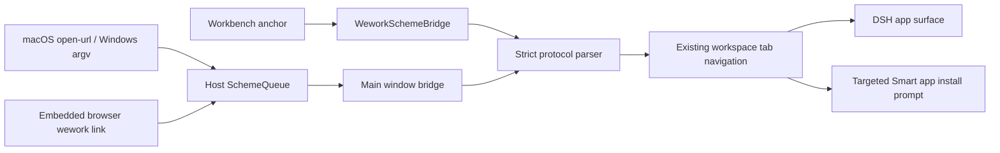

# Wework deep links

Wework uses `wework://` as its only client deep-link protocol. `wegent://` is already
reserved for internal resources such as attachments, so the two protocols must not be
treated as aliases. Every external link names one explicit resource and cannot carry an
arbitrary web URL, query string, or redirect target.

## Path space

The grammar is `wework://<resource>/<path...>`. Each path segment is one
percent-encoded identifier; query strings and fragments are not allowed.

| Path                                                     | Destination              | Behavior                                                         |
| -------------------------------------------------------- | ------------------------ | ---------------------------------------------------------------- |
| `wework://boards`                                        | Project-space home       | Open or reuse the project-space tab                              |
| `wework://boards/{projectId}`                            | Cloud project space      | Open the project                                                 |
| `wework://boards/local/{projectId}`                      | Local project space      | Open the local project                                           |
| `wework://boards/{projectId}/issues/{itemId}`            | Work item                | Open the project Issue                                           |
| `wework://tasks/{deviceId}/{taskId}`                     | Runtime task             | Reuse a task tab by device and task identity                     |
| `wework://interactions/{deviceId}/{taskId}/{requestKey}` | Runtime input            | Open the pending user interaction                                |
| `wework://apps/{appId}`                                  | Registered DSH app       | Native apps use their declared route; others open `/app/{appId}` |
| `wework://smart-apps/{smartAppId}`                       | Smart app marketplace ID | Open it when installed; otherwise show its install guide         |

`smartAppId` is the marketplace identity, not the local installation ID. The client
loads the local installation list and matches `installation.smartAppId`. A match reuses
the existing `HarnessAppAutoLauncher` flow and opens the workspace tab. Without a match,
the link opens `/sites?app_type=smart_app&smartAppId={smartAppId}` with an installation
prompt and the target app details.

When the Wework client itself may not be installed, external pages use the web handoff:

```text
https://<wegent-web>/open-wework?url=<percent-encoded wework URL>
```

That page accepts only allowlisted `wework://` destinations, offers an **Open in Wework**
button, and keeps the client download and retry actions on the same page. The existing
`projectId`, `itemId`, and `commentId` parameters remain compatible with project-space
notifications.

## Entry points and security



- The operating system delivers URLs through `open-url`, command-line arguments, and
  `second-instance` into the host queue. Only the main window consumes and acknowledges
  the queue; popout and workspace windows must not take requests.
- The workbench intercepts ordinary `<a href="wework://...">` clicks during capture.
  The Electron host forwards links clicked in the embedded browser to the same queue.
- The parser rejects userinfo, ports, query strings, fragments, control characters,
  empty segments, `.` and `..`, oversized URLs, and unknown resources. Navigation can
  target only registered DSH apps or existing workspace routes.
- Cloud destinations wait in the main-window queue until authentication is restored;
  the client neither acknowledges them early nor opens a broken page.

## Examples

```text
wework://boards/12/issues/WEG-42
wework://tasks/local-device/task-01
wework://apps/wegent
wework://smart-apps/42
```
