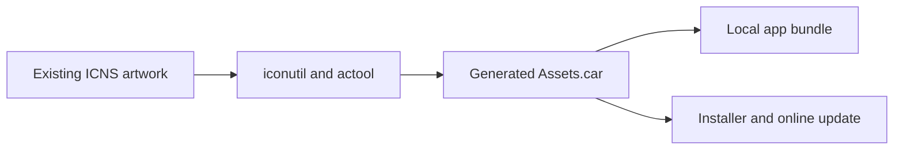

# Wework desktop releases

The Wework desktop application uses Electron. Formal builds and releases are
handled by `.github/workflows/wework-app.yml`, which produces Electron
installers for macOS, Windows, and Linux.

macOS arm64 releases use the Apple Silicon `macos-14` runner; x64 releases use
the native Intel `macos-15-intel` runner. Before installing dependencies, the
workflow checks that host hardware and Node.js architectures match the target,
preventing release tools from running through Rosetta translation. Intel builds
can take longer; do not restore translation solely to shorten compilation.
Package preparation logs each subprocess command, PID, and completion state,
and retains exit codes or signals to identify failures during parallel preparation.
Harness Runtime native
dependencies follow the running Node.js architecture, so selecting an Electron
Builder target alone cannot cross-build the complete runtime. If the
architectures differ, correct the Node.js architecture and rebuild; do not
reuse artifacts built for the wrong architecture or rerun only publication.

When formal macOS arm64 package verification fails, the workflow prunes large
temporary runtime directories and uploads desktop E2E diagnostics retained for
seven days. Use those logs to establish the root cause instead of hiding a
failure through reruns or weaker E2E assertions.

If `ERR_NETWORK_CHANGED` interrupts an entry script, stylesheet, or main document
from the same Core DSH origin during initial loading, Electron reloads that page
once before confirming completion. A repeated interruption enters the existing
startup error path. The `startup-network-change` checkpoint interrupts one real
script request through Chromium's protocol error API and verifies that the
recovered workbench can continue opening a task.

## macOS app icons

macOS bundles include both the existing `wework/resources/icons/icon.icns` and
an `Assets.car` generated during packaging. `CFBundleIconName=Wework` registers the app
icon in the catalog. macOS 27 adds another background and shrinks the artwork
when it adapts an unregistered ICNS icon; registering the catalog prevents this
extra processing. Every catalog size comes directly from the current ICNS,
preserving its macOS 15 corners, padding, and artwork. Do not revert the icon or
use Icon Composer to regenerate the bitmaps for older systems.

Electron Packager local bundles, Electron Builder installers, and online
updates must place the catalog at `Contents/Resources/Assets.car` and retain
the ICNS referenced by `CFBundleIconFile`. macOS packaging requires full Xcode.
Packager compiles the current ICNS before packaging; Builder compiles it in
`beforePack` for both installers and online updates. Compilation failures stop
packaging. Generated files live in the ignored
`wework/electron/resources/macos/` directory and are not committed.



After changing the ICNS, check compilation and output on a Mac with full Xcode:

```bash
node wework/electron/scripts/compile-macos-app-icon.mjs
pnpm --dir wework/electron test scripts/macos-app-icon.test.mjs
```

The script extracts all ten ICNS size representations and compiles a standard
`.appiconset`. It also updates the source and artifact SHA-256 hashes in
`app-icon.json` in the generated directory. Atomic replacement prevents parallel
installer and online-update builds from reading partial files. Regression tests
compile the catalog and verify all ten representations and both hashes.

## Version and artifacts

The release version is written to `wework/package.json` and
`wework/electron/package.json`. For a formal release, the workflow commits both
files and builds every platform from that commit. This keeps the About page,
Electron package, and release tag on the same version.

Build release installers with:

```bash
pnpm --dir wework/electron build:release
```

Artifacts are written under `wework/electron/release-installer/`:

```text
WeWork_<version>_macos_<arch>.dmg
WeWork_<version>_macos_<arch>.zip
WeWork_<version>_windows_x64-setup.exe
WeWork_<version>_linux_x64.AppImage
```

## Automatic updates

Clients with the release-slot updater prepare the complete target in a separate
directory and retain the running installation, its selected component cache,
and its runtime as the rollback baseline. They neither copy nor prepare the old
host again, including thin hosts installed by historical component updates.
After stopping all writers, installation retains the original plugin profile
directory in the source slot before switching to the target profile. Target
preparation and execution do not write to the source components or profile.
The shared real-package upgrade, rollback, and recovery scenarios additionally
check retained host paths, component directories, and profile identity for
independently built regression packages.
Compatible manual rollback switches directly to the retained release. Incompatible
rollback still requires confirmation before restoring the pre-update snapshot.

Electron releases use `electron-updater` and the `latest*.yml` or `beta*.yml`
files in the rolling `wework-updater` Release. Before installing a downloaded
update, Wework shuts down its local runtime and then restarts into the new
version. A channel that has not published an Electron release may omit its YAML
manifest; the client treats that state as no available update rather than a
network failure. Other update-check failures remain visible.

Wework disables `electron-updater` differential downloads and old ZIP caching.
macOS and Windows clients download only the compressed full Host update,
avoiding low-reuse Range request bursts, duplicate traffic, and extra disk
usage. Component updates still reuse unchanged components by content hash.

The release workflow emits only Electron YAML update manifests and component
manifests. macOS and Windows use Electron's ZIP and NSIS update paths. Linux
continues to use manual AppImage replacement.

## Initial package and component updates

The initial Electron installer contains a complete runtime that can start
offline:

- Electron, whose embedded Node runtime is shared by the Electron main
  process, Core DSH, plugin subprocesses, and Codex skill scripts;
- Core DSH;
- Wework core DSH plugins;
- Wework application static assets;
- bundled personal plugins and Skills;
- Executor;
- Codex;
- DWS.

`components.json` records the application version, release channel, and each
component's version, resource path, and content SHA-256. The Electron
application itself continues to update through `electron-updater`; the other
seven components use target-version
`components-<channel>-<platform>-<arch>.json` manifests.

For macOS, publication locates immutable signed components by their unsigned
content, certificate identity, architecture, signing policy, and build-tool
version. When those inputs are unchanged, the installer and online component
reuse exactly the same signed bytes. A changed input is signed and verified
again. Electron Builder skips those already processed managed resources so a
new signing timestamp alone cannot change their component hashes. Published
component archives must use resources inside the final delivered application,
checking each content SHA-256, application version, and source revision against
its bundled manifest. Never read the mutable `electron/resources` staging tree,
which E2E fixture builds can overwrite, or re-sign the delivered application to
extract components. Catalog generation checks the component descriptor against
the target source revision again and blocks publication on an identity mismatch.

Re-signing an existing Mach-O file must preserve the entitlements from its
previous signature. Codex and `codex-code-mode-host` require `allow-jit` and
`allow-unsigned-executable-memory` to run V8; `codesign --verify` alone does
not detect removed entitlements. Any signing-argument change must increment
the signing-policy version so cached components signed under the previous
policy are invalidated.

The Codex component boundary is the complete `codex/` runtime directory, not
the standalone `codex` executable. The component must contain
`WEGENT_CODEX_BINARY.json`, the target architecture's `codex` and
`codex-code-mode-host` binaries, the `codex-path` tools, and legal resources.
The client resolves the main executable from the runtime descriptor's
`binaryPath` and verifies the sibling code-mode host before activation.
Release scripts must not point the Codex entry in `components.json` at the main
executable or archive that executable alone.

Component archives are named by their archive SHA-256 and stored as immutable
assets. Repository-built Wework core plugin/UI, application static asset,
bundled plugin, and Executor archives live in their corresponding version
Release. External Core DSH, Codex, and DWS archives live centrally in
`wework-updater` for reuse across versions. Version Releases must not attach
Core DSH, Codex, or DWS binaries. Every publication Release contains complete
installers and its component manifests, and uploads only archive hashes that
are not already available at the appropriate location.

Before uploading a version Release component, the workflow checks any existing
asset's upload state, size, and SHA-256. An exact match is reused without
overwriting the immutable component. If GitHub CLI reports an upload error,
the script queries the asset list again and continues only when the remote
asset is fully uploaded and exactly matches the local archive. Missing,
incomplete, or mismatched assets still block publication, and the original
CLI error remains in the logs.

After checking out the release source, the publish job uses the shared
`setup-node-workspace` action to prepare Node.js, pnpm, and workspace
dependencies before running release scripts. Harness Runtime archive
collection uses the `tar` package declared by Wework; dependencies installed
in build jobs are not automatically available in the publish job.

All bundled desktop components and Electron share one application release version.
Component hashes and upstream product versions support integrity checks and reuse
across releases. User-installed marketplace plugins remain independently managed.

The Wework UI, core plugins, application static assets, bundled personal
plugins, and Executor share one `wework-<sourceSha12>` runtime version, where
`sourceSha12` is the first 12 hexadecimal characters of the source commit, and
switch atomically through the same component manifest. They remain separate
content-addressed archives only as a transport optimization, so clients
download the files that actually changed; the split does not make Executor an
independently released product. Codex and DWS retain their own product
versions.

The Wework application is further split by change frequency:
`weworkCorePlugins` contains frequently changing application code and UI,
while `weworkAppStatic` contains stable `web/vendor` and `web/wasm` assets. The
client atomically composes both components into the complete plugin directory
before startup. A routine Wework UI change should change only the content of
`weworkCorePlugins`, whose archive must remain below 20 MiB. If it exceeds that
limit, re-examine component ownership instead of adding external binaries such
as Codex, Core DSH, or DWS to the version Release.

Every desktop code or bundled component change advances the application version
and publishes one immutable `wework-v<appVersion>` Release with complete installers,
Electron YAML, and component manifests. Unrelated changes skip publication.
Published versions cannot be reused for different code. Component changes also
advance the stable patch or beta sequence; same-version Runtime releases are removed.

Clients check application versions through the selected stable/beta channel.
Downloading an update stages its matching components before downloading the host;
both activate together after restart. Startup no longer checks for independent
same-version component updates. Component manifests and caches optimize transfer
and storage, rather than creating a second update path.

Repository-built Wework core plugin/UI, application static asset, bundled
plugin, and Executor archives are uploaded to their corresponding version
Release. External Core DSH, Codex, DWS, and other non-repository binary
dependencies use content-addressed archives stored centrally in
`wework-updater` for reuse across versions. Rolling component manifests are
also published there, but it is no longer the first-time installer download
entry point. Existing users reuse unchanged components and download the slim
host update that matches the new application version.

Online Electron host updates use a separate `WeWorkHostUpdate` artifact. The
rolling Electron manifest points at a slim host package without the seven
managed components only after the currently published version advertises
`componentizedHostUpdate: 1`. The client stages the complete component set for
the target application version before installing that host update. Older
clients without this capability first receive one migration host package that
still contains the managed components, preventing missing runtime resources
after the upgrade. Component manifests and archives must be published before
the Electron YAML so a visible host update never references unavailable
components. The `WeWorkHostUpdate` ZIP must use normal compression rather than
the `store` mode that only wraps the original bytes. Formal Release E2E reads
the ZIP summary and rejects an uncompressed host update artifact. Complete
installers always contain every component for first-time offline installation.

The client accepts only a component manifest that exactly matches the target
Electron application version, channel, platform, and architecture. A
manifest's `downloadUrl` may point to a version Release, a shared dependency
Release, or independent object storage; it does not need to share the rolling
manifest's origin or path. Content integrity defines the download trust
boundary: the client verifies the archive size and SHA-256 before extraction,
then verifies the extracted component content SHA-256. Downloads enter a
content-addressed store under the user data directory as `pending` and the
complete component set switches through one atomic state file on the next
startup. Wework confirms the new set only after the workbench and Core DSH
start successfully. A failed startup, or a process exit before confirmation,
rolls back to the previous set on the next launch. Packaged resources remain
the final fallback.

The main process owns one application-update task. Automatic downloads, manual
downloads, and repeated checks for the same version and channel share that
task, and a check cannot clear an active download. Missing components download
with at most three workers; Wework writes the `pending` set only after every
archive passes size, archive-hash, and extracted-content verification. Progress
covers component downloads, host download, and installation readiness. The
local Squirrel.Mac handoff of the downloaded ZIP is not counted as network
traffic.

When one component download encounters an explicitly transient transport
failure, the client makes at most three attempts, waiting one second and then
two seconds before retrying. Retries are limited to interrupted connections,
DNS, connection, or request timeouts, HTTP 408, HTTP 429, and HTTP 5xx
responses. Other HTTP 4xx responses, archive size or SHA-256 mismatches, and
extracted-content SHA-256 mismatches are not retried and remain real update
failures. Bytes transferred by a failed component attempt are removed from the
current progress before retrying. Failure events in `app-update.log` record the
sanitized error type, code, message, and first-level cause without logging URLs.

Wework no longer packages or downloads a second Node runtime. At startup it
creates a lightweight `node` entry under the user data directory, prepends it
to `PATH`, points `WEWORK_NODE_PATH`, `NODE`, and `npm_node_execpath` at
Electron, and sets `ELECTRON_RUN_AS_NODE=1`. Core DSH and Codex skills therefore
use Electron's version-bound Node for both explicit `node script.ts` commands
and `#!/usr/bin/env node` entry points.

The entry point also preloads a standard-stream guard. After the consumer of a
stdio MCP or another Node child process closes, diagnostic writes to a broken
`stderr` must not surface as an Electron main-process error dialog. A broken
protocol `stdout` means the caller has gone away, so the child exits normally.
The guard handles only `EPIPE`; other stream errors still fail and expose their
root cause. A configured external Node executable keeps native Node error
handling and does not load this Electron-specific guard.

The Electron main process may also be launched through pipes by a terminal,
development script, or automation runner and remain resident after that parent
exits. Before loading other Electron modules, the main process must install the
same strict `EPIPE` guard on its own `stdout` and `stderr`, preventing later
Node warnings or diagnostic logs from becoming uncaught-exception dialogs
after the consumer closes. This path must neither exit the main process nor
ignore errors other than `EPIPE`; the desktop window and local runtime do not
share the log consumer's lifecycle.

## Bundled sidecars and resources

Prepare Codex and DWS before packaging:

```bash
cd wework
pnpm run prepare:codex --materialize
pnpm run prepare:dws
```

The Codex package is pinned by `wework/codex-binaries.lock.json` and verified
with SHA-512. Prepared desktop resources live under `wework/resources/`.
`wework/electron/scripts/prepare-package-assets.mjs` copies sidecars, plugins,
icons, and runtime descriptors into the application resources. Do not maintain
a second desktop resource tree or manifest.

The current pin is Codex `0.163.0-alpha.5`. Codex `0.152` disables
`tools.update_plan.enabled` by default, while Wework consumes the corresponding
plan events to render plan blocks, so the Executor must enable the tool
explicitly when launching Codex. Desktop E2E verifies the lockfile binary by
default; only the dedicated `WEWORK_E2E_CODEX_BIN` may override it. It must not
inherit the generic `CODEX_BIN`, which could otherwise select an older binary
from an installed application instead of the repository version under test.

Desktop distributions must also include the project and bundled-sidecar
licenses and attribution notices:

- `LICENSE` at the application resource root contains Wegent's Apache-2.0
  license;
- `licenses/` contains third-party licenses for Electron dependencies such as
  CUA Driver;
- `codex/legal/` contains the Codex Apache-2.0 license, `NOTICE`, and the
  Ratatui MIT license.

`prepare-codex-binary.mjs` generates the Codex legal directory, and
`prepare-package-assets.mjs` must copy it together with the target architecture
binary. Packaging changes must inspect the real packaged application and
confirm that these files exist and match their repository sources. Inspecting
only an intermediate resource directory does not prove that the distribution
is complete.

## Development hot reload

Wait for Chokidar's `ready` before taking the input snapshot and starting the
initial build. Creating a native watcher alone does not establish subscription
readiness, so the first edit can lose its notification. Await all watcher
closures during shutdown; failure diagnostics retain the edit, notification,
and build timeline.
Chokidar's Node backend throttles normalized `change` events, so preserve raw
file notifications as well and deduplicate through the input snapshot. A rapid
edit that fixes a compilation error must still trigger recovery.

`pnpm --dir wework run dev:mac` continuously builds the original Wework
application through `wework/scripts/dev-wework-app-watch.mjs`. The watcher
clears `dsh/app-wework/web` once at startup and must not clear it again for
incremental builds. A running renderer may still request hashed assets from the
previous generation, and deleting them while the next generation is being
written can leave the window blank.

Each build publishes `.wework-build-id` only after Vite finishes the bundle,
the build result is closed, and file-viewer metadata is normalized. Core DSH
uses this marker as the published build ID, so the page reloads only after the
marker changes instead of treating an intermediate `index.html` write as a
loadable generation.

Automatic reload is enabled only in desktop renderers that expose the Wework
Electron preload capabilities. Opening the Core DSH URL directly in the system
default browser must not start the hot-reload poller. When a desktop renderer
observes a newly published build, it records that build ID before attempting a
reload. If the new page fails to load and the old document remains alive, the
same build must not trigger another reload. A later build with a new ID still
reloads normally.

In development hot-reload mode, static resources under `/wework/app/` must use
`Cache-Control: no-store`. In addition to hashed assets, this tree contains
fixed-name `plugins/*.js` bundles. Serving those files with the production
immutable cache can mix an old plugin bundle with a new main bundle after
reload, creating duplicate instances of modules such as React contexts.
Formal builds continue to use `public, max-age=31536000, immutable`.

## Local verification

Release changes must run at least:

```bash
pnpm --filter wework typecheck
pnpm --dir wework/electron typecheck
pnpm --dir wework/electron test
pnpm --dir wework/electron build:release
```

Changes to windows, tray behavior, IPC, the built-in browser, sidecars, or
packaged resources must also be verified in an isolated real Electron session:

```bash
pnpm --filter wework ai:verify start --packaged true
```

Give each concurrent worktree a distinct `WEWORK_PORT`. Isolated sessions use
separate Executor Homes, application-data directories, and single-instance
locks.

## GitHub Actions

`.github/workflows/wework-app.yml` supports stable and beta channels, an
optional version override, parallel builds for three platforms, Actions
artifacts, formal GitHub Releases, and rolling Electron and component
manifests. The workflow automatically selects a component or full
publication from the source changes since the last published state; there is
no manual release-kind input. Stable releases advance both stable and beta
channels; beta releases advance only beta. The workflow installs the
dependencies owned by `wework/electron`, prepares bundled sidecars, and calls
the unified Electron build command. Desktop resource changes belong in
`wework/resources/` or the Electron packaging scripts, not in a duplicated
workflow resource list.

A rolling channel may skip an equal-version upload only when both Electron
YAML manifests and component manifests for all four build targets exist. The
workflow repairs an incomplete equal version and fails for an incomplete newer
version instead of overwriting it with an older release. Component archives
are never overwritten and are uploaded only when their content-addressed asset
name is absent.

## Component preparation I/O concurrency

Formal package verification requires `component-update` to stage the complete
component set within its existing budget. Release scripts and Electron share
one hashing implementation: read at most eight files concurrently per directory
tree, then feed records to the hash in sorted path order. Directory records,
file digests, and path separators remain consistent, preserving existing
component digests. Unsupported entries such as symbolic links still fail
validation. Independent components validate and prepare their caches in
parallel; missing downloads and pending-state publication follow only after
all preparations succeed. Do not increase E2E timeouts or omit digest checks
to hide serial I/O costs.

## Runner capacity for formal package verification

The shared runner executes all three formal-package checkpoints with a concurrency
limit of one: `release-package-startup`, `component-update`, and `app-update-full`.
Each isolated signed app unpacks its own Core Runtime. With three concurrent cold
starts, release logs show approximately 121 seconds per unpack, and two apps exhaust
the existing controller connection or first UI-action budget. Address this resource
contention by limiting formal verification concurrency, without reruns or larger
timeouts. Regular desktop CI shards and concurrency remain unchanged, as do formal
scenario code, assertions, and timeouts.

## Apple ticket-service transport errors

Notarization submission, stapling, and ticket validation share bounded transport
retries: three attempts by default, with five- and ten-second delays. Only recognized
connection loss and timeout failures qualify; notarization rejection, invalid tickets,
and other validation failures stop immediately. CloudKit lookups made by
`stapler validate` can also fail with `NSURLErrorDomain -1005`. A failed lookup must
not be treated as a missing ticket and trigger another notarization submission.
Exhausted transport attempts still fail the release, and final ticket validation is
always required.
