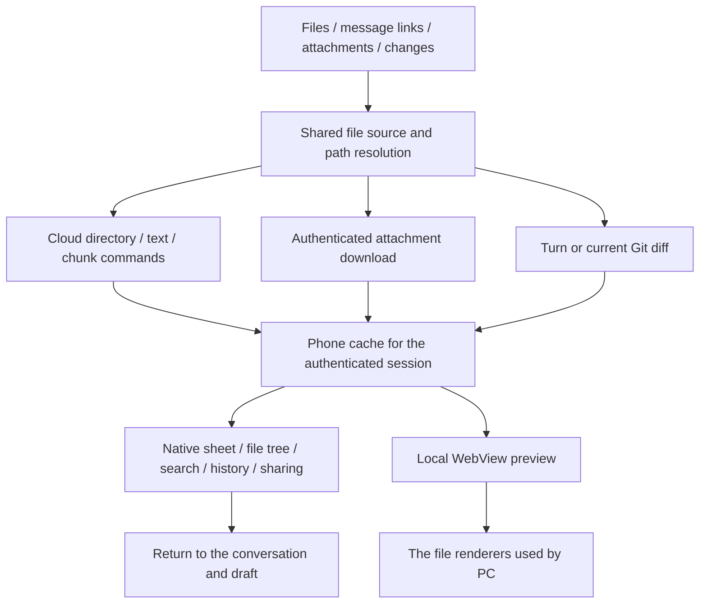

# Mobile file previews

View cloud-device files, message attachments, and code changes from a conversation on iPhone or
Android. This is a read-only preview with search and system sharing; desktop editing and saving are
not available. Closing the preview preserves the original conversation and unsent draft.

## Entry points

| Entry                                                                      | Action and availability                                                                                                                                                     |
| -------------------------------------------------------------------------- | --------------------------------------------------------------------------------------------------------------------------------------------------------------------------- |
| Conversation top-right **More → Files (更多 → 文件)**                      | Browse the conversation or selected project's directory; disabled when no accessible workspace is available                                                                 |
| File links in replies and file paths in tool details                       | Open the file; links with line numbers open source at that location                                                                                                         |
| Attachments already added to the composer or included in messages          | Tap the filename or thumbnail; the separate remove button removes only a draft attachment                                                                                   |
| Generated images in tool output                                            | Tap an image to open its full preview                                                                                                                                       |
| **N files (N 个文件)** or **Edited N files (编辑 N 个文件)** below a reply | Expand and tap a path to inspect changes; when a historical diff is available, **More file actions → Open current file (打开当前文件)** opens the device's current contents |

Files open in a rounded native sheet. **Modified / All files (已修改 / 所有文件)** switch between
changes and an expandable directory tree. **Search files (搜索文件)** floats at the bottom; the title
menu provides path entry, parent navigation, and refresh. A new conversation without a title menu
retains a folder button for its selected project.

**More → Changes (更多 → 更改)** and the **N files +added −deleted** pill above the composer open
Git changes for the owning workspace. Tap the project title to select **Branch, Unstaged, Staged,
or Last commit (分支、未暂存、已暂存、最近一次提交)**. Branch mode offers a comparison baseline
selector at the bottom. The default “Main branch” follows PC automatic selection. An explicit
baseline requires backend support for `git_compare_branch_diff`; older backends report an error
instead of silently substituting the default. Staged and unstaged use their corresponding Git semantics.
Large reviews open individual diffs on demand while preserving real statistics; empty lists show a mode-specific empty state.

The bottom-left folder button returns to files, and bottom-right history opens **Recent (最近)**.
It retains up to 30 files and reading positions during the authenticated app session. Device files
keep their original owner. Records do not survive logout or restart and do not sync to desktop.
**Back (返回)** returns to the previous location. Top-right **Close (关闭)** or the iOS swipe-down
gesture dismisses the sheet.

The conversation **More** menu also offers **Pin / Unpin, Rename, Copy conversation ID, and Archive
(置顶 / 取消置顶、重命名、复制对话 ID、归档)** using PC cloud conversation identities and APIs.
Archiving a managed worktree preserves a snapshot before cleanup; cleanup failures are reported
separately without pretending the already archived conversation remains unarchived.

The **N agents (N 个智能体)** pill above the composer appears only when the conversation has real
subagents. It opens their status and conversations. Running agents show live activity; completed
child threads load history independently from the owning device without switching the parent conversation.

## Reading and sharing

Tap the filename in the preview header for content search, line navigation, copy path, refresh,
and wrapping. Code wraps by default with fixed line numbers; continuation lines do not repeat them.
Renderable text such as Markdown and HTML offers **Preview / Source (预览 / 源码)**. Format viewers
provide their supported reading controls. The top-right share button opens **Share or save file
(分享或存储文件)**; available destinations come from iOS or Android. The filename menu also shows
the full path and size. Failed previews offer retry and **View error details (查看错误详情)** for
the original cause; source remains available for supported files.

Regular text-file previews display at most the first 256 KiB and show a truncation notice. Sharing obtains
the complete file; the truncated preview must not be mistaken for the full contents. Existing device
authorization governs reads, including permitted absolute paths outside the current project.
Permission to access a computer's tasks remotely does not automatically grant access to its file API.

Sharing from an individual diff exports only that file's `.diff` patch. A change preview without a
selected file exports the full patch.

Images, PDF, Office, archives, XMind, and diagrams reuse PC renderer components. Video previews support
MP4, OGV, and WebM. Renderers are bundled with the app rather than sending files to a third-party
conversion website. Document references may still load network resources. Mermaid renders locally;
PlantUML sends source only to an explicitly configured `EXPO_PUBLIC_PLANTUML_SERVER_URL`.

HTML runs in an isolated page. Local CSS, JavaScript, and images beside the file are not loaded
automatically, so multi-file pages that depend on relative resources may render incompletely; source
view and sharing remain available. Access denial, offline devices, missing files, and renderer failures
are shown as errors while the conversation remains usable.

## Implementation and PC parity

Mobile follows the PC cloud-device file contract. Execution devices, file owners, workspace paths,
and final worktrees are distinct. Remote workspaces use `remoteHostId`; queued independent worktrees
must not expose their source directory as the final workspace.

Preview pages never receive authentication tokens or interpret cloud paths as phone-local paths.
Chunks are written directly to native cache files, and complete sharing does not read the full text
back into JavaScript. Rendering still depends on WebView and each viewer's memory and format support.

- `wework/src/api/environment.ts` and `runtimeWork.ts`: Git comparisons and conversation actions.
- `wework/src/api/devices.ts` and `attachments.ts`: cloud commands and authenticated downloads.
- `wework/src/lib/workspace-target.ts`: ownership and worktree resolution.
- `wework/src/components/layout/workspace-panels/WorkspaceFilePreview.tsx`: formats and presentation.
- `packages/chat-core/src/workspace-file-types.ts` and `workspace-file-paths.ts`: type detection and paths shared by PC and Mobile.
- `packages/collaboration/src/files/XMindPreview.tsx`: shared XMind presentation.
- `packages/collaboration/src/markdown/assistantMarkdownLinks.ts`: links and line references.
- [Codex on mobile](https://learn.chatgpt.com/docs/mobile) and the [changelog](https://learn.chatgpt.com/docs/changelog): file links, attachment previews, recent files, and reading positions.

## Builds and verification boundaries

See `wework-mobile/README.md` in the repository for development commands. Adding native
modules or changing bundled preview pages requires rebuilding and installing the app. Metro reloads
and Expo exports do not replace native modules or preview assets inside an already installed app.

The existing cloud `workspace-attachments` E2E checkpoint includes a binary file larger than 512 KiB,
chunk offset/size/EOF checks, full-file SHA-256 verification, and real baseline/staged/unstaged Git comparisons using the existing CI cloud fixture.
This is a **real cloud file protocol regression**, not native mobile UI verification; it was not run
for this change. Type checks, component tests, asset builds, and iOS/Android exports also do not establish
physical-device compatibility. Android physical-device behavior was not verified for this change;
record native gestures, system sharing, WebView, and individual file-format checks separately.
