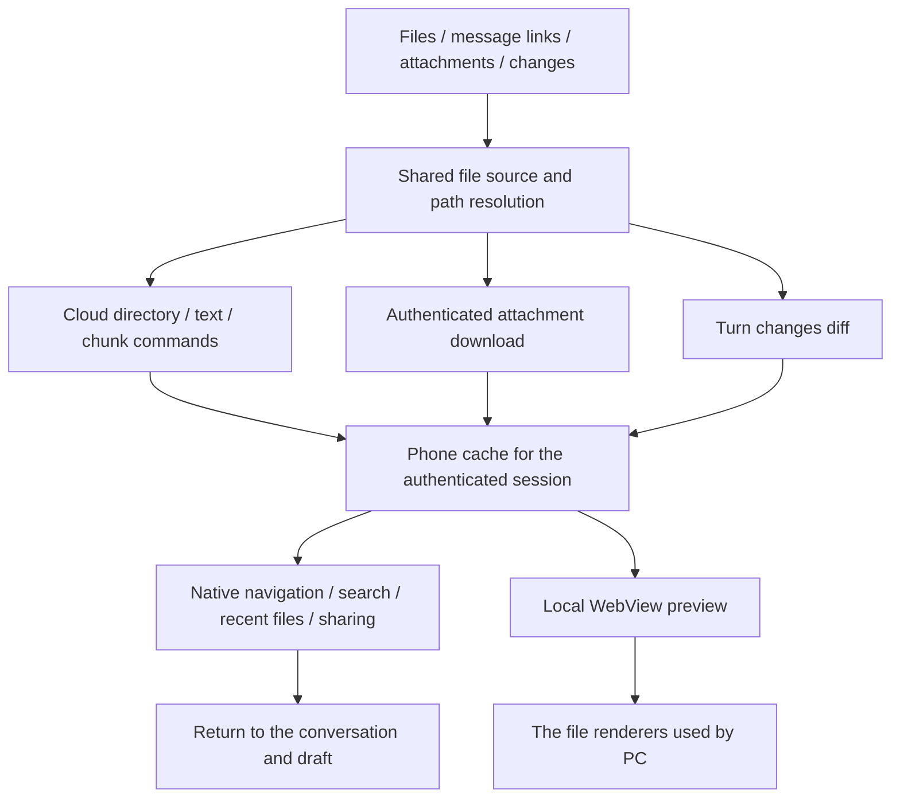

# Mobile file previews

View cloud-device files, message attachments, and code changes from a conversation on iPhone or
Android. This is a read-only preview with search and system sharing; desktop editing and saving are
not available. Closing the preview preserves the original conversation and unsent draft.

## Entry points

| Entry                                                                                         | Action and availability                                                                                                                        |
| --------------------------------------------------------------------------------------------- | ---------------------------------------------------------------------------------------------------------------------------------------------- |
| Folder icon at the top right of a conversation, **Browse workspace files (浏览工作空间文件)** | Browse the conversation or selected project's directory; disabled when no accessible workspace is available                                    |
| File links in replies and file paths in tool details                                          | Open the file; links with line numbers open source at that location                                                                            |
| Attachments already added to the composer or included in messages                             | Tap the filename or thumbnail; the separate remove button removes only a draft attachment                                                      |
| Generated images in tool output                                                               | Tap an image to open its full preview                                                                                                          |
| **N files (N 个文件)** or **Edited N files (编辑 N 个文件)** below a reply                    | Expand and tap a path to inspect changes; when a historical diff is available, **Current file (当前文件)** opens the device's current contents |

The **Files (文件)** tab supports directories, parent navigation, entering paths, search, and refresh.
**Recent (最近)** retains up to 30 files and reading positions during the current authenticated app
session. Device files keep their original owner. These records are not retained after logout or an
app restart and do not sync to desktop. **Back (返回)** returns to the previous file or directory;
the top-right close button dismisses the entire preview.

## Reading and sharing

Text supports **Find (查找)**, **Wrap (换行)**, and **Find → Line number (行号) → Go (跳转)**.
Renderable text such as Markdown and HTML offers **Preview / Source (预览 / 源码)**. Other viewers
provide the reading controls supported by their format. Use the top toolbar to copy the path or
choose **Share or save file (分享或存储文件)**; available save destinations come from iOS or Android.

Regular text-file previews display at most the first 256 KiB and show a truncation notice. Sharing obtains
the complete file; the truncated preview must not be mistaken for the full contents. Existing device
authorization governs reads, including permitted absolute paths outside the current project.
Permission to access a computer's tasks remotely does not automatically grant access to its file API.

Images, PDF, Office, archives, XMind, and diagrams reuse PC renderer components. Video previews support
MP4, OGV, and WebM. Renderers are bundled with the app rather than sending files to a third-party
conversion website. Document references may still load network resources. Mermaid renders locally;
PlantUML sends source only to an explicitly configured `EXPO_PUBLIC_PLANTUML_SERVER_URL`.

HTML runs in an isolated page. Local CSS, JavaScript, and images beside the file are not loaded
automatically, so multi-file pages that depend on relative resources may render incompletely; source
view and sharing remain available. Access denial, offline devices, missing files, and renderer failures
are shown as errors while the conversation remains usable.

## Implementation and PC parity

Mobile follows the PC cloud-device file contract. Execution devices, file owners, workspace paths,
and final worktrees are distinct. Remote workspaces use `remoteHostId`; queued independent worktrees
must not expose their source directory as the final workspace.

Preview pages never receive authentication tokens or interpret cloud paths as phone-local paths.
Chunks are written directly to native cache files, and complete sharing does not read the full text
back into JavaScript. Rendering still depends on WebView and each viewer's memory and format support.

- `wework/src/api/devices.ts` and `attachments.ts`: cloud commands and authenticated downloads.
- `wework/src/lib/workspace-target.ts`: ownership and worktree resolution.
- `wework/src/components/layout/workspace-panels/WorkspaceFilePreview.tsx`: formats and presentation.
- `packages/chat-core/src/workspace-file-types.ts` and `workspace-file-paths.ts`: type detection and paths shared by PC and Mobile.
- `packages/collaboration/src/files/XMindPreview.tsx`: shared XMind presentation.
- `packages/collaboration/src/markdown/assistantMarkdownLinks.ts`: links and line references.
- [Codex on mobile](https://learn.chatgpt.com/docs/mobile) and the [changelog](https://learn.chatgpt.com/docs/changelog): file links, attachment previews, recent files, and reading positions.

## Builds and verification boundaries

See `wework-mobile/README.md` in the repository for development commands. Adding native
modules or changing bundled preview pages requires rebuilding and installing the app. Metro reloads
and Expo exports do not replace native modules or preview assets inside an already installed app.

The existing cloud `workspace-attachments` E2E checkpoint includes a binary file larger than 512 KiB,
chunk offset/size/EOF checks, and full-file SHA-256 verification using the existing CI cloud fixture.
This is a **real cloud file protocol regression**, not native mobile UI verification; it was not run
for this change. Type checks, component tests, asset builds, and iOS/Android exports also do not establish
physical-device compatibility. Android physical-device behavior was not verified for this change;
record native gestures, system sharing, WebView, and individual file-format checks separately.
