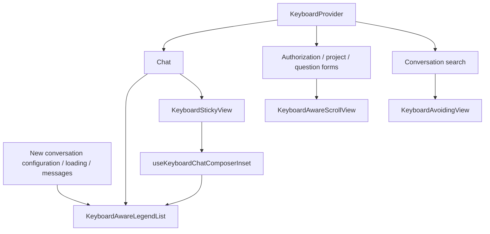

# Mobile keyboard and chat layout

Wework Mobile shares native keyboard integration across iOS and Android. A single
root `KeyboardProvider` covers authorization, navigation screens, Paper portals,
and native modals.

## Screen responsibilities

| Screen or region                       | Keyboard handling                                                                  |
| -------------------------------------- | ---------------------------------------------------------------------------------- |
| Authorization and backend address      | The whole form scrolls, keeping inputs and the login action reachable              |
| Conversation search                    | Search input and results share the available viewport                              |
| New and existing conversations         | The composer follows the keyboard; the list receives its measured inset            |
| Project creation                       | Name, path, device selection and submit action share one form scroller             |
| Model questions                        | The entire native modal form scrolls while preserving drafts, submission and retry |
| Copy, attachment and plugin menus      | Position respects keyboard and safe areas; the first tap performs the action       |
| Model, device and permission selection | Opening an input-free selection surface dismisses the keyboard                     |

Opening project forms, question modals or connection settings dismisses the previous
input area's keyboard. Native inputs then manage focus within the new form.

## Chat scroll ownership

`KeyboardAwareLegendList` from `@legendapp/list/keyboard` owns dynamic measurement,
end following, reading anchors and gesture interruption. The app no longer runs a
per-frame scroll loop. A new user message requests the end; streaming updates use
`maintainScrollAtEnd`, while prepending history preserves the reading position.
Automatic following uses `animated: false` so each height change follows the new
end immediately instead of waiting for a native scroll animation targeting an older
position. Explicit scrolling after a user send remains animated. Do not switch
automatic animation based on task `running`: displayed text can still stream after
the task finishes.
Initial loading, conversation switching and re-entry start at the latest message.
Only user scrolling initiates history pagination.

New conversations, loading and populated messages share one mounted list. Dataset
changes use `dataKey` rather than a React `key` that remounts the native keyboard
scroll view. This retains keyboard state through the first send, task address
confirmation and loading completion. New conversation configuration is a separate
presentation row measured by the list, aligned to the bottom and scrollable on
small screens or when multiline input leaves less space. Keep it distinct from
chat messages; do not use the unmeasured `ListEmptyComponent` for configuration.

`useKeyboardChatComposerInset` reports composer height without duplicating it in a
list footer. The screen reserves the bottom safe area. The list's `keyboardOffset`
matches the composer's `KeyboardStickyView` offset so the safe area is compensated
once when the keyboard opens. Do not wrap this chat list in another
`KeyboardAvoidingView`.

PC cloud-device conversations remain the product reference:

- `packages/collaboration/src/conversation/useConversationScrollController.tsx`
- `wework/src/components/chat/ScrollableMessageArea.follow.test.tsx`
- `wework/src/components/chat/ScrollableMessageArea.streaming.test.tsx`

Layout adaptation does not change device identity, task addresses, model selection,
executor routing, message protocols or question permissions.

## Verification

Run `pnpm typecheck`, `pnpm test` and `pnpm build` in `wework-mobile/`. Component
tests cover application triggers and component boundaries. Expo exports verify
JavaScript bundling, not native keyboard behavior. Rebuild native applications
after changing native dependencies and synchronize the CocoaPods lockfile on iOS.

For device overlap diagnosis, set `EXPO_PUBLIC_CHAT_LAYOUT_DIAGNOSTICS=1` before building.
`[ChatLayout]` logs compare following state, item heights, composer inset and native scroll
geometry, throttled to one record per 200 ms for each frequent event type. They exclude
message content, task and message IDs, device identifiers and credentials. Diagnostics
are disabled by default and do not change scrolling behavior.
When enabled, the app also caches the latest 1000 records in
`chat-layout-diagnostics.jsonl`, writing at most one snapshot every 500 ms. On iOS,
read it from `Library/Caches/` in the app data container without collecting system
logs for the entire device. An `appStart` record verifies the diagnostic channel
before opening a conversation.

Verify separately on iOS and Android:

1. Send the first message while the keyboard is already open; the reply remains above the composer.
2. Stream a growing response, interrupt following by reading history, and send again to return to the end.
3. Expand multiline input, add attachments, open model settings and toggle the keyboard without overlap.
4. Preserve reading position while loading history; switch and re-enter conversations without stale scroll requests.
5. Reach the last input and submit action on small-screen authorization, project and question forms.
6. Open copy and attachment/plugin menus with the keyboard visible; menus fit and actions respond to the first tap.
7. Exercise interactive keyboard dismissal on iOS and Android back dismissal with different navigation bar modes.
