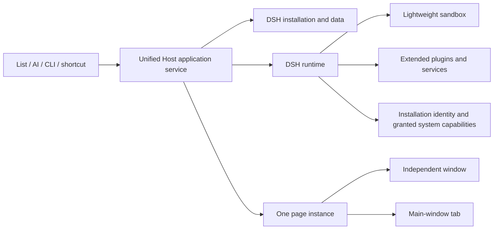

# Workbench applications

Smart apps and Light apps are unified as **Workbenches**, sharing DSH project formats, installation, runtime and data management. These applications are separate from the code workbench used to develop software.

## Create and open

On desktop, open **Sidebar → Applications → Workbenches → Mine**. No experimental switch is required. The marketplace requires a cloud connection; local creation and execution do not depend on the marketplace.

- **Create workbench**: enter a name and choose **Lightweight** for calculators and notes, or **Extended** for DSH services and plugins. Description and location are optional; Advanced allows editing the directory identifier. The default location is `WeworkSmartApps` under Documents. Creation opens a development conversation for the linked directory.
- **Create TODO note**: review the native installation confirmation and requested system capabilities. Accepting installs and opens it; cancelling does neither.
- **Link folder** / **Import workbench**: link DSH source or import a package. Review version and capabilities. Explicitly importing an old light-app directory converts it to DSH instead of retaining its old runtime.
- **Run** / **Open**: start or focus the existing instance, using an independent window by default. Refresh failures retain the existing list and show an error.

## Presentation and shortcuts

Open a card's **More actions → Workbench settings → Open in**, then select **Independent window** or **Main-window tab**. Both flavors support both modes. Changes save immediately and move the same running page, preserving unsaved input and page state.

**Run automatically when Wework starts** controls restoration on the next launch. **Keep running after closing the window** separately controls the close button; **Hide and keep running** retains the instance; **Stop** releases its runtime while keeping local data and registered reminders. Fully quitting Wework stops execution.

Enter a **Global shortcut**, such as `CommandOrControl+Shift+T`, and click **Save**. While Wework is running, the shortcut opens or focuses the application; pressing it while focused hides it. Save an empty value to clear it. Invalid or conflicting combinations show an error without replacing another application's binding.

**Create desktop shortcut** writes a macOS `.app` launcher bound to its owning Wework instance and data directory, keeping development and installed instances separate. Windows uses `.url`; Linux uses `.desktop`. Opening the shortcut starts the target directly without opening the main window first. Windows and Linux require the registered Wework protocol. Recreating a macOS shortcut removes that workbench's old generated `.webloc`; user-modified files are preserved.

**Remove** asks for confirmation before stopping the instance, unregistering shortcuts, cancelling reminders and deleting owned data and managed installation files. Linked external source directories remain. Cancelling preserves the running application.

## Models and development

Flavor does not determine whether a model is required. Tools without AI can run without a model; applications using AI can bind a Wework model per installation. An explicitly selected model that becomes unavailable must be selected again. Cloud models retain the current user's authorization even when the main window is absent.

**Develop workbench** edits the same directory. **Add DSH plugins** applies to extended projects. The development preview supports **Verify**, **Add plugins**, **Refresh page** and **Reload DSH**. Export requires verification of the current source; edits invalidate earlier verification. Use **Copy as my workbench** before editing marketplace installations. Publishing and access management retain marketplace permissions.

## System capabilities and reminders

The manifest declares required capabilities; native confirmation grants them. Notifications, clipboard, native file choosers and external links have separate capability checks. Pages cannot select another installation identity or arbitrary filesystem paths.

Data is isolated by installation ID. Host reminders persist independently of windows and continue after hiding or stopping an application. They pause while Wework is fully closed, then recover overdue reminders on restart. Operating-system notification permission is also required.

## Development contract

AI uses the absolute `WEWORK_CLI_PATH` provided by its Host. It must not resolve a bare `wework` through PATH or rewrite personal launchers. Missing bindings and command failures must be reported accurately.

```sh
"$WEWORK_CLI_PATH" workbench create --project "/absolute/my-tool" --name my-tool --display-name "My tool" --flavor lightweight --format json
cd "/absolute/my-tool"
node scripts/build.mjs
"$WEWORK_CLI_PATH" smart-app verify --project "/absolute/my-tool" --format json
"$WEWORK_CLI_PATH" workbench install --project "/absolute/my-tool" --format json
"$WEWORK_CLI_PATH" workbench launch --id INSTALLATION_ID --presentation window --format json
```

`smart-app verify` checks packaging, build output and isolated DSH page readiness. It does not grant native capabilities to source awaiting installation. Verify native SDK and business actions after real installation confirmation.

Use the successful installation result's top-level `id`; `null` means cancellation and must not be followed by launch. `plugin-manifest.json` accepts `flavor: lightweight` or `extended`; omission means extended. Presentation belongs to installation preferences.

For lightweight projects, edit root `view.html` and local assets while retaining the trusted generated DSH bridges. The opaque sandbox exposes asynchronous `window.weworkWorkbench` APIs:

| API                                                                | Capability                                                    |
| ------------------------------------------------------------------ | ------------------------------------------------------------- |
| `storage.get()` / `storage.set(value)`                             | Own JSON document, up to 1 MiB                                |
| `storage.commit({value, reminders?})`                              | Atomic state and reminders; reminders require `notifications` |
| `notifications.show({title, body})`                                | `notifications`                                               |
| `reminders.schedule({id,title,body,at})` / `list()` / `cancel(id)` | `notifications`                                               |
| `clipboard.readText()` / `writeText(text)`                         | `clipboard.read` / `clipboard.write`                          |
| `files.openText()` / `saveText({name,text})`                       | `files.read` / `files.write`, native chooser                  |
| `external.open(url)`                                               | `external.open`, HTTP(S) or `mailto:`                         |
| `window.hide()` / `setAlwaysOnTop(boolean)`                        | Current workbench window                                      |

Supplying a complete reminders collection, including `[]`, requires notification capability; omitting it preserves existing reminders. At most 100 unique reminder IDs are allowed, and new times must be in the future. Use `storage.commit` when an edit changes state and reminders together.


