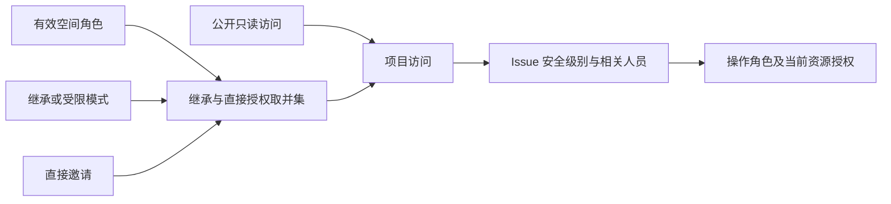

# 项目角色与 Issue 可见性

完整规则见[协作权限契约](../wegent/developer-guide/collaboration-permissions.md)。项目管理角色为管理员（Maintainer）、成员（Developer）和只读成员（Viewer）。创建者只保留审计身份；创建项目时单独授予创建者管理员角色。

每个项目通过既有 `CloudProject → workspace` 关系归属唯一空间；`workspace_id` 是读取属性，不是新增列。默认项目继承空间成员角色；受限项目仅继承空间所有者和管理员的治理权。直接邀请与继承权限取并集，较低的直接角色不能降低继承权限。公开项目仅授予 Viewer，不把浏览者变成负责人候选。

Issue 先检查项目访问，再检查 `open` 或 `related` 安全级别。项目管理员可读取全部 Issue；其他成员只能读取公开 Issue 或与自己相关的 Issue。相关人员包括创建者、负责人、协作者、有效任务关联用户以及被指派智能体的所有者。列表、详情、交付物、执行记录与会话遵循同一判定；无关 Issue 返回 404。创建者的读取关系不提供额外修改、评论或指派权限。

钉钉多维表格的记录权限仍由钉钉控制；项目角色控制表格入口和操作能力。

项目列表使用固定四次批量查询返回项目、父空间、公开授权和权限来源，不随项目数量增加。`workspace_context` 仅用于父空间导航；`workspace_access_role` 明确表示是否具有空间权限。仅获得项目权限不会获得空间成员、资源目录或其他项目权限。

无需改表或洗数据。成员模式存入原 JSON，旧角色读取时规范化，原父空间关系保持不变。旧合法安装绑定保留原项目内使用效力；显式 private 定义仍仅创建者可见和可用。新绑定使用明确资源授权。旧后端执行旧规则，新权限上线需统一后端策略；详见协作权限契约。
