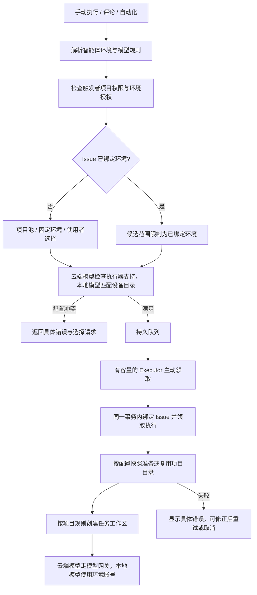
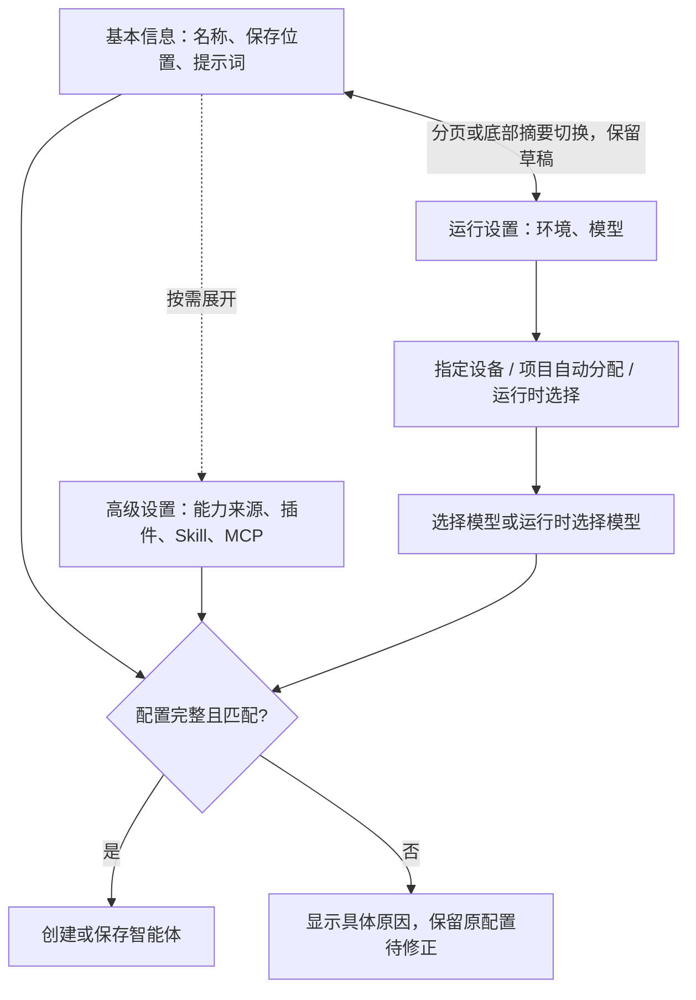
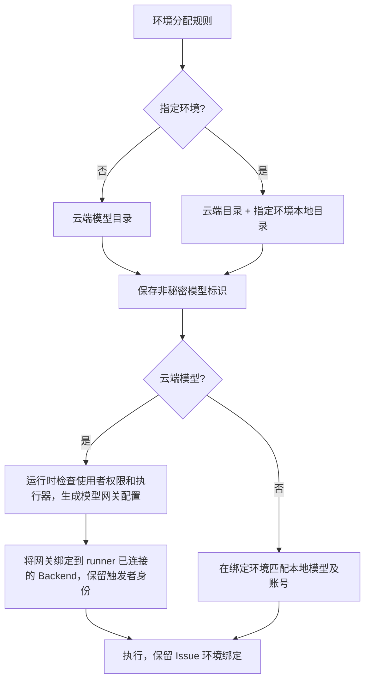
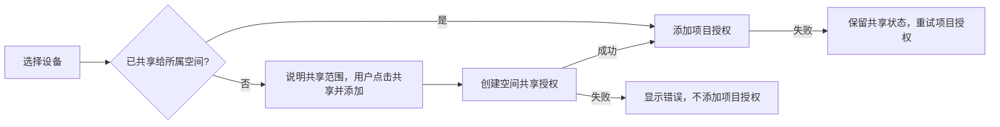
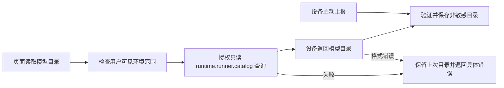
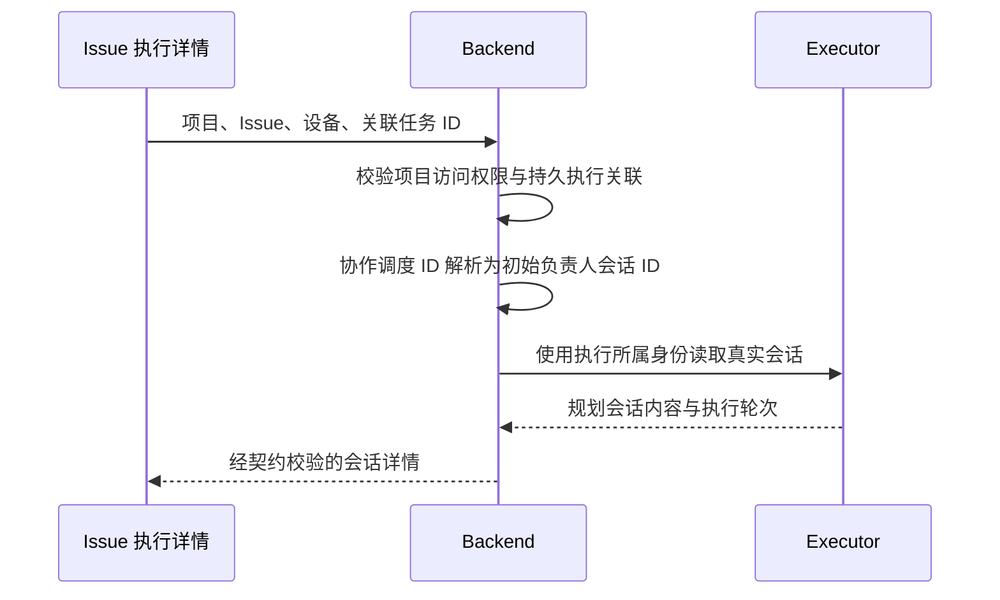
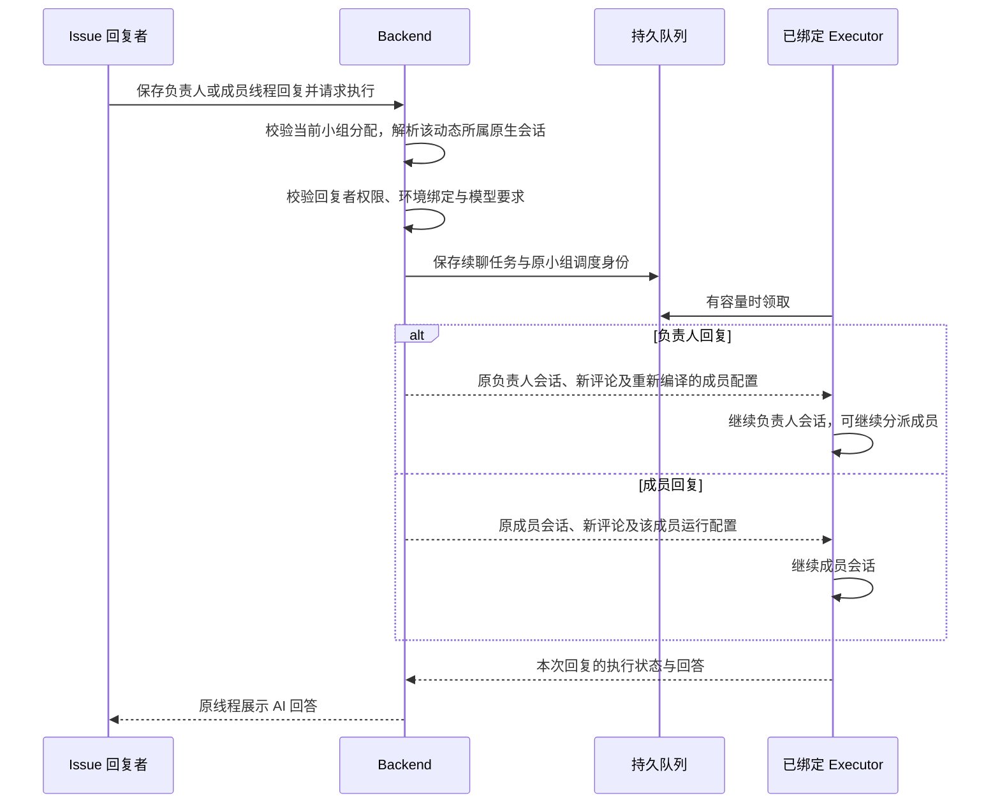
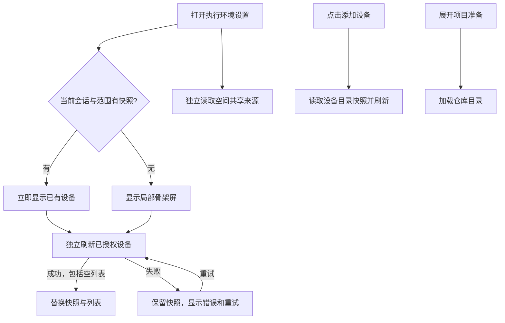
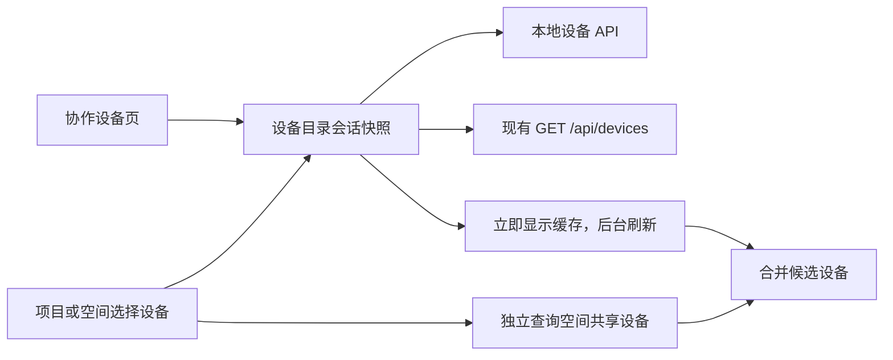

# 协作执行环境路由

智能体保存环境与模型的要求，Executor 从持久队列领取符合要求的执行。Issue 首次成功领取时绑定环境，后续评论、回复、重试和自动化均受此绑定约束。更改个人默认或智能体配置不会迁移 Issue。



## 配置与权限

项目设置侧栏将基本信息、执行环境和自动处理放在“项目设置”分组，将“智能体、成员、协作团队”作为“AI 团队”分组下的独立页面。项目页不再嵌套协作成员页签；Issue 创建时的“添加成员”和“添加智能体”直接进入对应侧栏页面。云端与本地项目共用这套导航。

Wework 的创建和编辑表单分为“基本信息”和“运行设置”，默认打开基本信息，填写名称、保存位置和提示词。新建智能体默认采用指定环境规则：从有权使用且支持当前执行器的目录中，优先选择个人默认环境，其次选择桌面当前 Executor；均无法匹配且只有一个环境时选中该环境，存在多个候选时保持待选。设备的传输别名统一匹配目录中的 `device_key`，保存目录环境 ID。模型优先选择该环境上报的当前执行器默认模型；没有默认且只有一个可选模型时选中它，其余情况要求选择。编辑时保留已有环境和模型规则。底部显示可点击的环境与模型摘要，切换分页保留草稿和高级配置。

这些默认值只在新建时初始化一次，并保存为明确的固定规则；异步加载不覆盖用户手动选择，环境变化不替换已选模型，历史待配置数据和运行时选择弹窗不会应用创建默认值。

运行设置只用一个环境选择框：按个人、空间归属列出可用设备，把“自动选择项目环境”和“运行时选择”放在“其他分配方式”组。模型选择框始终保留；尚未选择环境规则或固定环境的具体设备时禁用。具体模型和“运行时选择”共用一个选择框，选项展示模型名和云端／本地来源。本地模型选定后显示环境账号来源，云端公共模型不显示“公共账号”提示，因为调用身份是已登录使用者。环境切换不会替换已选模型；失效环境和模型保持可见，已确认的配置冲突也会显示在基本信息页，修正前不能保存。

高级设置仍保留“跟随运行设备”和“固定智能体能力”两种模式，后者完整配置插件、Skill 和 MCP，提示词引用的能力仍自动加入配置。分页和折叠只改变展示，不把这些规则简化成一个勾选框，也不改变保存契约。



`execution_policy` 支持 `project_pool`、`fixed`、`user_select`。固定环境保存环境资源 ID；它不是部署位置。Backend 使用 Device Kind 的数字 ID，本地项目使用本地环境 ID。`model_policy` 支持 `fixed`、`user_select`。模型保存 `runtime`、`provider`、`model_id` 及 `source`；云端模型额外保存 `cloud_model` 的资源名称、类型、namespace、所属用户 ID，不保存模型配置或凭证。缺少来源的历史模型保留原本的设备目录匹配方式，不能自动解释为云端模型。

| 环境分配规则 | 模型目录                                       |
| ------------ | ---------------------------------------------- |
| 项目自动分配 | 使用者有权使用的云端模型                       |
| 指定环境     | 云端模型及指定环境的本地模型，按执行器能力过滤 |
| 运行时选择   | 使用者有权使用的云端模型                       |

云端目录复用 `/api/models/unified`，与设备目录并行加载，云端选项不等待设备目录。云端模型按资源标识授权，执行时由实际触发者的模型网关解析账号；本地模型仍使用环境本身的账号。Codex 支持现有网关的三种上游协议；Claude Code 只接受 Anthropic Messages。设备上报 `runtimes`，历史目录中已有模型的 runtime 也作为能力证据。

Executor 将模型网关地址绑定到自己已连接的 Backend 地址，包括实际协议、主机、端口和路径前缀；服务端配置中的旧内网地址或端口不作为设备的请求地址。只处理 Wegent 的模型网关路径，直接连接的模型服务地址保持原样。触发者凭证和云端模型资源标识保持不变。`codex_catalog_model_id` 只选择 Codex 能力元数据，与网关收到的模型资源标识分开；非 Codex 原生模型也提供能力目录标识，不改变实际选择的模型。

智能体详情保留云端模型的资源名称、类型和归属，不能将上游模型 ID 当作本地模型返回。手动重跑先保存独立顶层评论，再通过评论执行队列解析规则，沿用 Issue 的环境绑定；授权或配置失败时直接显示错误。显式 Team 运行在构造 Bot 执行请求前解析本次模型选择，不要求路由型机器人另存模型引用。

评论执行保留项目 ID、Issue ID、执行 ID 和看板引用，再附上本次评论内容；智能体可以通过真实看板工具读取原 Issue。



个人默认沿用 `preferences.default_execution_target`，执行时只参与**未绑定 Issue、手动调用、环境由使用者决定、调用未指定环境**的分支。自动化在启用前必须补齐所有留给使用者的选择，并持久化 `runnerSelection`。协作组必须存在同时满足所有成员环境与模型要求的 runner；成员可以使用不同固定模型。

个人环境共享到空间后仍归个人所有，仍使用该环境的模型账号。项目池取空间 Device 授权与项目 Device 授权的交集。撤销空间共享会立即使项目授权失效。固定环境及个人默认也按实际触发者的权限重新校验；智能体创建者有权限不代表其他使用者有权限。

云端项目的设备选择器区分“添加”和“共享并添加”。未共享的个人环境在操作前说明共享范围和账号／额度来源，用户点击后先调用空间共享接口，再调用项目授权接口。共享状态未取得时不能提交；已共享的设备直接授权给项目。共享失败不继续项目授权；共享成功但项目授权失败时保留实际共享状态，重试只执行项目授权。



环境目录 API：`GET /api/v1/resources/execution-environments?project_id=...`。本地模型目录来自 Executor 的 `runtime.runner.catalog` RPC，并保留最后一次报告供离线排队使用。目录错误显式展示，不替换模型。云端模型不要求每台设备单独配置账号，只检查执行器支持。指定环境且模型由使用者决定时，手动调用可以使用该环境的默认模型；项目自动分配和运行时选择环境必须明确选择云端模型。自动化仍必须显式补齐选择，本地队列领取时也会重新校验云端权限并生成运行配置。

设备主动上报和页面主动刷新使用同一模型目录契约。页面查询先检查环境可见范围，再由 Backend 使用设备归属身份发送 RPC。桌面应用环境允许这一项只读目录查询，授权仅适用于 `runtime.runner.catalog`；其他远程控制权限保持原有规则。刷新失败保留原始 RPC 错误码，响应格式不合法则报告 `runner_catalog_invalid`；日志记录环境 ID、错误码及异常类型，不记录模型凭证或 RPC 内容。



本地项目的目录和队列由本地 Executor 持有。云端项目通过 Backend 授权池调度，可包含个人电脑和已有服务器上的 runner。共享环境不会合并会话：顶层评论各自创建 Runtime task，线程回复通过队列向原 task 发送新一轮消息。

协作小组的调度 ID 与负责人会话 ID 分开。队列领取、心跳和调度结果保留 `codex-queue-{execution_id}`；Issue 关联任务和初始规划动态指向真实的 `codex-queue-{execution_id}-manager-initial`。完成、失败和重排投影使用相同的会话关联。已有调度 ID 的详情链接通过项目、Issue、设备和执行记录校验后读取初始负责人会话，不需要修改历史数据库。读取权限仍使用原执行所属身份，不允许客户端提供的会话句柄扩大访问范围。Runtime 返回不合法的详情结构时，接口返回明确的 502 错误并记录字段位置，不记录会话内容。



协作小组负责人提交计划或状态决策时，动态保存当轮真实会话与设备，并建立 Issue 会话关联。回复这些动态时先校验当前小组分配，再解析该动态所属会话；历史动态缺少会话字段时，根据同次调度已持久化的轮次解析。明确保存的旧会话不会被替换成最新会话，非法关联返回冲突。回复已有续聊回答时，沿用该次回答保存的模型选择与会话。

负责人回复也进入持久队列，沿用 Issue 绑定的环境和原会话，保留小组调度权限，并重新校验回复者及所有成员的环境、模型要求。领取时重新生成成员运行配置，通过既有续聊接口传给 Executor。成员配置含运行凭证，只保留在进程内存；索引刷新保留本进程配置，不将它写入持久会话索引。缺少会话时返回明确错误，已保存的评论不作为 AI 执行成功。

成员任务由 Executor 内部创建，不要求为每个任务创建普通执行记录。成员动态保存实际设备与会话，并在同一事务建立 Issue 会话关联。回复成员时，按根调度、轮次、任务分配与成员身份解析原会话，校验设备别名属于同一个环境；随后进入持久队列，继续该成员会话并保留其模型要求，不切换到负责人。缺少分配或会话身份不匹配时返回明确冲突。

历史成员卡没有会话关联时，详情读取使用已持久化的任务分配验证身份，不修改历史数据库，也不依赖当前模型目录。阅读历史会话不要求小组仍是当前分配；执行回复则必须校验当前分配与授权。客户端传入的会话句柄不能扩大读取范围。



## 项目目录自动准备

项目环境授权与目录准备是两件事。创建 Issue、分配智能体和进入队列不要求提前初始化；本地项目也不再把准备记录作为环境授权。执行环境页面展示设备是否在线，移除全局“环境已初始化”状态。“更多 → 提前准备项目目录”保留为可选操作。

runner 路由只选择执行设备，不生成代码项目绑定。项目未配置仓库或准备命令时，使用独立会话目录；配置了项目准备时，由准备流程提供目录。只有存在仓库或有效代码工作区时，才创建 Git worktree。

本地分配入口也不要求提前准备目录；已有准备记录只用于复用。固定本地模型的分配不请求云端模型目录，云端不可用不会阻塞该执行。

领取执行后，Runtime 保存本次仓库、准备命令和配置指纹，再异步准备项目目录，最后按项目规则创建独立 worktree 或使用共享目录。自动准备与提前准备使用同一个 Executor 实现，按目录串行执行；成功的配置指纹可复用，配置变化为新任务生成新目录。历史准备路径只在原 runner 上复用。克隆使用该环境的 Git 凭证，私人仓库需要在环境内配置访问权限。

准备期间创建接口返回 `workspacePending: true` 和空 `workspacePath`，最终目录写入 Runtime task，本地执行绑定同步保存该目录。准备过程占用运行名额，支持取消，不阻塞任务接收和心跳；仓库或命令失败会记录具体错误，且不会启动模型会话。修复环境问题后可以在原任务上重试保存的配置；修改项目配置后，重新发起执行使用新配置。排队任务的重启恢复和立即运行同样经过准备流程。

线程回复复用已有会话目录，不重新准备。已有会话和继承上游工作区的流程不受项目准备配置变化影响；Issue 的 runner 绑定始终保留。取消准备不会删除共享项目目录。

## 执行环境设置的加载

设备列表按 API 会话、项目或空间保留内存快照。重新打开页面立即显示上次成功的数据并后台刷新，只有从未取得列表时显示局部骨架屏。刷新失败保留设备，在列表旁显示错误与重试；成功返回空列表才清空旧数据。增删成功立即更新快照，较早发出的查询不得覆盖变更；多个订阅者共享进行中的请求。

项目设备、空间共享设备各自加载，互不阻塞。空间目录未返回前不推断设备的授权来源。个人候选资源在打开“添加设备”时加载，Git 仓库目录在展开“项目准备”时加载。未取得候选列表不能据此断言没有在线设备。缓存只用于显示，运行时授权仍以现有服务端和 Executor 校验为准。



加载回归单测覆盖重开、慢请求、首次失败、刷新失败和重试、空结果、会话与项目隔离、并发去重及增删与旧查询竞态。现有桌面 CI 的项目环境配置步骤增加离开后立即返回的检查。

协作设备页和“选择设备”共用设备目录的会话快照，不读取包含智能体的完整资源列表。云端目录复用云端工作的 `GET /api/devices` 和执行器筛选规则；本地目录直接读取本地设备。两种来源独立请求，导航或云端请求较慢时仍显示已经取得的本地设备。按稳定设备标识合并，已注册的云端记录提供授权使用的设备 ID。



云端项目或空间只使用已注册的云端设备 ID，本地项目或空间只使用本地目录，不能把本地占位 ID 提交为云端授权。个人与空间共享候选独立显示；任何来源失败都显示错误和重试，不伪装成空列表。设备目录缓存按 API 会话隔离，同一会话的项目 API 包装器共享目录；切换账号不复用之前的目录。现有桌面 CI 场景覆盖设备页和选择器重开后的缓存保留。

“当前设备”由本机运行时上报的稳定设备标识确定，不能通过 `local/app` 部署类型或设备名称推断。其他电脑及历史记录使用云端设备管理入口。设备目录和环境列表优先显示已识别的当前设备，其后按在线、准备中、错误、离线排序，同状态按名称自然排序，再按 ID 确定顺序；同名但标识不同的历史设备保留各自记录。

## 空间 runner 接入

空间 Maintainer/Owner 可在执行环境界面注册已有服务器，也可以调用：

```text
POST /api/v1/workspaces/{workspace_id}/runners
{"name": "团队执行服务器"}
```

响应提供 `environment_id`、`device_id`、一次性显示的 `token`。在服务器上为既有 `wegent-executor` 服务配置：

```text
EXECUTOR_MODE=local
WEGENT_BACKEND_URL=<Backend URL>
DEVICE_ID=<注册响应的 device_id>
WEGENT_AUTH_TOKEN=<注册响应的 token>
```

`local` 是 Executor 已有的连接协议模式；环境资源的 `deploymentLocation=cloud` 表示它部署在服务器上。空间拥有权由 `workspaceOwnerId` 表示，独立于部署位置。

runner 使用独立机器身份，不依赖管理员的个人登录。凭证只允许该设备注册，数据库只保存摘要。任务内的项目操作使用触发者的授权；模型账号留在服务器上。Codex 模型目录来自其原生配置。Claude 目录读取 `WEGENT_CLAUDE_HOME/settings.json`（默认 `~/.claude/settings.json`）中显式配置的模型。自定义 Claude 服务根据规范化地址的 SHA-256 摘要自动生成服务标识，无需额外配置；已有的 `env.WEGENT_CLAUDE_PROVIDER_ID` 仍作为显式标识使用。地址保留协议、端口、路径与查询参数差异，地址本身和凭证不随目录上报。账号仍需在执行环境中配置。

撤销凭证：`DELETE /api/v1/workspaces/{workspace_id}/runners/{environment_id}`。撤销会停用环境、断开连接，后续事件和重连均拒绝旧凭证。重新注册会创建新环境，不迁移已绑定 Issue。

## 队列、错误与恢复

| 条件                             | 行为                                                    |
| -------------------------------- | ------------------------------------------------------- |
| 环境离线或无空闲容量             | 保持排队，显示原因；恢复后继续领取，可取消              |
| 项目权限或共享授权撤销           | 禁止领取，显示授权冲突                                  |
| 模型移除、provider 不匹配        | 禁止领取，要求修正环境或模型配置                        |
| 已绑定环境与新智能体固定环境冲突 | 返回 `ISSUE_RUNNER_CONFLICT`，不换机                    |
| 使用者尚未选择环境或模型         | 返回结构化选择请求；补齐后重放原操作                    |
| 自动化缺少显式选择               | 拒绝启用，不读取个人默认                                |
| 本地队列配置不满足               | 显示 `waiting_runtime` 错误；修正后取消旧执行并重新提交 |

Backend 使用 Issue 行锁与条件更新，在同一事务内完成绑定和执行领取。本地队列使用 SQLite `IMMEDIATE` 事务。执行记录保存最终环境、原生模型标识、账号来源及配置来源。目录和资格校验不传递账号密钥。

本地直接执行开始时，在同一事务内将评论标记为执行中、Issue 标记为进行中，线程续聊也遵循此规则。存在排队回复时保持进行中，最后一轮完成后转为待确认；协作小组成员和管理者仍由工作流管理 Issue 状态。

## 存储、历史数据与验证

本功能复用现有扩展字段，不增加表或列，也不执行批量数据迁移：

| 数据                     | 存储位置                                                                                                       |
| ------------------------ | -------------------------------------------------------------------------------------------------------------- |
| 智能体环境与模型规则     | 项目智能体的 `metadata`，或 Bot CRD 的 `spec`                                                                  |
| 个人默认环境             | 用户 `preferences.default_execution_target`                                                                    |
| 环境模型与账号来源目录   | Device CRD 的 `spec.runnerCatalog`                                                                             |
| Issue 环境绑定           | Issue 的 `metadata.runner_binding.environment_id`                                                              |
| 执行规则快照与版本       | 原有 `execution_payload` 的路由对象；Backend 使用 `runtime_selection.runner_routing`，本地使用 `runnerRouting` |
| 实际环境、模型及配置来源 | 同一执行载荷的运行选择与路由快照，以及现有 Runtime 身份字段                                                    |

首次领取使用 Issue 行锁和 JSON 路径条件更新，与执行领取在同一事务提交；更新保留其他 metadata。Issue 内容的 ORM 更新保护已保存的绑定，避免并发编辑覆盖它。本地沿用 SQLite `IMMEDIATE` 事务和 JSON 路径更新，schema 版本仍为 10。队列在原有状态和设备筛选条件下识别执行载荷中的路由对象，不依赖专用路由列。

已有明确智能体设备、模型和运行配置保留原字段。历史 Issue 尚无 JSON 绑定时，读取旧执行记录与 TaskBinding；Backend 按设备归属解析别名，本地按持久设备标识解析。唯一明确绑定在首次有效领取时保存；设备无法解析或历史跨环境冲突时要求修正，不采用个人默认。已经存在的 JSON 绑定始终优先。

针对性测试覆盖六种环境/模型组合、目录合集、权限撤销、并发首次绑定、JSON 字段保留与回滚、历史绑定解析、原表结构查询、独立评论会话、线程续接和空间机器凭证。现有 CI 场景 `collaboration-local-agent-dispatch`、协作组、worktree 和离线本地项目场景已改为使用原生 runner 目录。

目录准备的针对性测试覆盖首次准备、并发复用、配置变化、失败与重试、执行中取消、先克隆后创建独立 worktree、恢复排队任务和立即运行。已有 CI 场景的环境接入步骤已移除预先初始化，远程场景保留可选提前准备的错误与恢复覆盖。

按用户明确要求执行 E2E 和隔离打包应用的 AI verify，并保留实际验证结果；测试仅替换模型服务，其余后端、队列和执行器使用真实实现。不包含云端机器创建、Issue 跨 runner 迁移或按成本调度。API 继续遵循现有 Python/Rust 归属，未修改 Rust 切流配置。
