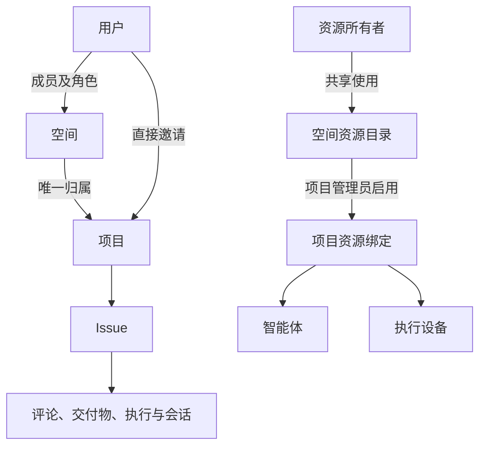
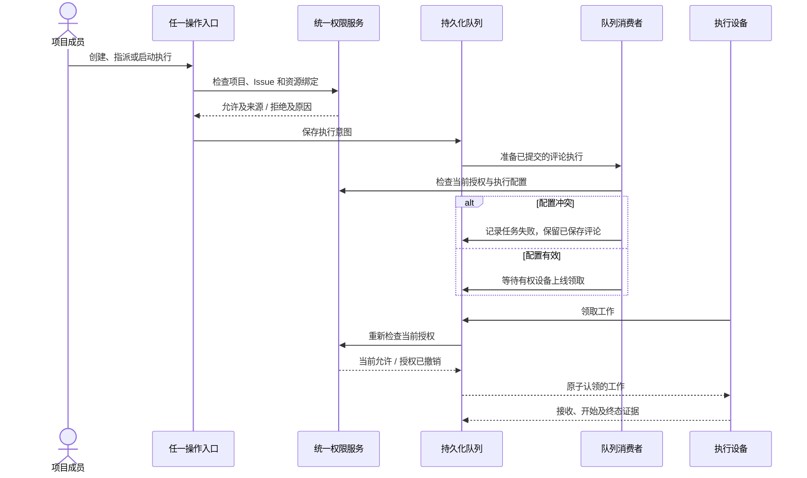

# 协作权限架构与不可破坏的规则

空间决定管理范围，项目默认继承空间成员，资源通过明确授权参与项目。所有列表和操作使用同一套服务端权限判定。本文是经用户确认的产品契约；测试验证这些规则，不能为了通过测试而降低规则。

项目详情与项目列表复用同一条权限查询和响应构造路径（CP13），保留空间继承角色与权限来源。个人分身配置保存在所选 Executor，本地保存和启用不查询云端权限、智能体目录、模型目录或目录就绪状态。Issue 发起的个人任务和分身任务使用相同的 Issue 执行权限，不要求项目设备绑定或初始化项目环境；实际绑定云端 Issue 时仍由服务端检查当前用户的执行权限。`stand-in-personal-task` 桌面 E2E 以普通成员和零设备绑定验证手动任务与分身任务均在当前设备完成，并纳入共享桌面 CI。

## 归属与角色

管理角色只有管理员、成员和只读成员。API 使用 `Maintainer`、`Developer`、`Viewer` 表达；所有者由空间归属关系确定，响应中的 `Owner` 是只读的所有者标识，不能通过成员接口赋予。项目创建者是审计信息；创建项目时明确添加创建者为项目管理员。

新项目、父空间授权和创建者的管理员授权在同一事务中写入。新项目的父空间授权直接插入，不对不存在的授权记录加锁，避免不同空间并发创建项目时产生 MySQL 间隙锁死锁。资源授权按资源与实体的唯一标识原子创建或恢复，再锁定已存在的记录；保留原授权 ID、审批历史与外层事务边界。MySQL 权限回归套件覆盖并发项目创建、不同资源和同一资源的并发授权、唯一父空间及创建后的使用权限。

| 空间身份 | 默认继承项目 | 受限项目 |
| --- | --- | --- |
| 所有者 | 管理员 | 管理员 |
| 管理员 | 管理员 | 管理员 |
| 成员 | 成员 | 单独邀请 |
| 只读成员 | 只读成员 | 单独邀请 |
| 项目访客 | 项目直接授权 | 项目直接授权 |

空间所有者和管理员始终拥有所属项目的管理权。对其他用户，有效的项目直接角色优先于空间继承角色，可以提升或降低项目权限；移除项目直接授权后恢复当前空间继承权限。仅修改项目职责不创建角色覆盖，也不批准待审批或已拒绝的授权。公开浏览是单独的读取授权，不自动将浏览者加入负责人或协作小组名单。

## 权限契约

| 编号 | 不变量 |
| --- | --- |
| CP01 | 每个项目有唯一、有效的父空间；归属与成员授权分别保存。 |
| CP02 | 空间所有者和管理员管理所有所属项目，包括受限项目，与项目创建者无关。 |
| CP03 | 默认项目继承成员和只读成员；受限项目停止这两类继承。 |
| CP04 | 仅加入项目不获得父空间资源、成员或其他项目权限。 |
| CP05 | 空间所有者和管理员保留项目管理权；其他用户的有效项目直接角色优先于空间继承角色，移除直接授权后恢复继承；待审批、拒绝、未知角色、失效空间和归档项目不提供权限。 |
| CP06 | 创建者、负责人、小组组长和设备账号不产生额外的人类管理权限。 |
| CP07 | Viewer 能读取空间及有权访问的项目，不能修改、评论、指派或执行。 |
| CP08 | 项目成员列表包含继承和直接成员，返回有效角色、直接角色、来源及来源空间；空间继承角色只读，项目管理员可为继承成员设置或移除项目直接角色。 |
| CP09 | 已启用共享项目智能体对项目读者可见；显式 private 定义保持仅创建者可见和可用；离线或配置问题以状态和原因表达。 |
| CP10 | 资源使用授权不授予修改原定义或读取私人凭据的权限。 |
| CP11 | 项目派发使用智能体和设备必须满足有效资源使用授权及项目启用关系；旧版合法安装关系在原项目内保留使用效力，不扩展资源目录或原定义权限。个人任务及分身使用自己的 Executor 不要求项目设备绑定。 |
| CP12 | 项目派发的固定设备、项目池和用户选择只改变调度，不绕过项目资源授权；个人任务及分身沿用个人执行路径。 |
| CP13 | 列表、详情、创建、修改、指派、评论启动、自动化派发与设备领取使用相同的授权规则。 |
| CP14 | Issue 读取先检查项目权限，再检查 open/related；项目管理员可读全部 Issue。 |
| CP15 | 执行检查当前 Issue 访问和执行能力；项目派发另检查启用绑定和资源授权，个人任务及分身不要求项目设备绑定；快照不能替代当前授权。 |
| CP16 | 撤权阻止新派发和领取；正在运行的任务请求停止，收到 Runtime 确认后才标记停止。 |
| CP17 | 移出空间撤销空间成员关系及其所有下属项目直接授权；需要继续作为访客时重新邀请。 |
| CP18 | 撤销空间资源授权使所有下属项目绑定失效；保留历史数据并显示失效状态。 |
| CP19 | 空间所有权可以转交，历史创建者保持不变；项目的治理权不依赖历史创建者。 |
| CP20 | 权限判定返回来源和拒绝原因；前端不能独立授予服务端拒绝的能力。 |

分身、连接消息与 Issue 派发执行使用 Codex 原生基础权限：自动模式继承 `:workspace`，允许正常文件读取、工作区与临时目录写入；操作前确认模式继承 `:read-only`。两者均保留网络访问，使已启用插件资源和 CLI 配置可正常读取。文件系统可读不代表允许提取凭据或访问无关私有数据，来源内容仍不能授予额外权限。越界操作必须经当前原生审核器批准：自动模式使用 AI 审核，确认模式使用单次人工确认。批准后该次命令实际提权，拒绝后不得执行；不得使用全局根目录 `deny` 使批准失效，也不得将批准变成后续命令的永久权限。此执行策略由用户明确授权，CP01–CP20 的服务端成员、资源使用及凭据隔离契约保持不变。

`stand-in-workspace` 桌面 E2E 通过真实 Codex、shell 和 GitHub CLI 验证插件资源读取、合成且不含凭据的 CLI 配置读取、联网、默认越界写入拒绝、AI 批准后的真实越界写入及拒绝后的不执行。`stand-in-action-confirmation` 使用真实 `connection_work` 来源验证人工批准前文件不存在、批准后文件创建。只模拟模型和审核模型响应；不读取个人登录文件，不声称验证了真实 GitHub 登录。

## 授权与执行

派发人、智能体定义所有者、设备所有者和 Runtime 会话身份分别记录。资源所有者共享的是明确的使用能力；模型与连接凭据仍由原有凭据权限和执行身份管理。项目访问只授予所属 Issue 的会话读取权，不授予整个设备的任务目录。

评论入队先检查当前用户、Issue 与智能体的使用授权；Runtime 配置、模型和环境绑定由队列消费者准备，失败属于执行记录。待准备意图不授予设备使用权，准备和领取都必须重新校验当前资源授权。`test_queued_comment_execution.py` 覆盖只读成员、私有定义和已撤销资源的入队拒绝，以及入队后撤权、配置失败、人工审批、离线领取和未领取会话的提前回复；这些测试使用隔离数据库和合成执行状态，不代表真实 Runtime 联调。

从 Issue 创建的个人任务以原项目和 Issue 作为默认上下文，可以通过 `wework_space` 显式指定当前用户有权限访问的任意项目和 Issue，按实际权限读取、修改、指派或评论。会话起点不构成额外的访问边界，服务端继续校验目标项目和 Issue 的权限；访问其他项目或 Issue 不改变原会话或交付物绑定。Issue 会话统一使用协作上下文，不按私人任务或分身任务增加写入限制；用户任务及已配置职责所需的回写、改派和交付无需因共享 Issue 写入而另行确认。原生工具审批和服务端实际权限校验继续生效。`wework/src/features/todo/workItemRuntimeContext.test.ts` 保护该上下文契约。协作执行成员仍限定在派发 Issue 和执行类工具内；协作管理者保留项目内管理权限。`executor/src/task_runtime/mcp/issue_access_tests.rs` 覆盖同项目和跨项目的本地读写、云端读写与评论、服务端读写拒绝及默认上下文保持，角色边界由同模块现有契约测试保护。

个人分身连接插件继续使用现有外部来源内容约束和操作确认机制。新的 `connection_work` 与历史 `dingtalk_work` 均不能从来源内容取得额外权限；项目限定智能体仍只能接收所属项目工作。连接记忆按用户、Provider、账号和资源精确隔离，钉钉迁移保留原记忆范围及去重身份。`stand_in_identity_contract` 覆盖迁移和 Provider 隔离；Codex 确认契约同时覆盖两种工作来源以及默认和命名 Home。

后台 MCP 桥只调用当前 Provider 声明依赖中的读取工具，不运行模型回合。工具归属同时核对完整插件身份；共享 App 服务另外核对 Connector 身份。缺少只读标注的旧工具可以由 Wework 适配插件声明精确读取契约，但不能覆盖明确的写入或破坏性标注。调用参数不能自授读取权限；后台授权交互取消后明确失败，不自动放行，也不改变分身执行时的确认策略。`connection_mcp_tests` 覆盖归属、读取边界、依赖变更和取消/超时清理，`stand-in-mcp` 桌面 checkpoint 覆盖真实 Executor 对跨依赖调用的拒绝。

没有 MCP 的插件可通过通用 CLI 读取传输复用已有 `localAuth.tool`。可执行工具、Connector、固定命令和允许参数均来自精确依赖及已安装 Wework 适配插件的读取声明；调用者不能传入命令或增加参数，也不执行 Shell 或 Skill 文本。钉钉采集已使用该路径，专用读取 RPC 已删除；回复继续沿用原来源绑定及确认策略。通用 CLI 契约测试与 `stand-in-cli` CI checkpoint 覆盖写入拒绝、参数注入和旧入口删除。

## 界面入口

看板批量排序的 HTTP 与 MCP 入口共同遵守 CP07、CP13、CP14：Viewer 不能排序，其他成员只能提交和接收其可见的 Issue。可见卡片的重排只交换它们在全局同级顺序中的位置，保留不可见成员的位置；普通成员提交不可见或不存在的请求目标时，在写入前统一返回 404。项目管理员仍按既有规则查看全部 Issue。`test_loop_item_reorder_permissions.py` 覆盖角色、默认安全级别、同状态和跨状态排序，以及拒绝请求不改变持久化状态。

只有项目权限、没有父空间权限的用户，仍能从统一侧栏进入获授权项目。父空间只提供名称分组，不可打开空间主页或设置，也不暴露空间成员、资源目录或未授权的兄弟项目。公开项目的 Viewer 和直接邀请的项目访客都遵守这条规则；切换本地或云端空间、重复点击当前空间，不改变全局项目导航的授权范围。

- 空间管理：成员、项目目录、共享智能体、共享设备、空间小组和所有权转交。
- 项目管理：成员模式、有效成员与来源、访客、已启用资源、项目小组、自动化及 Issue 安全级别。
- 个人资源：原定义、个人设备、连接配置及共享授权。

成员行必须区分有效项目角色、只读的空间继承角色和项目直接角色。项目中修改继承成员的角色会创建项目直接授权，不改变空间或其他项目的权限；移除直接授权后，成员行仍显示恢复后的继承角色。空间所有者和管理员的项目管理权不受项目直接角色影响。停用与删除分别表达绑定和原资源的生命周期。

## 不改表的存储与版本兼容

本次实现不增加表或列，不要求洗数据、批量改角色或重建项目。项目归属继续使用现有 `resource_members` 的 `CloudProject → workspace` 已批准关系，原关系的 Owner 标签保持不变；`workspace_id` 是查询属性，不是新增物理列。每次读取要求唯一父空间，缺失或歧义时拒绝授权，不猜测归属。

成员模式写入项目已有 `metadata` JSON 的 `membership_mode`，缺省为 `inherit`。新建项目同时写入旧后端识别的父空间关系。旧请求未提供新字段时不清空它们；旧代码若整体覆盖 JSON 仍可能丢失新设置，因此旧后端只能维持旧行为，不能承担新权限规则的实施。

已有角色读取时规范化：人类 Owner 为 Maintainer，Reporter 为 Viewer；空间真正所有者仍由 `Kind.user_id` 决定。旧请求中的 Owner/Reporter 接受同样的规范化，不能通过角色字段转交所有权。新空间 Viewer 在原关系中存为 Reporter，让旧后端的空间列表仍能识别；项目 Viewer 保持 Viewer。旧公开 Developer 关系在新后端仅授予 Viewer，原记录不重写。

资源使用分为两个有明确边界的版本：

- 新绑定记录 `authorization_version: 2`。直配定义要求 `Workspace → project_agent` 使用授权，CRD 智能体要求 `Team → workspace`，设备要求空间和项目的使用关系。
- 无版本标记的旧绑定保留原项目的安装授权。CRD 定义必须由记录中的安装者所有，内置定义沿用原规则；固定设备必须是旧绑定中明确记录、仍有效且由安装者所有的设备。不能凭个人所有权使用其他设备，也不会因此暴露空间目录。
- 新后端撤销旧资源授权时，先将相关绑定转为明确授权版本，或在项目 JSON 中记录固定设备撤权，再撤销共享关系。撤权后不能重新走旧安装路径。新绑定、待审批、拒绝或无效的显式授权不能使用旧路径。

创建或重新启用项目智能体时，只有已批准且具有使用角色的空间授权可以直接复用。显式共享仍需校验空间权限与原定义的共享管理权；校验通过后，在原授权记录上恢复批准状态和使用角色，再校验项目绑定，避免只读授权被误认为可用或待审批记录产生唯一键冲突。`test_project_agent_creation.py` 覆盖真实 Bot、Team 创建接口及授权恢复、拒绝分支；桌面 CI 的 `project-automation` 场景覆盖停用后重新授权并启用。

`creator_admin` 保留兼容输入，但共享项目绑定按项目权限展示。显式 `private` 保持仅创建者可见、可用；其他项目管理员也不能公开别人的私有定义。配置和私人凭据不自动共享。空间所有权转交时，若缺少历史创建者字段，只在本次操作中保存原所有者，不批量回填。

| 客户端 / 后端 | 行为边界 |
| --- | --- |
| 旧客户端 / 新后端 | 接受旧角色和智能体字段，沿用旧归属关系；由新后端执行统一权限规则。 |
| 新客户端 / 旧后端 | 缺少 `owner_user_id` 时不展示所有权转交；缺少 `membership_mode` 时不展示成员模式；资源目录先确认实际空间访问权。 |
| 旧后端 / 旧客户端 | 继续使用原表和原接口，执行原权限逻辑。 |
| 多版本后端混跑 | 数据格式兼容，但旧后端不会自动获得新规则。新权限能力上线前，相关请求需统一切换到新后端，或将同一策略回移到旧后端。 |

本地独享项目使用本地所有者权限，离线可运行；云端项目共享操作以服务端关系为准。

## 事故事实与恢复

开发服务会在启动时自动运行 Alembic。最初新增权限迁移被该服务自动执行，备份序列化失败；MySQL 保留了已执行 DDL，而项目归属回填回滚。原启动代码吞掉迁移失败，随后查询空的新父空间列，导致列表消失。此前“未迁移真实数据库”的报告不准确。

只读检查确认原 49 个项目记录和 49 条原父空间关系仍在，其中 29 个项目处于 active，未发生项目删除。当前代码已撤回新增迁移并恢复原关系查询，Alembic head 为 `f3a7c9e1b2d4`。失败尝试留下的两个未使用列和空备份表暂时保留，当前代码不读取它们；恢复过程没有继续执行 DDL、洗数据或批量改角色。将来清理这些遗留结构应作为独立数据库操作处理。

实际开发接口验证：admin 项目列表返回 200、27 个有权访问项目，空间列表返回 200、2 个空间。WebSocket 在 Python 直连和网关均能完成鉴权及项目订阅。首次连接失败后界面不再订阅的问题已修复：连接恢复时重新订阅，成功后清除错误，卸载和切换 Issue 时清理监听。

开发启动现在遇到迁移失败直接退出，不再带着不完整结构继续提供服务。

## 实现与验证入口

`collaboration_permissions.py` 统一提供角色、来源及拒绝原因；`cloud_project_visibility.py` 提供同样规则的列表查询。`collaboration_revocation.py` 检查当前 Issue、智能体、小组、Runtime 配置和设备授权，并处理撤权后的持久化队列。

回归入口：

- 提及通知遵守 CP03、CP05、CP08、CP13 和 CP14：接收人必须是当前有效项目成员，Issue 评论和回复预览还要求接收人可读取该 Issue；任一接收人校验失败时，消息与通知一起回滚。GitHub/GitLab Issue 始终使用 provider 的读取权限，包括不存在本地记录或只有本地索引的情况。`test_project_chat_mentions.py` 覆盖权限矩阵；`frontend/e2e/tests/collaboration/project-mentions.spec.ts` 通过真实 WebSocket、持久化历史和接收人收件箱验证两种评论入口，并覆盖浏览器选择继承成员后发送及刷新。`external-issue-mentions.spec.ts` 覆盖 GitHub/GitLab、有无本地索引的发送者与接收人权限、跨项目拒绝、自提及及通知去重。这些外部 Issue 场景仅在第三方 HTTP 边界使用 mock；Wegent API、WebSocket、成员关系、权限、数据库与收件箱使用真实服务，不代表已完成真实 GitHub/GitLab 联调。两份 E2E 均由 `e2e-tests.yml` 的 Chromium 分片调用；外部场景通过显式配置的 `DATABASE_URL` 安排并检查真实索引记录，无需第三方凭据。

- Rust 已接管的项目列表、详情和项目执行设备查询遵循同一 CP 契约。`test_rust_collaboration_permissions_mysql.py` 在真实 MySQL 上执行 Rust 使用的 SQL，核对角色覆盖、恢复继承、空间管理权、受限继承、项目访客、公开只读及撤权；Rust 单元测试保护来源字段与设备授权交集。Python 服务测试保留相同业务断言，迁移接口的 HTTP 断言沿现有桌面 CI 场景运行。

- API 角色矩阵与资源契约：`test_collaboration_permission_contract.py`、`test_collaboration_permission_resources.py`、`test_workspace_shared_agents.py`。
- 领取、指派、评论与队列：`test_loop_item_executions.py`、`test_runner_routing.py`、`test_loop_item_assignment.py`、`test_project_comment_execution.py`。
- 原表兼容与数据保持：`test_collaboration_permission_compatibility.py`；CI 的 `integration_checks/test_collaboration_permission_mysql.py` 验证已填充旧数据库及迁移中断留下的未使用结构。
- 启动失败保护：`test_startup_migration_failure.py`。
- 规则保护：`test_collaboration_permission_guard.py` 校验批准的 CP 指纹与逐条覆盖。CP05、CP08 按用户确认支持项目角色覆盖普通空间继承，并保留 CP02 的空间管理范围；CP09、CP11 保留私有选择与原项目内的安装授权。
- 共享界面覆盖继承来源、项目访客、成员模式、所有权转交、旧后端能力缺省、失效绑定恢复和讨论重订阅。

测试使用独立数据库和测试加密配置，外部服务由单元测试 mock 隔离。测试不代表已部署或获得真实 Runtime 执行确认。

## 防回归与变更要求

`backend/tests/api/test_collaboration_permission_contract.py` 是 CP 规则的 API 契约；角色矩阵、来源、资源判定和迁移另有针对性测试。测试必须包含正例、拒绝、角色组合、权限单调性、撤权、跨项目隔离、所有权转交以及创建/修改/指派等入口的一致性。

权限相关改动必须更新本文对应规则、本地架构记录和契约测试。改变规则需要明确的用户授权；不得删除测试、放宽断言、跳过场景或加入管理员特判来掩盖违反契约的实现。CI 运行这些测试，桌面核心流程沿现有 CI 场景覆盖；本地 E2E 与 ai:verify 仅在用户明确要求时运行。

## 本次实现的验证记录

最终结果按当前无 DDL 实现重新验证；此前迁移版的通过数量不能作为当前实现的验证证据。后端全量包含权限专项，两者不能相加。

<!-- final-validation-record -->

复现后端全量：`cd backend && uv run pytest tests/ -n 4 -q --assert=plain --tb=line --show-capture=no`。权限专项见 `.github/workflows/test.yml`；共享组件使用 `pnpm --filter @wegent/collaboration test`。MySQL 用例仅连接独立临时测试容器。

本次未运行 E2E 或 `ai:verify`，未部署。真实开发库曾受自动迁移影响，事实及恢复边界见上文。
