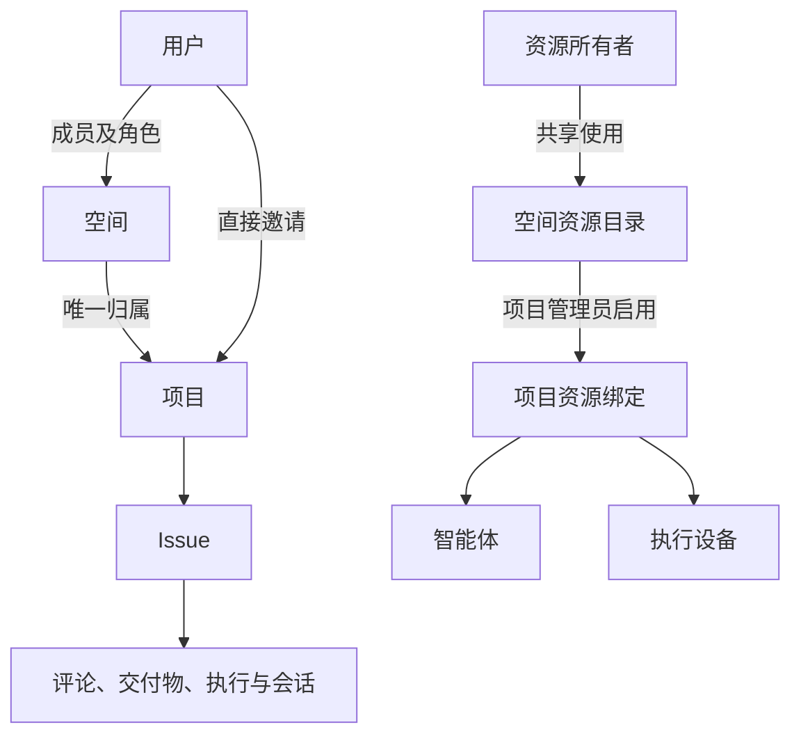
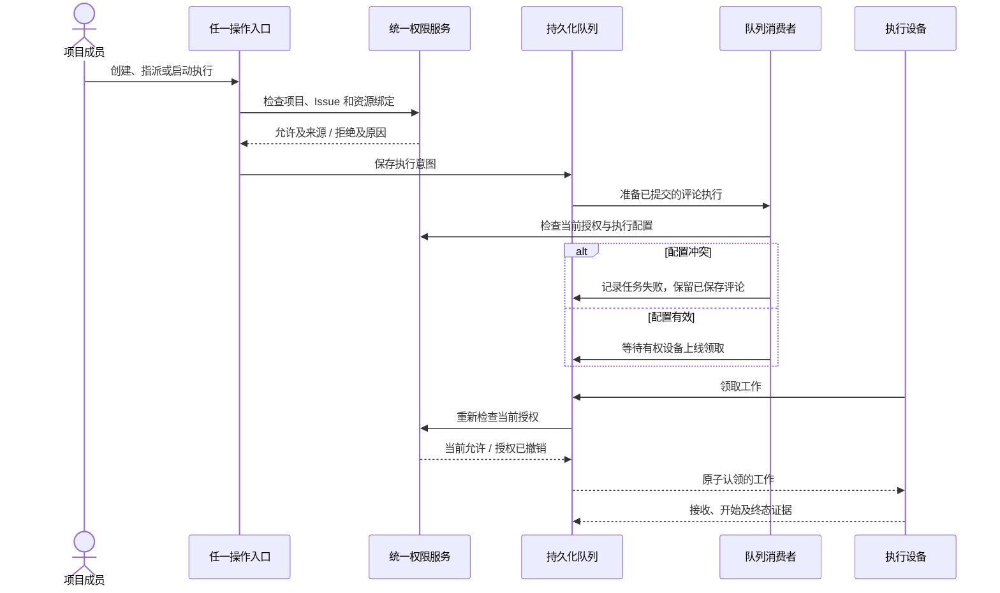

# 协作权限架构与不可破坏的规则

项目聚合看板的显式排序作用域与事项所属群独立。移动仍验证事项所属群的当前写权限；项目排序另要求当前项目 Developer 权限、真实分类关联，以及可读且同父项的锚点。排序只写项目元数据 `board_item_order`，不修改其他群事项的内容、版本、所属群或群内顺序。状态变更与项目排序在原更新事务中一起提交或回滚；普通群内排序保持原合同。当前项目快照只对已获授权的事项投影项目排序。`test_project_board_order.py`、Native 存储事务用例和原项目排序桌面检查点覆盖拒绝、持久化与重新加载；不改变 CP 不变量。

Rust 主 Socket 消息入口用显式容器类型分发；类型标记不授予权限。群发送事务按群根、当前直接授权、数字顺序账号及精确 Thread 取锁，再检查当前写权限和参与关系。消息、持续提醒、分身唤醒及内容版本一起提交；完成状态允许继续讨论。重试消息必须匹配原群和 Thread。提醒提交后的投递重查当前成员、参与及静音选择，群链接直接定位群或 Thread。该实现正在真实云端 checkpoint 中验收，编译或单元测试不能替代该验收。

Thread 状态按真实群容器类型固定为 `inbox/pending/in_progress/in_review/completed`；群配置不能重新定义状态或处理起点，任意合法标签不要求预先登记。Python 状态校验与历史、Native 工作容器投影、Rust 配置写入及读取均使用统一五态。项目聚合补齐五态并保留旧项目／外部来源的完整状态列和未知历史值，不自动改写历史状态。筛选可包含历史值，Thread 状态写入仅允许五态；真实所属群权限继续独立检查。

云端群创建事务同时分配唯一 `groups/{id}` 文件 namespace。文件读取、签名、复制及删除验证持久对象键属于当前容器；移动和递归删除在首次存储调用前验证全部源记录。缺失 namespace 或无法确认归属的旧记录被拒绝，不推断、搬迁或清理可能属于其他群的对象。`test_group_file_namespace.py` 覆盖同路径隔离和异常记录拒绝，真实创建及对象内容由云端验收检查。

工具调用先验证派发绑定范围，再根据真实存储节点选择来源。本地私有群不需要出现在项目目录中；云端镜像继续走后端，已删除的私有群、损坏的来源元信息或存储读取错误直接终止，不能被解释为应尝试云端。评论读取仍验证 Thread 的真实所属容器；父项只读例外继续要求同一容器内的直接父子关系及当前访问权限。分配候选读取改用工作容器定位，不代表已接入群成员候选或共享执行资源。

历史参与者初始化只使用原容器内持久记录的创建者、当前人工负责人及实际讨论作者，并与当前有效账号和目标群授权取交集；项目名册、阅读行为和智能体所有权均不是参与事实。用户聊天作者必须是规范的有效用户 ID 字符串，不能把 `0007` 等异常记录解释为用户 `7`。重复初始化保留已退出和静音选择，不恢复已撤销的群权限。`test_thread_participation.py` 覆盖精确作者、异常身份及原容器边界；此帮助函数的通过不等于完整迁移编排已验收。

本地参与者固定使用设备身份 `0`。退出、重新加入及邀请本人重入均保留持久通知偏好和其他元信息，只有显式设置才解除静音；确定性参与者键发生类型、父 Thread 或用户冲突时拒绝修改。归档群保留可读参与状态，但不允许发言或出现在 Thread 导航中。本地存储测试覆盖这些边界，桌面场景验证静音后退出并重新加入的实际入口。

未发送的 Thread 创建草稿属于当前操作者，不属于群共享内容。云端草稿按后端及账号隔离，群看板、项目创建向导和首页使用相同身份边界；本地群使用设备的本地身份。重新加入不会覆盖静音选择，只有显式修改通知设置才更改偏好，其他参与元信息保持。Rust 群成员管理与参与邀请在正式授权前，按用户 ID 预锁操作者和全部目标账号，随后仍验证当前角色、有效账号及精确群授权；身份比较使用规范字节值，不接受 `07` 等账户别名。`group_management_locks_shared_accounts_in_message_order` 验证真实 SQL 锁等待、混合字符集查询、非规范身份拒绝及参与偏好的真实写入；不代表完整跨运行时 HTTP 验收。

群写入均先锁所属群，私人会话预留不能先持有 Thread 再等待群。普通消息和附评论指派先锁当前群直接授权，再按用户 ID 排序锁定本群全部规范授权账号；验证发送者账号有效后才锁精确 Thread，随后验证当前角色、参与及通知选择。锁定全部当前授权账号包括观察者和静音成员，是为了在参与范围锁之前固定账户顺序，避免可重复读下的间隙锁与另一群的指派索引插入形成死锁；不会据此加入、通知成员或查询无本群授权的其他账号。公开评论使用同一消息主路径。其他内容写入在群授权后锁定并刷新 Thread。AI 活动启动和评论执行显式复用 Thread 执行门禁，已完成 Thread 不生成虚假运行活动，普通讨论仍可继续。现有 CI 数据库套件中的 `thread_binding_mysql.py` 验证讨论／预留及撤权顺序；`thread_current_facts_mysql.py` 验证删除后的普通消息／交付拒绝、接收者撤权及新加入／恢复通知／批准授权；`thread_cross_group_mentions_mysql.py` 在两种隔离级别下用真实账户锁等待验证显式提及、回复静音分身和实际指派附评论接口。静音只阻止人类提醒，保留已加入分身的原有唤醒授权。这不代表群内个人执行资源已接入。

从项目新建 Thread 时，调用方必须显式选择有编辑权限的所属群；Thread、初始参与者及可选项目关联在同一事务提交。项目分类授权不能仅对派生的角色优先级查询加外层锁：在可重复读下，该查询可能保留撤权前的快照。写入事务锁定并重读当前活动账号、项目根记录、父空间关系、有效空间及直接和继承授权，再应用既有 CP05 优先级。项目成员更新共享项目根锁；Rust 更换分类按项目 ID 排序锁定原项目及目标项目。`thread_classification_mysql.py` 使用真实成员服务，覆盖直接及继承授权的移除和降级、两种隔离级别及两种提交顺序共 16 个并发场景；撤权先提交时不产生 Thread、关联或序号变更。Rust 的 `thread_classification_reads_current_permission_facts` 验证当前授权 SQL 矩阵，属于顺序数据库集成验证，不代表 Rust HTTP 并发验收。项目 PATCH 当前仍由 Python 路由处理；本变更不迁移其实现所有权。

群内私人任务绑定的读取按事项实际所属群检查当前活动账号和成员授权，不能将群 ID 送入项目权限查询；无需加入即可读取自己的绑定，但这不授予执行权限。绑定列表仍按调用者的私人任务所有权过滤，其他群成员看不到他人的绑定。

项目聚合看板可返回当前用户自己的群事项执行预览，但绑定继续归群。绑定查询复用可读关联事项的当前群授权条件，限制在本次可见事项集合内，并始终按 `task_user_id` 过滤当前用户；移除群授权后，即使仍管理项目也不返回事项或绑定。`test_project_thread_aggregation.py` 同时覆盖两位执行者在群及项目看板仅看到自己的绑定，以及保留项目权限时撤销群授权的情况。

项目看板将原项目任务与可选关联的群 Thread 聚合展示；GitHub/GitLab 项目保留外部任务来源，同时补充可读的群 Thread。关联读取要求活跃账号、有效直接群授权及未删除的群、Thread 和关联记录，投影仍使用所属群角色。项目管理员不能因此读取未加入的群，项目 Viewer 也不改变其已有群角色。返回值保留真实所属群 `cloud_project_id/group_id`，未加入不授予讨论或执行权限；项目聚合不扩大私人运行绑定的读取范围。`test_project_thread_aggregation.py` 覆盖外部及本地任务来源的聚合边界；本地存储用例验证分类、退出和解除关联不改变 Thread 所有权。

群 Thread 的聊天与公开评论接口共用同一持久消息流，公开评论不再创建第二份讨论记录。聊天推送、Thread 变更及人类通知共用按事务分桶的提交后队列：保存点成功合并到父事务，局部回滚仅丢弃局部事件；根事务提交并释放数据库连接后才以新的会话读取已提交事实及当前授权。最终回滚或关闭未提交会话不会投递，重复的 Thread 变更按对象去重。单连接测试覆盖事件与通知各一次、回滚不发及保存点失败保留外层记录。

消息链接声明所属群及存储来源，不借可选项目关联决定权限。历史定位和前后游标查询都复用当前成员授权、精确会话及未删除过滤，NULL／空字符串的旧主会话表示使用同一范围条件。历史模式单次最多返回请求的有限窗口，不沿定位消息无限追赶到最新；更早／后续读取由用户显式翻页，返回最新后再恢复实时跟随。查看及翻页均不创建 Thread 参与关系。`test_group_chat_navigation.py` 与桌面群场景覆盖旧消息、重复定位及观察者/已完成状态；不能替代云端多用户端到端验收。

Thread 普通消息和公开评论在原写入事务中，为“当前有效群成员 ∩ 已加入 ∩ 未静音”的收件人创建持续提醒，不提醒发送者。@ 不绕过参与或静音设置，也不把未加入者唤醒为执行分身；已加入者的人类通知偏好不改变分身原有执行授权。完成状态不自动取消讨论订阅。延迟发送前重新验证成员、Thread 作用域和通知选择；静音或退出只停止后续提醒，保留仍可读的历史通知。移出群、停用账号、删除群或 Thread 后，持久通知列表、未读数和已读响应均不返回已失去阅读权限的群内容。通知不授予项目或私人资源权限，旧项目行为保持。`test_thread_notifications.py` 覆盖两种讨论入口、通知选择、延迟投递、幂等、已读接口和恢复路径；Rust 群通知 MySQL 用例复用现有协调事务 CI。

群实时阅读沿用当前群成员权限，不要求加入 Thread。群消息复用连接认证时已加入的个人 Runtime 房间；普通消息、跨进程推送和 Runtime 增量／快照仍根据持久容器类型、精确 Thread 归属及当前有效群授权逐次选择受众，不向群公共房间发布。用户所有在线会话均可能收到有权读取的群正文，由客户端按群及 Thread 过滤；这不产生持续提醒，也不自动加入 Thread。Rust 群历史订阅只读取有界窗口，取消订阅不会退出个人房间，避免历史查询与临时加入房间之间的漏消息窗口。后续 audience 查询排除已移除成员和停用账号，查询失败不会退回公共广播。查询后已选中的一次投递可能仍在途，因此此机制不提供撤权提交与网络投递之间的原子屏障。旧项目继续使用原消息房间。`test_group_chat_audience.py` 覆盖独立数据库会话读取已提交撤权，以及真实 Runtime 持久化投影在下一包排除被移除成员；Socket.IO 和 Redis 发送边界使用测试替身，不代表真实双设备或独立进程端到端验证。

群写入授权在事务中按群根记录、活动账号、直接成员授权取锁并重读状态，与群成员变更共享同一群根锁。归档群只能读取；草稿交付的附件上传、丢弃和提交均在写对象存储前验证当前写权限及 Thread 参与关系。完成的 Thread 可继续讨论，但发起执行前必须重开。`test_thread_participation.py` 覆盖拒绝后的数据及存储不变；`thread_group_permissions_mysql.py` 复用现有 Issue 分配并发 CI，在真实 MySQL 锁等待证据下验证评论写入与移除成员、降级、退出及归档的两种提交顺序。这些用例不替代实时订阅撤权或执行撤权的验收。

独立群与项目使用不同的资源身份和授权入口，项目 CP01–CP20 不变量保持不变。群成员身份只提供群内 Thread 的发现和读取；讨论、提交附件或交付及执行仍需同时满足当前角色、Thread 参与关系和原有私人资源权限。历史参与者初始化只消费创建者、当前负责人及原容器内真实讨论的持久作者事实，再与当前有效账号和目标群成员求交，不复制项目成员名单、不生成群授权。旧普通评论缺少真人输入与 API 代发的来源区分，只能使用其持久作者；系统、分配和机器人事件不以操作者或所有者推导参与。迁移必须在重映射历史评论／消息作用域之前读取这些事实，并与 Thread 移动及检查点一起提交。重跑只补缺失参与记录，不覆盖退出或静音选择；完成状态不因初始化改变。`test_thread_participation.py` 覆盖该边界；本段不代表完整迁移或桌面验收已完成。

人工回答的精确接收确认可能晚于执行完成。Rust Socket.IO 原投影事务仅在设备归属、持久回答 ID、原执行、项目、Issue 及已完成活动的 Runtime 轮次全部匹配时结算原问题；依次锁定 Issue、执行和活动，提交后发布问题变化，不重复完成通知。执行状态、版本和事件序号不变，不重发输入。已有后续执行也不丢失原回答确认；旧消息、错误轮次与其他所有者不能结算。回归复用现有隔离 MySQL 迁移验收，覆盖乱序、重复确认、身份拒绝及重试轮次边界；该迟到确认行为仅由 Rust 事件主路径负责。CP01–CP20 不变。

云端手动启动继续复用持久派发队列，临时失败和执行器重启不能丢失已接收的请求。恢复手动请求不要求指派、项目订阅或接收开关，但仍验证当前账号、角色和 Issue 权限；已启动或已删除的工作不因恢复而重复执行。自动派发继续验证当前指派及自动接收策略。`manual_issue_startup_intent_survives_restart_without_assignment_or_intake` 和既有真实数据库故障与重启 E2E 覆盖恢复事务，CP 不变量不变。

分身 Issue 消息从排队进入执行时，重新读取服务端当前 Issue 的 `permissions.execute`；角色降为只读或缺少执行权限信息时不启动模型。该检查不依赖负责人或接收开关，权限恢复后原会话仍可使用。`queued_stand_in_turns_recheck_current_issue_execution_permission` 覆盖权限撤销、缺失和恢复，CP15 不变。

已读确认仍先验证当前 Issue 访问，仅推进当前用户游标，不改 Issue 版本或时间。自动确认携带已观测内容版本，云端单次原子更新限制到 `min(当前版本, 观测版本)` 并保持游标单调，本地以相同观测版本限制清除未读；旧请求不清除后来内容及提醒。`test_delayed_read_acknowledges_only_the_observed_public_content`、API 游标回归和真实 MySQL 桌面场景保护该事务，CP 不变量不变。

显式手动委托和持久会话不依赖自动接收条件：角色接收开关、项目订阅、标签、当前负责人及旧指派或提及均不限制用户启动、继续、重试会话或发布公开回复。未指定角色时沿用已有项目角色，没有项目配置也可使用默认角色；启动不自动改变 Issue 指派。当前确有本人指派时保留接收回执，缺少指派不阻止执行，也不代替其他人确认接收。请求来源仍与持久会话身份逐项核对，执行及公开仍验证当前角色存在、账号、项目和 Issue 访问权限。自动接收及后台跟进继续按用户配置选择工作。`issue_conversations_do_not_depend_on_intake_or_current_assignment`、`manual_issue_work_needs_no_assignment_or_intake_subscription` 和既有分身会话桌面场景覆盖该边界；CP 不变量不变。

同一分身的 Issue 会话预留使用独立于指派的持久标识。现有任务绑定写入在 Issue 行锁下重读本人、当前活跃设备与有效绑定，另一设备或不同原生任务不能重复占用同一标识；提及和指派共用相同路由检查。标识仅用于路由，不授予执行、来源或私人会话访问权限。两设备真实 MySQL 并发验收与 `test_issue_conversation_reservation_is_device_independent_and_idempotent` 覆盖该事务，CP 不变量不变。

Issue 分身长期会话不改变 CP 不变量。会话身份独立于触发它的指派或提及：改派、取消指派或删除原提及后仍可继续使用，并保留历史和公开回复。公开同步验证当前成员、项目、角色及本人有效设备上的精确 Issue 任务绑定；外来设备、任务和已撤销设备被拒绝。公开消息无私人 Runtime 地址；回复评论仅选择原角色，不授予私人会话访问。持久唤醒收件箱只允许当前收件人读取，并在真正派发前重验来源；@自己不创建人员提醒。`test_stand_in_issue_replies.py`、执行器公开消息过滤测试及现有桌面会话检查点覆盖这些边界。

记忆整理的完成结果不能自动启动普通主分身对话，否则会恢复超出记忆读写与进度工具白名单的能力。宿主识别的定时记忆整理任务保留原任务结果及安排状态，但不进入通用生成式回报链路；成功、失败、取消和重启恢复均遵守此边界。普通定时任务与委派任务的回报不变。`memory_review_completion_never_starts_an_unrestricted_parent_turn` 覆盖这一权限边界，CP 不变量不变。

仅所有者规则管理接口补充列出未被新规则引用的旧版遗忘指纹，不猜测原文或作用域；模型规则读取仍只返回经授权过滤的语义规则。旧指纹删除要求用户身份、版本及精确遗忘时间一致，并在同一立即事务中再次检查不存在新规则引用。该能力复用所有者删除 RPC，不向自动整理开放。CP 规则不变。

项目负责人私有会话复用统一的主动记忆与语义遗忘策略，不再要求用户使用明确的保存口令。宿主仍固定当前成员和项目作用域，保存私有记忆不授权发布到共享项目；只读受托任务仍无记忆写工具。运行上下文将策略和不可信记忆数据分开，`project_memory_policy_preserves_private_context_and_semantic_forgetting` 与 `project_memory_tool_reuses_formation_and_forgetting_without_widening_scope` 覆盖该边界。CP 规则不变。

按用户明确选择，纠正或遗忘记忆时保留最小化负向规则：仅保存原记忆的简短事实、作用域、版本及摘要关联，不复制原始会话、附件正文或证据摘录。规则独立于有效记忆；`list_memory_forgetting_rules` 复用相同的当前来源与角色授权过滤，并支持完整分页，后台读取仍要求有效整理运行。模型须按含义避免重新学习该具体事实，不能把规则当成可回答的事实或执行指令；精确证据指纹仍由存储层强制校验。规则仅可由所有者管理入口删除，不向自动整理开放删除能力；删除会原子释放不再被其他规则引用的指纹，手动恢复匹配记忆也会解除对应规则。隔离环境中的当前账号原生验收已验证跨会话改写不会复活已遗忘事实、独立新事实仍能学习，以及所有者删除规则后可重新学习；该结果不代表确定性的通用语义判定。CP 规则不变。

分身角色与用户直接对话时，可召回该角色当前已授权来源的记忆；接收新工作的暂停状态不撤销来源授权。召回先按当前角色收窄授权，再过滤候选记忆，不能借用主分身或其他角色的项目、账号与资源授权。绑定具体来源的工作仍仅能召回该来源的记忆，其他角色的私有记忆不共享。`role_memory_recall_includes_own_connected_projects_without_borrowing_grants` 覆盖暂停角色、项目存储区分、跨角色拒绝、精确来源和撤销授权。CP 规则不变。

定时记忆整理仅在主分身的精确 `memory_review` 模板下走独立安排调度，不进入普通接单队列。因此暂停新工作不会阻止已授权信息整理；普通日历工作仍遵守接单暂停和确认策略。运行版本、安排启用状态、所有者及证据来源校验不变。`memory_review_due_skips_empty_history_and_routes_changed_history_independently` 覆盖暂停接单时的定时路由及空增量跳过，CP 规则不变。

后台记忆整理复用独立 Codex 进程和受限模型能力目录，关闭 Shell、补丁、插件、浏览器搜索及子智能体，只保留绑定当前运行身份的分身证据工具。工具编排沿用原生 Code Mode，与纯文本生成的无工具模式分离；Code Mode 不授予被关闭的执行能力。经用户确认，记忆整理仅对明确白名单内的证据读取、内部记忆保存和进度工具配置原生逐工具自动批准；端点默认仍要求审批，未列入白名单的工具不会暴露，继承的其他端点与逐工具批准配置被清除。运行身份、来源授权和证据校验仍由服务端执行，其他会话及外部写操作的审批不变。`memory_review_boundary` 定向测试保护配置边界，目录契约测试要求白名单与受保护的记忆工具目录完全一致；真实原生工具暴露仍需独立 Electron 验证。

分身记忆的模型检索和上下文注入复用当前已保存的来源授权过滤，来源绑定会话不能借用其他身份的连接授权。用户管理列表和删除仍保留断开来源的旧记录，便于清理；管理可见性不等于模型可回忆。`memory_recall_drops_revoked_sources_but_owner_can_still_delete_records` 覆盖连接撤销后的搜索、身份隔离和删除，CP 规则不变。

个人分身召回项目统筹记忆，还必须匹配当前已连接项目的精确 ID 和存储类型，并遵守项目排除项；拥有记忆记录不等于拥有项目来源授权。项目自身受授权会话仍使用原项目作用域，管理列表和删除不受此召回过滤影响。`personal_recall_requires_a_current_grant_for_project_coordinator_memories` 覆盖未连接、同 ID 不同存储、连接后可用及排除后不可召回。此检查复用已保存来源范围，不替代项目服务的实时成员权限检查。

空间决定管理范围，项目默认继承空间成员，资源通过明确授权参与项目。所有列表和操作使用同一套服务端权限判定。本文是经用户确认的产品契约；测试验证这些规则，不能为了通过测试而降低规则。

项目详情与项目列表复用同一条权限查询和响应构造路径（CP13），保留空间继承角色与权限来源。个人分身配置保存在所选 Executor，本地保存和启用不查询云端权限、智能体目录、模型目录或目录就绪状态。Issue 发起的个人任务和分身任务使用相同的 Issue 执行权限，不要求项目设备绑定或初始化项目环境；实际绑定云端 Issue 时仍由服务端检查当前用户的执行权限。`stand-in-personal-task` 桌面 E2E 以普通成员和零设备绑定验证手动任务与分身任务均在当前设备完成，并纳入共享桌面 CI。

主分身与静默后台统筹复用当前用户已授权的 Wework 能力。项目空间仍执行服务端资源权限与派发范围校验，插件和工具写操作继续走原生审查；事件和工作内容不是授权。任务调度仅操作当前账号和设备的任务，不自动回答用户输入或审批，也不提高被续聊任务的权限。批次派发意图执行前重新校验角色、连接、指派和启用时间。

用户与个人分身的直接会话默认复用 Codex 原生 Guardian 审查技术操作；启动、恢复、分叉和续轮使用同一审查者配置。Executor 不代答审批卡，也不把业务时间或范围的回答转换成执行许可。只读执行边界、连接范围、业务操作的 `askBeforeAct`、配置确认和登录授权保持原路径；来自外部连接及委托工作的人工确认策略不因此改变。原生工具审批使用结构化协议元数据，普通业务表单和 URL 授权仍由用户处理。CP01–CP20 不变。

项目统筹以项目、小组、启用成员和承载设备记录责任归属。同一项目小组只保留一个启用绑定，启用、停止和显式接管通过当前 generation 比较更新；绑定保存不创建私人会话。项目成员、Agent 与设备的使用权限继续独立校验。派发及模型任务凭据使用启用成员的执行身份，源定义所有者、设备所有者及 Runtime 身份保留各自职责。

远程执行区分目标设备的模型引用与本次任务明确提交的模型接口。前者始终重新校验目标设备当前模型目录；后者仅由服务端鉴权后的 Runtime RPC 绑定当前用户、实际 Runtime 设备、任务及命令，不能用客户端自报的来源替代。接口密钥只保留在该任务命令的内存绑定中，不写入目标的全局模型目录或任务快照。续跑使用相同绑定；进程重启后凭据不可恢复时，明确要求重新选择接口。命令重放不能改变原接口配置。CP01–CP20 不变。

项目统筹命令复用 Issue 指派、小组任务准备和现有执行队列。服务端生成的不可变输入摘要与命令 ID 绑定，已经接受的执行记录作为回执优先返回；重放不能修改输入或重复创建执行。新派发在同一事务检查绑定、项目与小组版本、成员及资源权限，并通过 Issue 版本比较保留并发编辑和已有指派。事务内授权读取复用当前连接，单连接 MySQL 回归覆盖完整提交、资源撤销、重复命令及写入失败后的回滚。领取和负责人决策另外校验当前绑定；独立短事务可观察已提交的撤权，并保留调用方事务。运行中的撤权记录取消请求，等待 Runtime 确认停止。`test_project_coordination_authority.py` 与 CI 注册的 `project_coordination::mysql_tests` 保护这些服务端协议约束。

项目统筹启动 Codex 或 Claude 轮次前，用请求自带的执行凭据校验当前命令及资源授权，并比较完整的持久命令上下文；此只读校验不会派发工作。负责人后续轮次在当前进程内保留启用成员的原始身份，原本缺失的凭据不得替换成设备登录凭据。这些凭据不进入任务索引；进程恢复后缺少原身份时，必须先完成授权恢复，不能切换执行人继续派发。命令回执读取首次接受的事实，当前授权读取最新执行尝试，以兼容现有隔离重试机制。

本地项目也复用原小组执行队列，保留 Issue 级执行占用及原生审批、模型和工作区策略。命令回执关联现有执行记录，不创建第二套队列。指派标识贯穿负责人、成员和人工交付；显式改派会使旧标识失效，正常轮次交接保留它。领取、请求启动、Native 实际启动及后续轮次都检查当前 Issue 与绑定。未启动的 Native 排队项在持久移除后通过原取消回调释放执行占用；已运行的任务只请求停止，并等待实际结果确认。创建和指派人工子任务也记录原启用成员，仍等待原交付流程。

项目事件由自有 DSH Router 程序化归集，项目负责人对话中的自动统筹入口只在明确启用后生效。静默评估使用独立、临时且禁用工具的 Codex 轮次，只接收有权查看的项目、Issue 和公开评论，不读取私人聊天、记忆、Agent 提示词或账号配置。模型只返回结构化意图；Executor 持久化意图并通过原队列提交具体工作，不能代答人工输入或审批。需要补充的信息仅对启用成员展示，返回原 Issue 补充；发布到项目仍须显式操作。

禁用工具的评估复用 Executor 现有隔离 Codex 运行器，在进程启动时限制能力目录和工具注册，结束后退出；仅覆盖共享进程的线程配置不足以建立此边界。模型选择、提供商认证、取消和原任务队列保持原有路径。模型协议验证同时检查顶层与输入中的增量工具定义。

本地项目审批沿用本地会话身份与实际执行智能体创建者的比较，启用成员仍是派发和执行的审计身份。小组审批按当前执行 ID、同一 Issue 的智能体消息及当前项目智能体记录识别创建者；缺失或存在歧义时不提供入口，不以小组负责人或历史执行替代。云端仍沿用服务端审批授权。桌面验证通过原 Issue 批准执行、读取结果并由用户验收完成。

后台上下文和临时任务按绑定 generation 隔离，迟到的旧读取、注册与回调不能覆盖新绑定的批次。受版本冲突或已不可访问 Issue 影响的未接受意图重新读取当前源后再判断；已接受命令优先恢复原回执。只读评估中断可以重新判断，不能据此重放业务操作。`project_router` 回归保护代次隔离、真实队列回执恢复、Issue 归档恢复、静默窗口和状态读取权限，桌面 CI 的 `project-coordination` 检查点覆盖显式启用、问题回原 Issue、审批保留、接管和停止。

## 归属与角色

管理角色只有管理员、成员和只读成员。API 使用 `Maintainer`、`Developer`、`Viewer` 表达；所有者由空间归属关系确定，响应中的 `Owner` 是只读的所有者标识，不能通过成员接口赋予。项目创建者是审计信息；创建项目时明确添加创建者为项目管理员。

新项目、父空间授权和创建者的管理员授权在同一事务中写入。新项目的父空间授权直接插入，不对不存在的授权记录加锁，避免不同空间并发创建项目时产生 MySQL 间隙锁死锁。资源授权按资源与实体的唯一标识原子创建或恢复，再锁定已存在的记录；保留原授权 ID、审批历史与外层事务边界。MySQL 权限回归套件覆盖并发项目创建、不同资源和同一资源的并发授权、唯一父空间及创建后的使用权限。

| 空间身份 | 默认继承项目 | 受限项目     |
| -------- | ------------ | ------------ |
| 所有者   | 管理员       | 管理员       |
| 管理员   | 管理员       | 管理员       |
| 成员     | 成员         | 单独邀请     |
| 只读成员 | 只读成员     | 单独邀请     |
| 项目访客 | 项目直接授权 | 项目直接授权 |

空间所有者和管理员始终拥有所属项目的管理权。对其他用户，有效的项目直接角色优先于空间继承角色，可以提升或降低项目权限；移除项目直接授权后恢复当前空间继承权限。仅修改项目职责不创建角色覆盖，也不批准待审批或已拒绝的授权。公开浏览是单独的读取授权，不自动将浏览者加入负责人或协作小组名单。

## 权限契约

本地参与发现使用服务组合层确认的范围：本机归属主体 `0` 与当前已验证账号主体；这不是全局用户别名，也不改变云端授权。快筛、统一待办、只读原生 pending 提示和本地 inbox 使用同一范围；空闲时不新增 inbox 轮询，提示失败为未知而非空列表。新评论由组合层注入的当前实际作者写入，历史 sender 不变。答复仍要求精确 `recipient == persisted comment.sender`，例如接收人 `0`、当前作者 `7` 时必须显式转派后再答，不因发现范围包含两者而放宽 claim。既有小组、已读与任务启动权限继续使用其授权身份，不被存储归属 `0` 覆盖；CP01–CP20 不变。

问题分派仍要求当前 Issue Developer 权限及责任人、小组负责人或 Maintainer 身份；仅作为问题报告人不产生分派权限。报告与阻塞标记先核验本人有效默认命名空间 Device，再以原活动持久执行 ID 校验同一项目、Issue、原 Runtime task、设备及 `executor_owner_user_id`；同名自有设备不能证明拥有别人的 Runtime。只有手工绑定、或小组 Runtime 尚无精确 canonical 执行证据时返回 409，不猜测 owner 或按会话命名补身份。请求标识使用原活动持久设备身份，切换同设备别名不会重复创建问题。

问题报告源可以通过显式 `set_blocking` 操作更新是否阻塞，但仍须具备当前 Issue Developer 权限，并同时匹配持久记录的报告人、原 Runtime task 和本人拥有的原设备身份。此权限不包含分派、取消或答复；请求不得混入接收人或取消字段。行锁内校验 pending 状态与版本，仅更新阻塞标记、版本、更新时间和 `blocking_changed` 事件，保留接收人、责任人及本轮等待起点。普通分派权限与原生操作审批保持不变；缺失来源证据不补猜身份，CP01–CP20 不变。

Issue 中已精确指派的业务回答只续接可信持久原执行的授权身份，不将答复人视为私有机器人的新使用者。接收人仍独立通过当前 Developer、Issue、原评论线程和 Runtime 绑定校验；入口与队列都重新验证原 assigner 的当前资源权限，答复归因保留为实际答复人。缺失原执行授权证据的绑定拒绝续接，不用 Runtime owner 或答复人推测身份。普通评论与新执行的授权规则保持不变。`test_human_reply_execution_authority.py` 覆盖跨人私有机器人续接、普通使用拒绝、撤权、错误接收人/线程/Runtime、队列身份及缺失来源拒绝；不授予私有 Runtime 或凭据访问，CP01–CP20 不变。

<!-- prettier-ignore -->
| 编号 | 不变量                                                                                                                                                                                     |
| ---- | ------------------------------------------------------------------------------------------------------------------------------------------------------------------------------------------ |
| CP01 | 每个项目有唯一、有效的父空间；归属与成员授权分别保存。 |
| CP02 | 空间所有者和管理员管理所有所属项目，包括受限项目，与项目创建者无关。 |
| CP03 | 默认项目继承成员和只读成员；受限项目停止这两类继承。 |
| CP04 | 仅加入项目不获得父空间资源、成员或其他项目权限。 |
| CP05 | 空间所有者和管理员保留项目管理权；其他用户的有效项目直接角色优先于空间继承角色，移除直接授权后恢复继承；待审批、拒绝、未知角色、失效空间和归档项目不提供权限。 |
| CP06 | 创建者、负责人、小组组长和设备账号不产生额外的人类管理权限。 |
| CP07 | Viewer 能读取空间及有权访问的项目，不能修改、评论、指派或执行。 |
| CP08 | 项目成员列表包含继承和直接成员，返回有效角色、直接角色、来源及来源空间；空间继承角色只读，项目管理员可为继承成员设置或移除项目直接角色。 |
| CP09 | 已启用共享项目智能体对项目读者可见；显式 private 定义保持仅创建者可见和可用；离线或配置问题以状态和原因表达。 |
| CP10 | 资源使用授权不授予修改原定义或读取私人凭据的权限。 |
| CP11 | 项目派发使用智能体和设备必须满足有效资源使用授权及项目启用关系；旧版合法安装关系在原项目内保留使用效力，不扩展资源目录或原定义权限。个人任务及分身使用自己的 Executor 不要求项目设备绑定。 |
| CP12 | 项目派发的固定设备、项目池和用户选择只改变调度，不绕过项目资源授权；个人任务及分身沿用个人执行路径。 |
| CP13 | 列表、详情、创建、修改、指派、评论启动、自动化派发与设备领取使用相同的授权规则。 |
| CP14 | Issue 读取先检查项目权限，再检查 open/related；项目管理员可读全部 Issue。 |
| CP15 | 执行检查当前 Issue 访问和执行能力；项目派发另检查启用绑定和资源授权，个人任务及分身不要求项目设备绑定；快照不能替代当前授权。 |
| CP16 | 撤权阻止新派发和领取；正在运行的任务请求停止，收到 Runtime 确认后才标记停止。 |
| CP17 | 移出空间撤销空间成员关系及其所有下属项目直接授权；需要继续作为访客时重新邀请。 |
| CP18 | 撤销空间资源授权使所有下属项目绑定失效；保留历史数据并显示失效状态。 |
| CP19 | 空间所有权可以转交，历史创建者保持不变；项目的治理权不依赖历史创建者。 |
| CP20 | 权限判定返回来源和拒绝原因；前端不能独立授予服务端拒绝的能力。 |

分身、连接消息与 Issue 派发执行使用 Codex 原生基础权限：自动模式继承 `:workspace`，允许正常文件读取、工作区与临时目录写入；操作前确认模式继承 `:read-only`。两者均保留网络访问，使已启用插件资源和 CLI 配置可正常读取。文件系统可读不代表允许提取凭据或访问无关私有数据，来源内容仍不能授予额外权限。越界操作必须经当前原生审核器批准：自动模式使用 AI 审核，确认模式使用单次人工确认。批准后该次命令实际提权，拒绝后不得执行；不得使用全局根目录 `deny` 使批准失效，也不得将批准变成后续命令的永久权限。此执行策略由用户明确授权，CP01–CP20 的服务端成员、资源使用及凭据隔离契约保持不变。

`stand-in-workspace` 桌面 E2E 通过真实 Codex、shell 和 GitHub CLI 验证插件资源读取、合成且不含凭据的 CLI 配置读取、联网、默认越界写入拒绝、AI 批准后的真实越界写入及拒绝后的不执行。`stand-in-action-confirmation` 使用真实 `connection_work` 来源验证人工批准前文件不存在、批准后文件创建。只模拟模型和审核模型响应；不读取个人登录文件，不声称验证了真实 GitHub 登录。

GitHub/GitLab 仓库与个人来源使用更严格的原生边界：本地工作区分析和修改继承 `:workspace`，模型 Shell 默认不能联网；账号绑定的只读 MCP 工具在宿主执行，外部写入逐次人工原生确认。不能通过关闭角色确认设置放宽此边界。合并需明确交办并绑定 head SHA。接收、读取、确认和接管均校验用户及设备代次；Webhook 验签不授予执行权限。此扩展不改变 CP01–CP20。Executor 的 Git 权限契约测试覆盖网络、审核器和工具审批，`stand-in-git` CI 场景覆盖真实内部服务的协议边界，不声称验证真实平台登录。

## 授权与执行

Issue 创建和自动化事件派发不扫描或准备全局执行队列。派发提交后只读取本次运行对应的执行记录，并异步通知这些记录的目标执行器；共享执行器使用其实际所有者的设备地址。通知不携带任务，也不授予执行权限，队列准备与领取仍由消费者和独立维护任务处理。

执行资源解析和资源发现使用独立作用域，解析器可声明是否参与执行校验，默认保持既有行为。请求内权限组缓存按作用域隔离，避免资源发现的结果直接成为执行授权；扩展仍须检查项目、Issue、资源绑定、白名单和授权撤销。

派发人、智能体定义所有者、设备所有者和 Runtime 会话身份分别记录。资源所有者共享的是明确的使用能力；模型与连接凭据仍由原有凭据权限和执行身份管理。项目访问只授予所属 Issue 的会话读取权，不授予整个设备的任务目录。

评论入队先检查当前用户、Issue 与智能体的使用授权；Runtime 配置、模型和环境绑定由队列消费者准备，失败属于执行记录。待准备意图不授予设备使用权，准备和领取都必须重新校验当前资源授权。`test_queued_comment_execution.py` 覆盖只读成员、私有定义和已撤销资源的入队拒绝，以及入队后撤权、配置失败、人工审批、离线领取和未领取会话的提前回复；这些测试使用隔离数据库和合成执行状态，不代表真实 Runtime 联调。

桌面普通会话与已绑定 Issue 的会话均注册 `wework_space`，不再根据消息中的云链接决定是否提供工具。Codex 沿用与内置浏览器相同的原生延迟工具发现，Claude 默认启用原生工具搜索；初始化只提供简短路由说明，不读取项目、Issue 或评论，详细流程随工具描述按需加载。未绑定时 `get_current_context` 返回 `bound: false`，由 `list_spaces` 和显式目标参数发现资源；绑定仅提供默认目标。无绑定上下文仅在后端、凭据和能力面完全一致时复用；绑定授权始终使用独立上下文。跟进回合仅在 MCP 配置或审批边界变化时重载线程，保持后台进程存活；进程重启和线程卸载会清除已加载配置记录。工具调用继续校验实际资源权限与派发范围；人工领取保留个人执行身份，公开分身 Issue 会话依据经验证的本人和角色身份使用个人权限，不依赖人工分配标识。派发 ID 仅关联流程而不授予智能体角色；显式智能体角色仍校验派发范围，角色无效或缺少项目、Issue 时拒绝启动。`project-space-tool-discovery` 桌面 CI 检查点覆盖普通会话的延迟发现、显式读取与评论持久化；MCP 单元测试覆盖初始化不取数、授权拒绝和派发边界。

从 Issue 创建的个人任务以原项目和 Issue 作为默认上下文，可以通过 `wework_space` 显式指定当前用户有权限访问的任意项目和 Issue，按实际权限读取、修改、指派或评论。会话起点不构成额外的访问边界，服务端继续校验目标项目和 Issue 的权限；访问其他项目或 Issue 不改变原会话或交付物绑定。Issue 会话统一使用协作上下文，不按私人任务或分身任务增加写入限制；用户任务及已配置职责所需的回写、改派和交付无需因共享 Issue 写入而另行确认。内置协作 MCP `wework_space` 的服务器与单工具策略均免于工具审批，包括分身自动模式与操作前确认模式；外部工具仍遵守原生审批，协作工具继续执行服务端实际权限校验与派发角色边界。`stand-in-personal-task` 桌面检查点同时断言协作读取、评论和指派完成后没有 AI 审核记录。`wework/src/features/todo/workItemRuntimeContext.test.ts` 保护该上下文契约。协作执行成员默认限定在派发 Issue 和执行类工具内，并允许下述直接父项只读例外；协作管理者保留项目内管理权限。`executor/src/task_runtime/mcp/issue_access_tests.rs` 覆盖同项目和跨项目的本地读写、云端读写与评论、服务端读写拒绝及默认上下文保持，角色边界由同模块现有契约测试保护。

个人分身连接插件继续使用现有外部来源内容约束和操作确认机制。新的 `connection_work` 与历史 `dingtalk_work` 均不能从来源内容取得额外权限。分身作为独立身份运行，不再引用个人或项目智能体；旧绑定迁移先将原项目限制与已选范围取交集，保留排除项和确认策略，再删除绑定字段，不扩大既有授权。`personal_stand_in_contract` 覆盖旧格式、幂等持久化、版本冲突和授权交集；CP01–CP20 保持不变。连接记忆按用户、Provider、账号和资源精确隔离，钉钉迁移保留原记忆范围及去重身份。`stand_in_identity_contract` 覆盖迁移和 Provider 隔离；Codex 确认契约同时覆盖两种工作来源以及默认和命名 Home。

受管 `wework_control` 不向 `stand_in_identity`、`connection_work`、`dingtalk_work` 或项目委托执行授予个人控制入口；这些执行保留各自的工具范围与操作确认。源会话持久化身份也参与校验，不能通过缺失来源字段取得个人权限。`workbench_control` 契约测试覆盖注入与源身份校验，HTTP 回归覆盖替身与控制 surface 隔离及各自会话关闭。个人调用方可以按现有权限续聊项目或替身目标；目标仍以原身份执行，不取得调用方的个人权限。跨设备续聊复用现有目标元数据、会话授权和发送接口，不新增权限或远控豁免。发送入口通过已有历史授权链路的 `identityOnly` 元信息投影取得原始身份、工作区与 Runtime，不加载消息正文或占用历史 CPU worker，按单条会话查询相同规则拒绝已归档或删除的目标，使用前端 materialize 相同的编译器；续聊统一调用既有项目/Issue 可见性和 execute 权限服务。目标 Runtime 强制保留派发角色和项目/Issue 绑定，替身确认机制仍然生效。回归覆盖源身份伪造、目标保留执行范围、设备拒绝及后端读写拒绝，拒绝后不会改用直接写 RPC。CP01–CP20 不变量不变。

本机 APP 会话的云项目绑定不会改变发送位置：复用既有 `/runtime-work/materialize` 完成原生或 Team 意图编译、资源和项目执行权限校验，再通过本机 Runtime 创建或续聊。创建和续聊共用当前项目/Issue 可见性与 execute 校验；仅绑定项目而未关联 Issue 时也拒绝 Viewer 执行。原生模型凭据仍由执行设备持有，Team 和云模型配置仍由后端编译；远端请求保留原有 APP 远控限制。已授权 IM 发送携带的内部 APP 消息授权同时用于读取目标原始身份，仍检查设备归属；普通 HTTP 读取、发送不能取得该授权。回归同时验证有权 IM 续聊、普通请求拒绝、创建和续聊的 Viewer/撤权/不可见 Issue 拒绝，以及本机 APP 云项目会话的附件创建、去重续聊和界面续聊。

新建会话只接受共享创建契约中的意图字段，执行身份和模型凭据由可信设备通道或原后端编译。会话引用不得将委托执行 fork 为个人执行。跨设备创建继续执行原后端的设备归属、资源权限、能力协商和 APP 控制策略；不会因新增工具放宽这些规则。本地项目空间绑定仍由本机存储和执行器处理。创建与控制回归覆盖上述分支、绑定清理、代理策略及来源隔离。

后台 MCP 桥只调用当前 Provider 声明依赖中的读取工具，不运行模型回合。工具归属同时核对完整插件身份；共享 App 服务另外核对 Connector 身份。缺少只读标注的旧工具可以由 Wework 适配插件声明精确读取契约，但不能覆盖明确的写入或破坏性标注。调用参数不能自授读取权限；后台授权交互取消后明确失败，不自动放行，也不改变分身执行时的确认策略。`connection_mcp_tests` 覆盖归属、读取边界、依赖变更和取消/超时清理，`stand-in-mcp` 桌面 checkpoint 覆盖真实 Executor 对跨依赖调用的拒绝。

没有 MCP 的插件可通过通用 CLI 读取传输复用已有 `localAuth.tool`。可执行工具、Connector、固定命令和允许参数均来自精确依赖及已安装 Wework 适配插件的读取声明；调用者不能传入命令或增加参数，也不执行 Shell 或 Skill 文本。钉钉采集已使用该路径，专用读取 RPC 已删除；回复继续沿用原来源绑定及确认策略。通用 CLI 契约测试与 `stand-in-cli` CI checkpoint 覆盖写入拒绝、参数注入和旧入口删除。

### 外部工作本地交付元数据

分身委派和外部来源工作仅向当前线程的 Shell 注入 `WEGENT_EXECUTOR_BINARY`、
`WEGENT_TASK_ID` 和 `WEGENT_TASK_WORKSPACE`，用于工作目录内的本地交付物声明。
这些元数据不进入共享 App Server 进程；任务凭据、Runtime 和 Skill 身份、
Connector Broker 凭据及 Backend Task 身份仍不提供给外部工作 Shell。
本地声明校验文件真实路径、读取文件计算哈希并返回本地路径，不访问 Backend。
原生审核、权限配置和 MCP 范围保持不变，CP01–CP20 不变。
`task_artifact_env_tests` 保护精确三字段、线程隔离和 start/resume/fork 权限边界；
`dots-closed-loops` 桌面 checkpoint 验证真实委派声明及原主会话交付物打开。

任务级工作目录以持久化的执行意图为准：明确的 `workspace_source=local_path`
保留原目录，即使它位于 Git worktree 内，也不转换为受管 worktree 或提升到仓库根。
项目分组和 Git 属性不构成执行归属。受管 worktree、历史任务和独立聊天保留原约束；
`workspace_identity_tests` 用真实 Git worktree 验证 get/list 的一致性和原元数据白名单。
旧主分身记录仅在来源字段缺失、原始身份与项目绑定完整一致、执行目录精确匹配已记录根目录时，
从这些持久证据恢复原有当前工作区意图。读取不参考当前设置、不改写索引；来源明确、绑定冲突或
证据不完整的历史记录不进入此恢复路径。

### 子 Issue 执行的父项只读上下文

协作执行成员的派发范围增加一项只读例外：可以显式指定当前子 Issue 的直接
`parent_id`，通过 `get_board_item`、`list_board_item_comments`、`list_deliveries`、
`read_delivery` 和 `download_delivery_asset` 读取同项目父 Issue 的需求、评论和交付物。
每次调用都从当前 Provider 读取子 Issue 的真实父项关系，并沿用父 Issue 当前的
项目权限和 open/related 可见性检查；父子关系本身不授予访问权，也不放宽 CP14。
改父项或撤权后，后续读取立即按当前关系和权限拒绝。

该例外不覆盖祖先、兄弟、无关 Issue、父项评论写入、修改、指派或交付操作。
交付物必须属于所读取的父 Issue，下载文件必须属于对应交付物。
`get_current_context`、阶段上下文及交付写入仍绑定子 Issue；父执行的完整对话历史
不在此授权范围内。`mcp/parent_issue/tests.rs` 保护本地读取、关系变化、写入拒绝和
交付归属，并以云端协议集成测试验证原凭据及服务端权限拒绝的保留。

用户故事的真实进程 E2E 由既有 `local_task_mcp_contract` 套件和 Executor CI 执行：
子 Issue 智能体读取父项需求、评论和交付文件，同时拒绝父项评论写入且保持子项绑定；
运行中的同一 MCP 会话在改父项后拒绝旧父项、允许新父项只读，并持续拒绝祖先、
兄弟和跨项目 Issue。测试使用真实 Executor、MCP、SQLite 和交付文件；云端撤权
另由协议集成测试覆盖，不代表真实云端环境已完成 E2E 验证。

## 界面入口

子树归档与恢复在任何任务写入、外部提供方关闭或执行取消之前，逐项校验所有后代的编辑权限，保持 CP13/CP14。可编辑父任务不授予私有后代权限；拒绝时统一返回 404，不泄露后代信息，并保留原版本和排队执行。管理员保留全部子任务权限。`test_loop_item_archive_permissions.py` 覆盖原生项目及 GitHub/GitLab 协议，网页 `collaboration-project-views.spec.ts` 使用真实成员验证拒绝、无副作用及管理员归档恢复；既有 CP 契约不变。

云端 Runtime 历史读取的每个设备分块都在独立短事务中检查当前项目权限、Issue
可见性和持久会话绑定，遵循 CP14 与 CP15。鉴权 Session 在设备 RPC 前关闭，
不修改调用方事务；不能依靠重复 SELECT 或刷新 ORM 对象推进 MySQL REPEATABLE
READ 的旧快照。其他 Session 提交撤权或将无关联 Issue 收紧为 related 后，下一块
返回 404，且不再调用设备。现有 CI MySQL 权限套件用独立请求、写入和观察 Session
验证省略版本和 v1，断言旧请求快照仍存在、最新权限已拒绝以及 RPC 只调用一次。

Issue 关联的个人 Runtime 任务仅向任务所有者返回，变更请求关联也必须验证任务所有者。看板快照、分页关联任务和单 Issue 关联任务列表均按当前用户过滤；项目管理员身份不授予读取其他人个人任务的权限。仅有手动关联记录时，对话详情与搜索也必须验证所有者，不能以 Issue 可读权限替代个人任务权限。正式派发执行和协作成员活动继续使用各自的持久化执行授权。`test_project_board_snapshot_queries.py`、`test_runtime_session_device_identity.py` 和 Rust 关联任务查询测试保护这些边界。打开已归档任务前读取 Runtime 的明确归档状态，提示用户先恢复任务。

看板批量排序的 HTTP 与 MCP 入口共同遵守 CP07、CP13、CP14：Viewer 不能排序，其他成员只能提交和接收其可见的 Issue。可见卡片的重排只交换它们在全局同级顺序中的位置，保留不可见成员的位置；普通成员提交不可见或不存在的请求目标时，在写入前统一返回 404。项目管理员仍按既有规则查看全部 Issue。`test_loop_item_reorder_permissions.py` 覆盖角色、默认安全级别、同状态和跨状态排序，以及拒绝请求不改变持久化状态。

只有项目权限、没有父空间权限的用户，仍能从统一侧栏进入获授权项目。父空间只提供名称分组，不可打开空间主页或设置，也不暴露空间成员、资源目录或未授权的兄弟项目。公开项目的 Viewer 和直接邀请的项目访客都遵守这条规则；切换本地或云端空间、重复点击当前空间，不改变全局项目导航的授权范围。

- 空间管理：成员、项目目录、共享智能体、共享设备、空间小组和所有权转交。
- 项目管理：成员模式、有效成员与来源、访客、已启用资源、项目小组、自动化及 Issue 安全级别。
- 个人资源：原定义、个人设备、连接配置及共享授权。

个人目录 `GET /api/v1/resources?include_readiness=false` 只发现当前用户拥有的活跃智能体和设备。智能体只读取标识和名称元数据，返回 `status: unchecked`，不解析 Bot、Ghost、Shell、Model、运行凭据或模型依赖的组权限，也不展开列表未使用的 `workspace_ids` 和逐智能体设备 ID。设备仍返回选择器需要的身份、运行能力和在线状态。空间共享智能体继续使用经过空间权限校验的 `/api/v1/workspaces/{workspace_id}/agents`，不扩大资源可见范围。

目录中的“可选择”不承诺“可执行”。真正执行时仍重新检查当前资源授权和所选智能体的完整执行配置。未传 `include_readiness` 或显式传 `true` 的旧客户端继续获得原来的 `available` / `unavailable` 状态和绑定字段；新版网页和桌面共用轻量目录。

成员行必须区分有效项目角色、只读的空间继承角色和项目直接角色。项目中修改继承成员的角色会创建项目直接授权，不改变空间或其他项目的权限；移除直接授权后，成员行仍显示恢复后的继承角色。空间所有者和管理员的项目管理权不受项目直接角色影响。停用与删除分别表达绑定和原资源的生命周期。

## 不改表的存储与版本兼容

本次实现不增加表或列，不要求洗数据、批量改角色或重建项目。项目归属继续使用现有 `resource_members` 的 `CloudProject → workspace` 已批准关系，原关系的 Owner 标签保持不变；`workspace_id` 是查询属性，不是新增物理列。每次读取要求唯一父空间，缺失或歧义时拒绝授权，不猜测归属。

成员模式写入项目已有 `metadata` JSON 的 `membership_mode`，缺省为 `inherit`。新建项目同时写入旧后端识别的父空间关系。旧请求未提供新字段时不清空它们；旧代码若整体覆盖 JSON 仍可能丢失新设置，因此旧后端只能维持旧行为，不能承担新权限规则的实施。

已有角色读取时规范化：人类 Owner 为 Maintainer，Reporter 为 Viewer；空间真正所有者仍由 `Kind.user_id` 决定。旧请求中的 Owner/Reporter 接受同样的规范化，不能通过角色字段转交所有权。新空间 Viewer 在原关系中存为 Reporter，让旧后端的空间列表仍能识别；项目 Viewer 保持 Viewer。旧公开 Developer 关系在新后端仅授予 Viewer，原记录不重写。

资源使用分为两个有明确边界的版本：

- 新绑定记录 `authorization_version: 2`。直配定义要求 `Workspace → project_agent` 使用授权，CRD 智能体要求 `Team → workspace`，设备要求空间和项目的使用关系。
- 无版本标记的旧绑定保留原项目的安装授权。CRD 定义必须由记录中的安装者所有，内置定义沿用原规则；固定设备必须是旧绑定中明确记录、仍有效且由安装者所有的设备。不能凭个人所有权使用其他设备，也不会因此暴露空间目录。
- 新后端撤销旧资源授权时，先将相关绑定转为明确授权版本，或在项目 JSON 中记录固定设备撤权，再撤销共享关系。撤权后不能重新走旧安装路径。新绑定、待审批、拒绝或无效的显式授权不能使用旧路径。

创建或重新启用项目智能体时，只有已批准且具有使用角色的空间授权可以直接复用。显式共享仍需校验空间权限与原定义的共享管理权；校验通过后，在原授权记录上恢复批准状态和使用角色，再校验项目绑定，避免只读授权被误认为可用或待审批记录产生唯一键冲突。`test_project_agent_creation.py` 覆盖真实 Bot、Team 创建接口及授权恢复、拒绝分支；桌面 CI 的 `project-automation` 场景覆盖停用后重新授权并启用。

`creator_admin` 保留兼容输入，但共享项目绑定按项目权限展示。显式 `private` 保持仅创建者可见、可用；其他项目管理员也不能公开别人的私有定义。配置和私人凭据不自动共享。空间所有权转交时，若缺少历史创建者字段，只在本次操作中保存原所有者，不批量回填。

| 客户端 / 后端     | 行为边界                                                                                                           |
| ----------------- | ------------------------------------------------------------------------------------------------------------------ |
| 旧客户端 / 新后端 | 接受旧角色和智能体字段，沿用旧归属关系；由新后端执行统一权限规则。                                                 |
| 新客户端 / 旧后端 | 缺少 `owner_user_id` 时不展示所有权转交；缺少 `membership_mode` 时不展示成员模式；资源目录先确认实际空间访问权。   |
| 旧后端 / 旧客户端 | 继续使用原表和原接口，执行原权限逻辑。                                                                             |
| 多版本后端混跑    | 数据格式兼容，但旧后端不会自动获得新规则。新权限能力上线前，相关请求需统一切换到新后端，或将同一策略回移到旧后端。 |

本地独享项目使用本地所有者权限，离线可运行；云端项目共享操作以服务端关系为准。

## 事故事实与恢复

开发服务会在启动时自动运行 Alembic。最初新增权限迁移被该服务自动执行，备份序列化失败；MySQL 保留了已执行 DDL，而项目归属回填回滚。原启动代码吞掉迁移失败，随后查询空的新父空间列，导致列表消失。此前“未迁移真实数据库”的报告不准确。

只读检查确认原 49 个项目记录和 49 条原父空间关系仍在，其中 29 个项目处于 active，未发生项目删除。当前代码已撤回新增迁移并恢复原关系查询，Alembic head 为 `f3a7c9e1b2d4`。失败尝试留下的两个未使用列和空备份表暂时保留，当前代码不读取它们；恢复过程没有继续执行 DDL、洗数据或批量改角色。将来清理这些遗留结构应作为独立数据库操作处理。

实际开发接口验证：admin 项目列表返回 200、27 个有权访问项目，空间列表返回 200、2 个空间。WebSocket 在 Python 直连和网关均能完成鉴权及项目订阅。首次连接失败后界面不再订阅的问题已修复：连接恢复时重新订阅，成功后清除错误，卸载和切换 Issue 时清理监听。

开发启动现在遇到迁移失败直接退出，不再带着不完整结构继续提供服务。

## 实现与验证入口

回复公开分身评论时，Socket.IO 仅从同一项目、同一 Issue 的已保存代理消息中恢复分身身份；调用方未显式提及其他接收人时，沿用该分身的用户和角色作为续聊目标。隐式目标与显式提及经过相同的成员及 Issue 读取校验，并在评论事务内写入唤醒事件；不从调用方元数据推测身份，也不覆盖显式接收人。`socketio::project_chat_events::reply` 定向测试保护身份来源及显式提及优先级，现有 `stand-in-assignment-notifications` E2E 验证子代理运行期间排队补充和无须再次 @ 的续聊。CP01–CP20 不变。

Rust Socket.IO 的 Issue 评论在同一事务内写入评论、通知和分身唤醒事件。提及接收人继续通过项目成员及 Issue 读取权限校验；自提及不产生人类通知，但保留本人分身的持久唤醒。写入按 Issue、接收人、收件箱的顺序加锁，按接收人和评论内容生成与 Python 一致的去重键，事务失败时全部回滚。收件箱和事件均先执行幂等插入，再读取当前行，避免不同接收人首次建箱时争用缺失行的间隙锁。CP01–CP20 不变。CI 已注册的 `project_coordination::mysql_tests::issue_mention_wakeups_are_atomic_deduplicated_and_recipient_owned` 覆盖真实 MySQL 的不同接收人首次并发建箱、接收人隔离、并发序号、去重及回滚；`stand-in-assignment-notifications` 桌面 E2E 覆盖实际评论唤醒与公开回执。

首次创建收件箱和去重事件时，不对不存在的主键范围加锁。接收人行锁继续串行化同一人的序号分配；旧事务快照遗漏并发创建的行时，由唯一键裁决，并读取当前收件箱或保留已存在事件，重复投递不递增序号。相同 MySQL 回归固定持有一个人的首次收件箱事务，验证另一人的首次写入仍能提交，并验证旧快照下的创建和去重。评论、通知和唤醒事件的事务边界及 CP01–CP20 均不变。

`collaboration_permissions.py` 统一提供角色、来源及拒绝原因；`cloud_project_visibility.py` 提供同样规则的列表查询。`collaboration_revocation.py` 检查当前 Issue、智能体、小组、Runtime 配置和设备授权，并处理撤权后的持久化队列。

回归入口：

- 提及通知遵守 CP03、CP05、CP08、CP13 和 CP14：接收人必须是当前有效项目成员，Issue 评论和回复预览还要求接收人可读取该 Issue；任一接收人校验失败时，消息与通知一起回滚。GitHub/GitLab Issue 始终使用 provider 的读取权限，包括不存在本地记录或只有本地索引的情况。`test_project_chat_mentions.py` 覆盖权限矩阵；`frontend/e2e/tests/collaboration/project-mentions.spec.ts` 通过真实 WebSocket、持久化历史和接收人收件箱验证两种评论入口，并覆盖浏览器选择继承成员后发送及刷新。`external-issue-mentions.spec.ts` 覆盖 GitHub/GitLab、有无本地索引的发送者与接收人权限、跨项目拒绝、自提及及通知去重。这些外部 Issue 场景仅在第三方 HTTP 边界使用 mock；Wegent API、WebSocket、成员关系、权限、数据库与收件箱使用真实服务，不代表已完成真实 GitHub/GitLab 联调。两份 E2E 均由 `e2e-tests.yml` 的 Chromium 分片调用；外部场景通过显式配置的 `DATABASE_URL` 安排并检查真实索引记录，无需第三方凭据。

- Rust 已接管的项目列表、详情和项目执行设备查询遵循同一 CP 契约。`test_rust_collaboration_permissions_mysql.py` 在真实 MySQL 上执行 Rust 使用的 SQL，核对角色覆盖、恢复继承、空间管理权、受限继承、项目访客、公开只读及撤权；Rust 单元测试保护来源字段与设备授权交集。Python 服务测试保留相同业务断言，迁移接口的 HTTP 断言沿现有桌面 CI 场景运行。

- API 角色矩阵与资源契约：`test_collaboration_permission_contract.py`、`test_collaboration_permission_resources.py`、`test_workspace_shared_agents.py`。
- 领取、指派、评论与队列：`test_loop_item_executions.py`、`test_runner_routing.py`、`test_loop_item_assignment.py`、`test_project_comment_execution.py`。
- 原表兼容与数据保持：`test_collaboration_permission_compatibility.py`；CI 的 `integration_checks/test_collaboration_permission_mysql.py` 验证已填充旧数据库及迁移中断留下的未使用结构。
- 启动失败保护：`test_startup_migration_failure.py`。
- 规则保护：`test_collaboration_permission_guard.py` 校验批准的 CP 指纹与逐条覆盖。CP05、CP08 按用户确认支持项目角色覆盖普通空间继承，并保留 CP02 的空间管理范围；CP09、CP11 保留私有选择与原项目内的安装授权。
- 共享界面覆盖继承来源、项目访客、成员模式、所有权转交、旧后端能力缺省、失效绑定恢复和讨论重订阅。

测试使用独立数据库和测试加密配置，外部服务由单元测试 mock 隔离。测试不代表已部署或获得真实 Runtime 执行确认。

## 防回归与变更要求

`backend/tests/api/test_collaboration_permission_contract.py` 是 CP 规则的 API 契约；角色矩阵、来源、资源判定和迁移另有针对性测试。测试必须包含正例、拒绝、角色组合、权限单调性、撤权、跨项目隔离、所有权转交以及创建/修改/指派等入口的一致性。

权限相关改动必须更新本文对应规则、本地架构记录和契约测试。改变规则需要明确的用户授权；不得删除测试、放宽断言、跳过场景或加入管理员特判来掩盖违反契约的实现。CI 运行这些测试，桌面核心流程沿现有 CI 场景覆盖；本地 E2E 与 ai:verify 仅在用户明确要求时运行。

分身职责与会话身份不要求使用云端执行器。云端 Issue 的任务绑定、分配接收回执和公开回复使用所属 Runtime 注册成功后返回的设备路由；桌面 `electron-…` 标识仅用于本地路由。同一桌面标识可能对应多个 Runtime 注册记录，不能据此猜测设备归属。注册路由失效时等待重新注册，不跳过服务端的设备归属、项目、Issue 和活动分配校验。回执保留接收时绑定的设备，角色与会话身份不随设备路由变化而重建。`test_stand_in_issue_replies.py` 与 Executor `runtime_owner_tests` 覆盖歧义拒绝、确切路由和回执身份；CI 的分身 Issue 会话场景覆盖重复桌面标识下的真实任务执行。

角色的运行设备只决定新工作的接收位置，不授予任何资源权限。切换先在目标设备保存暂停的角色，再将源设备的新工作路由转向目标，最后启用目标角色；目标设备沿用原有身份、资源与来源授权校验，不复制凭据。源设备保留旧任务、会话和原角色配置，已有 Issue 的继续处理仍受原设备绑定约束。切换失败时按版本检查恢复；目标启用结果不确定时不恢复第二个接收者。设备路由不改变 CP 规则。`saveStandInRoleDevice.test.ts`、执行器的角色设备测试及现有 CI 分身会话场景覆盖成功、拒绝、响应丢失和新旧任务分流。

手动请求因设备不符被拒绝时，不得将其作为已接单工作恢复；重复请求也不得删除切换前已经持久接单的工作。按项目保存角色配置保留主分身设备。仅导入旧项目格式时统一陈旧设备别名，已保存的独立角色设备选择保持不变。执行器回归覆盖这些持久化及恢复边界。

Rust 评论入口与原有权限规则一致：先校验评论和提及对象的项目、Issue 可见性，在同一事务内保存评论及分身唤醒事件。锁定顺序为 Issue、接收者、接收者收件箱；序号和事件身份沿用 Python 契约。关闭人员提醒或 @ 自己不抑制分身唤醒。直接回复经验证的分身公开评论时，沿用该角色身份，并再次校验接收者可见性；普通用户评论不能伪造分身接收者。事件仅提示运行时重新检查权限，不授予执行或资源权限。CI 的分身 Issue 会话场景覆盖自我提及、持久事件和直接回复，Rust 定向测试覆盖回复身份及跨实现事件去重。

## 本次实现的验证记录

最终结果按当前无 DDL 实现重新验证；此前迁移版的通过数量不能作为当前实现的验证证据。后端全量包含权限专项，两者不能相加。

<!-- final-validation-record -->

复现后端全量：`cd backend && uv run pytest tests/ -n 4 -q --assert=plain --tb=line --show-capture=no`。权限专项见 `.github/workflows/test.yml`；共享组件使用 `pnpm --filter @wegent/collaboration test`。MySQL 用例仅连接独立临时测试容器。

本次未运行 E2E 或 `ai:verify`，未部署。真实开发库曾受自动迁移影响，事实及恢复边界见上文。

分配接收回执遵循 CP07、CP13、CP14 和 CP15：沿用项目及 Issue 读取权限，只允许当前分配的接收人确认本人已读；分身回执还需验证接收人所属设备上的当次任务绑定。回执只记录接收事实，不授予编辑、执行或资源权限。云端保存前在事务中重新检查活动分配，本地在同一 SQLite 事务中校验；转派后的旧请求不能确认新分配。定向回执测试和 CI 的 `stand-in-notifications`、`stand-in-cloud` checkpoint 覆盖身份、持久化及详情展示。

回执的高频读取复用 `loop_items` 中 `resource_type='assignment_index'` 的当前分配索引节点，以及现有的 `(parent_id, resource_type, sort_order)` 索引，再按分配事件主键读取回执。指派与撤销在事件事务内维护索引，所属 Issue 的行锁串行化转派与确认。存量 Issue 首次访问时在同一锁内一次性整理历史，随后不再重放动态；标记节点区分“尚未初始化”与“当前没有分配”。本地同样复用 `loop_items`，使用 `resource_type='issue_receipt'` 的小记录保存回执，按确定性主键定位；仅存量 Issue 首次读取时提取已有历史，后续不解析或重写 Issue metadata。不新增表、列、索引或数据库迁移。

新建 Issue 的首次指派在创建事务中直接写入事件和活动索引，不锁定尚不存在的评论或索引范围，避免不同项目并发创建时的 MySQL 间隙锁死锁。只有创建服务能选择首次指派路径；已有 Issue 仍在 Issue 行锁下读取最新指派、去重并重建索引。`test_issue_assignment_initialization.py` 验证首次写入不加历史范围锁且索引完整；CI 的 MySQL 权限回归套件验证不同项目并发创建及首次指派均可提交。

指派历史读取保留 `FOR UPDATE` 和 `populate_existing()`，但不强制指定 MySQL 索引名称，避免历史迁移库缺少 ORM 自动生成的同名索引时触发 MySQL 1176。锁定读取仅按 `loop_item_id` 查询当前 Issue 的节点，再筛选未删除的指派评论，避免评论类型或删除状态索引使锁定扫描经过其他 Issue 的未提交行；普通读取仍在 SQL 中筛选评论。`test_loop_item_assignment.py` 覆盖锁定 SQL 仅含 Issue 条件、无索引提示、刷新读取及评论筛选；跨 Issue 的并发锁等待由 MySQL 集成用例单独验证。

补报失败采用 5 秒起步、最长 1 小时的指数退避，调度状态在本地持久保存，重启不会重置等待时间。401、403、404、408、429 和服务器或网络失败均可在恢复后继续补报；成功及失效分配（409）完成出队。待发送记录最多保留 30 天，避免已删除 Issue 或永久无效绑定无限重试。分身确认前必须解析为当前有效、属于接收人的设备，停用设备的历史绑定不能用于确认。

空间智能体发现使用 `GET /api/v1/workspaces/{workspace_id}/agents?include_readiness=false`，保留空间可见性、源配置编辑权限与归属信息，批量读取所有者、设备授权与协作组织角色，返回 `unchecked`，不遍历执行依赖。外部身份提供方在请求内批量解析当前用户的组织角色，不跨请求保存权限结果。角色仅采用实际匹配的实体类型与实体 ID 所对应的授权，组织可见不代表拥有其他部门在同一组织上的角色；旧客户端的默认完整预检行为保持不变。

Namespace 成员授权按图分层批量读取，每个可达组织只访问一次，并从已验证的人员或外部实体成员关系传播。循环引用本身不产生权限，也不影响无关组织的解析；待审批和被拒绝的关系不参与传播。

Rust 项目成员名册通过三次批量查询读取父空间、人员授权和有效用户。计算结果保留 CP02/CP03 继承、CP05 空间管理权限、CP08 项目覆盖角色、权限来源顺序、待审批直接授权行标识，以及仅参与者可见的邮箱。真实 MySQL 回归覆盖受限项目、停用用户和撤权后的即时更新；这些列表读取不授予执行或源配置编辑权限。

里程碑遵守 CP07、CP13、CP14、CP20：项目读取权限是前提，Maintainer/Owner 管理里程碑，Issue 关联属于内容编辑（与分配混合修改时分别校验）。统计使用相同的 Issue 可见性过滤，归档的已完成 Issue 保留在完成统计中。关联校验与里程碑删除锁定相同记录，删除在同一事务中解除所有关联并推进 Issue 版本，不授予额外执行或资源权限。

关联项目的 Thread 计数还要求读取者具有当前已批准的群成员授权且账号活动，项目管理员也不例外；读取计数不要求加入 Thread。删除里程碑时，在同一事务中清理关联 Thread（包括已归档 Thread）的引用，仅维护引用完整性，不返回其内容，也不改变所属群或项目关联。本地项目列表、归档列表与里程碑计数复用相同的项目关联范围。

云端项目归档箱也只聚合当前具有群权限的已归档 Thread。外部项目归档箱先合并可读的已关闭源端 Issue 与这些 Thread，再统一排序和分页；各自的源端归属及恢复路径不变。仅有项目管理权限不能读取已归档 Thread 或其内容。

恢复操作在验证当前群权限后显式锁定归档 Thread，并在修改前校验整个待恢复子树。普通写入仍排除归档记录；只读成员、已撤权成员及归档群的恢复请求不会改变子树。`test_project_thread_aggregation.py` 覆盖这些校验和外部归档分页，仅在单元测试中替换源端调用。桌面 `group-thread-cloud` 检查点通过两个真实登录用户验证内部项目的计数和归档权限，不代表已验证真实 GitHub/GitLab 兼容性。

本地队列领取按实际所属容器解析，与项目关联分离。群内执行要求群活动、当前仍参与 Thread 且 Thread 未完成；拒绝后结算尚未启动的队列记录。群内执行保留机器人自己的私人工作区配置，不把群 ID 套入项目执行环境。存储层测试覆盖群内领取与完成、派发前退出，以及原项目完成和归档拒绝；不代表已验证桌面执行派发或云端执行资源。

领取成功不会缓存启动授权：实际请求启动时再次核对当前所属群、Thread 归属、参与状态和生命周期，拒绝发生在写入启动标记或绑定前。运行状态观测可以更新原有私人绑定的观测时间，但不能自动重开已完成的群内 Thread，也不授予新执行或公开发布权限。分身每次公开回复均在核对来源和私人绑定后、去重前检查当前群活动及参与状态；退出或归档后拒绝，仍参与的已完成 Thread 保留讨论能力。`tests/group_runtime.rs` 覆盖这些时序窗口和拒绝后的状态不变。

迁移盘点工具 `backend/scripts/inspect_thread_migration.py` 只读取显式指定的源项目和目标群，分别要求源项目及目标群管理权限和活动账号。以部署运维身份在 Backend 目录运行 `uv run python scripts/inspect_thread_migration.py --source-project <项目ID> --target-group <群ID> --actor-user <操作人ID>`，可用 `--status-map-json` 显式提供旧状态映射。输出列出公开历史记录、参与者事实与目标群活动成员的交集、归档标记、工作记录数量及已记录的对象存储引用；不输出私人 Runtime 地址或上下文，不创建成员授权、移动数据或复制对象。受限旧记录排除，公开子项不能继续跨群引用被排除的上级。未知状态、执行资源映射和未初始化的目标序号会列为待处理项；源项目继续遵守现有读取权限，已归档源项目不会绕过该校验。清单摘要只标识本次报告，不是执行授权、迁移检查点或已验证的复制清单；盘点通过不代表资源复制或完整迁移已经完成。

里程碑计数的客户端查询按当前用户、项目角色、存储类型和默认 Issue 安全策略隔离。权限范围变化时立即隐藏旧范围的计数，并隔离未完成请求；新请求失败也不会重新显示旧权限数据。组件契约测试覆盖降权、读取失败和旧请求迟到。

迁移资源准备由 `thread_migration_assets.py` 单独执行，复制前后使用新的数据库会话重新验证活动账号、两端管理权限和清单。清单包含每个公开 Thread 附件及交付对象的资源身份、字段、对象键和已记录的文件大小／SHA-256；未知或外部对象引用不会被猜测成目标文件。复制保留历史快照字节及来源信息，不复制项目共享目录、群授权或私人执行上下文。每份副本均按字节数和 SHA-256 校验，并在整批结束后重新核对源与目标；已有相同副本可复用，损坏目标不会被静默覆盖，失败不删除源文件或改写数据库归属。`test_thread_migration_assets.py` 覆盖中断恢复、损坏、源变化、清单篡改与复制期间撤权；现有云端 `group-thread-cloud` checkpoint 复用真实 MySQL 和 MinIO 验证复制及恢复。复制回执不是迁移检查点，后续归属写入仍须重新校验回执与当前权限；这些复制检查不能代替完整迁移验收。

源项目写入与迁移共享 Thread 行锁。Python 内容、评论和交付、Rust 普通聊天及执行活动新增／更新、队列入队均在产生副作用前重新读取实际归属；即使 ORM 或请求仍持有旧项目作用域，归属切换先提交后也必须拒绝。旧项目的正向操作及 GitHub/GitLab 的 provider 归属保持原有路径。真实云端 checkpoint 在精确行锁等待处验证提交顺序和拒绝后的状态不变。

`thread_migration.py` 提供显式目标群的单向事务，是否保留源项目分类必须显式传入。事务锁定当前两端管理授权与源 Thread，再读取 checkpoint、盘点和资源；首次普通读取不能早于 Thread 锁，以免 RR 旧快照遗漏刚提交的附件。活跃执行使用新的数据库会话检查，不能凭旧运行或复制回执跳过权限。归属、统一状态映射、公开资源引用、可选项目分类、历史参与初始化及完成 checkpoint 一起提交；失败整体回滚，源文件不删除。已完成重试仍校验当前管理权限，且不重放用户后续编辑或退出／静音选择。旧评论与聊天按原时间合并到目标分页序列，保留原消息业务 ID、作者、内容、元数据和时间；私人执行绑定身份及上下文不扩权，收件人私有的来源记录保留原作用域。现有云端 checkpoint 使用真实数据库、对象存储和运维 CLI，覆盖事务、资源及写入连接中断后的整体回滚与回执恢复。本地历史迁移与原私人会话继续也已通过真实 Electron 验收；完整执行资源映射和最终上线验收仍需完成。已结束的执行记录也在同一事务中更换归属，保留执行者、原私人任务地址、来源上下文和历史时间；旧项目的执行列表不能继续返回迁移事项。迁移前的持久提及事件保留原身份和来源。云端验收将旧事件交给真实 Executor，确认即使原操作者仍有项目管理权及目标群权限，旧作用域也会被拒绝，不能凭历史事件在新群启动工作。

部署运维使用 `scripts/migrate_threads.py --inventory-file <已审阅清单.json> --receipts-file <复制回执.json> --actor-user <操作人ID>`，并且必须明确选择 `--retain-source-project` 或 `--unclassified`，不会推断目标群成员或项目分类。首次执行重新核对当前清单与两端管理权限，准备并以独占创建方式保存复制回执后提交归属事务；再次运行同一清单和回执会在当前授权下识别已完成 checkpoint，不重复移动或覆盖后续编辑。清单与回执都不是授权令牌；不得把资源准备成功解释为迁移已经提交。

本地 `chat_groups.migration.inspect/apply` 要求显式指定有效的本地源项目、目标群及是否保留项目分类；不自动迁移系统事项、云端镜像或外部来源。盘点后以 SQLite Immediate 事务重读清单和执行状态，原 ID、讨论、日期、文件键及私人绑定上下文保留，迁移完成检查点与归属一并提交。本地文件键不含容器路径，不复制或重命名原文件。历史参与事实仅接受规范身份 `0`，保留退出和静音。旧项目智能体／协作小组分配必须先提供显式资源映射，两端均拒绝猜测迁移。原生存储测试覆盖整批失败回滚、重试及受限层级；真实 Electron 同时验证迁移后导航、可选项目关联、文件字节、交付正文和原私人会话继续，私人执行结果不进入公开讨论。
