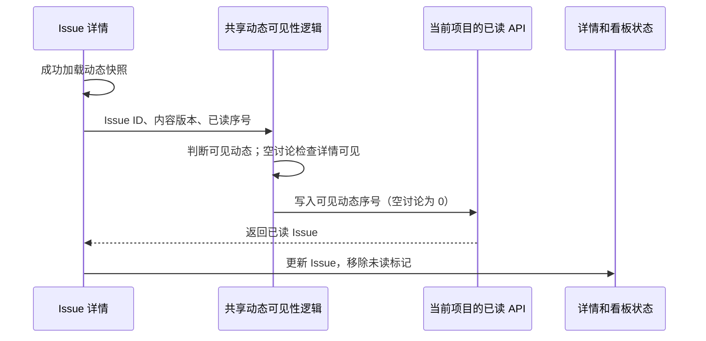

# Issue 未读状态

Issue 未读属于当前用户，由服务端持久化在现有 Issue 元数据中。读取不会修改 Issue 的版本或更新时间，也不需要表结构迁移。

桌面 `TaskActivityView` 和共享 `IssueActivityPanel` 都使用 `useIssueActivityScroll`。桌面按照项目存储位置选择云端或本地 API，并通过已有 `onTaskUpdated` 同步详情和看板。

- 只有创建记录、没有讨论的 Issue，也必须在详情加载成功且可见后标记已读。
- 动态序号只推进到已经进入可见区域的消息；屏幕外的回复不能借用整个讨论卡片的序号被提前读取。
- 新动态进入可见区域时重新检查，用户无需额外滚动。
- 未读内容版本变化时，即使消息序号相同，也需要保存该内容版本的已读状态。
- 已读请求成功后才确认本地游标；请求失败时显示错误，保留游标并允许后续可见性事件重试。订阅失败不能冒充空讨论完成读取。
- 正在进行的相同读取请求应去重；切换 Issue 后不能复用上一个 Issue 的读取状态。

## 回归验证

`useIssueActivityScroll.test.tsx` 覆盖空讨论、隐藏详情、可见与屏幕外消息、读取失败重试、新消息、内容版本变化、请求去重及切换 Issue。

`TaskActivityView.test.tsx` 覆盖云端和本地 API 路由、空讨论的状态回传、订阅失败保留未读、可见动态序号写入以及读取失败后的恢复。

现有桌面 CI checkpoint `collaboration-issue-comment-notification` 验证另一成员创建的空讨论 Issue 打开后持久化已读、看板移除标记、关闭重开不恢复未读，以及评论深链写入活动游标。执行 E2E 和真实 Electron 验证时遵守仓库运行策略。
