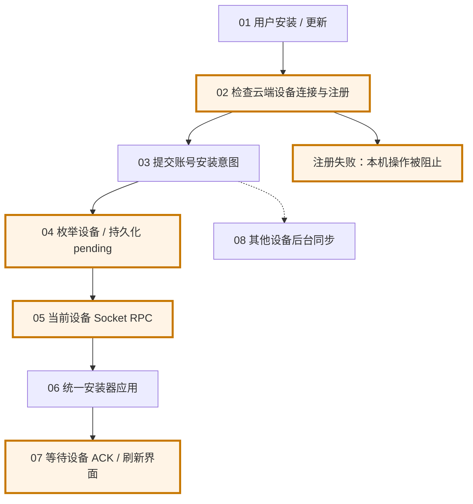
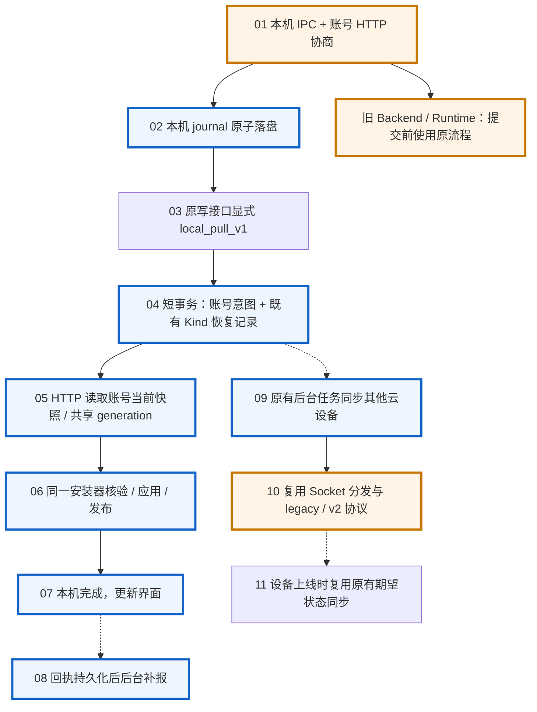

# 插件本机执行与云设备同步解耦

本机安装、卸载、版本更新、组件开关和刷新对账使用账号 HTTP 与本机 Runtime，不以 Device 注册、Socket 在线或其他设备 ACK 为前提。仍需要登录账号并访问 Backend；这不是离线插件市场。第三方认证及退出认证继续复用现有能力，账号托管认证尚未解除 Device 路由要求。

## 改造前

## 改造后

## 接口与持久化

- 复用原安装、更新、删除及 builtin ensure-installed 接口。只有显式携带 `delivery_mode=local_pull_v1`、`local_instance_id`、`operation_id` 和正整数 `local_intent_order` 的请求进入新事务；这些写接口的默认分支不读写新模式的恢复记录。安装/更新保留原响应体，删除仍是 204。新模式通过 `X-Plugin-Delivery-Mode`、`X-Plugin-Operation-Id`、`X-Plugin-Intent-Order` 确认受理。
- 新 Rust `POST /api/plugins/local-sync` 合并能力探测、账号 revision、当前快照及指定 operation 查询。`contractRevision=2` 包含顺序保护，Runtime 只在合同匹配时启用；`probeOnly` 不创建分发状态；无变化返回 200 与 `unchanged=true`。读取来自主库事务，revision 包含旧客户端产生的账号变更。
- 单次安装、卸载和逐插件更新下发仅含目标插件的增量快照；手动刷新、修复和后台账号对账直接使用完整快照，不先重放 pending。新操作和逐插件更新优先执行自己的目标，历史失败不会阻止新目标；增量完成不能充当全账号无变化的证明。
- 新 Rust `POST /api/plugins/local-sync/receipts` 校验账号、安装实例、快照、generation、目标包与逐项结果；迟到回执标记 superseded，仅记录本机观察。快照绑定本次确认的 operation ID，单插件成功不会结束其他待恢复操作。
- 下载复用 `GET /api/plugins/installed/{id}/download`。可选 `expected_release_id` 不匹配时返回 409 `RELEASE_CHANGED`，不会退到历史包或旧上传包分支。
- 仅新增一个本机 IPC `executor.plugins.local_sync`，支持探测、安装、builtin 安装、更新、卸载和对账。Executor 通过已绑定账号读取可信快照，renderer 不能提供执行脚本、ZIP URL 或目标目录。
- 不新增数据库表或迁移。幂等意图、快照和回执复用 `kinds` 中的内部 `PluginSyncState` 记录，使用独立命名空间 `plugin-local-sync`，不会混入原有账号同步状态。本次不增加云端分发队列表、Redis Stream 或轮询 Worker。账号写事务不枚举设备、不调用 Socket；提交后使用原有后台 Socket 分发，云设备上线后复用原有期望状态同步。可选 `source_device_id` 只在后台能解析时排除发起端，缺失或未注册不会阻止本机操作，也不会阻止其他云设备同步。自动更新沿用原账号版本推进与设备对账机制。
- 服务端按账号、实例和 operation ID 隔离恢复记录；实例 ID 与 operation ID 的带边界哈希生成 64 字符资源名，原标识保留用于校验。Python 和 Rust 使用相同命名及 JSON 合同。重复或不匹配的内部记录按冲突拒绝，不能据此丢弃不确定请求。账号意图与恢复记录在现有账号写锁和 revision CAS 保护下同事务提交。
- journal 在本机 Codex home 的 `plugin-local-sync` 目录，按 Backend 与账号 ID 隔离，不保存 token。实际文件指纹与账号 revision 同时一致时才跳过应用；中断操作使用原 operation ID 和递增的 intentOrder 恢复。顺序先于 HTTP 请求原子落盘；Backend 在现有 `PluginSyncState.spec.localIntentOrders` 中按本机实例及插件保存已受理顺序，不随操作记录回收而删除。首次迟到的旧意图返回 409 `INTENT_SUPERSEDED` 并回滚整个写事务。
- HTTP 与 Socket 共享一个安装器实例，复用 generation、tombstone、prepare/publish、checksum、真实运行时文件核验及账号切换隔离。结果补报不持有前台协调锁，不进入本机完成条件。账号退出或连接配置切换会使旧安装器绑定失效，阻止旧账号在途任务继续发布。

有安装期认证要求的插件可以先完成包安装，界面提示在插件详情完成授权。自动授权失败不再回滚这个新模式下已经确认的本机包安装；原模式保留原认证流程。

### pending 恢复与完整对账

完整对账在读取快照前，先在 journal 锁内准备一条按尝试时间轮转的原 pending，随后由独立后台任务提交原意图；快照请求失败、合同无效或包应用失败都不会取消这项恢复。独立 recovery 文件锁避免多个 sidecar 重复恢复，重试 HTTP 不获取前台协调锁或普通 journal 文件锁，可以在快照 HTTP 或安装器尚未返回时推进。结果写回短暂取得普通锁后重新读取最新 journal，按 operation ID 合并，保留期间新增的请求。恢复失败不进入完整对账的完成条件，实际包发布继续使用现有串行安装器。

账号协调器分别合并自动更新和完整对账的触发请求，每项工作独立记录在途与待执行状态、处理失败和发布界面变化。在 HTTP 模式下，空闲调度器只负责启动任务，不等待长时间网络请求；因此任一任务未返回或失败，都不会阻止另一项任务被触发。退出账号、切换配置或卸载协调器后，不再启动待执行任务，也不发布迟到结果。旧模式保留原来的设备锁和等待式空闲调度。

只读能力探测不取得 Native 的前台执行锁，也不触发 pending 重放；本机实例 ID 仅在独立的短文件锁内创建或读取。安装与应用请求等待前台锁后会再次校验账号配置，旧账号的排队请求不能在切换后继续受理。安装器的文件发布仍按原有顺序保护。

只有 Backend 取得账号写锁并确认同一账号、实例和 operation ID 尚未受理，才会在明确业务拒绝（400、403、404、422，或 409 `INTENT_SUPERSEDED`）中增加 `X-Plugin-Operation-State: rejected`。取得锁失败仍属于受理结果不确定，防止误判尚在提交的超时请求。Native 同时核对 delivery mode、operation ID、intent order、状态码和响应正文，将未受理请求转存到 `rejectedOperations` 终态记录，再移出 pending；已知受理的请求不会因此移除。旧默认请求不增加这套标记。

网络超时、响应丢失、5xx、401、408、429、其他 409，以及缺失或不匹配确认标记的错误都不能证明未受理。Native 保留原 operation ID、intentOrder、动作、目标和 payload，重启后继续幂等重试，不重新创建请求，也不自动切回旧协议。

## 发布、兼容与回滚

1. 不需要新增表或执行本功能的数据库迁移；原迁移 head 与 fresh schema 保持不变。恢复记录使用现有 `kinds` 表。
2. 部署全部 Python、Rust、网关副本，再发布包含新 IPC 的 Runtime/Wework。两个新路由由 Rust 注册并选通；原 Python API 的所有权不变。
3. 全部副本部署完成后，在 API 副本设置 `PLUGIN_LOCAL_SYNC_ENABLED=true`，默认 false。仅靠新查询参数不能防止旧副本忽略参数，因此全部副本完成部署是启用前提。
4. 旧客户端未携带新模式，继续使用原逻辑。新版客户端遇到明确不支持的 Backend/Runtime，只能在提交前选原路径；一次新模式提交发生后，错误不会自动重放为旧请求。
5. 关闭受理开关时保留两个新 HTTP 接口和 Runtime 恢复能力。已有 journal/回执仍使用新协议恢复；排空前不得回滚到完全不认识新协议的二进制。
6. 内部 Kind 操作记录保留用于幂等重试和 pending 恢复，本次不新增清理 Worker。下发快照有效期 24 小时，过期后重新对账；不删除网络超时或受理结果不确定的原请求。

账号级低频 HTTP 对账合并到已有自动更新协调器：启动、恢复联网、页面重新可见及 120 秒空闲检查使用同一路径；页面隐藏/离线时暂停周期检查。设备通知用于加速，不是正确性前提。新模式的页面安装、刷新和自动更新均不要求本机设备号；自动更新也不依赖旧设备库存读取或 Socket 配置。首次协商失败后随联网、页面可见性和周期检查重新探测，不等待设备注册成功事件。

## 验证边界

- Python 默认接口回归，以及新模式的无 Device 写入、幂等、回滚和复用原有云设备分发测试。开关开启/关闭时，旧写接口及后台流程均断言不产生新模式恢复记录。
- 真实 MySQL 的原 schema/head 不变、原请求持久化恢复及账号/实例隔离；真实 Rust HTTP/MySQL/Redis 的无 Device 快照、探测无写入、账号/实例隔离和旧回执测试。
- Wework 单元/组件测试覆盖能力协商和提交后不切换传输；HTTP 独立对账有变化时失效缓存并广播现有事件，无变化不重复刷新。市场投影以当前账号安装记录的版本及校验值核验本机证明，库存读取失败不确认已安装、仍保留健康的市场列表。统一安装器测试覆盖实际文件损坏检测。
- Python/Native 定向回归覆盖明确未受理标记、已受理请求保护、真实 HTTP 超时、恢复期间释放前台锁、并发 journal 写回合并，以及快照 HTTP 失败、合同错误和安装失败时继续恢复原请求；Wework 覆盖自动更新与完整对账互相失败或长时间未返回、逐项合并触发，以及手动和后台完整对账绕过 pending。
- 无注册安装/更新/卸载、回执响应阻塞、未到达旧卸载被新更新取代、404 pending 不阻塞完整对账，以及实际已受理但丢响应的原请求在无关包下载失败后继续恢复等场景接入既有 `plugin-write-coordination` 桌面 checkpoint，复用服务、构建与 CI。本地是否执行，以任务验证记录为准；增加覆盖不代表已经运行真实 Electron。
- 尚无 1.0.0、1.1.0、1.1.1 实际发行制品的完整测试证据。旧默认合同回归不能替代这些制品的真实兼容验证。
