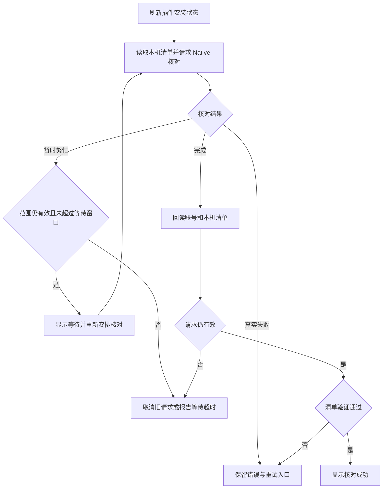
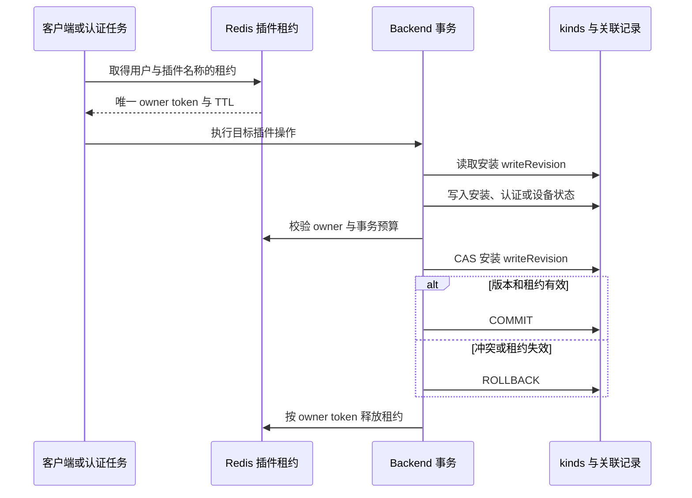

# 插件本机执行与设备注册解耦

本机安装、卸载、版本更新和完整对账使用账号 HTTP 与本机 IPC，不要求 Device 注册、设备号、Socket 在线或其他设备 ACK。仍需要登录和访问 Backend。本机对话的普通插件命令保留原本机认证路径；托管账号调用使用下面的 Native 插件授权通道。云设备及旧客户端仍走原有 Device／Socket 安全路由。

## 状态与职责

- `InstalledPlugin/default` 仍是账号期望状态的唯一来源，原安装、更新、卸载和包下载能力继续复用。
- 不新增表、迁移或 `plugin-local-sync` 命名空间记录；不保存独立操作、执行快照或回执账本。
- 原 `PluginSyncState/plugin-sync/account` 继续保存 generation 和设备水位。`spec.localIntentOrders` 保存每实例、每插件的顺序水位；`spec.localIntents` 每实例、每插件仅保留一个最新受理标记，包含 operation ID、请求摘要、顺序、安装 ID、动作及安装 revision，不包含完整插件副本或历史。
- 期望状态、最新受理标记与顺序水位在插件 Redis 租约和 CAS 下同事务提交。旧客户端的写入和 Socket generation 更新保留这些字段。
- Native journal 按 Backend 和账号隔离，原请求在 HTTP 之前原子落盘，不保存 token。实际文件、manifest 和运行时配置由统一安装器管理。HTTP 和 Socket 共享安装器、generation、tombstone、校验与发布保护。

HTTP 与 Socket 对同一插件下发相同目标时，共享一次准备和发布，并分别按各自 generation 返回结果。目标指纹包含安装记录、插件身份、启用状态、版本、包校验值及组件配置；跨 generation 合并安装目标必须有可信包校验值，此时可忽略临时下载地址。manifest 的目标指纹和等价顺序范围保留真正变更的边界，实际发布水位始终取已接纳的最新 generation。更新、卸载或目标变化会终止旧目标的等价范围；旧目标后来再次出现也不能复活此前的操作。共享任务失败或取消不会被当作安装成功。

若共享下载失败，提供了不同下载地址的等待请求会重新检查顺序保护，并尝试自己的地址一次。同一地址的失败、校验失败和取消仍向调用方返回，不能据此宣称安装成功。

已连接设备提交当前连接的精确记录路由作为可选来源，未注册本机不填写该字段。服务端保留“已提供但无法唯一解析”的来源信息并延后后台广播，避免把来源丢失误当成向全部设备同步；本机 HTTP 操作仍可独立完成。

手动核对将 Native 的 `plugin_local_sync_busy` 作为暂缓信号，按 500 毫秒、1 秒、最多 2 秒间隔重新读取和核对，单次等待窗口为 30 秒。只安排状态核对，不创建新的安装、更新或卸载意图；journal 仍按原机制恢复已有请求。前台操作会暂停核对，操作结束后重新核对；账号、后端、设备或请求切换会取消旧任务。真实错误和等待超时仍向用户报告，成功必须经过清单回读验证。

Rust 设备重连后的插件回执按安装记录逐条落库，各自获取单插件租约、开启事务并核验 CAS，不一次占有全部插件的租约。单个插件繁忙不阻止其他插件提交回执；整轮落库仍受 20 秒预算约束。数据库冲突仅重试事务，不重新发送已执行的设备操作；未能落库的插件保留待同步状态并记录具体安装 ID。

## 核心流程

1. 能力探测：Rust `POST /api/plugins/local-sync`，`probeOnly=true`，要求 `protocolVersion=1`、`contractRevision=3`。服务端探测不写数据库。
2. Native 先保存 operation ID、intentOrder、动作、目标和 payload，再通过原 Python 写接口携带 `delivery_mode=local_pull_v1` 提交。
3. Backend 同事务保存账号期望状态和最新受理标记，返回匹配请求的受理头。相同标记及摘要重试不重新执行写操作。
4. Native 从同一 Rust 接口读取当前执行计划，通过本机 IPC 调用统一安装器；计划直接返回，不持久化，不使用 snapshot ID 或回执接口。
5. 本机实际执行成功即更新 journal 和界面，不等待云设备。单插件操作使用 delta；完整对账负责发现旧客户端变更及隐式删除。
6. 提交后继续复用原后台 Socket 分发，云设备上线使用原期望状态同步。缺少或无法解析可选来源设备号不阻止本机操作。自动更新复用原账号批量推进。

## pending、顺序与并发

网络超时、5xx、401、408、429、未知冲突、丢失或不匹配受理确认均保留原请求，不创建新 ID，不自动切回旧协议。重试使用原 ID、顺序、动作和 payload。

最新受理槽位被后续操作覆盖后，旧请求仍受持久化顺序水位约束。Backend 明确返回匹配 ID/顺序的 `409 INTENT_SUPERSEDED` 和 `X-Plugin-Operation-State: superseded` 时，Native 才将原请求转存 superseded 终态。已受理请求之后被旧接口、其他实例或自动更新改变安装 revision，也不能再次执行旧动作。普通业务拒绝只有在取得写锁、没有匹配受理标记且请求顺序高于已有实例水位时才返回 `rejected`；标记已压缩不能被当成从未受理的证明；已知受理请求不会因普通拒绝被清理。

完整对账独立恢复原 pending；恢复 HTTP 不持有前台执行锁或 journal 文件锁。结果写回时重读并合并 journal。快照 HTTP、合同或安装失败不取消恢复，恢复失败不阻止对账。自动更新与完整对账独立合并触发；实际包发布仍串行。

排队的前台操作及扫描写回核验 Backend、账号 token 和安装器 Socket；pending 的账号 HTTP 恢复只核验 Backend 和账号 token。仅 Runtime token 续期不会中断这些工作。账号或 Backend 切换仍拒绝旧配置的请求，Socket 变化仍阻止旧安装器发布。

执行前仅持久化已有 `reconcilePending` 标记，不保存执行计划副本。中断后重新获取当前账号计划；读取旧 journal 时将原 `snapshot` 对象转为待对账标记并移除副本，原 pending 请求及顺序保持不变。前台提交与后台恢复复用同一套尝试、受理和拒绝结果处理。

pending 恢复先于完整内容扫描启动。全量指纹在阻塞线程执行，扫描期间释放前台执行锁和 journal 文件锁；写回前重新核验账号、journal 执行状态和 manifest 版本，保留扫描期间合并的受理结果。新的前台操作或发布使旧扫描结果失效。扫描另有独立互斥，请求取消后也要等扫描线程结束才释放，避免重复扫描堆积。

扫描复用已有单调意图顺序号识别新的前台请求。pending 的受理、明确拒绝及 superseded 归档属于恢复进度，可以合并而不触发重扫；归档引起的对账标记和缓存失效仍被保留。

## 插件级写入协调

Redis key 为 `wegent:plugin-write:{user_id}:{InstalledPlugin.name}`。名称复用原稳定派生规则，首次安装前即可计算；已有历史名称的安装还取得原记录的租约。设备号不能用于账号状态的锁，否则两台设备可以同时改变同一安装。

租约 TTL 为 30 秒，Python 每 10 秒续期，事务预算为 20 秒，单插件最多等待 3 秒。批量操作排序后逐个尝试，多个目标时不等待忙锁，并在失败时先回滚再释放已取得的租约。不同插件的网络下载、适配器执行和 journal HTTP 不持有公共用户锁；本机安装器保留原逐插件准备锁和短暂的 manifest 发布锁。

`InstalledPlugin.spec.writeRevision` 是认证、设备记录和安装的共同提交栅栏。提交以原写版本为条件递增；安装 JSON 整体替换同时比较并保留写版本。原 `spec.revision` 仍表示安装意图，仅安装、更新、卸载等期望状态改变时推进。软卸载保留原安装行及版本，重装继续使用；迟到回执同时检查 generation、水位和当前期望状态。

健康目录只读检查不取得插件写租约；检测到目录漂移或重复安装后，才对需修复的记录加锁并重新核验。

现有 `PluginSyncState` 只承担短暂的同步元数据写入：不同插件的意图按各自 JSON 路径原子合并；快照先读元数据版本、再读插件，最后将 generation 与版本一起 CAS。期望状态事务同时推进元数据版本，避免旧内容获得更新的 generation。CAS 冲突需回滚并重新构造快照；不增加表或 `FOR UPDATE`。

单设备和批量设备回执复用同一持久化入口。元数据 CAS 冲突沿用原最多 3 次的事务重试，每次回滚、释放租约并重新读取当前状态；只重做数据库写入，不重复远端执行。忙锁、Redis 不可用和失效租约仍直接报错。

认证提交还校验真实的账号自动授权策略版本，最后用条件空更新保护该共享设置直到提交；普通认证不递增策略版本，安装／更新／卸载不依赖此策略。只有真正的账户开关和首次元数据初始化使用短暂的专用元数据租约。

首次安装尚无安装行，先取得 Redis NX 租约，并读取现有 `PluginSyncState.spec.creationRevisions[安装名称]` 的计数。首次插入提交时只 CAS 对应插件的计数；计数随卸载保留，使租约过期的旧首次安装无法晚于后续安装／卸载提交。不同插件比较各自的槽位，只有最终元数据写入短暂共享数据库行，不跨网络或适配器等待持有它。已有安装行仍使用自身的 `writeRevision`。请求重试继续复用原最新受理标记和顺序水位。

## 部署与验证

插件租约协议的 key 与旧用户锁不同，不能让新旧 Python／Rust 写入进程混跑。上线必须先停止受理并排空旧写事务，再统一切换两种 Backend；回滚采用同样步骤。不能仅靠滚动发布保证互斥。现有 v2 客户端协议不变，新桌面版本才具有本机并行执行能力。

默认 `PLUGIN_LOCAL_SYNC_ENABLED=false`。全部 Python、Rust、网关和 Runtime 副本部署完成后才启用。未携带新模式的旧接口逻辑不变；旧客户端仍走原路径。合同 3 与原 PR 内的合同 2 不混用，不能把新查询参数被旧副本忽略视为受理成功。

关闭受理开关时保留当前 HTTP/IPC 恢复能力；已受理标记可重放，已有实例可继续对账，未知新操作不能受理。本机旧 journal 的 pending 原样保留，已删除协议的回执不再补报。

聚焦回归覆盖无 Device 安装/更新/卸载、最新标记容量、重复请求、摘要冲突、原子回滚、旧接口变更后迟到重试、标记压缩后防乱序、账号/实例隔离、恢复与对账互不阻塞，以及 Runtime token 续期期间的排队操作、两阶段扫描和 pending 恢复。连接字段独立变化的反例验证账号、Backend 和 Socket 校验边界。真实 HTTP/MySQL/Redis 测试及桌面 `plugin-write-coordination` checkpoint 接入现有 CI；本地执行情况以 PR 记录为准。尚无 1.0.0、1.1.0、1.1.1 实际发行制品的完整兼容验证。

## 本机对话中的托管账号调用

新增 Rust `POST /api/plugins/native-auth/exchange`。桌面主进程用原桌面 refresh token
及其绑定私钥签名的请求证明换取一小时以内的 `plugin_native` 会话；证明绑定此接口、
请求方法、时间和 refresh token，Redis 的短 TTL 标记拒绝证明重放。该会话只能访问
插件接口，不能作为共享用户、设备、任务或工作区 API 的凭据。私钥和会话不进入 renderer。
没有新接口的旧 Backend 返回 404 时保留原 Socket 通道；新 HTTP 请求失败不隐式改用 Socket。

Executor 复用现有 Broker、统一适配器及后台认证循环。Broker 随账号／Backend 切换取消；
同账号 access token 轮换保留业务端口。Native 会话绑定当前 Backend 和账号 token，迟到的
旧账号响应不会交给适配器。设备注册状态仍如实返回失败，不伪造在线状态；云设备授权
仍检查原 `deviceGrants` 和 Runtime 绑定。

复用 `ConnectorConnection`、`ConnectorMigration`、`ConnectorTransfer`、本机认证策略及
插件级写租约，不新增表、列或独立执行账本。现有 JSON 增加本机密钥授权 `localGrants`、
来源观察值 `nativeAuthSources`、待登录 generation 和 Native 刷新／撤销租约归属。
旧接口写凭证时保留适用的本机字段，认证定义变化或退出认证时撤销本机授权。
独占转移先持久化原 escrow，再由统一适配器确认本机 detach；丢失受理响应不得覆盖 escrow。
OAuth 刷新结果不确定时要求重新登录，不重复消费可能已旋转的 refresh token。

自动认证复用原后台任务：启动、Backend 重连、托管插件清单变更，以及本机登录／退出成功时触发。清单事件只处理内容发生变化且仍启用的托管插件；登录事件只清除该插件的冷却。正常巡检间隔为 300 秒，按进程加入 ±30 秒抖动；事件不会推迟巡检。每批最多 16 个插件，一次巡检处理所有批次，单批适配器并发最多 4。失败按 30、60、300 秒退避，移除插件后清除重试。成功后的冷却不会产生每分钟轮询。撤销任务保留原 15 秒检查及其退避；会话刷新沿用原机制。

凭据登记、OAuth 更新或独占转移成功提交后，Rust Backend 通过现有 Socket.IO Redis 适配器向同账号发送 `plugin.auth.changed`，只包含安装 ID。Cloud／Remote 执行器按该 ID 立即重做授权同步，继续检查现有账号策略和设备权限；本机执行器不消费此通知，避免导出回环。通知丢失时由低频巡检补齐。

新版 Native HTTP 的业务读取、状态查询及 prepare 不推进安装写版本；旧 Socket 的本地设备自动认证 `prepare_only` 也只读，不取得整批插件写租约。创建认证意图、写入凭据时才取得目标安装租约并校验 CAS。空清单不查询 Backend 的自动导出接口。安装 pending 的原请求与顺序保护继续复用。

真实 HTTP／MySQL／Redis 回归覆盖无 Device 会话、跨用户／密钥隔离、Python 密文格式、
刷新与撤销、独占 escrow 重放；现有 `plugin-account-auth-password` CI checkpoint 追加
真实 Backend 拒绝注册后本机对话执行及安装／更新／卸载，保留旧协议原测试断言。
