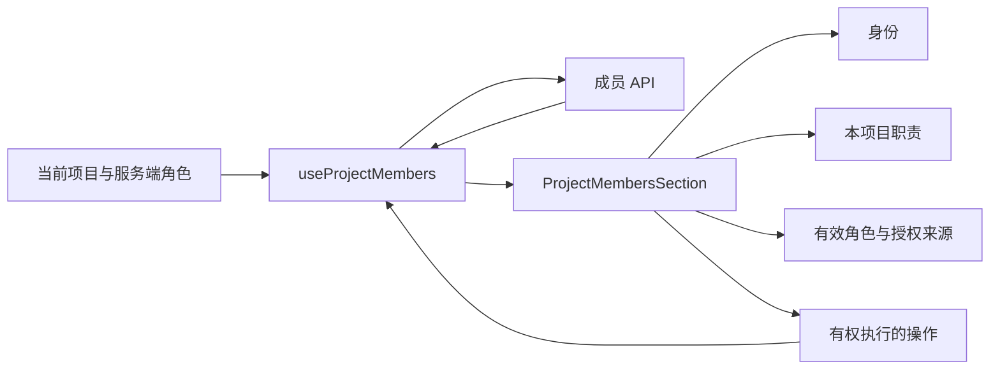

# 项目成员设置界面

成员页使用紧凑的中性设置布局，分别呈现身份、职责与能力、角色与来源、操作。每个成员行保持四个单元格，避免继承来源增加网格列数而使角色和按钮错位。

角色显示管理员、成员、只读成员等产品名称。继承来源使用项目响应中的空间名称；没有名称时显示“继承自父空间”，不展示数据库编号，也不额外读取空间目录。

继承角色在项目内只读。继承与直接邀请并存时，同时显示有效继承角色和可以修改的直接角色，避免将低权限的直接授权误认为有效权限。项目管理员可以填写继承成员在本项目的职责；职责编辑不改变成员角色。

成员模式使用一个简洁的设置行，并说明空间管理员始终保留治理权限。旧服务端不提供成员模式时不显示该控制。只读访问者看不到添加、改角色或移除操作。

职责采用轻量的行内编辑，失焦保存。保存期间禁用成员变更控件。加载、空列表和保存失败分别表达；项目切换会重置成员编辑状态，旧项目的异步响应不能写入新项目。

桌面使用四列布局、轻分隔线和中性角色标记。手机使用横向设置导航及纵向成员信息，交互控件至少 44px；键盘焦点使用蓝色焦点环，成员选择器支持 Escape 关闭。

实现位于 `packages/collaboration/src/project-manage/`：成员视图和控制器分开，标签及扩展内容使用独立呈现组件，项目变更队列保持原有版本校验。

回归检查包含角色与来源本地化、四列结构、继承只读、双重授权、职责保存、保存失败、项目切换隔离、旧服务端能力缺失以及加载/空状态。`ProjectMembersSection.test.tsx` 和 `ProjectManageView.test.tsx` 随共享组件 CI 运行。桌面成员检查已接入既有 `collaboration-shared-core` 场景；本次未运行 E2E 或 `ai:verify`。

组件预览已在 1440×900 和 390×844 尺寸检查，手机文档宽度为 390px，没有页面横向溢出。预览使用示例成员数据，不代表已验证真实 Electron 或已部署。

架构事务：`tx-76face5c9721`，已合并至 `A00000003`。界面稳定 ID 为 `arch://wegent/ui/287398da`，成员界面测试为 `arch://wegent/test/8e6bb2c4`。本界面不修改 CP 权限契约。

## 验证记录

2026-10-14 完成共享组件全量 830 个测试、共享组件/Web/桌面类型检查、6 个改动组件及控制器的 ESLint、格式检查和 2 个 CP 契约保护测试。桌面 E2E 增量通过脚本语法检查，并确认由现有 CI 检查点调用。

全量测试与编译分开执行，使用 `pnpm --filter @wegent/collaboration test --maxWorkers=1`；原有 5 秒测试限制保持不变。先前同时执行编译和测试的全量检查出现过 6 个超时，记录为验证环境资源争用，未跳过用例、添加重试或放宽超时。
