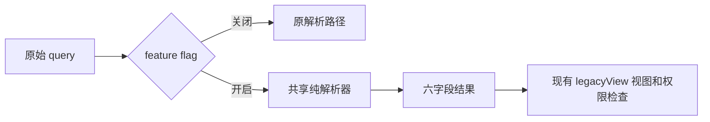

# 项目视图映射契约

`@wegent/collaboration/project-shell/projectSurfaces` 是项目视图语义的共享来源。
本契约只解析入口，不改变导航布局、权限或数据模型。

| 旧 view    | surface | mode       | timelineSubview |
| ---------- | ------- | ---------- | --------------- |
| board      | work    | board      | null            |
| calendar   | plan    | timeline   | calendar        |
| gantt      | plan    | timeline   | gantt           |
| table      | plan    | table      | null            |
| milestones | plan    | milestones | null            |
| files      | admin   | files      | null            |
| manage     | admin   | settings   | null            |

每个结果固定返回 `surface`、`mode`、`legacyView`、`timelineSubview`、`lossy`、`unsupported`。
`projectViewRegistry` 包含标准视图和扩展视图；新增注册项必须补齐 resolver 的 `never` 分支。
注册表同时检查现有 `CollaborationView` 是否全部覆盖。

## Query 规则

- 合法 `view` 优先，即使其他参数冲突或非法。
- 没有合法 `view` 时读取 `surface+mode`。有效的新参数可以替代无效的旧参数，此时 `unsupported=false`。
- 缺省 mode：work→board、plan→timeline、admin→files。
- timeline 无合法旧 view 消歧时默认 calendar，且 `lossy=true`；其他有效组合可精确恢复，`lossy=false`。
- 未指定任何视图参数时返回精确的 work/board。
- 存在无效参数且无法解析时返回 work/board，同时 `lossy=true`、`unsupported=true`。
- 参数值区分大小写；空值属于非法值，重复键取第一个值。
- 解析只读取 query，不规范化或改写地址栏；原有路径迁移和用户主动导航仍由宿主负责。

## 开关与回滚

`collab.projectSurfaces.v1` 默认关闭。宿主在解析器外检查开关；关闭时解析器调用次数为零。
Web 由 `NEXT_PUBLIC_COLLAB_PROJECT_SURFACES_V1=true` 启用，桌面由
`VITE_COLLAB_PROJECT_SURFACES_V1=true` 启用。桌面现有运行时配置的 `featureFlags`
可覆盖构建配置，显式 false 优先。两个宿主也支持注入 `featureFlags`，变更后恢复原解析路径。
开关不持久化、不迁移数据，不新增开关 UI；桌面的 `wework://` 协议规则保持原样。

## 验证

`src/project-shell/__fixtures__/resolver-matrix.json` 保留需求提供的 15 条 golden case。
补充测试覆盖冲突、非法值、重复键、原型属性名、开关隔离、主题变化和运行时回滚。
编译器测试在内存中追加注册项，要求唯一错误落在 resolver 的 `never` 分支。

运行 `pnpm --filter @wegent/collaboration typecheck` 和该包的聚焦测试。
浏览器回归位于 `frontend/e2e/tests/collaboration/project-surface-links.spec.ts`，
由默认 Chromium CI suite 收集，验证 Web 的六个可用深链及不可用里程碑视图的既有回退。
Web 尚未提供里程碑 API，因此基线不显示该入口，旧 `view=milestones` 会回到看板并规范化为
`view=board`；本开关不改变宿主能力或这条既有行为。七个视图的共享映射由 golden fixture 验证，
里程碑的实际交互由桌面的 `collaboration-milestones` CI checkpoint 覆盖。
E2E 和像素对比需要单独执行，单元测试通过不代表已取得像素证据。
