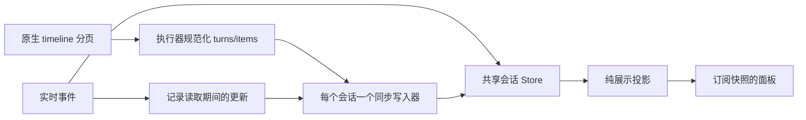

# Runtime 会话的一致性

Wework 的会话内容归共享会话 Store 所有。任务是否运行、Goal 是否继续和输入框草稿是独立状态，不能用展示消息是否存在来推断历史损坏，也不能在面板里维护另一份可写的会话。

## 协议与顺序

当前锁定的 Codex `0.163.0-alpha.5` 提供 `thread/timeline/list`：返回内容按原生 rollout 的 `position` 排列，首次请求读取最新窗口，`nextCursor` 向更早的位置分页。单次原生请求最多返回 100 条 timeline entry。执行器普通读取最多组合五页；显式完整导出才遍历剩余历史。cursor 始终视为不透明值，不解析原生 cursor 来推断位置。

`thread/items/list` 的数组顺序可用，但其 entry 和实时通知都不提供同一个历史位置或快照版本。实时事件的接收顺序、时间戳、工具完成时间和字符串内容都不能作为持久化历史的排序依据。

执行器将 timeline entry 的 `position` 传到规范化 turn/item；一个源 item 产生多个展示块时保留共同的源位置和稳定的块身份。历史分页、实时更新和重复读取按 item 身份更新，已确认的位置按原生位置排序。相同文本的不同原生 item 必须保留。只有尚未持久化的实时输出可以没有位置，作为临时内容显示；历史页之外的已完成实时缓存不能追加进该页。

原生 `threadId` 界定位置的有效范围。切换分支或恢复时原生 thread 改变，旧分支的缓存不能与新分支的位置合并；仍在途中的旧 thread 请求必须失效。普通任务切换不清除对应任务的共享会话。

同一 turn 可以跨多个原生页。只有包含其用户 item 或 turn-start 边界的页面拥有合成用户提示的资格；游标携带的 turn 元数据不能把这个归属带到另一页。

持久化条目按原生位置排序；没有位置的运行态条目保留在已观察到的相邻原生身份之间。相邻关系只从合并前的各来源序列提取；联合数组中新插入的历史项不能反过来被视为实时输出曾观察到的邻居。历史页缺少某项不代表删除，后台命令和待答问题可能尚未写入 timeline。执行器先将尚未落盘的当前实时条目叠加到原生历史，再一次性投影 turns 和 messages，保证两种接口视图包含相同的当前内容。已完成历史缓存不能参与该叠加。独立的 runtimeTurns 仅承载仍在运行的后台命令及输出，并使用本次原生页中的相邻项作为顺序锚点，不回放缓存文本；前端以原生历史为底、运行态为叠加层，统一按身份归并。只有显式 supersededTurnIds 才会删除旧轮次，并阻止迟到事件复活。用户消息通过同一轮次内唯一的原生用户 item 与宿主发送身份绑定，避免乐观消息重复。

## 数据流和恢复

历史规范化和展示消息从同一次处理产生。原生位置决定条目顺序，展示分组则使用明确的用户边界：首条普通用户输入开启同一回复，输入前的上下文压缩等处理不会额外生成助手回复；runtimeGuidance 标记的引导输入建立新的展示分段。引导消息可以把一轮拆成多个展示段，但文件变更等轮次级信息必须从整轮汇总，不能只取末段。原生主流程不能从展示 messages 反向拼回 turns。其他运行时和 legacy 历史的既有适配保持明确的协议边界。

编辑或重试产生的 superseded turn 标记在规范化前过滤原生 turn，保证两种视图一致。元数据读取复用既有启动重试，只重试协议明确的暂未就绪错误，永久错误仍向调用方报告。

切换任务、连接恢复和生命周期协调通过 `synchronizeRuntimeConversation` 读取：相同请求合并，同一会话的竞争读取串行提交，不同会话独立推进。请求取消或任务归档后，迟到结果不能重新创建会话。只读取导航元数据不应冻结或改写会话。

读取期间仍立即发布实时更新，同时记录用于提交的更新集合。工具输出等追加增量先基于已观察的状态形成结果，再与原生历史合并，避免对已包含该增量的历史重复追加。文本更新按稳定 item 身份协调；保留原生快照已经包含的完整前缀。该策略没有宣称上游提供了不存在的原子版本或水位。

子线程查看是只读投影，不采纳为父任务的新 thread，也不更新父任务上下文用量。父任务的恢复写入与子代理面板的读取必须分开。

共享缓存立即处理结构与文本更新；React 订阅按动画帧合并视图通知，避免大量 item 完成事件触发逐项同步渲染。订阅不持有另一份消息状态。

实时动作仅在到达时发布一次。水合完成或终止只发布快照变化，不能再次回放动作给订阅者，否则会重复触发副作用。

已加载的原生历史由分页和会话缓存生命周期控制，不得再被实时临时块的数量限制截断。临时输出仍受原有的大小与数量限制。Goal 只投影执行状态；事件缺失、连接恢复等明确的恢复原因由同步层处理。

## 阅读位置

底部跟随保存的是跟随意图。阅读历史时，快照保存 message/item 身份、可用的文本偏移及视口位置；恢复时先提供初始虚拟位置，再由滚动控制器定位相同内容。内容暂时未挂载时保留待恢复快照，在布局提交后继续定位。展示段使用 item 身份作为 React key，不能用数组下标承载展开状态或阅读身份。

## 验证

锁定二进制已在隔离的 Codex Home 中验证 510 个合成 item 的六页读取：身份唯一，位置单调，原生单页上限为 100。该协议验证只使用隔离合成数据库；产品通过公开 RPC 读取历史，不读取 Codex 内部数据库。

自动化回归包括：已有错误顺序的修正、重叠分页的不同到达顺序、重复读取、相同内容的不同身份、历史和工具增量的竞态、超过 500 条历史后的实时更新、归档期间的迟到结果、thread 替换和任务快照切换。

桌面回归 `streaming-conversation-switching` 已注册到共享 checkpoint 和 CI 套件。它只模拟模型响应，使用真实执行器产生超过 500 个 item，在任务切换期间继续输出，验证恢复后身份与顺序不变且内容不重复。按仓库执行策略，只有明确要求时才运行桌面 E2E 和 `ai:verify`；注册覆盖不等于已执行验证。
