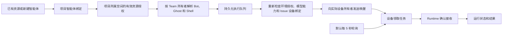

# Wework 协作执行与授权

项目智能体绑定、智能体资源所有者、任务指派人和执行设备所有者是不同身份。
共享空间中的智能体可以被项目成员使用；这不授予成员修改原始 Team、Bot 或模型凭据的权限。

## 资源和编辑权限

- 项目内使用空间共享 Team 必须匹配项目所属空间中的有效授权；移出空间后不再通过该授权解析。
- Team 的子资源使用 Team 所有者身份解析。执行所用模型仍按执行者能力检查，不能借共享 Team 读取他人的私有模型凭据。
- 服务端返回 `can_edit`。个人 Team 仅所有者可编辑；群组 Team 使用群组 Developer 权限；项目管理角色不代替资源编辑权限。
- 本地资源没有 Team ID。已有智能体选择器使用资源提供的 `project_binding_input`，保留本地执行配置，不能编造 Team 关联。
- 本地资源目录负责确保“当前设备智能体”存在；项目添加入口同时提供已有智能体选择和新建操作。

## 任务领取

设备领取仍由持久化队列、原子认领和 Runtime 接收确认控制。唤醒通知只提示有工作，不携带任务，也不证明任务已经启动。
路由任务向满足当前授权、模型和 Issue 绑定的设备发送通知，并使用设备所有者的连接身份。
`LOCAL_RUNTIME_WORK_POLL_INTERVAL` 可覆盖默认 5 秒间隔；连接恢复和通知仍触发立即领取。

## 分身接单身份

普通人工分配的 `human_task_binding.assignmentId` 是 Issue 分配事件 ID。
协作轮次中的该字段是负责人分配的成员任务 ID；额外的 `issueAssignmentId`
指向当前 Issue 分配事件。Executor 必须使用后者验证当前分配及写入接收回执，
并在任务绑定元数据中保存为 `issue_assignment_id`，保留原有成员任务 ID 供轮次汇总使用。
接收回执仍要求当前接收人、本人设备及本人任务绑定全部匹配。

通知尚无执行任务时，手动交给分身省略分身 ID，由 Executor 选择已连接该项目的身份，
不能假定身份名为 `default`。普通重新转派产生新的分配事件及独立分身任务。
CI 的 `stand-in-assignment-notifications` 套件同时验证通知触发、手动接单、
处理完成后转派回来，以及轮次任务接收回执。

## 验证场景

1. 项目 Maintainer 使用其他成员加入空间的智能体，能建立绑定；全局资源详情和编辑权限保持原有边界。
2. 撤销空间 Team 授权后，项目成员不能通过个人权限绕过项目资源授权。
3. 共享设备的所有者与指派人不同时，唤醒到达设备所有者；撤销环境授权后不再通知该设备。
4. 只修改 Bot 路由配置，不修改名称或 Shell，仍可保存且保持资源身份。
5. 本地项目可以从已有资源添加“当前设备智能体”，并且不会生成假的 Team ID。

针对性单元和 API 测试覆盖以上规则。桌面回归沿现有 `collaboration-local-agent-dispatch` 场景进入 CI；本地仅在明确要求时运行 E2E 或 `ai:verify`。
