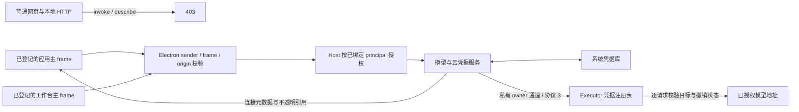
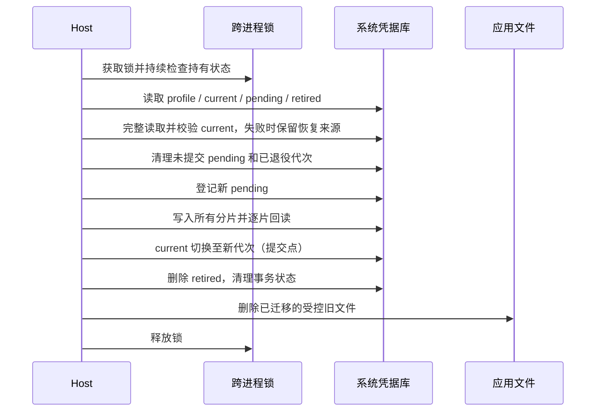
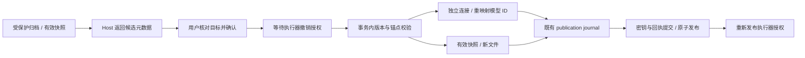

# Wework 桌面凭据存储与迁移

桌面 Host 是模型密钥、云刷新令牌和设备私钥的唯一持久化入口。原生系统凭据库保存秘密和事务提交状态；磁盘上的模型配置只保存连接元数据和引用。renderer 和普通 Executor 客户端不能读取这些业务凭据。

## 信任边界



- Host 按登记的 `webContents`、真实主 frame 和预期 origin 验证身份。工作台运行时还必须处于活动状态，其 principal 和能力范围由 Host 指定。
- HTTP `electron-host` 的 describe/invoke 一律拒绝，Host、Origin 和 Fetch Metadata 请求头不能建立身份。移除 HTTP 回退后，插件客户端也使用 preload IPC。
- 通用 `secureStorage` 不允许访问 `wework-model-key.*`、`wework-models.*`、`wework-cloud.*`、`wework-mirrors.*`。业务秘密只能通过专用服务使用。
- 已信任 Core 插件与应用共享 JavaScript 执行环境；隔离渲染 surface 属于应用信任域。这里不提供对恶意原生插件、任意同用户代码执行、完整 Host RCE 或管理员的秘密隔离。WW-29 的入口漏洞仍需独立修复。
- 仅替换 API 密钥并不自动改变请求地址。密钥使用范围还绑定 provider、完整请求 URL、模型、协议和代理；更换地址或认证路径需要重新输入密钥授权。

## 系统凭据库和事务

macOS 使用 Keychain，Windows 使用 Credential Manager，Linux 显式使用 Secret Service。Linux 不回退到 keyutils、内存或明文文件。存储不可用时返回稳定错误，不生成磁盘主密钥。原生依赖的平台选择见 [keyring-node 实现](https://github.com/Brooooooklyn/keyring-node/blob/v2.1.2/src/entry_builder.rs)。

`credential-profile.json` 只保存版本和随机 profile ID；系统库中的 locator 绑定规范化数据目录。复制文件不能导出系统库内容，也不能通过修改该文件切换到别人的 profile。更换目录、品牌标识、系统用户或机器需要专门的恢复或重新授权流程。



逻辑仓库上限为 16 MiB；每片原始数据为 1,500 字节，Base64 后为最多 2,000 个 ASCII 字节。原生适配器使用明确的 UTF-8 字节 API。原生异步操作超时后，本进程拒绝后续操作，避免把迟到的写入当作未发生；超时不承诺能够取消原生调用或中断同步初始化。

模型配置使用第二层受保护的 publication journal：新密钥、有效快照、文件归属和待发布意图在同一个仓库代次提交；随后原子写 YAML 和绑定文件，最后回收不再被任何已登记文件引用的密钥。恢复只允许磁盘内容等于旧内容或候选内容，不覆盖其他外部编辑。文件写入包含文件同步、rename，以及非 Windows 平台的父目录同步；真实断电行为必须在支持平台验证。

恢复时先校验当前已提交代次，再删除未提交分片、退役代次和遗留弱文件。当前代次缺片、损坏或不可访问时保留恢复来源并报错，不自动信任旧备份。校验结果在同一次锁内操作中复用，读取和更新不会重复加载同一代次。

## 迁移和恢复规则

| 来源                           | 迁移动作与失败处理                                                                                                                 |
| ------------------------------ | ---------------------------------------------------------------------------------------------------------------------------------- |
| `secure-values.json` 与 `.key` | 严格验证版本、32 字节主密钥和全部 AES-GCM 条目；受保护提交并回读成功后才删除旧文件。缺钥、坏标签和未知格式拒绝迁移。               |
| `model.yml` 内联密钥           | Host 在发布应用能力前预读默认或已绑定文件，将密钥转换为 UUID 引用和 `credential_protocol: 3`。非法文件保留错误和受保护的有效快照。 |
| 旧 renderer 模型列表           | Host 将原始内容先移入受保护仓库，严格转换并合并未归属的模型 ID；renderer 不再从 localStorage 拼接模型或执行导入。                  |
| `cloud-credentials.json`       | 启动时迁移完整设备身份，验证公私钥匹配，保留原设备公钥，不在损坏时重新生成替代身份。                                               |
| preferences / renderer 云连接  | 令牌迁入系统库，持久化镜像仅保留元数据；冲突来源受保护保留，不覆盖已选身份。                                                       |
| 已知损坏副本和临时文件         | 仅处理应用拥有且名称匹配的文件；原始字节先受保护归档，再删除弱副本。未知备份不擅自删除。                                           |

选择有效模型文件是显式恢复操作：可以替代被外部编辑阻塞的 publication，也会终止旧模型列表的自动导入；旧导入原文仍受保护保留。保存和选择操作在更改前等待 Executor 确认撤销旧授权。取消文件选择不撤销当前授权。发现模型的请求与配置更改串行执行；连接探测在撤销时中断。

旧模型列表与 YAML 中的模型 ID 冲突时，保留当前 YAML 的归属；旧列表的精确原文先归档到受保护恢复条目，再清理导入源。部分合并和全部冲突都不能丢弃旧密钥。云凭据迁移在受保护事务内部再次检查迁移标记，防止另一个延迟实例覆盖已经轮换的令牌，或恢复已经注销的身份。

Executor 仅通过经传输认证的 owner 通道接受协议 3 的凭据替换。owner token 在启动其他线程或 shell 前从环境中移除，并从子进程环境过滤。普通客户端自报 owner 字段无效。运行时只保存不透明引用；每次请求重新检查 URL、模型、协议、代理、有效期和撤销状态。撤销也终止排队请求和已经开始的流；已经发送的网络字节无法撤回。

刷新令牌和设备私钥不返回 renderer。短期云 access token 仍需用于现有云请求，但不再持久化到 preferences 或 localStorage。旧云协议的 access token 也由 Host 按绑定的端点恢复。注销先清理系统凭据，再确认 UI 已断开；失败时显示错误，不能伪装成功。

云身份必须先完成格式与键对校验，再清理遗留文件。受保护身份损坏时保留旧恢复来源并停止初始化；JSON 解析错误只返回固定错误，不能在日志或界面中带出原文片段。

模型设置提供“恢复模型配置”入口。Host 在同一次系统库事务中读取候选、回执和版本，只向界面返回不透明 ID 与接口/模型元数据。用户确认后，旧配置恢复为独立连接，全部本地模型 ID、目录 slug 和内部视觉引用一起重映射；密钥始终绑定归档中的原接口。当前配置、原始归档和已有对话模型 ID 均保留，用户需要手动选择恢复的模型。



有效快照恢复会创建新的 `recovered-*.yml` 并切换绑定，不覆盖损坏、丢失或被外部修改的原文件。来源版本、当前锚点、一次性回执与新密钥使用既有 publication journal 同事务提交；提交后中断通过 journal 续作，不能重复导入。原生库不可用、密钥缺失或视觉引用不完整时不能报告成功。受保护 publication 遇到外部文件冲突时允许打开设置进行显式恢复；系统库异常仍停止启动。

`modelConfiguration.recovery` 与 `modelConfiguration.restoreRecovery` 经过既有 sender/principal 权限通道。恢复操作先等待 Executor 撤销旧授权，再提交及重新发布；HTTP 仍拒绝全部调用。界面提供取消、刷新、失败重试与选择有效模型文件入口。历史云令牌冲突通过重新连接云端解决，不自动启用旧令牌。格式损坏的原始归档、未来 renderer 版本及无法解析的内容只保留，不猜测修复；系统库丢失也无法从无秘密文件重建密钥。

`model-configuration-recovery.test.ts` 覆盖连接冲突、版本伪造、并发提交、缺失密钥、损坏/缺失文件、三次受保护事务前后中断及重启恢复。桌面 `model-settings` checkpoint 通过独立历史文件夹具覆盖取消、恢复独立连接、文件损坏后恢复到新文件及原文件保留；这份 E2E 定义不等于已经实际运行。

以下恢复约束需要在发布和支持流程中保留：

- 不支持降级后重新生成明文兼容文件；旧应用拒绝协议 3 的 YAML，旧 Executor 无法完成凭据协议握手。Host、Executor 和插件必须作为匹配组件发布。
- 清空、注销后保留防止旧备份自动复活的受保护标记。系统库丢失或 profile 不匹配时，应解锁、恢复同一系统用户的凭据库或重新授权，不能创建同名空库覆盖证据。
- 已登记的其他模型文件可能仍持有共享密钥；只回收不再被任何已登记文件引用的密钥。恢复原文会占用系统库空间，不能当作已删除秘密的证明。
- 历史 Kimi、DeepSeek、MiniMax 配置的既有归一化在 Host 内继续执行，并复用共享模型目录；不再依赖 renderer 读取弱存储时升级。普通自定义连接保留已存协议和能力元数据。
- 文件删除是逻辑删除，不能证明 SSD、Time Machine、快照、外部文件副本、日志或既有崩溃转储中的旧秘密消失。怀疑历史泄漏时必须在服务端撤销旧密钥、刷新会话并核验模型地址。
- Host 和 Executor 必须在内存中短暂持有解密后的秘密；系统库迁移不提供堆内存、进程转储或同用户任意进程访问的隔离。诊断和反馈包还需独立验证；不要把认证秘密放入会公开返回的连接 URL 或查询参数。

## 风险和测试门槛

下表是需要持续验证的风险清单，不代表全部可能状态已经验证。

| 风险                                                | 必需场景                                                                                                                                    |
| --------------------------------------------------- | ------------------------------------------------------------------------------------------------------------------------------------------- |
| R01–R03 来源、格式、旧主密钥                        | 所有历史来源、空安装、未知版本、坏结构、坏标签、缺钥、错误密钥长度、空值和 Unicode；失败不得覆盖原文。                                      |
| R04–R07 引用、身份、语义、路径                      | 共享密钥和模型别名、不同 provider 同模型名、设备键对、全部能力字段、外部文件、只读或离线卷、符号链接和路径替换。                            |
| R08–R10 事务、中断、并发                            | 每个原生 get/set/delete 的前后故障、publication 各阶段、锁丢失、并发实例、SIGKILL、真实断电和磁盘失败。单元故障注入不等于真实断电验证。     |
| R11–R15 迁移交错、优先级、清理、旧副本              | 目录迁移先后关系、冲突源、提交后清理、恢复备份、已知临时和损坏文件、清理失败重入。                                                          |
| R16–R21 消费者、入口、插件、目标、撤销、旧云协议    | 所有模型消费路径、主窗口和工作台、子 frame 和普通网页拒绝、保留 namespace、令牌替换、地址和重定向、视觉缓存、轮换与流式响应、旧云连接恢复。 |
| R22–R23 可用性和等待                                | 启动未就绪、系统库锁定、拒绝或取消授权、休眠、超时和迟到写入；同时验证 UI 的可恢复性。                                                      |
| R24–R29 发布身份、profile、平台、原生包、回滚、备份 | 正式签名跨版本、证书变化、开发与正式包、beta/stable、品牌和目录变化、arm64/x64、三平台真实库、ASAR 原生加载、组件混用、降级、换机和换用户。 |
| R30–R34 注销、既有泄漏、诊断、容量、测试证据        | 清理失败及邻近 profile、恶意既有地址、服务端撤销、日志和反馈包、最大仓库和启动延迟、覆盖分母、危险变异、CI 场景发现及统计口径。             |

`wework-credentials.yml` 配置三平台真实原生库 roundtrip、跨进程读取、轮换与删除；现有 desktop `model-settings` checkpoint 包含 HTTP 拒绝、业务 namespace 拒绝和不透明模型引用检查。E2E 和 `ai:verify` 仅在明确要求时本地执行；新增场景仍必须由 CI 调用。

`credential-upgrade.test.ts` 将真实文件存储、云身份、模型配置和镜像迁移组合起来，在完整升级链路的每次系统库调用前后注入故障，并验证重新启动、旧引用、冲突归档、损坏源保留和文件发布失败后的恢复。它使用显式内存凭据适配器，不代替原生系统库验证。

原生验证脚本使用随机命名空间和临时目录，仅创建合成凭据；在 11 个迁移和恢复检查点强制终止子进程，再逐项验证两次跨进程恢复。CI 默认执行；本地必须显式选择合成数据模式，可传入 Executor 验证生产文件锁和并发写入：

```bash
pnpm --dir wework/electron run build
ELECTRON_RUN_AS_NODE=1 pnpm --dir wework/electron exec electron scripts/verify-native-credentials.mjs --local-synthetic --executor /absolute/path/to/wegent-executor
```

脚本在结束时删除本次命名空间内的条目。强制进程终止不等于断电；本地原生库通过也不证明正式签名包升级、其他操作系统或权限拒绝场景已通过。

覆盖率必须报告对应源码集合、分母、平台、执行日志和精确版本。单元测试、风险映射、真实系统集成和迁移成功率是不同指标；99.99% 的行或分支覆盖率不能证明 99.99% 的迁移可靠性，也不能证明风险全集已穷尽。发布判断需要当前变更对应的 CI、原生库权限语义、正式签名安装升级和恢复证据，不能用模拟后端通过替代这些门槛。
