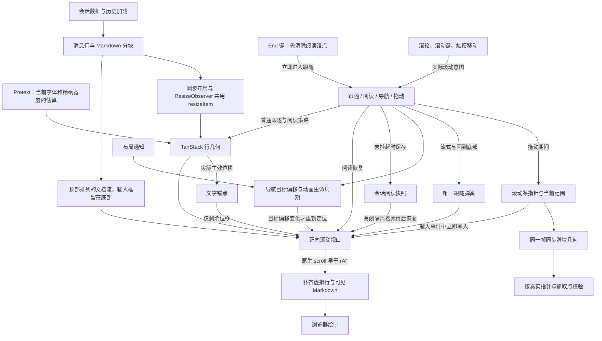

# Wework 消息滚动验证

共享聊天区域使用正常 DOM 坐标：顶部 `scrollTop = 0`，底部 `scrollTop = max(0, scrollHeight - clientHeight)`。桌面工作台、临时会话和网页 Issue 会话复用相同实现。短会话从顶部排列，多余空间留在消息与底部输入框之间；内容超出可用高度后，按跟随或阅读状态处理滚动。滚动条使用同一真实范围。



拖动输入使用同一份当前几何，立即写入视口位置与滑块变换；不能等后续 `scroll` 事件才绘制滑块，也不能另加 rAF 延迟滚动写入。浏览器在 rAF 之前派发原生 `scroll`，虚拟行与 Markdown 分块必须在绘制前补齐新视口；rAF 内才写入滚动会错过该阶段，产生一帧占位或空白。短会话回归场景必须先确认内容不溢出视口，消息条数本身不能证明这一前提。

连续拖动验证在首个采样帧之后读取实际滑块位置，再派发按下事件。固定记录该事件坐标与滑块顶部之差；每帧检查 `abs(thumbTop + grabOffset - pointerY) <= 2`。搜索定位可能在首帧移动滑块，行高变化也可能改变滑块长度；旧指针起点、整数化滑块高度和预设比例都不能代替真实抓取点。

实现约束：

- 消息内容容器使用正向 flex 列，不能用 `justify-end` 或顶部占位将短会话推到底部。TanStack 的末端锚定只控制溢出内容的滚动位置，不改变消息在文档流中的排列。虚拟和非虚拟列表保持相同布局。
- `useConversationVirtualizer` 使用 TanStack 的 `anchorTo: 'end'` 和 `followOnAppend` 处理普通前插、追加与行测量补偿。导航期间使用起点锚定。暂停阅读时关闭追加跟随和末端容差，向上移动几像素也不能重新吸到底部。
- 不维护反向坐标适配器，不依据总高度差猜测前插补偿，不用固定延迟链重试定位。历史加载前采样语义锚点；没有虚拟列表的短会话也按实际文字位移恢复位置。
- 导航加载和已挂载目标共享取消生命周期：新点击、视口输入或外部滚动条输入会取消旧目标，旧异步结果不能重新定位或清除新加载状态。定位命令和完成检查共用包含顶部留白、范围限制的同一个目标偏移。布局通知只有改变目标偏移时才重新定位；首次观察通知和无关尺寸变化不能打断原生平滑动画。
- 按住滚动条期间由指针独占视口，暂停行高补偿、文字锚点及底部跟随。内容实测高度变化时，按最新范围保持滑块抓取点；松手后采样当前位置并交回阅读或底部跟随。拖动帧只存数值快照，不扫描文字锚点。
- End 键与回到底部按钮表达相同的跟随意图：输入阶段清除阅读锚点并进入跟随，不能等待滚动事件再用可能变化的范围推断。随后行高测量仍追踪实际底部；Home 或向上输入立即恢复阅读。
- 内容点击和触摸轻点保持原跟随或阅读状态。指针滚动输入来自滚动条；原生触摸从 `touchmove` 开始记录意图，避免把之后的弹簧滚动误判为手动输入。搜索与回合导航仍由各自的取消生命周期响应点击和触摸开始。
- 等待指示器是虚拟行。列表前的加载按钮通过 `scrollMargin` 计入偏移，列表后的内容页脚和 sticky composer 通过 `paddingEnd` 计入可滚动末尾；真实页脚已在文档流中，列表 sizer 必须扣除这部分高度，避免重复计数。
- 所有行测量统一调用 `resizeItem`，使用 `Math.round(getBoundingClientRect().height)`。同步 Markdown 布局和同一个 ResizeObserver 走相同函数；不再同时调用 TanStack `measureElement`。隐藏行的零尺寸不能覆盖有效测量。
- Pretext 只估算未测量内容，不代替真实 DOM 尺寸。排版使用当前 UI 字体、正文行距和精确宽度；准备好的文本与宽度无关，可跨宽度复用。代码围栏按不折行的真实代码行数估算，过程区按默认折叠高度计算。
- 行高缓存同时校验实际消息列宽、布局类、字体、字体加载版本和消息内容签名。先在布局阶段测量消息列，再启用虚拟列表、恢复有效尺寸或估高；不能用视口宽度代替列宽。消息块按完整内容生成并缓存指纹，同长度内容变化也会失效。展开、编辑和搜索造成的临时高度不作为默认高度保存。缓存最多 50 个会话，任务别名迁移同时迁移快照、尺寸和有效性信息，淘汰时一起清除。
- 搜索先准备匹配范围，再启动一次原生滚动。平滑动画完成前保留导航控制权，`scrollend` 或已到达目标才释放；暂停、目标替换、卸载和用户输入都取消尚未完成的动画。用户输入取消定位后，高亮仍随已加载消息更新。导航结束回调不能抢回已交给阅读或拖动的控制权。
- `overflow-anchor: none` 禁止浏览器成为另一套滚动补偿源。TanStack 负责行几何；阅读锚点只补偿尚未由 TanStack 实际应用的文字位移：`correction = ΔanchorOffset + ΔreaderScrollTop`。自身写入和浏览器范围 clamp 从读者位移中扣除，避免重复补偿。原节点丢失时重新采样，不按旧序号选择另一段文字。
- 切换会话时使用已保存快照，不在卸载阶段扫描长会话 DOM。跟随态只保存距底部为零；阅读态保存距离及可解析的消息、运行时项和文字偏移。搜索或隐藏窗格挂起自动滚动时，同时暂停快照写回；隔离搜索页的临时导航位置不能覆盖原会话快照。恢复生成的滚动事件不能覆盖读者位置。

| 触发                                     | 视口归属及预期                                                        |
| ---------------------------------------- | --------------------------------------------------------------------- |
| 普通追加、等待指示器、流式增长           | 跟随态继续跟随；阅读态保留原位置                                      |
| 自己发送消息或提交 guidance              | 恢复跟随                                                              |
| 向上滚轮、触摸、滚动条拖动、键盘滚动     | 立即取消程序滚动；向上移动即暂停，向下回到底部可恢复                  |
| 点击回到底部                             | 清除手动输入状态并进入跟随；后续高度变化继续追踪，不设释放定时器      |
| End 键                                   | 在键盘写入前进入跟随；后续测量不能被旧阅读锚点拉回                    |
| 搜索或回合导航                           | 取消已有命令；目标真实布局和 `scrollend` 决定定位完成，用户输入可中断 |
| 打开侧面板、字体变化、展开消息、前插历史 | 更新真实尺寸，保留同一文字位置                                        |
| 隐藏窗格                                 | 挂起滚动；恢复显示后按原跟随或阅读状态处理                            |

以下历史顺序和发送约束继续保留：

- 重新打开长会话时，规范化的 turn 级会话视图必须以 executor transcript 返回的全局 `messageIndex` 合并。分页快照中缺失的本地已停止回合只能回到它原本的位置，不能被追加到最新 AI 回复之后；没有索引的临时回合才使用消息时间戳作为次级排序依据。Provider transcript 分页仍由 Provider 自己管理：只能按稳定 ID 去重，不得把本地已停止回合合并进去，也不得绕过 Provider 分页。
- 空闲任务提交新目标时，目标与首条指令必须通过一次 `runtime.tasks.send` 原子发送。Codex 的 `thread/goal/set` 会自动启动目标回合，executor 必须等待该回合，不能再额外调用 `turn/start`，否则真实回合的输出会被错误归到旧位置，而空转的重复回合会在 180 秒后显示“消息生成失败”。
- 回归测试必须在真实 Electron 应用的长历史会话中发送消息，暂停模型响应，并检查滚动容器位于底部且等待指示器完整位于容器边界内。

## 流式渲染职责边界

流式正文和滚动跟随各自只能有一个调度源，不能同时叠加组件动画、直接滚动和延迟滚动定时器：

- `useBufferedStreamingText` 只负责把同一帧内的正文更新合并到下一动画帧。它不得维护慢于权威消息内容的逐字揭示队列；下一帧必须提交当时最新的完整前缀，后台帧不可用时必须由短超时兜底。
- `Streamdown` 继续使用 `streaming` 模式做增量 Markdown 解析；非尾部 Markdown 块继续使用现有窗口化和冻结逻辑，不能因动画重建整棵消息树。
- `ScrollableMessageArea` 的流式自动跟随只由一个阻尼弹簧驱动。ResizeObserver、消息追加和运行态变化只能请求这个弹簧继续追踪最新底部，不能同时调用流式直跳或稳定滚动定时器。
- 弹簧持有底部跟随权时，关闭 TanStack 的自动追加跟随和末端尺寸补偿；几何仍由虚拟列表维护。阅读态由 TanStack 补偿视口前的行高变化，文字锚点只补偿剩余的行内重排。
- 用户主动向上滚动、导航或自动滚动挂起时，立即取消弹簧和 TanStack 未完成的滚动命令。回到底部也复用同一弹簧，不能另起平滑动画。
- `prefers-reduced-motion` 下跳过弹簧运动，直接定位到底部。

仅在用户明确要求时运行 E2E 和 `ai:verify`；日常执行聚焦单元测试及类型检查。桌面回归入口：

```bash
cd wework
pnpm e2e:desktop:streaming-text
```

该场景使用真实后端请求，并由桌面 E2E harness 提供确定性的 SSE 响应流。测试会在服务端开始输出前暂停响应，以稳定覆盖用户消息先渲染、等待指示器和虚拟列表随后完成测量的竞态；不得通过跳过、mock 前端请求或放宽底部与可见性断言来掩盖滚动回归。

流式渲染改动还必须覆盖帧内合并后立即显示最新完整前缀、Unicode 内容、弹簧收敛、用户上滚暂停和回到底部恢复。真实 Electron 场景需要保留用户上滚前后的锚点截图，并确认后续流式追加不会移动该锚点。回到底部回归必须发送真实的指针按下与点击事件，并在点击后继续追加足以改变虚拟列表高度的内容，最终断言距离底部不超过滚动容差。

消息顺序回归还会先停止一轮响应，再发送 26 个新回合使旧回合离开默认 transcript 分页，切换到其他任务后重新打开原任务，并确认底部显示最新 AI 回复而不是“已停止”提示。

`latest-conversation-history` 桌面检查点覆盖历史中存在无消息项的失败回合：先打开最新分页，再加载包含失败回合的旧分页，切换任务后重新打开并确认最新回复仍在底部。无消息项的回合必须使用已有的开始时间或完成时间参与排序，不能因为缺少消息时间戳而让整段历史停止排序。该检查点通过真实 Executor、Codex 历史存储和 Electron 界面验证，模型服务使用测试响应。

## Markdown 分块窗口化契约

Markdown 窗口化继续保留离屏分块的懒渲染。普通块只有进入真实聊天视口上下各 1600px 的预渲染范围才挂载完整 Markdown；更远的块使用占位，不能通过把所有块设为 eager 来规避闪烁。流式回复的首尾块立即渲染，不可再分割且达到 4000 字符的超长块在流式结束和重新打开后仍完整渲染。

- `MarkdownWindowingScope` 使用消息列表传入的实际滚动容器作为交集 root。没有 scope 时，容器查找会跳过显式 `overflow: visible` 的内容包装层，不能让浏览器视口的 rootMargin 被嵌套滚动容器裁掉。
- 新虚拟行首次挂载或可见行范围提交时，在布局阶段检查预渲染范围；已经出现在可见区的块不能先绘制占位再等待 IntersectionObserver。滚动时由消息列表读取一次视口几何，收集需要激活的块并一次同步提交。IntersectionObserver 继续管理离屏释放，但回调必须复查当前几何，防止旧交集记录把已经入屏的块退回占位。
- 高度缓存只保存完整 Markdown 的真实尺寸，以精确正文和实测宽度为键，在同一个会话列表的外层虚拟行卸载、重挂载之间复用。每个 scope 最多保留 256 个正文/宽度组合，按 LRU 淘汰；会话或滚动容器 scope 改变时重新建立缓存。正文变化或宽度变化不能复用旧尺寸，没有匹配记录时才使用估算。
- 占位使用匹配的真实高度；完整 Markdown 仍按当前布局自然排版，不用旧高度撑住变矮的内容。块使用独立的 `flow-root` 布局，段落外边距必须计入块的测量范围。
- 完整块在布局阶段同步通知所属消息行，虚拟列表用 `resizeItem` 更新该行的真实尺寸，然后沿现有布局回调交给 `ScrollableMessageArea` 保持阅读锚点或跟随底部。Markdown 不写 `scrollTop`，不新增滚动补偿或底部跟随调度源。
- 真实消息行高度含小数时，所有主动 DOM 测量的 `resizeItem` 路径统一使用 `Math.round`，同步布局与共享 ResizeObserver 保持一致。初始高度估算仍可向上取整，但不能把估算规则用于真实行测量，否则同一行会在同步测量与异步测量间反复增减 1px，触发无意义的锚点补偿。
- 前面的分块完整渲染或释放时，会插入或删除标题、段落等语义锚点。补偿必须继续测量原来的实际阅读节点，并确认它仍属于当前内容和同一消息；不能按消息内的旧序号找另一段文字。原节点被卸载、替换或失去锚点标记时，放弃本次无法归因的补偿并重新采样。这项修正保留上述离屏懒渲染和超长流式块完成后保留的策略。

验证使用包含多个虚拟消息行的长历史会话，正文至少包含可分块的标题、换行较多的列表或表格、长行折行，以及一个不可分割的超长代码块。先检查已结束对话，再检查底部仍在生成的对话；以下步骤需要保留尺寸记录和真实 Electron 画面：

| 用例               | 操作                                                                                 | 预期                                                                                                                  |
| ------------------ | ------------------------------------------------------------------------------------ | --------------------------------------------------------------------------------------------------------------------- |
| 提前排版与离屏释放 | 从底部上滑，让普通块进入预渲染范围，再滑离该范围                                     | 入屏前已有完整 Markdown，更远的块仍使用占位；外部滚动容器与内部滚动容器都使用各自的真实视口                           |
| 首次可见与快速上滑 | 快速跨过多个外层虚拟行，使未挂载过的历史行直接进入可见区                             | 首个采样帧就有完整 Markdown 和实际可见文字，没有可见占位，不在随后帧中二次撑高                                        |
| 高度复用           | 同一宽度下先完整渲染一块，再让所属虚拟行卸载，随后回到该行                           | 占位复用对应真实高度，入屏时完成排版；不会重新退到 1200px 的高度上限                                                  |
| 宽度和正文变化     | 打开、关闭侧面板，或让同一流式块继续增长，再重复往返滚动                             | 使用当前正文和宽度的尺寸；阅读位置保持稳定，旧宽度或旧正文的记录不能撑出永久空白                                      |
| 同一阅读节点       | 在一个段落处停住，让同一消息前面的块完整渲染或释放；再覆盖当前段落替换和虚拟行重挂载 | 前面新增、删除语义锚点不改变当前采样节点，补偿只对应原节点的实际位移；原节点离开 DOM 时重新采样，不按旧序号补偿另一段 |
| 小数行高一致       | 在宽度和正文不变时，检查带小数高度的消息行经过同步布局测量和原生 ResizeObserver 复测 | 两条测量路径得到同一整数行高，重复测量的 `sizeDelta` 为零，不出现交替的 −1px/+1px 锚点补偿                            |
| 流式完成与恢复     | 等待超长代码块完成，再切换任务并重新打开                                             | 在同一次挂载内保留代码 DOM 和高亮，完成和重新打开后不退回估算占位；普通远处块仍可懒渲染                               |
| 阅读与底部跟随     | 在底部继续生成时上滑停住，再点击“回到底部”并继续追加                                 | 历史阅读锚点保持，恢复后跟随最新底部，没有第二个滚动调度源                                                            |

已有 `rendering-extensions` 桌面回归使用 `sampleRapidMarkdownWindowing` 在一个动画帧滚动，从下一帧开始连续采样四帧，再执行下一次滚动。结果保存为 `streaming-text-rapid-markdown-windowing.json`，只包含尺寸、数量和状态。断言要求远处仍有占位、每个采样帧都没有可见占位且有完整 Markdown 和实际可见文字、已结束块连续可见时高度变化不超过 1px。离屏提前排版可以改变高度，整体最大高度差用于分析，不要求为零。使用上面的桌面回归入口执行该检查，不增加独立测试命令。

新增的 `streaming-conversation-switching` 覆盖四个真实回合、八个消息行和可窗口化的标题段落；持续按住滚动条并跨九个位置移动，每个位置连续采样四帧，检查指针与滑块一致、可见区没有占位且包含真实正文，再检查 Home、End 和切换后阅读位置恢复。它复用现有 CI 桌面检查点。

## 快速滚动闪烁诊断

滚动诊断必须由诊断控制接口或反馈入口显式开启；普通滚动输入不会自动启动采集。采集窗口为 10 秒，最近 400 条记录保存在当前页面内存中。窗口外不做额外的 Markdown 尺寸读取，也不向控制台逐帧输出。记录仅包含临时滚动区域编号、行/块序号、长度、尺寸和状态；不会记录正文、文件路径、任务 ID 或消息 ID。

默认验证环境使用独立执行器目录。需要在明确指定的现有目录中复现长历史对话时，可以传入绝对路径；窗口数据和验证日志仍然隔离，执行器会使用该目录的真实数据。`--executor-home` 不能与首次 Codex 初始化测试同时使用。

```bash
WEGENT_EXECUTOR_HOME="/absolute/path/to/executor-home" pnpm --filter wework ai:verify start --executor-home "/absolute/path/to/executor-home"
pnpm --filter wework ai:verify conversation-diagnostics --session <absolute-session-path>
```

控制接口可以在复现过程中定期读取上述快照，避免只导出停止滚动后的最后 400 条事件；快照返回数值和状态，不返回对话正文。测试完成后用同一绝对会话路径执行 `ai:verify stop`。

如果仍有偶发抖动，但普通记录中没有非零锚点补偿或锚点丢失，可以在同一验证会话启用额外的动画帧探针。探针默认关闭，只在显式启用后的读者输入窗口内运行；它读取真实节点和字符位置，不修改阅读锚点、滚动位置或跟随权，输入窗口结束后停止采样。

1. 启动上述验证会话，打开需要测试的长历史对话。
2. 显式启用探针，`--value` 必须为精确的 `true` 或 `false`，无需 selector：

   ```bash
   pnpm --filter wework ai:verify conversation-frame-probe --session <absolute-session-path> --value true
   ```

3. 在手势开始前启动控制接口对 `conversation-diagnostics` 的持续读取，再从底部快速上滑，发生抖动后停住。边滚动边保存快照，按会话启动时间和事件 `sequence` 去重；不要只在停止后读取一次。帧记录和滚动事件共用 400 条环形缓冲区，需要检查序号缺口及 `droppedEventCount`，及时缩短读取间隔。
4. 对照 `anchor-frame` 中同一实际节点和字符的当前位置、预期位置、最近滚轮输入，以及对应的真实滚动写入和行测量事件。重新采样可能换到同一段落中的另一行，探针会先重测上一帧的原字符，再计算 `frameLayoutShift`，避免把换采样点当成布局位移；节点已离开 DOM 的记录不能作为连续同点位移证据。
5. 采集结束后关闭探针，再停止验证会话：

   ```bash
   pnpm --filter wework ai:verify conversation-frame-probe --session <absolute-session-path> --value false
   pnpm --filter wework ai:verify stop --session <absolute-session-path>
   ```

复现闪烁后，也可以保持当前窗口，立即打开问题反馈并保留“运行日志”，生成预览。反馈包可包含 `logs/webview/conversation-diagnostics.json`；刷新或关闭页面会清空记录。检查预览中的记录及 `droppedEventCount`，确认闪烁发生的时间段仍在包内。反馈导出会复用脱敏流程；诊断文件超过 256 KB 时会被跳过，预览会给出提示。开启帧探针后应优先通过控制接口持续导出，不能假设最后一份快照一定能放入反馈包。只有包含本诊断改动的构建才能导出此文件。

按时间顺序对照以下事件，区分 Markdown 切换、虚拟测量和滚动补偿：

| 事件                                        | 判断依据                                                                                                                                                                                                                                                                        |
| ------------------------------------------- | ------------------------------------------------------------------------------------------------------------------------------------------------------------------------------------------------------------------------------------------------------------------------------- |
| `markdown-intersection` / `markdown-layout` | 同一块从 `rendered: false` 变为 `true` 时，比较 `previousHeight`、`height`、`heightDelta`。同时检查交集范围与聊天滚动区域几何，判断是否在进入可见区后才开始完整渲染。                                                                                                           |
| `virtual-measurement` / `virtual-range`     | 比较普通历史行的 `previousSize`、`measuredSize`、`sizeDelta` 和可见行范围，确认切换是否引起整行重新测量。                                                                                                                                                                       |
| `anchor-lost` / `anchor-sample`             | 检查快速跨行滚动是否卸载了旧阅读锚点，以及重新采样是否成功。                                                                                                                                                                                                                    |
| `anchor-correction` / `scroll-position`     | 比较请求的 `correction` 和实际写入的 `appliedCorrection`，确认布局变化是否被补偿或被范围限制。                                                                                                                                                                                  |
| `anchor-frame`                              | 显式启用探针后，比较 `anchorOffset`、`expectedAnchorOffset`、`frameShift`；使用 `trackedNodeId`、`trackedTextOffset`、`trackedConnected` 和 `frameLayoutShift` 判断同一实际字符是否存在未被读者滚动解释的位移。`lastWheelDeltaY` 和 `lastWheelAgeMs` 提供最近输入的方向与时距。 |
| `scroll-write`                              | `writeSource` 为应用滚动写入来源的数字编号，结合 `previousScrollTop`、`targetScrollTop`、`scrollTop` 和 `appliedCorrection` 区分请求偏移和实际生效偏移；锚点补偿仍对照 `anchor-correction`。                                                                                    |

这些尺寸记录能定位布局跳动，但不能单独证明每一帧都没有视觉闪烁。此前仅检查“视口存在文字”的快速滚动测试允许纯文本占位通过；新的逐帧采样会分别检查占位、完整 Markdown 和文字几何。动画帧探针同样记录 DOM 几何，不采集绘制像素；真实绘制仍应结合 Electron 画面、录屏和安装包的版本/构建 commit，与上述时间线共同判断。

目标续跑回归会先确认同一个 `runtime.tasks.send` 请求同时携带目标和首条指令，再读取真实 executor 日志，确认目标提交只等待 `thread/goal/set` 自动启动的一个回合、没有额外 `turn/start`，并确认持续输出和完成后都没有出现错误卡片。
