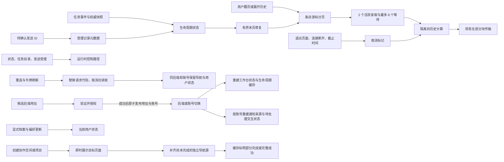
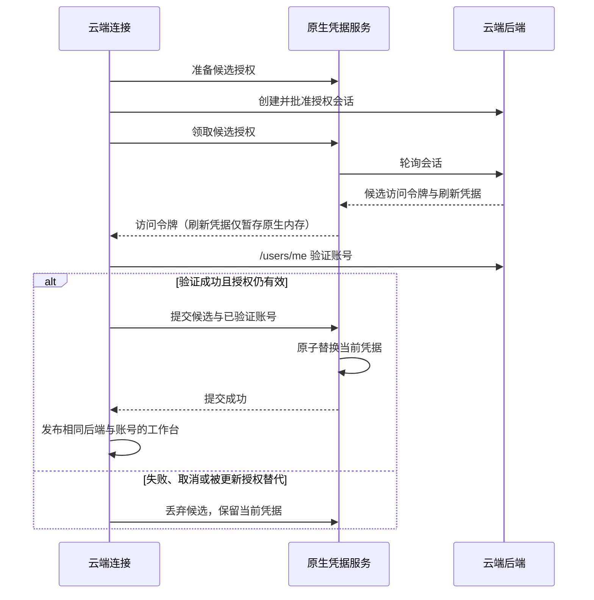

# Wework 长会话与运行时响应性

任务控制、任务目录和历史正文承担不同职责。长会话可以包含数千次工具执行，
但打开历史、终态同步和重连恢复不能因此阻塞其他任务的查询或操作。

## 故障依据

2026-11-03 的安装版本（源码 `a19aa4b`，不同于本次修复基线）两次读取同一会话，
分别耗时 176,741 ms 和 232,519 ms。
配置为 75 秒的执行器超时到计算结束才触发。另一个状态请求在客户端超时后才进入
执行器 handler，实际状态处理仅耗时 1 ms。采样捕捉到同步历史投影和 JSON 复制；
这证明了重计算没有隔离，不能据此认定所有 Tokio worker 均已耗尽。

故障历史约 83 MiB，只有约 12 轮，其中一轮包含 7,363 个完成条目。
按轮数分页不能约束工作量。原终态协调器请求 `includeFullContent: true`，
其语义会遍历所有历史页面，`limit: 50` 不是总量上限。

另一个普通任务在收到 `turn_settled` 后，执行状态仍保持运行，直到约 69 秒后的
权威快照才变为空闲；当时没有活跃 Goal。这证明了终态确认延迟，不能把这段等待
全部归因为历史投影。

## 目标边界

- 生命周期首先消费任务事件和权威状态。完整直播内容与权威终态均已存在时无需补读。
  必要的内容修复只读有界末页，不恢复原生会话，也不扫描全部正文。
- 普通轮次结束后停止“正在思考”展示；执行是否仍占用任务由权威状态决定。
  活跃 Goal 可在两轮之间继续执行，不能根据一段最终文本或单轮结束推断整个任务空闲。
  原生执行已有明确终态时，提供方的单轮完成状态不能改写整个执行的成功、失败或取消结果。
  本地任务通过已有的任务查询接口独立确认状态，不等待正文修复；项目会话仍使用
  经过项目授权的原读取路径。
- 停止与压缩前的提供方状态检查只读取当前线程状态和最近轮次元数据，不读取正文、
  不占用历史计算槽位。当前线程为活跃状态时，历史元数据合成的 `interrupted`
  不能作为轮次已结束的依据。
- 重连恢复先发布任务状态；每个任务的内容恢复独立执行，并限制同时恢复的数量。
- 事件补偿、重连和系统恢复只按当前待确认消息 ID 查询受理记录，确认来自已绑定原生轮次的记录，可覆盖
  末页之外的消息。正文缺席不表示消息未受理；缺少回执时保留待确认状态并记录错误，
  不自动重发。空回执列表也不能证明拒绝受理：消息可能已在执行器排队，尚未绑定轮次。
  查询开始后新提交的消息不能被旧查询重新排队。
  执行器重启后，早于新事件日志起点的旧游标触发事件缺口恢复，不能被当成本进程可回放的游标。
  项目和云端会话通过既有授权链路转发查询与回执，不新增绕过项目权限的读取入口。
- 普通历史使用条目游标。限制条目数和页面字节；一轮很长时仍可继续分页。
  自动分页直接跟踪不透明的 `beforeCursor`。缓存首项未变不代表游标没有前进；只有
  游标和显示边界都未变化时才停止自动请求并保留手动恢复。
  全文导出属于显式操作，不能成为后台终态处理的前提。
  原生 rollout 首次建立偏移索引仍需扫描文件，但在可取消的隔离工作线程执行；后续读取
  增量更新索引，并只加载所选页面的条目正文。
  rollout 游标绑定源文件身份与完整已索引前缀的长度和摘要，不绑定内存索引实例。
  索引淘汰或进程重启后可在重建扫描中验证旧游标；正常追加保留旧边界，替换文件或
  改写已索引内容则拒绝旧游标。摘要随现有扫描增量计算，不为正常分页重复扫描全文。
  明确标为 `historyMode=legacy` 的会话从规范 rollout 复用 legacy 投影，不能请求其
  不支持的 `thread/items/list`。正常分页最多保留 100 条正文和 2 MiB，单个超大条目
  可独占一页；扫描逐记录检查取消，保留 synthetic ID、回滚和迟到终态语义。
  该 legacy 路径每页仍顺序扫描元数据至文件末尾，不能宣称具有增量索引的读取成本。
- 保留已有完整内容和顺序语义。页面字节预算允许单个超大条目独占一页，继续使用
  无损分块传输；这不是严格的单条正文内存上限。严格限制单条正文需要独立的
  正文引用与按需加载契约，不能通过静默截断或拒绝已有有效会话实现。
- 投影在有并发上限的工作池中执行，工作许可一直持有到计算真正退出。
  异步调用取消后，计算在有限条目批次的检查点退出；只丢弃 JoinHandle 不构成取消。
- 原生历史页先读取轻量任务元数据，再按页面选择提示词与交互覆盖项，避免在共享
  任务锁内复制完整历史缓存。活跃轮次先过滤已完成条目，再复制需要补入的正文。
- 相同会话、范围和读取选项共享一次读取。每个页面持有独立订阅；一个页面退出不能
  取消其他页面仍依赖的读取，最后一个订阅退出才取消底层工作。
- 本次 IPC 取消与并发准入只适用于同一认证连接持有的
  `runtime.tasks.transcript` 请求；搜索接口保持现有契约。
  正常并发读取按 FIFO 等待，不因两个活跃槽位已满而立即失败；等待也受原有
  截止时间、连接退出和请求取消控制，过期的等待请求不能启动计算。
  发送、停止和其他写操作的结果不能
  因 HTTP 断开被当成未受理；已有消息身份与幂等语义保持有效。
  搜索及搜索结果上下文的旧计算路径未纳入本次隔离改造，不能宣称其中所有阻塞计算
  均可协作取消。
- 单次读取超时、主动取消和读取繁忙是局部操作状态，不表示执行器进程已退出。
- 任务列表分别表达初始加载、成功空、刷新和失败；同作用域刷新失败保留最近成功数据。
  后端或账号改变后清理旧快照，迟到响应不能覆盖新作用域。相同归属的重连或令牌刷新
  只替换请求代际，不清空当前项目、会话或导航，不卸载仍在使用的协作面板。
  云端任务与设备缓存使用相同的后端、账号作用域；不把缺少后端身份的旧缓存当成
  新后端的数据，也不因旧请求退出而放弃新作用域的同步。
  列表和设备响应只负责发现数据，不能用请求开始时的用户快照覆盖刚更新的档案或
  模型偏好；当前账号的用户状态仅由明确的档案和偏好更新改变。
  Electron 本地登录与已连接的云端账号可以不同。列表刷新使用与运行时服务相同的
  工作台账号，不能把本地登录账号写回已连接账号的状态，再依赖后续 effect 修正。
  工作台组件、共享生命周期缓存及其持久化命名空间使用相同的后端与账号身份；真正
  切换归属时一起重建，避免摘要查询恢复旧任务，或旧组件状态污染新缓存。相同归属的
  令牌更新不重建这些状态；不迁移缺少归属信息的旧生命周期缓存。
  最后选择的项目也按完整的后端与账号身份读写，不能只按本地登录用户或云端数字
  用户 ID 保存，避免不同后端的相同 ID 互相覆盖。
  全局通知来源与待处理交互的历史、草稿及已受理记录也使用相同的后端和账号归属，
  避免本地登录账号不变时沿用上一个云端账号的计数和回复。
  连接尝试的候选配置只在本次授权内使用；成功后与认证账号一起发布。失败不能把旧
  账号与候选后端组合为新的归属，也不能因此卸载仍在展示错误和恢复操作的连接弹窗。
  候选授权进度独立于当前连接，授权期间保留当前账号的令牌与服务，失败不改变当前
  连接。当前凭据过期时按本地账号重建工作台，不能在旧云端页面中调用本地服务。
  原生刷新凭据同样先暂存为候选，验证账号后才提交；失败或取消只丢弃候选，不能在
  授权轮询成功时就覆盖或删除当前账号的刷新凭据。
  所有刷新请求携带预期账号；原生凭据必须同时匹配后端与账号。缺少账号归属的旧
  凭据通过真实刷新和 `/users/me` 验证后才能绑定，验证前不能向调用方返回令牌。
  原生提交发起原子替换后，后续待验证候选不能撤销已提交账号；页面按提交顺序发布，
  断开操作独立使旧提交失效，避免迟到回执恢复已退出账号。

- 协作导航缓存区分尚未完成、已完成但部分失败、完整成功。创建空间或项目只补充
  目标对象，不能据此认定导航读取已经结束。路由切换后即时展示目标页面，同时补齐
  尚未完成的目录，避免迟到的本地空间永久缺失。已完成的部分缓存仍可复用已覆盖的
  目标，云端失败不会阻止本地空间继续使用。
- 内置浏览器的设备模拟在生效期间持续持有共享调试会话。页面读取与文件上传只持有
  各自操作期间的临时会话；临时操作结束不能断开仍用于模拟尺寸的 CDP 连接。
  模拟尺寸的设置和清除串行执行，关闭页面时释放持有者，避免尺寸因调用交错而回落。

## 验证契约

| 场景                                 | 必须保持的结果                                       |
| ------------------------------------ | ---------------------------------------------------- |
| 单轮 7,000 个以上工具条目            | 正常读取有界；遍历游标后内容完整且无重排、遗漏或重复 |
| 重历史读取期间查询状态               | 控制路径可继续响应，不等待历史转换结束               |
| 正文读取截止、HTTP 断开、页面退出    | 正文工作取消，许可在计算真正退出后释放               |
| 两个页面共享读取，一个退出           | 另一个仍得到完整结果，底层工作不会提前取消           |
| 旧终态与新一轮提交交错               | 旧结果不得结束新轮次或覆盖其内容                     |
| 初次列表失败及刷新失败               | 显示局部错误和重试；不显示虚假空状态或清空有效快照   |
| 同作用域刷新与切换账号               | 独立结果及时发布，旧响应不能泄漏到新作用域           |
| 相同账号重连和用户偏好更新交错       | 保留当前项目、会话与新模型选择，丢弃旧传输结果       |
| 导航未完成时创建并打开云项目或空空间 | 目标即时展示，本地目录迟到后正常补齐                 |

本地运行针对性的 Rust、组件和协议测试。桌面场景复用 CI 的 checkpoint runner；
按仓库执行策略，未明确要求时不在本地运行 E2E 或 `ai:verify`。

桌面 CI 在实际正文传输期间并发查询健康、任务状态、任务列表与渲染器快照，
这些控制查询每项须在 3 秒内完成。完整历史通过界面逐页恢复，保留原有大输出与
内容完整性断言；终态后观察请求边界，禁止后台启动全历史扫描，并确认思考提示消失。
回执恢复场景复用已有的运行中回复，通过界面明确入队，再释放原回复进入真实发送；
不能把空闲时的直接发送当成待发队列。保留两次 Electron 重启，另增加一次执行器
SIGTERM 后由 supervisor 拉起的真实恢复验证。

诊断应记录请求 ID 和阶段耗时：客户端发起、IPC 接收、准入、提供方读取、投影、编码、
排队、客户端接收。只记录条目数量、字节和状态，不记录正文、凭据或会话文件内容。
