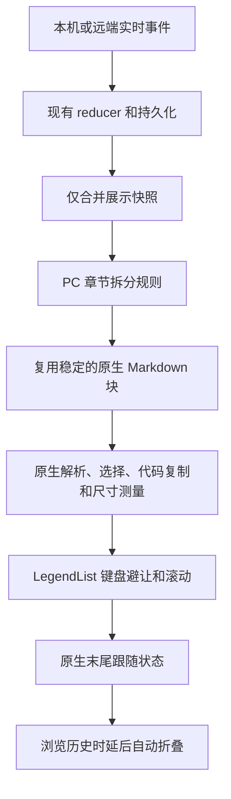

# 手机版会话内容渲染

手机版使用 LegendList 和原生 Enriched Markdown，复用 PC 的 Markdown 缓冲和章节拆分规则。
Minis 的流式批处理、完成块复用、原生选择和浏览位置保护作为实现参考；会话数据、工具状态与执行协议仍以 PC 为准。

## 流式与完成内容

- 运行时事件正常进入 reducer；缓冲只影响展示，不延迟保存、用户输入请求、取消或完成状态。
- 历史与流式消息合并时保留已加载邻接消息，并按原生快照校正已知消息的顺序；通过运行时的 `clientUserMessageId` 精确关联用户消息与回复。历史读取与发送并发时，用户消息仍位于对应回复之前，不按客户端时间戳猜测归属。
- 手机版按文本长度使用 48、96、160ms 的合并窗口，再在下一帧提交；持续收到增量时不重置截止时间。
- 第一段内容、内容替换、完成、失败和中断立即显示当前完整快照。卸载时清除待执行的批处理、帧和保底计时器。
- PC 默认仍按下一帧刷新。共享调度使用跨平台全局 API，Metro 和测试解析器将共享 Hook 绑定到手机版同一份 React。
- 长文本沿用 PC 的标题章节边界和代码围栏处理；已有章节以稳定位置复用。存在引用定义时保留整段源文，防止链接定义与引用分离。
- 没有安全章节边界的长代码、表格或段落保持完整。这是渲染复用，不是把每个 Markdown 节点改成独立虚拟列表项。
- 已完成的处理段按源 block 身份复用；正文尾部的增量不会重建已完成工具组。原生组件负责后台解析和包含宽度、字体缩放的尺寸缓存。

## 选择与代码操作

正文长按交给系统文字选择，不再叠加助手消息的 JS 长按菜单。保留短按收起键盘、链接和文件预览。
原生菜单提供“复制”“复制为 Markdown”“复制整条消息”和图片地址操作。整条复制读取当前源文，包含所有章节。
用户消息原有复制菜单保持不变。

GFM 原生代码块负责语言标题、代码复制、横向滚动和高亮。未闭合代码围栏逐步展示，复制与高亮按组件规则在闭合后启用；不增加第二套代码解析或复制按钮。

## 阅读位置

通过 LegendList 的 `isFollowingEnd` 订阅当前跟随状态。用户翻历史时，新的处理记录自动收起和活跃工具预览隐藏会延后到回到末尾。
已经收起的内容不会因浏览历史而重新展开；手动展开与收起仍即时生效。切换会话释放旧订阅和消息组件状态。
尺寸变化仍由 LegendList 补偿，不增加逐增量滚动、计时滚动或高度缓存。

## 验证边界

组件测试覆盖连续流式刷新、终态与替换、最后一段、章节复用、引用定义、代码围栏、复制失败、原生订阅释放及浏览中折叠。
PC 缓冲回归、Mobile 类型检查、完整单元测试和双平台导出用于验证交付。原生选区拖拽、代码块手势及实际流畅度需真机验证；JS 测试不代表已经通过真机交互。
