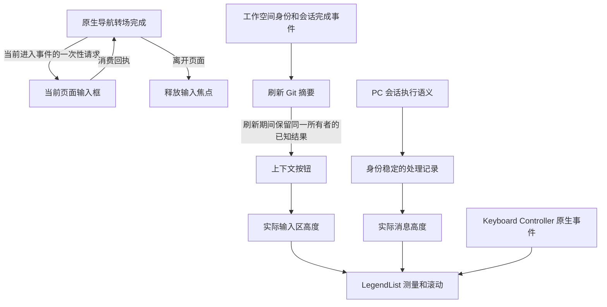

# 手机版滚动与键盘生命周期

手机版沿用 PC 的会话、工具执行和工作空间归属语义，导航、键盘和消息测量由原生组件负责。

## 组件选择

| 职责                     | 组件                             | 使用边界                                                                    |
| ------------------------ | -------------------------------- | --------------------------------------------------------------------------- |
| 原生导航                 | React Navigation native-stack    | 统一启用 `keyboardHandlingEnabled`，处理页面离开与交互式返回                |
| 键盘动画、拖拽和表单避让 | react-native-keyboard-controller | 单个根 Provider；聊天使用 LegendList 集成，表单使用 KeyboardAwareScrollView |
| 聊天虚拟列表             | LegendList                       | 同时管理内容锚定、末尾跟随与键盘 inset；业务层不按每个 delta 手动滚动       |
| 原生富文本               | react-native-enriched-markdown   | 保留稳定的段落身份，让组件按实际内容重新测量                                |

键盘库最低使用包含 iOS 焦点回收修复的稳定版本，当前锁定为 **1.23.0**。
上游 [PR #1678](https://github.com/kirillzyusko/react-native-keyboard-controller/pull/1678)
修复了 iOS 26+ 导航移除输入框与延迟失焦之间的竞争；
[发布记录](https://github.com/kirillzyusko/react-native-keyboard-controller/releases/tag/1.23.0)
还包含预加载键盘闪现的修复。修改原生依赖后必须更新 Pod 锁文件并验证原生编译，JS 导出不等于原生验证。

[FlashList](https://shopify.github.io/flash-list/docs/usage/) 也提供聊天锚定能力，但替换虚拟列表不能解决业务组件反复插入、移除内容造成的高度变化。
当前使用 [LegendList 官方键盘集成](https://www.legendapp.com/open-source/list/v3/api/)，不能因看到跳动就关闭锚定或叠加自制滚动补偿。

## 焦点和布局的所有者

- 新会话焦点请求属于一次页面进入事件，转场完成后才下发，消费后立即清除。取消转场、离开页面或不可编辑时作废，不在恢复页面或发送完成后补执行。
- 隐藏页面只释放自身输入框，不用延迟回调或全局 `Keyboard.dismiss()` 干扰下一页。恢复页面不会自动恢复旧焦点。
- iOS 的滚动收键盘使用 `interactive`，Android 使用 `on-drag`；React Native 在 Android 上把 `interactive` 视为 `none`。
- 保留 `keyboardShouldPersistTaps="handled"`，使链接和按钮第一次点击有效。消息正文的短按显式收起键盘，长按复制保持独立。
- Git 摘要刷新期间保留同一文件所有者的已知结果，避免空摘要或非 Git 目录反复插入 loading 按钮。换设备、目录、任务或 API 所有者时隔离旧数据并取消旧请求。
- 工作列表快照刷新不等于工作空间身份改变。文件上下文按 `deviceId/path/taskId/workspaceSource` 稳定化，字段不可丢弃。
- 工具段 key 使用源 block 身份，不使用完成数量、最后一个成员或显示行类型。整个处理记录只在真实终态折叠，连续工具之间保留活跃预览及用户展开状态。

PC 参考实现：`wework/src/lib/workbenchComposerFocus.ts`、`packages/collaboration/src/conversation/AssistantMessage.tsx`、`blocks/ToolBlocksDisplay.tsx`、`assistantMessagePresentation.ts`、`useConversationVirtualizer.ts`，以及 `wework/src/lib/workspace-target.ts`。

## 回归和诊断

组件测试覆盖重复进入页面、取消转场、失活请求、平台拖拽、消息短按、同一工作空间刷新、API 所有者切换、连续工具状态变化和展开状态保留。执行 Mobile 的类型检查、完整测试及双平台导出；原生视觉效果另需真机确认。

通过「设置 → 诊断 → 诊断日志」按需开启，默认关闭，变更立即生效并跨启动保留。关闭时不挂载排版采集回调，也不计算诊断快照；开启后保留尺寸、内容尺寸和 viewport 变化事件，仅对滚动事件按 200ms 节流。记录数量、状态和几何数值，不记录消息原文、文件路径或认证信息。输出进入系统日志，不再每 500ms 重写文件。分析一帧跳动时不能用 200ms 采样日志断言没有尺寸回退，也不能把其他会话时间段的日志当作当前录屏的证据。

启动诊断覆盖原生启动与 React 挂载、诊断偏好读取、Backend 会话恢复与健康检查、云端连接及设备发现、本机身份读取与原生启动、事件恢复、缓存恢复、模型目录读取、任务列表请求与快照提交，最后记录会话列表的 React 提交和原生布局。`[MobileLifecycle]` 使用操作名、独立 span、阶段、操作耗时和自 JS 诊断模块初始化的累计耗时关联并行操作；失败仅记录异常类型。偏好尚未读取完成时最多暂存 128 条固定生命周期元数据，只有读取结果为开启才输出，关闭则丢弃。

列表诊断同时记录缓存是否恢复、执行端状态、是否有选中设备及真实工作快照、loading、会话数和失败源数量。只有选中范围的真实快照已存在且 loading 结束，才能记录列表提交完成；空列表也遵循此条件。不能把原生进程启动、网络连接成功或 loading 变为 false 单独当作列表加载成功。诊断不新增请求、重试或等待条件。
