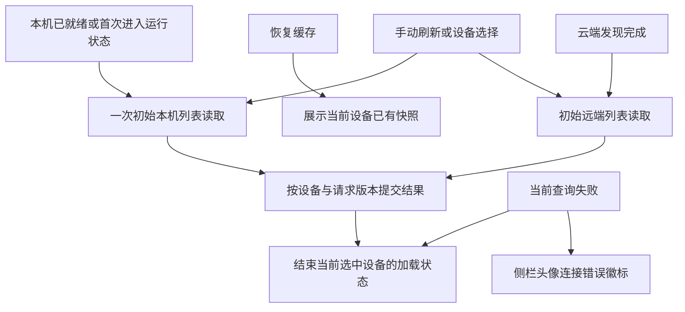

# 手机版列表加载状态

“这台手机”的列表经原生 IPC 读取本机 executor。云端设备发现、模型目录和缓存恢复不能决定本机列表是否可见。
执行协议和所有权沿用 PC 的 `listRuntimeWork` / `runtime.tasks.list`。

- 本机可用性在订阅时检查一次，因此已经运行的 executor 不依赖下一次状态变化才开始读取。
- 每个手机环境的首次读取独立于云端发现。云端稍后返回时不重复发起这次本机读取。
- `reloadWork` 管理单设备查询开始和结束的 loading；只有请求版本仍最新且设备仍被选中时才能结束转圈。
- 已有快照立即可见，刷新不会清空列表。迟到的缓存恢复依据当前保留的快照判断 loading，不能重新遮住刚到的本机结果。
- 查询失败也结束转圈，并沿用头像重试徽标。后续前台、重连或可用性变化不会自动重试；显式刷新仍重新读取。
- “全部设备”继续逐个提交已返回的设备，保留现有部分结果行为。

列表传输记录 `local`、耗时和任务数量，不记录消息、路径、账号或凭据。它用于区分实际 executor 查询延迟与页面加载状态被其他请求阻塞。
本次不改变列表内容、不引入替代数据源，也不修改 Backend 或 executor。
